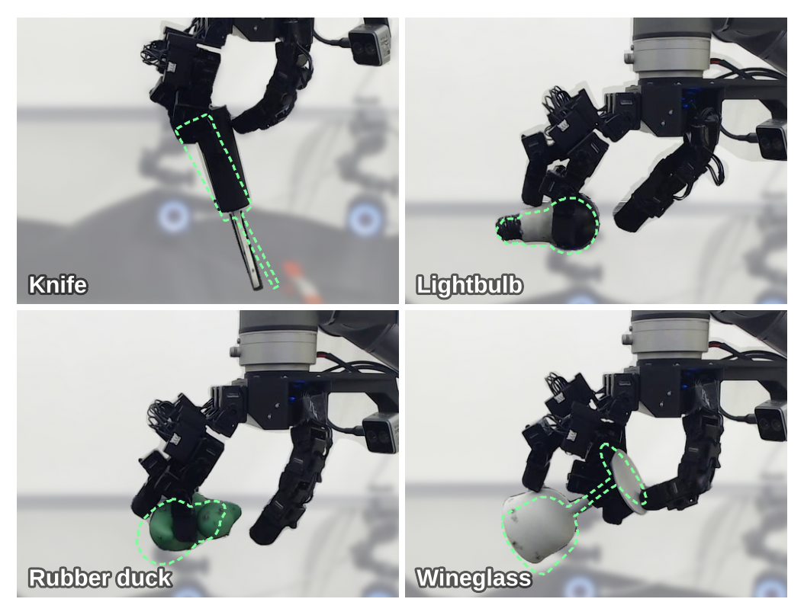
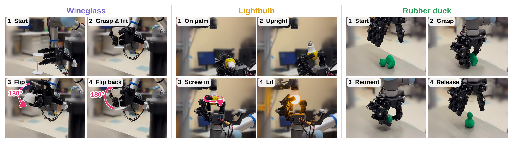
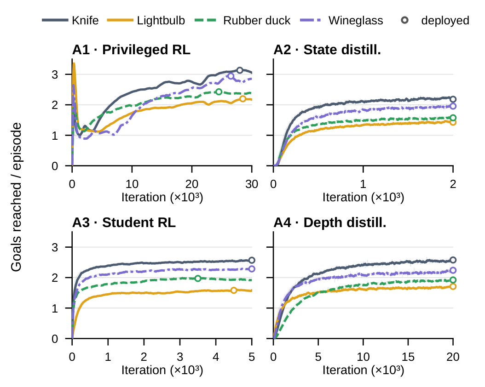

# Pushing Dexterity and Safety for In-Hand Object Pose Reaching That Works Remarkably Well

这篇论文要回答一个很具体的问题：五指手能不能在任意腕部朝向下，把物体连续送到手内任意位置和姿态，而且尽量不把物体掉下去。它的贡献不只是一个更强的策略，而是一整套把“可达目标生成、执行器辨识、教师学生蒸馏、残差安全过滤”接起来的配方，并用 13.3 小时真机、4,800 个未见目标去检验可靠性和安全性。

论文来自 UC Berkeley 与 UC Davis，2026 年 10 月 28 日 01:58（北京时间）提交到 arXiv，版本为 [arXiv:2610.37652v1](https://arxiv.org/abs/2610.37652)。项目页为 [ian-chuang.github.io/dexsafe](https://ian-chuang.github.io/dexsafe/)，代码标注为 coming soon。[PDF](https://arxiv.org/pdf/2610.37652)

## 任务：不是旋转，而是连续的大范围位姿到达

设物体在 hand root 坐标系下的位置为 $p$、姿态为 $R$，目标为 $p^\star,R^\star$。位置误差与姿态误差定义为

$$e_p=\lVert p-p^\star\rVert_2,\qquad e_R=\lVert \log(RR^{\star\top})\rVert,$$

对灯泡、酒杯这类绕自身轴旋转对称的物体，目标只给位置 $p^\star$ 与目标轴方向 $z^\star$，此时 $e_R$ 退化为物体 z 轴与目标轴的夹角。一个目标被判定到达，需要 $e_p$ 与 $e_R$ 同时落在容差内；粗容差是 2 cm/0.4 rad，精容差是 1 cm/0.2 rad。

安全则被写成状态约束。令 $p_{\text{obj}}$ 为物体位置、$p_{\text{hand}}$ 为手根位置，安全余量

$$h(x)=d_{\max}-\lVert p_{\text{obj}}-p_{\text{hand}}\rVert,$$

安全集为 $\{x:h(x)\ge 0\}$，论文取 $d_{\max}=0.3$ m。这个阈值远大于所有目标（目标都在手根约 0.2 m 内），所以一旦离开安全集，基本可以认定物体已经掉落。这个定义是工程性的：它不测接触力，也不保证物体没有滑动，只把“掉出手的范围”当作安全事件。

## 方法：先把可达目标造出来

### 机制流程

第一步，作者不直接在 SE(3) 里均匀采样目标，而是用 LightningGrasp 为每只手和每个物体生成 10 万个抓取，再用 DexterityGen 的 RRT 扩展成 50 万个覆盖掌上空间的抓取，剔除碰撞后每个物体保留 42.2 万–45.3 万个抓取。每个抓取同时给出 16 个关节角与物体位姿，既作为 reset，也作为目标分布。这样采到的目标天然更可能被手握住。

第二步，A1 阶段用特权观测（物体完整位姿、接触等）和 asymmetric critic 跑 PPO，得到一个强教师；A2 用 DAgger 把它蒸馏到只看本体状态与物体位姿的状态学生；A3 再对学生跑 PPO；A4 再蒸馏到只看腕部深度图的学生。A1–A4 解决的是“任务策略怎样从仿真走到可部署输入”。

第三步，B1 在冻结的 A3 策略上学习残差安全过滤器：过滤器输出一个修正量 $\delta$，与标称动作相加后再执行。奖励由任务奖励、对修正幅度的惩罚和掉落惩罚组成，修正权重 $w$ 控制保守程度。B2 再把过滤器蒸馏到深度输入，得到 A4 之上的深度版过滤器。部署时根据传感器选择 state 或 depth 两条路径。

*论文原图编号：Fig. 4。A1–A4 训练任务策略，B1–B2 在冻结策略上训练残差过滤器，C 是零样本真机部署的两条输入路径。*

### 抓取数据集与课程

课程设计是这套配方里最容易被忽略、但对 RL 探索最关键的部分。目标课程从容易抓的位姿逐步扩展到掌上更难的位置；摩擦课程从高摩擦逐步降到真实摩擦；作者还试了重力课程，从低重力逐步加到 9.81 m/s²。knife 上的消融显示，goal+friction 达到 2.27 goals/episode，friction only 为 2.14，无课程为 1.87，goal only 只有 1.33；重力课程没有帮助，重力变体只有 1.11–1.14。这个结果说明，真正难的是接触与摩擦，而不是重力本身。

### 系统辨识

sim-to-real 的差距主要来自 16 个 Dynamixel XC330 舵机。作者没有用理想 PD 模型，而是用 BAM 的电压驱动直流电机模型加扩展摩擦模型，在单舵机摆锤台上记录数据拟合参数；延迟则通过把同一关节轨迹在真机与仿真中播放、对齐时间偏移来标定。真机策略以 20 Hz 输出关节位置目标，UR5 只负责设定和测量腕部朝向，不参与手内控制。

### ResSafe：在冻结策略上只学修正

ResSafe 的关键选择是把安全做成“ residual ”而不是重新训练策略。任务策略冻结后，过滤器只学一个小的动作修正，因此不会破坏已经学到的位姿到达能力；一个标量 $w$ 就能在部署时连续调节保守度，$w$ 越小干预越强、掉落越少但成功率越低。相比 Hamilton-Jacobi 安全过滤器需要在运行时对动作做搜索、还依赖 critic，ResSafe 只有一次前向，部署代价更低。

## 结果：安全代价是多少

### 仿真：同掉落率下的对比

仿真基准跑 1,024 个环境，每个环境固定一个随机腕部朝向，连续执行 50 个目标。无过滤器时，状态策略粗容差成功率 92.1%、精容差 88.4%，掉落率 9.1%，首次掉落时间 154 s。加上 $w=0.5$ 的 ResSafe 后，粗成功率 91.3%、精成功率 80.1%，掉落率 4.5%，首次掉落时间 266 s。也就是说，粗成功率只掉 0.8 个百分点，精成功率却掉了 8.3 个百分点——安全过滤器保护的是“不掉”，代价主要落在高精度到达上。

与 HJ 过滤器比，ResSafe 在相近掉落率下明显更好：HCSF 在 $\alpha=0.3,\beta=0.95$ 时粗成功率只有 82.0%、掉落率 4.8%；LRSF 在 $\alpha=0.1$ 时粗成功率 79.3%、掉落率 8.2%。ResSafe 的 91.3% 粗成功率不是一个量级的提升，而是“同样安全水平下多救回约 9 个百分点”的差距。

### 真机：4,800 个目标

真机评估使用 16 自由度 LEAP 手、UR5 与 OptiTrack 动捕，物体是刀、灯泡、酒杯和橡胶鸭，覆盖 6 个腕部朝向。96 组、每组 50 个连续未见目标，合计 4,800 个目标、13.3 小时机器人运行时间。

状态策略在 2 cm/0.4 rad 下达到 95.2%，加 ResSafe 后为 91.5%，掉落从 16 次降到 4 次（减少 75%）。深度策略只用腕部双目相机，整体到达 72%，灯泡和橡胶鸭分别为 95% 与 88%；加过滤器后掉落从 88 次降到 46 次。这里的差距很重要：深度策略并不是状态策略的等价替代，它在精确到达上明显更弱，作者也没有回避这一点。

*论文原图编号：Fig. 10。绿色虚线是目标物体位姿，四类物体都在真机上被送到训练分布之外的目标。*

*论文原图编号：Fig. 13。酒杯翻转、灯泡拧入、橡胶鸭重定向三个多步任务，全部只依赖腕部相机与脚本化手臂运动。*

### 课程与过滤器消融

*论文原图编号：Fig. 21。A1–A4 四个阶段在四个物体上的 goals/episode 曲线，圆点是部署检查点。*

训练曲线显示，A1 特权 RL 在 knife 上能到约 3 goals/episode，A2 状态蒸馏后降到约 2.2，A3 学生 RL 回升到约 2.5，A4 深度蒸馏后约 2.6。这个“先降后升”的形状说明蒸馏会损失一部分能力，但后续 RL 能把学生拉回来；深度学生并没有出现灾难性下降，真正损失的是精确度而非粗到达。

## 这套配方真正可复用的部分

第一，用抓取数据集同时定义目标与 reset 分布，是把 RL 探索限制在可达流形上的实用技巧，比在 SE(3) 里盲目采样高效得多。第二，把执行器辨识做在单舵机台架上，而不是给整只手调 PD 参数，能把 sim-to-real 的误差来源局部化。第三，把安全过滤器学成冻结策略上的残差，使“成功率—掉落率”的权衡变成一个可调标量，这在部署时比重新训练策略灵活。

但证据边界也很清楚。所有真机结果只涉及 4 个物体、1 只手、1 台 UR5；状态策略依赖动捕，离开动捕环境只剩 72% 的深度策略；安全集用 0.3 m 的距离阈值定义，不是接触力或滑动意义上的安全保证。作者没有报告跨手、跨物体材质的迁移，也没有给出过滤器在 unseen 物体上的校准曲线。把这些结果读成“通用灵巧手安全控制”会超出论文能支撑的范围。

## 边界与仍待回答的问题

作者在文中承认深度策略与状态策略存在明显差距，也承认安全过滤器的代价随物体变化（橡胶鸭付出最大）。我的分析是，最值得追做的实验有三个：把状态输入换成学习到的物体位姿估计后，95.2% 还能保留多少；把安全集从位置阈值换成接触力/滑动检测，能否在保持成功率的同时覆盖“物体还在手里但已经滑脱”的情况；以及换更软的指尖或不同摩擦材料时，摩擦课程与 ResSafe 是否需要重训。这些问题不解决，这套配方仍然是一个在特定手、特定物体集上被强证据支持的工程系统，而不是通用的灵巧手安全框架。
