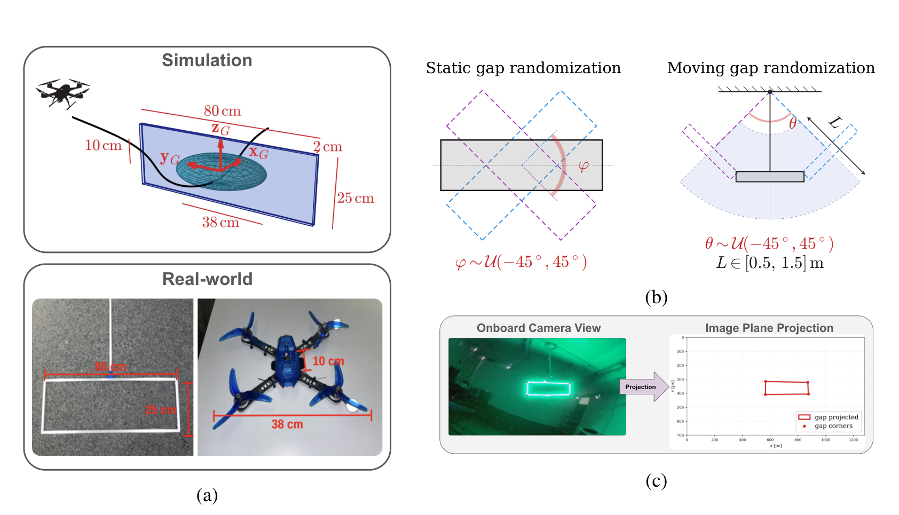
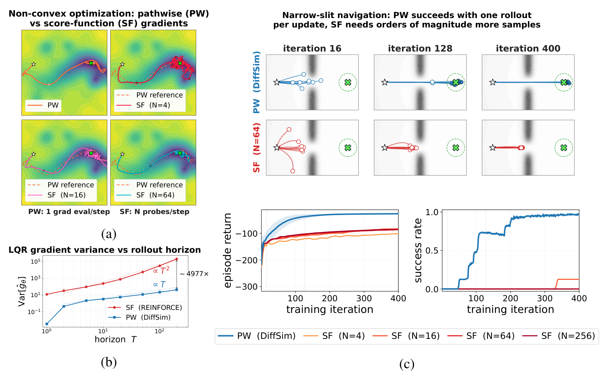
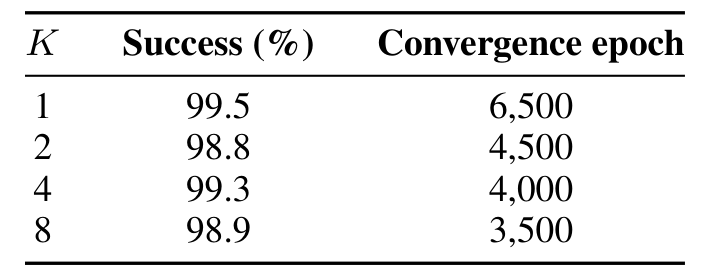
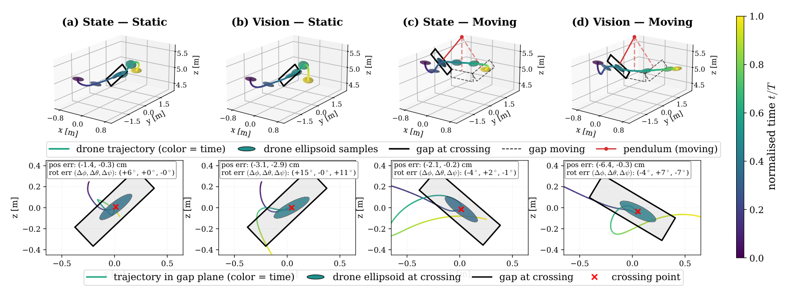

# Learning Visuomotor Quadrotor Flight Through Dynamic Narrow Gaps via Differentiable Simulation

这篇论文要解决的是“四旋翼如何穿过一个会动的窄缝”。难点不只是飞得准，而是要在正确的时间开始穿越：缝隙的位置和姿态随时间变化，飞行器必须在厘米级间隙里同时对齐位置、姿态与时机。作者的核心判断是，这类任务的瓶颈在学习信号，而不是策略容量；于是他们把移动缝隙写进一个可微的闭环仿真，用 pathwise 梯度直接训练视觉-惯性策略，不需要演示、教师、规划器或蒸馏。

论文来自 ETH Zurich 与 University of Zurich 的 RPG 组，2026 年 10 月 28 日 01:05（北京时间）提交到 arXiv，版本为 [arXiv:2610.37557v1](https://arxiv.org/abs/2610.37557)，被 CoRL 2026 接收。代码开源于 [uzh-rpg/agile_narrow_gap_diffsim](https://github.com/uzh-rpg/agile_narrow_gap_diffsim)，视频在 [youtu.be/z-txORkhnrg](https://youtu.be/z-txORkhnrg)。[PDF](https://arxiv.org/pdf/2610.37557)

## 移动窄缝：难在“何时穿”与“穿得有多准”

四旋翼约 10×38×38 cm，缝隙是 25×80×2 cm 的矩形。静态缝隙只要求飞手把机体投影塞进矩形；移动缝隙还要求飞行器在缝隙摆到可穿越姿态时到达，提前或滞后都会撞边。论文把成功定义为：穿越过程中，四旋翼椭球在缝隙平面上的投影始终完全落在矩形孔径内。

任务还有两个现实约束。第一，机载视觉在接近缝隙时视野会被边缘占满，门角可能短暂丢失；第二，策略只能看到部分观测，不能假设已知缝隙的全局位姿。作者因此同时评估特权状态输入与视觉特征输入，前者用于上限分析，后者才是可部署版本。

*论文原图编号：Fig. 2。缝隙尺寸、静态/移动随机化范围，以及机载相机到图像平面的门角投影。*

## 方法：把时变缝隙写进可微闭环

### 机制流程

第一步，60 Hz 的策略网络接收观测，输出集体推力 $T_t$ 与期望机体角速度 $\omega_{\text{des},t}$：

$$u_t=\pi_\theta(o_t)=\begin{bmatrix}T_t\\ \omega_{\text{des},t}\end{bmatrix}.$$

1000 Hz 的底层控制器跟踪这两个量。为了模拟真实延迟，仿真在 $t$ 步使用上一步的 $u_{t-1}$，而不是刚算出的 $u_t$。

第二步，可微的四旋翼动力学用 RK4 积分推进一步。状态包括位置、速度、姿态与角速度；动力学方程是标准的刚体模型，但所有运算都在 JAX 里可微，梯度可以沿整条轨迹反传。

第三步，每一步计算代价 $c_t$，再由 $r_t=-\sum_t c_t$ 得到回报。代价由进度、居中、靠近缝隙时的精细居中、姿态对齐、平滑碰撞、稳定性和（仅视觉）相机视场七项组成：

$$c_t=c_{\text{progress}}+c_{\text{centering}}+c_{\text{near centering}}+c_{\text{alignment}}+c_{\text{collision}}+c_{\text{stabilization}}+c_{\text{cam}}.$$

关键是这些项按“到缝隙平面的符号距离”门控：离得远时稳定项占主导，接近穿越点时居中、对齐与碰撞项的权重上升。移动缝隙的平面是时变的，所以门控函数也随时间变化，居中与对齐始终与当前孔径姿态耦合。

第四步，对整条 $T=2.5$ s 的 rollout 做 BPTT，最大化 $J(\theta)=\mathbb{E}[\sum_t r_t]$，更新策略。训练用 100 个并行环境、2 层 MLP（状态输入宽 512，视觉输入宽 1024）、Adam 与 warmup-cosine 学习率，最多 20k epoch，选验证集最好的 checkpoint。

*论文原图编号：Fig. 3。策略输出经可微动力学传播，代价沿 rollout 累积，梯度反向穿过整条轨迹。*

### 视觉特征与域随机化

视觉输入不是原始图像，而是机载图像中检测到的四个门角在图像平面的归一化投影，以及由投影确定的中心、面积、长宽比、可见性和短时差分。这样做的好处是把感知维度压到很低，60 Hz 策略可以在机载算力上闭环；代价是它依赖门角检测器，遇到自然开口或纹理复杂的环境会退化。

域随机化覆盖缝隙旋转（静态）、单摆相位/振幅/长度（移动）、感知-执行延迟、推力缩放，以及视觉门角的噪声与丢帧。训练时还对初始位置、速度、偏航角做扰动。这些随机化是零样本真机迁移能成立的前提之一。

## 结果：pathwise 梯度赢在哪

### PW 与 SF 的对照

*论文原图编号：Fig. 4。非凸地形、LQR 方差随 horizon 的增长，以及窄缝导航中 PW 与不同样本数 SF 的成功率。*

作者先用三个受控实验隔离梯度估计器的影响。非凸地形上，PW 紧跟解析梯度，SF 在样本少时明显发散；LQR 系统上，PW 的梯度方差随 horizon 近似 $O(T)$ 增长，SF 是 $O(T^2)$，在论文的 horizon 上相差约 4977 倍；窄缝导航任务里，PW 每次更新只需 1 条 rollout，SF 即使把每次更新的样本加到 4096 条仍然失败。这个对照是论文最有说服力的部分，因为它把“可微仿真为什么值得”从工程直觉变成了可测的方差差异。

### 仿真与样本效率

四种组合（state/vision × static/moving）都能从随机初始化训到 ≥98.9% 的成功率，训练时间 0.4–5.6 分钟，单张 RTX 4080 SUPER。视觉-移动任务在 $K=4$ 帧窗口下达到 99.3%，但 $K=1$ 的 99.5% 略高，说明多帧窗口的主要收益是收敛更快（4,000 vs 6,500 epoch），而不是最终精度更高。

*论文原表编号：Table 4。$K$ 为门角投影的时间窗口帧数，列为成功率与收敛 epoch。*

与 PPO 的匹配对比更能说明样本效率：在 1,000 个并行环境、五个 seed 的 state-moving 任务上，调优 PPO 平均使用约 19 倍 transition、45.5 倍训练时间。作者明确说明 PPO 用了不同的目标权重与课程，因此不能把全部差异归因于估计器；但差距的方向与前面的方差分析一致。

*论文原图编号：Fig. 5。state/vision 与 static/moving 四种组合的轨迹、穿越点与位置/姿态误差。*

### 真机与高保真仿真

真机实验用 LED 标记门角，在机载图像中检测后转成同样的几何特征，策略直接输出 CTBR。作者记录 12 次飞行，其中 2 次只有机载日志、缺少外部视频，被排除；剩下 10 次可验证飞行成功 8 次，Wilson 95% 区间为 49%–94%。两次失败都撞在缝隙下边缘，估计侵入深度 4.6 cm 与 9.3 cm；作者认为这与“训练仿真 99.3% → 高保真仿真 81%”的下降一致，可能是残余动力学/跟踪误差影响垂直精度，但 10 次试验不足以把初始化、感知与动力学误差分开。

这个 81% 的高保真仿真数字很重要：它说明训练分布内的 99.3% 不能直接当作真实世界的成功率，感知噪声、动力学失配与移动门机构的差异会一起吃掉近 18 个百分点。

## 这套方法的可复用点

第一，对于薄可行流形任务，把约束写成随符号距离门控的稠密代价，比稀疏成功奖励更适合可微训练；失败 rollout 也能提供“往哪边修正”的梯度。第二，时变平面的符号距离是表达“移动目标”的简洁接口，不需要为每一帧单独定义阶段标签。第三，视觉端只用门角几何特征，能显著降低机载策略的感知负担；这在受控环境里是优势，在自然场景里则是限制。

## 边界

作者在局限部分写得很清楚：训练依赖特权仿真几何与碰撞数据，视觉输入是工程化特征而非原始图像；真机只测平面单摆式移动门，门角靠 LED 标记；自然开口、突变或非周期运动、严重/长时间视觉丢失、硬接触与长时不稳定都未测试；10 次飞行只有 2 次失败，无法区分误差来源；BPTT 的显存与计算随 horizon 和保真度增长。

我的分析是，最值得追做的实验有三个：把门角特征换成原始图像或学习到的检测器后，80% 的真机成功率还能保留多少；在非周期、突然加速或旋转的缝隙上，当前时变平面代价是否需要重新设计；以及短 horizon 的 pathwise 方法加 bootstrap value 能否扩展到更长任务。这些问题不解决，这篇论文仍然是一个在受控室内环境、特定门型上被强证据支持的“可微仿真训练灵巧飞行”范例，而不是通用的自然场景飞行策略。
