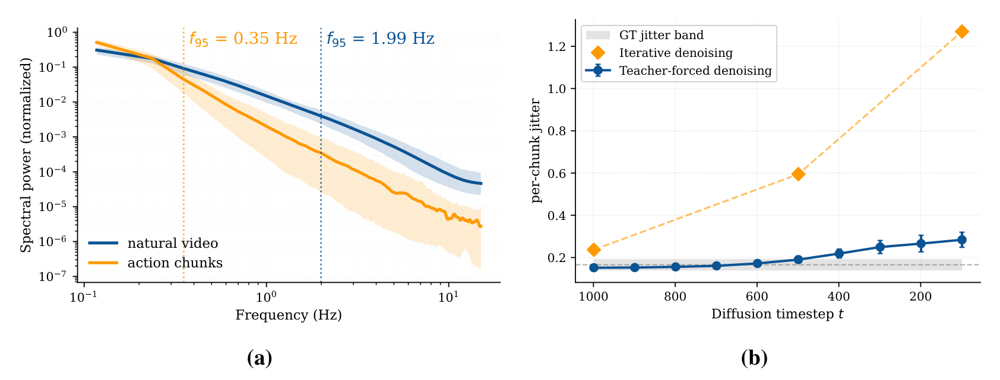
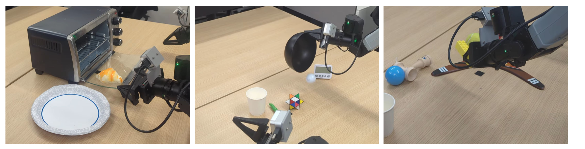
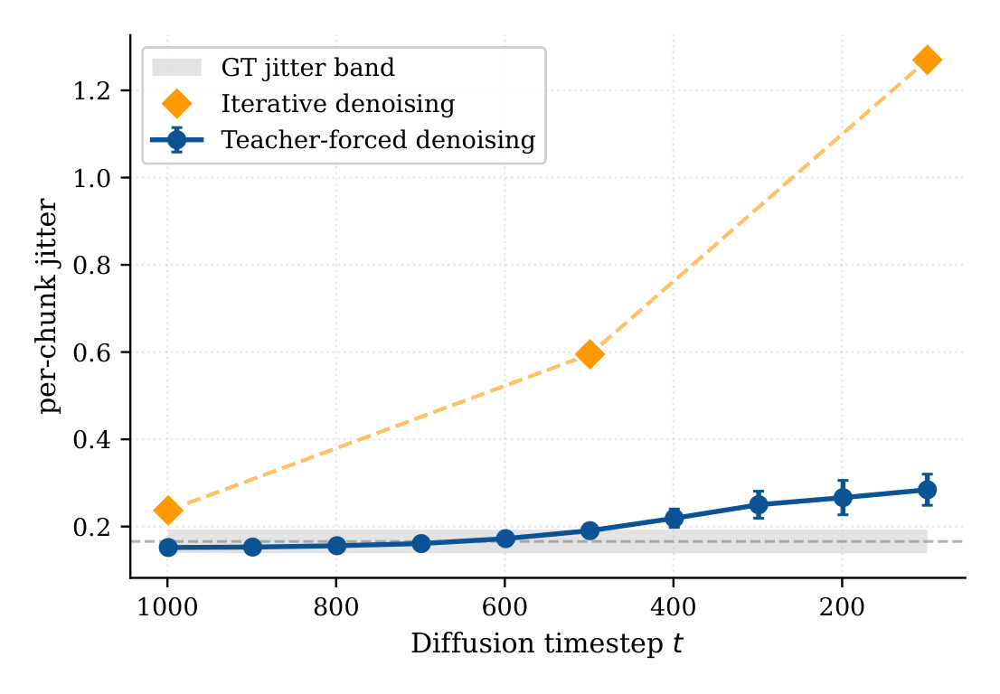

# TAPESTRY: A Single Backbone for Video Generation and Robot Control

这篇论文的核心判断很直接：视频生成模型对机器人有用的东西在权重里，而不在它生成的像素里。既然部署时只需要动作，就不必在测试时生成视频；可以把每个动作时间步塞进视频 VAE 的patch 空间，让动作和视频共享同一个预训练扩散 Transformer，训练时联合去噪，推理时只对动作做一步去噪。

论文来自 GAIR 与 Toyota Research Institute 等机构，2026 年 10 月 28 日 00:23（北京时间）提交到 arXiv，版本为 [arXiv:2610.36823v1](https://arxiv.org/abs/2610.36823)，被 CoRL 2026 接收。项目页为 [tapestry-wam.github.io](https://tapestry-wam.github.io/)。[PDF](https://arxiv.org/pdf/2610.36823)

## 先看一个反直觉选择：不生成视频也能用视频先验

现有的视频-动作联合模型通常有两条路：一条是在测试时生成未来视频，再从视频里解码动作，延迟很高；另一条是保留视频主干、另接一个从头训练的动作头，动作头学不到主干的动力学先验。TAPESTRY 走第三条路：把动作token 当作视频latent 里的单patch token，让同一个 DiT 同时处理视频token 与动作token，但部署时只跑动作那一路。

这个选择成立的前提是动作token 必须落在主干“熟悉”的分布里。作者发现，直接把原始动作向量线性投影到 DiT 隐空间，训练早期就会不稳，梯度裁剪、NaN 跳过与归一化只能推迟、不能消除发散。解决办法是复用预训练 VAE 的 patchify 卷积，并加一个 affine-free LayerNorm 对齐 VAE latent 的逐token 均值与方差。

## 方法：每个动作步只占一个patch

### 机制流程

第一步，当前观测帧被复制到时间轴，经冻结的 3D-VAE 编码，再用 patchify 卷积变成观测token；语言目标经冻结的 T5-XXL 编码成文本token。两者组成干净的 conditioning 前缀，永远不加噪。

第二步，动作块 $a=(a_1,\ldots,a_H)$ 的每一步 $a_i\in\mathbb{R}^{d_a}$ 经线性投影 $W$、affine-free LayerNorm 与共享 patchify 卷积 $\phi$ 变成一个 DiT token：

$$x^a_i=\phi(\mathrm{LN}(W a_i)).$$

$W$ 的形状是 $(p\cdot p\cdot c)\times d_a$，在 $p=2,c=16,d_a=20$ 时只有 1,280 个参数，是整个动作通路唯一新增的模块。每个动作步对应一个token，因此动作序列长度是 $H$（实验取 16），远短于视频latent 的空间token 数。

第三步，训练时每个样本按三种模式之一加噪：纯视频扩散、联合视频+动作扩散、动作单独扩散。动作监督样本以 0.5 概率走联合模式，否则同时走视频与动作单独模式。三路损失共享同一个 DiT，只是被加噪的token 与损失项不同。

第四步，推理时从纯噪声动作token 出发，做一次 DDIM 更新。这个单步成立的关键是噪声调度采用零终端 SNR：$\bar\alpha_T=0$，完全加噪的状态 $x_T=\epsilon$ 不携带任何 $x_0$ 信息，因此从纯噪声一步映射到动作块不会引入“从错误终点往回走”的偏差。输出token 经patch unembed 与 $W^\top$ 反解回动作空间，得到 16 步动作块。

*论文原图编号：Fig. 1。上方是视频与动作共享的 DiT，下方是三路训练目标与只跑动作的单步推理路径。*

### 为什么动作频率先验是个问题

视频主干是在自然视频上预训练的，自然视频的频谱在 0.35 Hz 附近衰减；动作块的频谱则延伸到 1.99 Hz。直接把动作当成视频patch，主干会以为动作“太高频”而把它平滑掉。论文用 Fig. 2 的频谱分析与 jitter 实验说明：单步推理的 teacher-forced 抖动接近真值带，而迭代去噪会在低时间步累积高频抖动。我的理解是，单步反而避开了迭代采样在噪声终点附近的方差放大，但这个解释仍属于作者的分析框架，不是独立验证的结论。

*论文原图编号：Fig. 2。左为自然视频与动作块的归一化频谱，右为 teacher-forced 与迭代去噪的逐chunk 抖动。*

## 结果：三个基准上的位置

### LIBERO 学习自视频

论文采用 AMPLIFY 的 learning-from-video 协议：只有 LIBERO-90 有动作标签，另外四个 suite 只给视频。这个设定下绝对成功率不能与全监督 leaderboard 直接比较。TAPESTRY 在四个留出 suite 上平均 76%，比最强的视频基线 Cosmos Policy 与 DreamZero（均 70%）高 6 点，比 AMPLIFY 高 15 点。提升不均匀：Cosmos Policy 与 DreamZero 在 LIBERO-10 更好，DreamZero 在 Goal 略高，TAPESTRY 赢在 Object 与 Spatial 两个更依赖物体/几何先验的 suite。从头训练的消融降到 58%，说明预训练主干贡献约 18 点。

### 真机 ID/OOD

真机平台是 20 自由度双臂 YAM，三个任务（Toolbox、Oven、Corn），每个任务 10 次 rollout。ID 成功率 93±5%，从头训练的 Diffusion Policy DiT 只有 50±9%（p<0.001）；去掉大规模视频共训练降到 67%，再去掉视频生成目标降到 63%。OOD 设置三个条件：新物体摆放、新运动基元、新物体组合。TAPESTRY 平均 67±12%，DreamZero 27±11%，其他方法 0%；但每个条件只有 5 次 rollout，67% 与 27% 的差异 p=0.07，未达到常规显著性阈值。作者也明确说，TAPESTRY 是唯一完成新物体组合的方法，这是视频长尾数据最直接的收益。

*论文原图编号：Fig. 4。新摆放、新运动基元、新物体组合三个分布外条件的真机场景。*

### 推理效率

在单张 RTX 5090 上，TAPESTRY 生成 16 步动作块只要 84 ms、9 GB 显存；DreamZero 是 5B 联合视频-动作模型，发布代码约 30 s/chunk，优化后 3.7 s/chunk，论文称约 44 倍加速。这个对比的关键不是绝对毫秒数，而是token 预算：每个动作步只占一个token，而 Cosmos Policy 把动作块铺成 112 份视频latent，推理成本自然高一个量级。

*论文原图编号：Fig. 6。teacher-forced 单步与迭代去噪在不同扩散时间步的逐chunk 抖动，灰带为真值抖动范围。*

## 边界

第一，LIBERO 用的是非标准协议，76% 不能拿去和全监督结果比。第二，真机 ID 每任务 10 次、OOD 每条件 5 次，统计功效很有限；OOD 相对 DreamZero 的优势并不显著。第三，单步推理的平滑性证据主要来自 jitter 分析，论文没有给出“单步 vs 多步”的成功率直接对照，因此不能断言单步不会损失动作多模态性。第四，动作投影只有 1,280 个参数，换到更高维的灵巧手动作空间是否仍足够，尚未验证。第五，推理数字来自桌面 RTX 5090，不是机载平台。

我的分析是，这篇论文最可复用的设计不是某个具体模块，而是“动作即单patch token”这个接口：它把视频扩散主干的复用成本压到了最低，同时把推理路径与视频生成彻底解耦。但它是否能在更大动作空间、更多本体、更长任务上保持 93% 的真机 ID 成功率，仍然需要独立复现。
