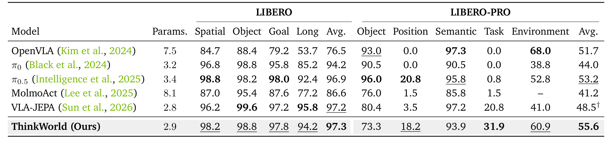
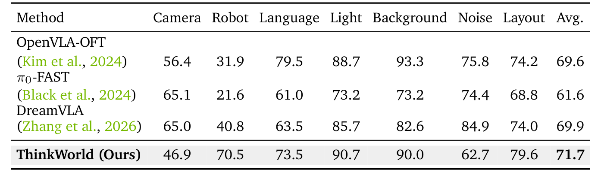
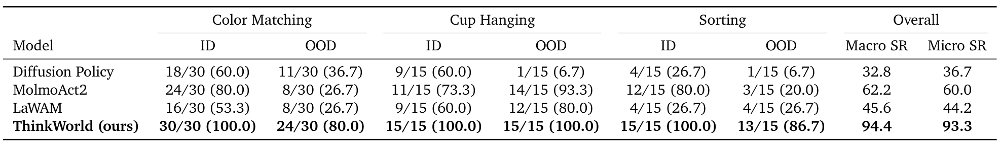
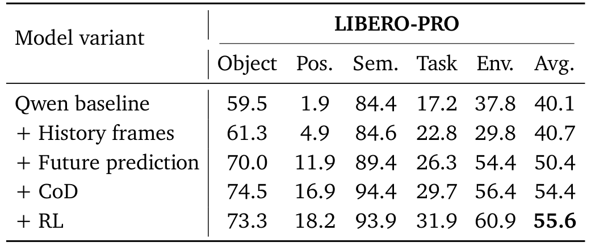
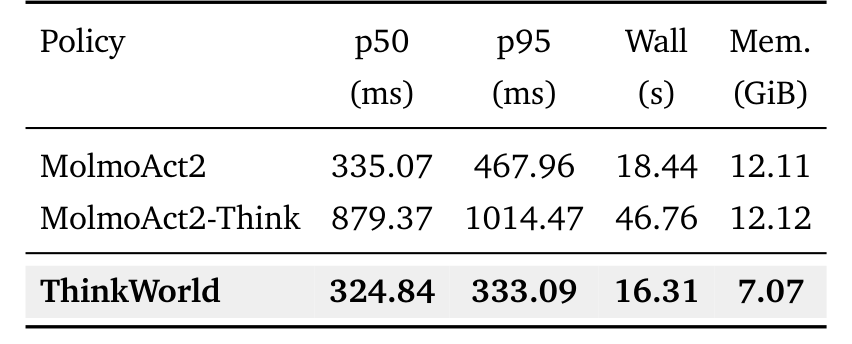

# ThinkWorld: World Imagination Reinforces Chain-of-Dynamics Reasoning

这篇论文想解决的不是“怎样再训一个更强的 VLA”，而是“机器人动作监督为什么只能来自机器人”。它的核心做法是把动作改写成一条离散的运动token 链，再让模型想象这条链会把世界带到什么状态；想象与真实未来的差距，反过来成为强化这条链的奖励。理解这条“动作—动力学—未来”的闭环，后面的训练阶段和实验结果就会顺理成章。

论文由 NVIDIA 与 KAIST 合作完成，2026 年 10 月 28 日 01:59（北京时间）提交到 arXiv，版本为 [arXiv:2610.37666v1](https://arxiv.org/abs/2610.37666)。项目页在 [thinkworld-project.github.io](https://thinkworld-project.github.io/)，截至本次核查代码与模型入口仍标注为 coming soon。[PDF](https://arxiv.org/pdf/2610.37666)

## 动作监督为什么被本体绑住

现有 VLA 通常直接回归关节位置或末端位姿。这样的标签可执行，却把监督锁在某一台机器人上：人类的视频里没有机器人关节角，换一只手或一个底座，动作空间也随之中断。论文由此提出一个更具体的中间层问题：能否找到一种与本体无关、又能被视频验证的“动作应该怎样展开”的表示？

作者的选择是 Chain-of-Dynamics（CoD）。它不是自然语言的理由链，而是一串离散运动token：把机器人轨迹或带标注的人手轨迹都映射到归一化的 delta 末端执行器表示，再用 FAST 风格 tokenizer 量化成共享词表。这样，人类手腕运动和机器人末端运动虽然动力学不同，却能在同一个离散空间里被生成、比较和强化。论文明确不假设两者运动学等价，只共享“运动如何改变世界”的抽象层。

## 从运动token 到可验证的未来

### 机制流程

第一步，模型接收语言指令、当前观测、历史帧和机器人本体状态，由 Qwen3-VL-2B 自回归生成 CoD，并在序列末尾附加 64 个可学习的未来查询。CoD 本身送进动作专家，未来查询则进入一个两层 MLP 加六层 cross-attention 的解码器。

第二步，解码器把未来查询映射成 196 个 DINOv3 patch 特征，对应 14×14 的潜空间网格。目标不是重建未来 RGB，而是用冻结的 DINOv3 ViT-H/16+ 编码一秒后的真实帧，得到同样结构的特征。论文的选择很关键：像素重建会把背景纹理、光照都算进损失，而 DINO 特征保留物体与空间结构，淡化了外观细节。

第三步，在监督阶段联合训练 CoD 生成与未来预测：

$$\mathcal{L}_{\text{SFT}}=\mathcal{L}_{\text{CoD}}+\lambda_{\text{future}}\mathcal{L}_{\text{future}}$$

其中 $\mathcal{L}_{\text{CoD}}=\mathrm{CE}(p_\theta(c_t\mid l,h_t,o_t),c_t^\star)$ 是离散token 的交叉熵，$\mathcal{L}_{\text{future}}=\mathrm{dist}(z_{t+\Delta},z_{t+\Delta}^\star)$ 是预测特征与真实未来特征的距离。这个式子把“说对动作词”和“想对世界变化”拆成两个可分别检查的监督项；前者给动作 grounding，后者给世界模型能力。

第四步，RL 阶段对同一上下文采样 $K=4$ 条 CoD，分别预测未来，再用运动加权的特征相似度作为奖励：

$$r_{\text{world}}=\mathrm{sim}(z_{t+\Delta},z_{t+\Delta}^\star),\qquad \mathcal{L}_{\text{RL}}=\lambda_{\text{GRPO}}\mathcal{L}_{\text{GRPO}}(r_{\text{world}})+\lambda_{\text{replay}}\mathcal{L}_{\text{replay}}$$

相似度对当前帧到未来帧变化更大的 patch 加权，避免大面积静止背景主导奖励。GRPO 在组内归一化这 4 个奖励，token级重要性裁剪到 $[0.8,1.28]$，KL 系数 0.04；监督 replay 占 0.001，用来防止 RL 把 SFT 学到的运动 grounding 冲掉。

*论文原图编号：Fig. 2。上排是 CoD 监督与未来想象，下排是把想象未来与真实未来比较后做 GRPO；部署时灰色路径被删除。*

### 为什么奖励可以不要动作标签

这套设计最值得注意的地方，是奖励只需要“当前帧 + 一秒后的帧”，不需要动作标注，也不需要执行候选动作。人类视频因此可以直接参与 RL：采样一条 CoD，想象它的未来，再与视频里真实发生的未来比较。作者在分析部分报告，打乱、置空或删除 CoD 都会让想象未来退回当前帧附近，说明奖励确实在读 CoD 提供的动力学信息，而不是只靠视觉上下文。

### 部署时把推理删掉

CoD 生成和未来查询只存在于训练期。部署时模型只做一次 VLM 前向，动作专家在冻结的 VLM 表示上做动作去噪。这个“训练期推理、部署期删除”的分离，是论文能把 324.84 ms 的 p50 延迟压到与普通 VLA 同一量级的原因；如果推理时还要生成未来视频或采样多条 CoD，控制回路会被拖垮。

## 实验：提升集中在哪些轴

*论文原表编号：Table 1。LIBERO 四个 suite 与 LIBERO-PRO 五个扰动轴的成功率，括号外为百分比。*

### 仿真主结果

LIBERO 平均成功率 97.3%，略高于 π0.5 的 96.9% 和 VLA-JEPA 的 97.2%，差距只有 0.1–0.4 个百分点，不能据此说仿真内分布能力有质变。真正拉开差距的是 LIBERO-PRO：ThinkWorld 平均 55.6%，π0.5 为 53.2%，OpenVLA 为 51.7%，VLA-JEPA 为 48.5%。拆开看，提升主要来自 Environment（60.9%）和 Task（31.9%）两个轴，而 Position 只有 18.2%、Object 为 73.3%。也就是说，方法缓解的是“换环境、换任务目标”的部分，不是“把物体放到指定位置”的部分。

*论文原表编号：Table 8。LIBERO-Plus 的 Camera、Robot、Language、Light、Background、Noise、布局（Layout）的七个轴结果。*

LIBERO-Plus 的平均成功率为 71.7%，高于 DreamVLA 的 69.9% 和 OpenVLA-OFT 的 69.6%。但 Camera 轴只有 46.9%，明显低于 OpenVLA-OFT 的 56.4%；作者没有对这个短板给出专门解释。我的分析是：DINO 未来特征对相机位姿变化的敏感性，可能让“想象未来”在视角偏移时反而变成噪声，这一点需要单独的视角鲁棒性实验才能确认。

### 真机 ID/OOD

真机实验使用一台双臂 YAM、三个 RGB 相机，任务是颜色匹配、挂杯子和分类。每类设置 5 次试验，三个任务合计 ID 60/60、OOD 52/60；按任务宏平均 94.4%，按试验微平均 93.3%。对比之下，Diffusion Policy 宏平均 32.8%，MolmoAct2 62.2%，LaWAM 45.6%。

*论文原表编号：Table 6。每个任务给出 ID/OOD 的成功数/试验数与宏、微平均。*

具体到 OOD，颜色匹配 24/30、挂杯子 15/15、分类 13/15。挂杯子的 OOD 没有掉点，说明该任务的“新物体”变化没有触到策略的薄弱处；分类的 13/15 与颜色匹配的 24/30 才是更真实的泛化读数。论文把 ID 与 OOD 成对报告是优点，但每任务 15 次 OOD 试验只能给出很粗的置信区间，不能支撑“普遍 OOD 鲁棒”的结论。

### 消融到底说明了什么

*论文原表编号：Table 3。从 Qwen baseline 逐项加入历史帧、未来预测、CoD 与 RL 的 LIBERO-PRO 结果。*

消融的起点是 Qwen baseline 的 40.1%，加入历史帧只到 40.7%，说明多帧输入本身几乎不解决问题。加入未来预测后跳到 50.4%，加入 CoD 后到 54.4%，最后 RL 到 55.6%。这条曲线支持“未来想象是主要增益来源”的解读，但也暴露一个边界：RL 只带来 1.2 个百分点，且 Object 轴从 74.5% 降到 73.3%。论文没有报告 RL 的多次运行方差，因此这 1.2 点是否稳定，尚不能确定。

### 推理效率

*论文原表编号：Table 9。p50/p95 单次调用延迟、总墙钟时间与显存占用。*

ThinkWorld 的 p50 为 324.84 ms、p95 为 333.09 ms，低于 MolmoAct2 的 335.07/467.96 ms；显存 7.07 GiB，也低于 MolmoAct2 的 12.11 GiB。带显式思考的 MolmoAct2-Think 则是 879.37/1014.47 ms。这个对比说明“训练期想象、部署期不做”确实避免了推理税，但延迟数字依赖具体硬件与输入配置，论文也承认这一点，不能直接外推到机载控制器。

## 这套方法真正证明了什么

第一，CoD 作为共享离散运动词表是可行的：人类视频与机器人示范能在同一空间里被 tokenizer 处理，并且 RL 阶段确实能利用无动作标签的未来帧。第二，冻结 DINO 特征空间足以承载“想象未来”的监督与奖励，不需要训练视频生成模型。第三，训练期推理与部署期执行的分离，能在不显著增加延迟的情况下把世界模型能力注入 VLA 表示。

但证据的边界同样清楚。所有真机结果来自一台 YAM 和三类桌面任务；LIBERO-PRO 的部分基线是作者复现而非官方数字；训练只跑了一个 seed，论文报告的置信区间是评估波动，不是训练波动。论文没有给出跨本体（灵巧手、移动底盘、不同相机）的迁移实验，也没有证明 CoD 词表可以零样本复用到新动作空间。把这些结果读成“通用机器人泛化”会超出论文能支撑的范围。

从复现角度看，成本也不低：SFT 用 128 张 H100，RL 用 64 张，真机后训练再用 32–64 张；4,276 小时、8 个数据集的预训练语料也不是单实验室容易复刻的规模。真正可复用的小设计是 delta EEF 的统一token化、冻结 DINO 特征的未来监督，以及把推理路径从部署图中删掉的做法。

## 边界与仍待回答的问题

作者在附录中承认单 seed 与延迟依赖硬件的限制，但没有讨论失败案例的分布。我的分析是，最值得追做的实验有三个：换到灵巧手或移动操作时，CoD 词表是否只需要重训 tokenizer；把奖励换成多位姿一致性或学习到的动力学距离，能否修掉 Object/Position 轴的退步；以及多 seed 下 RL 的 1.2 点平均提升是否仍然显著。这些问题不解决，“世界想象强化推理”仍然是一个有强实证支持、但外推边界较窄的框架。
