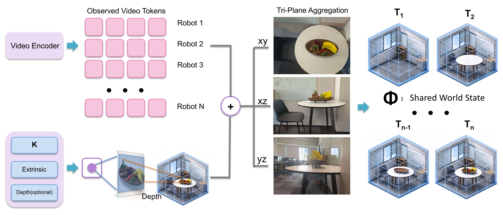
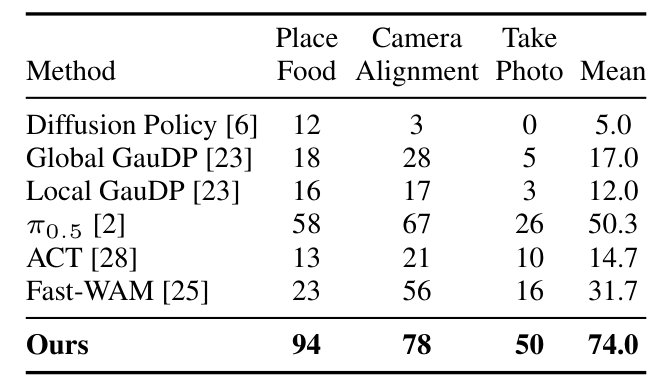
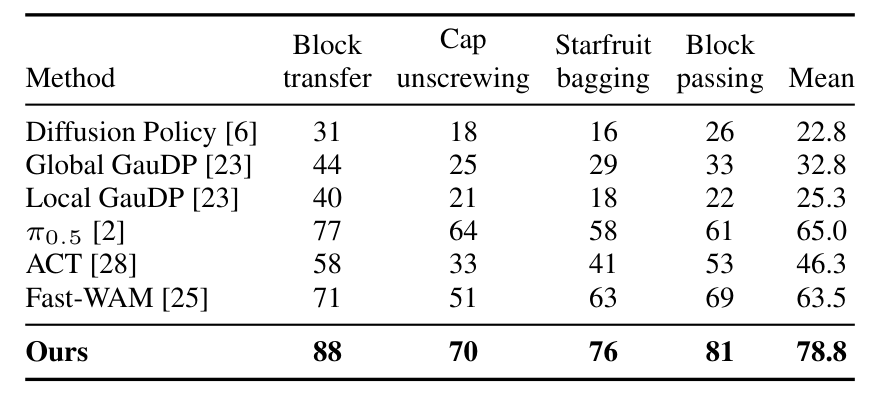

# World Dreamer v5-lite: A Multi-Robot World Action Model with One Dreamer

多机器人协作的难点不在于“把单机 VLA 复制 N 份”，而在于三件事同时发生：每个机器人只看到工作空间的一部分，图像patch 之间没有天然的空间对应；动作空间随本体不同而不同，但决策又必须耦合；某个机器人的相机还可能被队友或物体挡住。这篇论文用一个固定大小的共享世界状态 $\Phi$ 把多视角观测放进同一个workspace 坐标系，再让每个机器人保留独立的动作流，只通过查询交换信息。

论文由 World Agents 团队完成，2026 年 10 月 28 日 00:40（北京时间）提交到 arXiv，版本为 [arXiv:2610.37518v1](https://arxiv.org/abs/2610.37518)。论文 10 页、4 张图，未提供项目页或公开代码。

## 为什么不能直接拼接多相机token

最直接的做法是把所有相机的token 拼成一个长序列，喂给单机 VLA。问题在于不同相机的patch 索引不对应同一物理位置，拼接只能让模型自己猜对应关系；而且token 数随相机数线性增长，机器人一多，序列长度就不可控。另一种做法是每个机器人跑一个独立策略，动作空间保住了，但机器人之间不共享观测，遇到遮挡就无能为力。

论文的选择介于两者之间：用一个共享的、固定大小的三维状态 $\Phi$ 承载所有视角的空间证据；每个机器人仍有自己的动作流，但可以通过查询读取同一个 $\Phi$，并与队友的查询做姿态感知的注意力交换。

## 方法：把多相机特征放进同一个三维工作空间

### 机制流程

第一步，VLM 处理语言指令与当前图像，形成共享前缀；每个机器人槽位后附一个可学习查询。槽位 $i$ 的查询嵌入是

$$r_i=q_{s}+e_i,$$

其中 $q_{s}$ 是所有机器人共享的嵌入，$e_i$ 是槽位嵌入。因为所有查询共享同一个前缀，一次 VLM 前向就能让 N 个机器人查询条件化在同一场景上，不需要为每个机器人重跑 backbone。

第二步，因果视频 VAE 把每个相机的历史 RGB 转成 latent，预训练视频编码器处理 3 个观测 latent step，并在训练时额外接 2 个加噪未来 step 做辅助视频流预测。推理时只用观测，不生成未来视频。

第三步，把每个观测 patch 按相机内参、外参和可选深度投影到 workspace 三维位置，融合几何嵌入后，用加权双线性 splatting 写入 XY、XZ、YZ 三个轴对齐平面。没有深度时，patch 对应一条射线，论文沿射线取 8 个候选点，让模型学习权重；训练时以 0.25 概率丢弃深度，使同一个模型同时处理“有深度点”和“无深度射线”。三平面的大小与相机数量无关，这是 $\Phi$ 相对token拼接的核心优势。

第四步，动作解码器为每个机器人保留独立的因果动作流。本体状态与动作被补齐到 $D_s=20$、$D_a=18$，动作块长度 $H=30$。36层解码器按 read–decode–communicate 顺序更新：查询先通过 cross-attention 读 $\Phi$，动作流再读 VLM 的 KV cache，最后查询之间做带相对位姿偏置的注意力。机器人 $i$ 与 $j$ 的相对位姿被编码成 10 维描述（3 维平移、6 维旋转、1 维距离），经 MLP 变成注意力 logit 偏置，因此交互不依赖固定的通信拓扑。

*论文原图编号：Fig. 1。VLM 产生每机器人查询，视频编码器提供多视角特征，动作解码器为每个机器人保留独立动作流。*

*论文原图编号：Fig. 2。多视角token按相机几何写入 XY/XZ/YZ 三平面，形成固定大小的共享世界状态。*

### 遮挡视图训练

如果每个机器人总能看见自己的相机，解码器没有动机去用队友的观测。训练时以一定策略遮挡某个机器人的全部相机，或随机遮挡一部分视角，但保留所有机器人的动作目标；同一遮挡也作用于 VLM 输入与视频编码器输入。这样被遮挡的机器人只能通过 $\Phi$ 或队友查询获取信息，动作监督仍然有效。论文没有给出遮挡比例与遮挡策略的消融，这是后文要讨论的证据缺口。

### 训练目标

动作头用 conditional flow matching 训练。对机器人 $i$ 的动作块 $a_i$、噪声 $\epsilon_i$ 与 flow time $\tau$，插值输入与目标速度为

$$\tilde a_i=(1-\tau)\epsilon_i+\tau a_i,\qquad u_i=a_i-\epsilon_i.$$

解码器输出速度 $\hat u_i$，动作损失是带掩码的加权平方误差；总目标为

$$\mathcal{L}=0.5\mathcal{L}_{\text{act}}+0.2\mathcal{L}_{\text{future}}+\lambda_{\text{field}}\mathcal{L}_{\text{field}},$$

其中 $\mathcal{L}_{\text{future}}$ 监督未来视频 latent 的速度，$\mathcal{L}_{\text{field}}$ 让状态构建器能从 $\Phi$ 重建观测token的随机投影，$\lambda_{\text{field}}$ 从 0.1 线性降到 0.02。这个辅助项的作用是防止 $\Phi$ 退化成只对动作头有用、但丢失空间结构的表示。

## 结果：三个基准上的位置

### RoboFactory

*论文原表编号：Table 1。三个多机器人任务的成功率，每个任务 100 个场景配置。*

World Dreamer v5-lite 平均 74.0%，最强基线 π0.5 为 50.3%，Fast-WAM 为 31.7%。分任务看，Place Food 94%、Camera Alignment 78%、Take Photo 50%。提升最大的 Place Food 是两机器人任务，而四机器人的 Take Photo 只有 50%，说明随着智能体数量增加，任务仍明显变难。论文没有报告机器人数从 2 增到 4 时性能如何衰减，也没有与“共享 Φ 但去掉查询交互”的变体比较。

### RoboCasa365

在 50 个家庭任务上总体 58.08%，PatchWAM 为 47.6%，相差 10.48个百分点。三个 split 分别是 Atomic-Seen 80.8%、Composite-Seen 60.0%、Composite-Unseen 30.6%。Composite-Unseen 的任务不在 Human300 中，是零样本评估；30.6% 说明“没见过的任务组合”仍是明显短板。这里需要谨慎：榜单数字来自官方 leaderboard，基线的训练数据与调参预算不完全可比，不能把 10.48 点全部归因于 $\Phi$。

### 真机四任务

*论文原表编号：Table 2。两个 LeKiwi 与 LeKiwi+OpenArm 异构团队的四任务结果，每任务 100 次试验。*

四任务平均 78.8%，π0.5 为 65.0%，Fast-WAM 为 63.5%。分任务是Block transfer 88%、Cap unscrewing 70%、Starfruit bagging 76%、Block passing 81%。Block transfer与Cap unscrewing 由两个 LeKiwi 完成，后两个由两个 LeKiwi 加一个 OpenArm 完成，因此这张表同时覆盖同构与异构团队。70% 的 Cap unscrewing 是四任务最低，说明需要精细接触与旋转的任务仍然最难。

## 这套设计真正解决了什么

第一，$\Phi$ 提供了一个与相机数量无关的空间参考，使多视角融合不再依赖token 拼接顺序。第二，每机器人独立动作流加查询交互，避免了异构动作空间互相污染，同时保留了协调能力。第三，遮挡视图训练是一种不需要额外协调标签的协同正则，让模型在自身视角缺失时仍能利用队友信息。

但证据的边界同样明显。实验最多 4 个机器人，全部在标定相机与固定工作空间内；论文没有给出 $\Phi$、遮挡训练、姿态偏置等关键模块的消融，因此无法判断 74.0% 与 78.8% 中有多少来自共享状态、多少来自更强的预训练数据与 Qwen3-VL backbone。真机只有 4 个任务、2 种本体，也没有推理延迟、显存或训练算力的报告。把这些结果读成“任意规模多机器人团队”会超出论文能支撑的范围。

## 边界与仍待回答的问题

作者在结论中没有列出限制，只强调了共享状态与独立动作流的组合。我的分析是，最值得追做的实验有三个：当相机外参有误差或深度缺失比例更高时，$\Phi$ 空间对应会退化多少；机器人数量增加到 8–16 个时，查询交互的注意力是否成为瓶颈；以及遮挡训练的比例与策略如何影响真机遮挡场景的成功率。这些问题不解决，$\Phi$ 仍然是一个在 2–4 机器人、受控标定环境下被强证据支持的架构，而不是可外推的多机器人基础模型。
