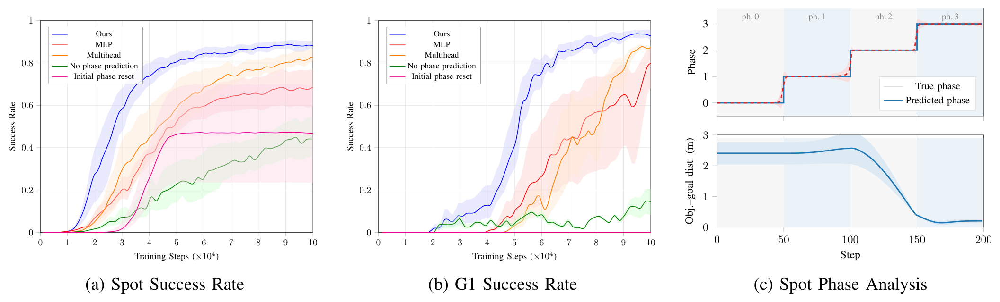

# Learning Multi-Phase Robot Loco-Manipulation via Phase-Conditioned Policy Optimization

长程 loco-manipulation 的难点往往不是单个抓取或行走技能，而是把接近、下蹲、夹持、抬起、搬运这些物理模式串成一个连续过程。用人形动作数据或示教可以绕过探索问题，但代价是数据处理与本体绑定。这篇论文选择另一条路：不提供人类动作，只把任务天然的阶段结构写进 PPO——用环境状态机切阶段、按阶段门控奖励、让 actor 额外预测阶段、让 critic 按阶段条件化，并在训练早期把 episode 直接重置到后段。最终每台机器人只部署一个策略。

论文来自 ETH Zurich 的 Robotic Systems Lab 与 RAI Zurich，2026 年 10 月 27 日 04:44（北京时间）提交到 arXiv，版本为 [arXiv:2610.36270v1](https://arxiv.org/abs/2610.36270)。作者为 Simone Manni、Annika Wollschläger、Dario Bellicoso、Abel Gawel、Marco Hutter、Simon Le Cleac'h、Jan Brüdigam。[PDF](https://arxiv.org/pdf/2610.36270)

## 问题：长程操作难在阶段切换，不在单个技能

短程 pick-and-place 的 RL 已经相当成熟，但把箱子从地面抬起再搬走，要求策略在同一条轨迹里切换直立、深蹲、前倾与行走。单一奖励很容易塌缩到局部最优，例如学会踢箱子或拖箱子，而不是抬起来。用有限状态机把独立训练的子策略串起来也不稳：动态阶段的进入与退出条件受连续动量与接触变化影响，部署时还需要精确的状态观测。

作者利用的结构性先验是：长程任务天然按局部成功条件分段。箱子离地超过阈值、夹爪闭合、身体到达目标高度，这些事件把任务切成阶段；每个阶段内的状态共享同一种行为要求。与其为每个阶段训练一个策略再用外部状态机调度，不如训练一个策略，但在训练时把阶段信息用于奖励、价值估计与探索。

## 方法：把阶段结构写进 PPO

### 机制流程

1. 环境状态机根据局部成功条件把任务切成离散阶段 $\psi_k$，并用滞回规则放宽回退条件，避免在边界来回抖动。训练时每个状态属于一个阶段，测试时策略不再观察阶段。
2. 高层 actor 接收观测与上一步命令，输出 delta 动作，经裁剪累加得到 5 维命令 $c_t=[v_x,v_y,\omega_z,z_{\text{base}},\theta_{\text{pitch}}]^\top$；同时一个辅助头从共享主干预测当前阶段。
3. 低层全身控制器跟踪这 5 维命令，控制 15 个腿与腰的自由度；手臂关节由高层直接给目标，不归低层控制。
4. critic 用共享主干加全局 base head 与阶段残差头估计价值；奖励按阶段门控，并叠加前向阶段转移奖励与回退惩罚；PPO 用这些信号更新 actor 与 critic。

### 低层全身控制器与命令接口

低层策略是一个 3 层 MLP（512-256-128），输入包含骨盆与躯干 IMU、命令、手臂目标关节、关节位置速度与上一步动作，输出腿与腰的关节目标。命令是残差式更新的：

$$c_t=\mathrm{clip}\left(c_{t-1}+a_t\cdot\Delta_{\text{scale}},c_{\min},c_{\max}\right).$$

$a_t$ 是高层输出的 delta，$\Delta_{\text{scale}}$ 控制步长，$[c_{\min},c_{\max}]$ 是物理限幅。这样命令天然平滑，不需要很重的动作变化率惩罚。为了让人形能学到深蹲与前倾，作者用逆运动学生成的关键帧初始化机器人，并把骨盆高度与躯干俯仰限制在关键帧凸包（静止）或随速度收缩（移动）的可行域内。Spot 则直接复用 ReLiC 的低层控制器。

### 阶段门控奖励与辅助预测

奖励不是固定的，而是按当前阶段激活。接近阶段只奖励缩短到箱子的距离；下蹲阶段关掉接近项，改为奖励降低骨盆高度并保持稳定；夹持、抬起、保持各有自己的项。阶段前向转移给稀疏正奖励，回退给重惩罚，防止策略在边界反复横跳刷奖励。

关键的一步是 actor 不观察阶段，但共享主干上挂一个阶段分类头，用交叉熵对真实阶段做监督：

$$\mathcal{L}_{\text{CE}}=-\sum_{k}\mathbf{1}[\psi=k]\log \hat{p}_k(o_t).$$

这个头只在训练时使用。它的作用不是给部署提供阶段输入，而是迫使共享表示编码任务进度；如果去掉它，策略仍能拿到同样的观测，但表示里缺少阶段边界信息，后文消融显示这是掉点最大的组件。

### 阶段条件残差 critic 与多阶段重置

critic 的结构是“全局头 + 每个阶段一个残差头”：全局头估计整体任务价值，残差头只负责该阶段的局部价值跳变，二者相加得到 $V(s_t,\psi_k)$。残差头的权重加 L2 正则，防止它接管全部学习负担。这样既保留了跨阶段的统一价值尺度，又允许阶段边界处出现有界的不连续；完全解耦的 multihead 则会在边界处产生不受约束的跳变。

探索方面，训练早期把 episode 直接重置到随机阶段，例如让机器人已经在轮胎旁、轮胎已经立起，或让 G1 已经夹住半空中的箱子；随着训练推进，重置分布逐步退回到第一阶段。对抬箱与搬运，作者还使用一组手工关键帧来绕过“先学会夹持才能获得抬起奖励”的死锁。这个课程不是加速技巧，后文会看到，去掉它后较难的任务会直接崩溃。

*论文原图编号：Fig. 3。左侧是多阶段重置课程，中间是环境状态机与 actor/critic，右侧是按阶段门控的奖励与阶段转移激励。*

## 硬件：两台本体、五个任务

作者在 mjlab 中训练，G1 策略导出 ONNX 后经 ROS2 部署，Spot 使用独立控制框架；两台机器人都用外部动作捕捉跟踪机器人与物体状态。任务与阶段如下：

| 任务 | 平台 | 阶段数 | 阶段序列 |
|---|---|---:|---|
| 轮胎翻滚 | Spot | 4 | APPROACH → UPRIGHT → ROLL → TILT-DOWN |
| 推箱 | G1 | 3 | APPROACH → PUSH → RISE |
| 推双箱 | G1 | 5 | APPROACH-1 → PUSH-1 → APPROACH-2 → PUSH-2 → RISE |
| 抬箱 | G1 | 5 | APPROACH → CROUCH → CLAMP → LIFT → HOLD |
| 抬运箱 | G1 | 7 | APPROACH → CROUCH → CLAMP → LIFT → CARRY → OFFLOAD → RISE |

抬运箱是最难的一项：机器人要在直立与深蹲之间反复切换，而且接触沿整个前臂而不是指尖，属于欠约束的接触丰富任务。作者报告在硬件上完成了这些任务，但没有给出每个任务的 rollout 次数与成功率主表；可量化的只有后文两个消融任务的成功率曲线。这一点在读结果时必须记住。

论文还演示了去动作捕捉的执行：高层只需要机器人局部坐标系下的物体状态，低层只需要本体感受，因此用机载状态估计加 ArUco 标记检测即可完成推箱与抬箱。作者特别指出，训练只加了标准观测噪声，没有显式建模标记丢失，策略仍能零样本执行；但搬运任务仍依赖外部动作捕捉。

双臂夹持的 sim-to-real 适配有三项值得复用。第一，训练时随机化最多 5 个物理步的执行器延迟（200 Hz 下 25 ms），消除硬件上出现的胳膊振荡与掉箱。第二，MuJoCo 的软接触导致持续微滑移，作者把金属-箱子滑动摩擦从 3.0 退火到 1.5–2.0，仍高于真实值，但足以让策略学会长时间夹持。第三，仿真不可压缩性与微滑移让策略在硬件上用过大的夹持力，导致肩部电机过热；作者不改奖励，而是限制指令与当前关节位置的偏差，折算成约 7 N·m 的等效扭矩上限，使连续夹持可以稳定到 5 分钟。

## 消融与边界：阶段预测贡献最大，但主结果缺少定量表

消融在 Spot 轮胎翻滚与 G1 推双箱两个任务上做，每条曲线是 3 个随机种子的均值与方差。最重要的结果是去掉辅助阶段预测：Spot 从 89%±2% 降到 44%±9%，G1 从 92%±2% 降到 14%±6%，而且收敛明显变慢。这个幅度说明阶段预测不是锦上添花，而是把阶段边界写进表示的核心监督；作者还用 1,000 个成功 episode 的阶段预测曲线佐证，预测阶段在大部分时间紧跟真实阶段，只在切换点有短暂偏差。

第二，多阶段重置课程是可行性条件。只用初始阶段重置时，较简单的 Spot 任务仍能学到，但方差很大；G1 推双箱任务完全崩溃——策略学会推第一个箱子后，遇到完全不同的奖励与动力学，无法适应。原因很直接：没有后段重置，价值函数与策略在训练早期几乎看不到后段状态。

第三，价值网络拓扑的差异被作者自己描述为 relatively subtle。残差 critic 的成功率更高、方差更低，但定量差距不大；作者的解释是残差结构缓解了不同阶段奖励带来的梯度冲突，并在阶段边界保持有界不连续，完全解耦的 multihead 做不到这一点。这个解释合理，但论文没有给出梯度冲突或边界跳变的直接测量。

*论文原图编号：Fig. 5。左、中分别是 Spot 与 G1 上完整方法、MLP、Multihead、无阶段预测、仅初始阶段重置的训练曲线，右图是 Spot 成功 episode 上的阶段预测与物体到目标距离。*

边界也很清楚。第一，阶段是人工定义的，依赖仿真中的特权信息与局部成功条件；测试时虽然不用阶段，训练仍然需要阶段标签。第二，阶段数增多会带来表示容量与价值估计的困难，作者在结论里明确承认这一点。第三，换箱子形状要重新设计重置关键帧与摩擦参数，扩展成本高。第四，主任务缺少 rollout 统计，无法判断 89% 与 92% 的消融数字能否代表抬运箱这类更长任务。第五，去动作捕捉只在推箱与抬箱上演示，抬运仍依赖外部跟踪。

我的分析是，这篇论文真正的贡献是把“阶段”从部署时的调度器变成了训练时的归纳偏置：actor 不拿阶段输入，却通过辅助预测与阶段条件 critic 被迫学出阶段结构，部署时不需要状态机。这让它与串接子策略的方法有了本质区别。但它的证据形态是“硬件能完成 + 两个任务的消融曲线”，而不是“多任务、多物体、多次重复的成功率表”；在阶段更多、物体更杂的场景里，这套方法是否仍能保持 89% 以上的成功率，仍需要更完整的定量评估。
