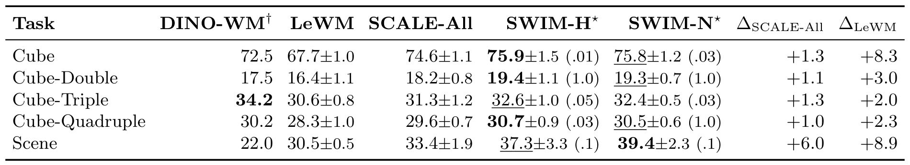

# SWIM: Learning What Matters from Behaviors for JEPA World Models

JEPA 世界模型用图像编码器把观测压到潜空间，再用动作条件预测器 rollout，规划时以终端潜嵌入到目标嵌入的距离作为代价。问题在于，这个距离只保证“预测得准”，不保证“离目标越近”。SCALE 一类方法用模拟器状态距离来校准潜空间，但如果把所有状态坐标等权相加，冗余编码（例如正弦-余弦对）会被重复计算，无关坐标也会把噪声带进目标。SWIM 的做法是先用离线动作学一组状态坐标的权重，再用加权后的状态距离去校准潜空间；学完就把逆动力学模型丢掉，部署时仍只做图像潜空间规划。

论文来自 Boston University 与 Unity Technologies，2026 年 10 月 27 日 13:28（北京时间）提交到 arXiv，版本为 [arXiv:2610.36662v1](https://arxiv.org/abs/2610.36662)。作者为 Jiaming Hu、Shi Bo、Yan Zheng、Tian Wang、Florian Dubost、Alejandro Mottini 等。[PDF](https://arxiv.org/pdf/2610.36662)

## 问题：潜空间距离不等于任务进度

LeWM 类模型的训练目标是预测下一帧的潜嵌入，再加 SIGReg 防止表示塌缩。规划时，给定当前图像与目标图像，CEM 或 iCEM 搜索一条动作序列，使终端预测嵌入尽量接近目标嵌入：

$$J(a_{0:H-1})=\left\lVert \hat{z}_H(a_{0:H-1})-z_g\right\rVert_2.$$

这个代价只衡量潜空间里的接近程度，不直接衡量任务状态推进了多少。SCALE 因此增加一个相关性损失，让同一批图像对的潜距离与状态距离正相关。但 SCALE 默认对所有状态坐标均匀加权：如果状态里同时有 $x$ 与 $\sin x$、$\cos x$，同一个变化会被算三次；如果追加了与任务无关的变量，它们也会进入目标。作者在 Cube 上做了干扰实验：往 22 维状态后追加 26 个无关的 Scene 变量，均匀对齐的 CEM 成功率从 75.5% 降到 74.2%，说明这个担忧不是假设。

## 方法：用逆动力学学状态权重，再校准潜空间

### 机制流程

1. 从离线轨迹取当前状态 $q_t$、$h$ 步后的状态 $q_{t+h}$ 与记录的动作块 $a_t$，对每个状态坐标做标准化，并采样不同的行为视界 $h$。
2. 用可训练门控 $g=\sigma(\alpha)\in(0,1)^d$ 缩放位移 $\delta_t=q_{t+h}-q_t$，让行为预测器从当前状态与门控位移预测记录动作；联合优化负对数似然、判别损失与 $\ell_1$ 门控惩罚，得到冻结的 $g^\star$。
3. 把 $g^\star$ 迁移到 SCALE：用 $\tilde{q}=\sqrt{g^\star}\odot q$ 计算加权状态距离，替换原来的均匀状态距离目标，只训练编码器与预测器。
4. 部署时丢弃行为预测器与状态，仍用图像编码、潜空间 rollout 与 CEM/iCEM 搜索动作。

### 门控逆动力学

行为预测器是一个高斯 MLP，输入是当前状态与门控后的位移，输出是动作块的均值与逐维对数标准差。记

$$s_t(\delta)=\log p_\phi\!\left(a_t\mid [q_t;\,g\odot\delta]\right),$$

其中 $[\cdot;\cdot]$ 表示拼接。当前状态不加门控，只有位移被门控缩放；一个环境共享一组门控。

只优化负对数似然不够：动作往往能从当前状态部分预测出来，预测器可能干脆忽略位移，此时门控收不到梯度，$\ell_1$ 惩罚会把所有门控压到零。作者因此加了一个判别项，要求真实位移比批内错配位移更好地解释动作：

$$\mathcal{L}_{\text{hinge}}=\mathbb{E}\left[\max\left(0,\kappa-s_t(\delta_t)+s_t(\bar{\delta}_t)\right)\right],$$

其中 $\bar{\delta}_t=\bar{q}-q_t$ 是同一 batch 中另一个样本的后继状态构造的错配位移，$\kappa>0$ 是 margin。若预测器忽略位移，两项相等，损失保持 $\kappa$，门控就仍有梯度。InfoNCE 版本则把真实位移与 $N$ 个错配位移做对比。完整目标是

$$\mathcal{L}_{\text{Stage1}}(\alpha,\phi)=\mathcal{L}_{\text{NLL}}+\gamma\mathcal{L}_{\text{disc}}+\lambda\lVert g\rVert_1.$$

$\ell_1$ 让门控整体偏小但不做硬选择，$\gamma$ 控制判别项的权重。这个设计有一个边界：门控是环境级共享、与状态无关的，它只能表达“这个坐标平均有多重要”，不能表达“在任务早期重要、后期不重要”。

### 迁移到 SCALE 的加权距离

冻结 $g^\star$ 后，加权平方状态距离写成

$$D^2_{g^\star}(q_i,q_j)=\left\lVert \sqrt{g^\star}\odot q_i-\sqrt{g^\star}\odot q_j\right\rVert_2^2=\sum_{k=1}^{d}g^\star_k\left(q_{i,k}-q_{j,k}\right)^2.$$

门控必须放在标准化之后，且后面不能再做一次逐坐标标准化，否则权重会被抵消。把 SCALE 的均匀状态距离换成 $D^2_{g^\star}$，得到

$$\mathcal{L}_{\text{SWIM}}=\mathcal{L}_{\text{LeWM}}+\lambda_{\text{corr}}\left(1-\rho_P\left(x,y^{\text{SWIM}}\right)\right),$$

其中 $x$ 是潜距离，$y^{\text{SWIM}}$ 是加权状态距离，$\rho_P$ 是 Pearson 相关。与 SCALE-All 相比，只有状态距离目标变了；编码器、预测器、SIGReg 与部署路径都不变。

*论文原图编号：Fig. 1。(a) 用当前状态、门控位移与记录动作训练行为预测器；(b) 冻结门控后加权状态距离，校准潜空间；底部是部署时的图像潜空间规划路径。*

### 为什么学习权重可能有用

作者给了一个候选选择误差上界：在固定起点-目标对与 $M$ 条候选动作下，选中动作的真实任务代价与最优候选之差，被分解为三项——潜空间对齐误差、rollout 误差，以及学习权重 $g$ 与参考任务权重 $g_0$ 的差异项 $R^2\lVert g-g_0\rVert_1$。均匀权重对应 $g_u=(1/d,\dots,1/d)$，无论潜空间对齐得多好，这一项都不会消失；学习权重只能降低第三项。这解释了一个重要边界：如果对齐误差或 rollout 误差主导，SWIM 的增益就会很小。后文的结果正好是“一致但幅度有限”。

## 结果：五个 OGBench 任务与两个规划器

实验在 OGBench 的五个视觉操作任务上进行：Cube、Cube-Double、Cube-Triple、Cube-Quadruple 与 Scene，状态维度从 22 增到 37。每个 LeWM 类方法训练 5 个 seed，每个任务、配置与规划器在每个 seed 上评 600 个 episode。

| 任务 | DINO-WM | LeWM | SCALE-All | SWIM-H⋆ | SWIM-N⋆ |
|---|---:|---:|---:|---:|---:|
| Cube | 72.5 | 67.7 | 74.6 | **75.9** | 75.8 |
| Cube-Double | 17.5 | 16.4 | 18.2 | **19.4** | 19.3 |
| Cube-Triple | **34.2** | 30.6 | 31.3 | 32.6 | 32.4 |
| Cube-Quadruple | 30.2 | 28.3 | 29.6 | **30.7** | 30.5 |
| Scene | 22.0 | 30.5 | 33.4 | 37.3 | **39.4** |

表内是 CEM 规划成功率（%），SWIM-H/N 用每个任务最优的 $\lambda$。五个任务上 SWIM 都高于 SCALE-All，提升 1.0–6.0 点；相对 LeWM 提升 2.0–8.9 点。Scene 的增益最大，Cube-Triple 最小。默认配置下，SWIM-H 平均提升 0.9 点（$p=0.009$），SWIM-N 提升 1.0 点（$p=0.022$），十个任务-规划器配置平均提升 0.7 点（$p=0.006$），且五个训练 seed 上方向一致。统计上显著，但绝对幅度不大；这不是一个能把成功率从 30% 拉到 50% 的方法。

*论文原图编号：Table 1。五个 OGBench 任务的 CEM 成功率，含 DINO-WM、LeWM、SCALE-All 与两个 SWIM 变体；括号内为每个任务使用的 $\lambda$。*

与 DINO-WM 的位置也需要说清楚。DINO-WM 用预训练视觉特征规划，在 Cube-Triple 上 34.2% 仍然最高，SWIM 只有 32.6%；在其他四个任务上 SWIM 更高。作者没有声称 SWIM 全面超过预训练特征方法，只说它在状态监督这条线上更好。

### 结构化干扰实验

为了验证门控确实在压低无关变量，作者往 Cube 的 22 维状态后追加 26 个来自 Scene 的无关变量，再比较干净、污染与加权对齐三种情况。结果：追加变量后，原始坐标的排序基本不变（Spearman 相关 0.995），所有追加坐标的门控都不超过 0.31，说明门控把无关变量压到了低位。规划上，均匀对齐污染状态的 CEM 从 75.5% 降到 74.2%，加权对齐恢复到 75.2%；iCEM 下加权对齐达到 76.7%，高于污染均匀对齐的 75.5% 与干净均匀对齐的 76.3%。这组实验只用一个训练 seed，统计强度弱于主表，但机制证据比主表更直接。

## 边界：平均 1 点增益能说明什么

第一，SWIM 依赖训练时提供的状态变量集合。门控只能在已给的坐标里分配权重，不能凭空创造缺失的任务变量；如果关键变量没被提供，学到的权重也帮不上忙。第二，门控是环境级共享且静态的，不能随任务阶段或观测变化；作者在结论里也把“状态相关或更丰富的加权机制”列为未来工作。第三，所有实验都在 OGBench 仿真中完成，没有真实机器人部署。第四，增益幅度有限：默认配置 0.9–1.0 点，十个配置平均 0.7 点；虽然五个 seed 方向一致且显著，但绝对提升很容易被任务难度或规划器差异淹没。第五，方法是通过 SCALE 演示的；换成子空间对齐、物理状态 grounding 等其他状态监督目标时是否仍有效，尚未验证。第六，结构化干扰实验只用一个 seed、一个任务。

我的分析是，SWIM 的价值主要在“诊断”而不是“刷点”：它把“状态距离目标该用哪些坐标”从一个手工选择问题变成一个可从行为数据学习的权重问题，并用误差上界说明了权重项只能修复三类误差中的一类。这既解释了为什么它的平均增益只有 1 点左右，也给出了什么时候值得用它的判断依据——当状态里冗余或无关坐标很多、而对齐与 rollout 误差已经被压得较低时，学习权重的收益最大。反过来，如果关键状态变量缺失或门控需要随阶段变化，当前方法就不够用。

从工程复现角度看，最值得借鉴的是两阶段解耦：Stage 1 只学权重，Stage 2 只改状态距离目标，部署路径完全不变。这让它可以作为一个轻量插件接到已有的 JEPA 世界模型上，而不需要重新设计规划器。但要把它当成通用提升手段，还需要在更多任务、更多状态维度与真实机器人上验证；目前 0.7 点的平均增益不足以支撑“普遍更好”的结论。
