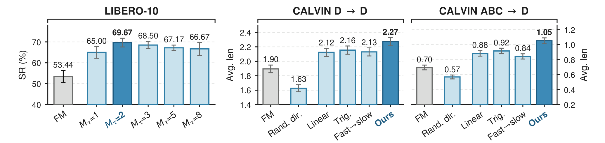

# TOPS: Reshaping Flow Source and Transport for Multi-Task Robot Manipulation

多任务 flow 策略通常让所有任务共享一个标准高斯起点，并用同一条线性路径把噪声推向动作。TOPS 的判断是：多任务性能的瓶颈不只在网络容量，还在生成过程的起点与时间表。作者先把已训练策略反向跑一遍，把专家动作映回噪声空间，发现不同任务的反演样本自然聚成不同的簇；于是按任务拟合低秩高斯混合作为新起点，再用高斯最优传输的特征值找出少数“需要扩张”的方向，只在这些方向上把插值改成先慢后快。网络结构、条件接口与动作表示都不变。

论文来自南洋理工大学 MARS Lab（Tuo An、Chuhao Zhou、Jiahua Dong 等），2026 年 10 月 27 日 14:11（北京时间）提交到 arXiv，版本为 [arXiv:2610.36694v1](https://arxiv.org/abs/2610.36694)，处于 under review 状态。项目页为 [ntumars.github.io/TOPS](https://ntumars.github.io/TOPS/)，[PDF](https://arxiv.org/pdf/2610.36694)。

## 问题：一个高斯源要覆盖所有任务

标准 flow matching 的策略训练目标并不复杂：给定观测与语言条件 $c$，网络回归从起点 $x_0$ 到专家动作块 $x_1$ 的速度场。麻烦在于多任务设定下，$x_1$ 的条件分布随任务变化很大，而 $x_0$ 始终是同一个各向同性高斯，插值也始终是 $x_t=(1-t)x_0+t x_1$。网络于是既要学会把同一团噪声分配到不同任务的动作流形，又要在每条方向上用同一种速度剖面前进。

作者没有直接改网络，而是先做诊断：用一个只预热了 300 epoch 的标准策略，把每个专家动作块沿反向 flow 映回噪声空间，得到反演样本 $\hat{x}_0=\Phi^{c}_{\theta_0,1\to0}(x_1)$。在 LIBERO-10 的 t-SNE 上，十个任务占据部分重叠但可区分的区域，任务内部还有子簇，对应到达、抓取、放置等不同执行阶段。这个现象不能证明反演样本一定保留任务语义，但它给出了一个可操作的假设：如果起点本身就按任务组织，网络需要跨越的分布距离会小得多。

## 方法：先反演专家动作，再改写源与时间表

### 机制流程

1. 输入是预热后的多任务策略、每个任务的专家动作块及其观测与语言。对每个专家动作块做反向 flow 积分，得到噪声样本，按任务汇成反演样本库 $\mathcal{B}_\tau$。
2. 以 $\mathcal{B}_\tau$ 为数据，用 EM 拟合一个 $M_\tau$ 分量的低秩高斯混合，得到任务源 $q_\tau$；同时由源协方差与专家协方差构造高斯 OT 映射，特征分解得到方向 $r_{\tau j}$ 与源到专家的标准差比 $s_{\tau j}$，据此构造调度矩阵 $K_\tau$。
3. 续训时从 $q_\tau$ 采样 $x_0$，在特征基中按任务相关的时间表插值，用闭式路径生成 $x_t$ 与速度目标 $u_t$，只更新速度网络。
4. 推理时由语言选择器输出任务索引 $\hat{\tau}$，从 $q_{\hat{\tau}}$ 采样，用一次两阶段 schedule-aware 积分生成 16 步动作块，执行前 8 步。

### 任务级 MPPCA 源

每个任务的源是若干个概率 PCA 分量的混合：

$$q_\tau(x_0)=\sum_{m=1}^{M_\tau}\pi_{\tau m}\,\mathcal{N}\!\left(x_0;\mu_{\tau m},\Sigma_{\tau m}\right),\qquad \Sigma_{\tau m}=U_{\tau m}\Lambda_{\tau m}U_{\tau m}^{\top}+\sigma_{\tau m}^2 I_D .$$

这里 $U_{\tau m}\in\mathbb{R}^{D\times r}$ 的列张成动作块内跨时间步、跨关节的 $r$ 个协同变化方向，$\Lambda_{\tau m}$ 控制这些方向的强度，各向同性残差 $\sigma_{\tau m}^2 I_D$ 负责吸收子空间外的变化。$D=H d_a$ 是整个动作块的维度，实验里 $H=16$、$d_a=10$，所以 $D=160$。用低秩协方差而不是满协方差，是因为反演样本数有限而维度很高；用混合而不是单高斯，是因为任务内部存在多个执行阶段。

训练时每个示范按任务标签选自己的 $q_\tau$，推理时改由指令选择。这个选择器是一个冻结的 MiniLM 句向量加五个轻量 MLP 分类器的集成，在 benchmark 的训练指令上离线训练，之后不再更新。

### 用 OT 特征基找 expansion 方向

有了源，还要知道源与专家分布差在哪些方向。作者用源协方差 $C_s^\tau$ 与专家协方差 $C_d^\tau$ 构造对称正定的高斯 OT 映射：

$$T_\tau=\left(C_s^\tau\right)^{-1/2}\left[\left(C_s^\tau\right)^{1/2}C_d^\tau\left(C_s^\tau\right)^{1/2}\right]^{1/2}\left(C_s^\tau\right)^{-1/2}.$$

它满足 $T_\tau C_s^\tau T_\tau=C_d^\tau$。对 $T_\tau=R_\tau\,\mathrm{diag}(s_{\tau1},\dots,s_{\tau D})\,R_\tau^\top$ 做特征分解，每个特征向量 $r_{\tau j}$ 是一组跨时间步、跨关节的协调变化模式，特征值 $s_{\tau j}$ 是该方向上专家标准差与源标准差之比。$s_{\tau j}>1$ 的方向被称为扩张方向。

这个量在实验里很集中：扩张方向只占 7.4–9.7% 的维度，却承担 60.9–69.6% 的高斯 OT 协方差代价。也就是说，大部分动作维度上源已经足够接近专家，真正需要改的是少数方向。这解释了为什么后文只在特征基里动时间表，而不是对全部 160 维统一调参。

### slow-then-fast 调度与闭式路径

在特征基 $y=R_\tau^\top x$ 中，第 $j$ 维的插值写成 $y_{t,j}=a_{\tau j}(t)y_{0,j}+[1-a_{\tau j}(t)]y_{1,j}$，其中 $a_{\tau j}$ 是从 1 单调降到 0 的源权重。线性插值对应 $a=1-t$。

作者把源与专家都近似为独立高斯，研究“只看插值状态预测速度”时的最小均方误差，并把风险按方向分解、对时间积分。最小化这个上界给出的最优调度满足端点速度比：

$$\frac{|\dot a^\star_{\tau j}(1)|}{|\dot a^\star_{\tau j}(0)|}=s_{\tau j}.$$

直观解释是：在靠近源的一端，插值状态几乎不携带专家终点信息，不同速度目标混在一起，所以要慢一点走；等专家成分变大、状态更有信息量后再加速。沿扩张方向 $s_{\tau j}>1$，这个比值大于 1，正好对应“先慢后快”。实现上用

$$\rho_{\tau j}=\kappa\tanh\!\left(\gamma\log s_{\tau j}\right)\mathbf{1}\{s_{\tau j}>1\},\qquad a_{\tau j}(t)=(1-t)e^{\rho_{\tau j}t}$$

把强度限制在 $0<\kappa<1$，非扩张方向保持线性。把 $K_\tau=R_\tau\,\mathrm{diag}(-\rho_{\tau1},\dots,-\rho_{\tau D})\,R_\tau^\top$ 代回动作空间，得到闭式的插值状态与速度目标：

$$x_t=x_1+(1-t)e^{-tK_\tau}(x_0-x_1),\qquad u_t=e^{-tK_\tau}\left[I_D+(1-t)K_\tau\right](x_1-x_0).$$

这一步的工程意义很直接：调度没有引入新的网络或新的损失，只是换了采样起点和路径；续训仍然用原来的 flow matching 回归，推理也只是换了一个积分器。这是它能直接接到 π0.5 上的原因。

*论文原图编号：Fig. 2。上半部分是按任务反演并拟合 MPPCA 源，下半部分是在 OT 特征基中把扩张方向改成先慢后快、其余方向保持线性。*

## 结果：一步生成的位置与代价

### 主结果与延迟

所有对比方法共享同一个四层 DiT（隐藏维 512、8 个注意力头）、ResNet-18 视觉编码器、冻结 CLIP ViT-B/32 语言编码器与 16/2/8 的预测/观测/执行视界，并训练同样的 600 epoch。TOPS 用一次两阶段积分（NFE=2），Standard FM 等方法用十步显式中点（NFE=20）。

| 方法 | LIBERO-10 | LIBERO-Plus | CALVIN D→D | CALVIN ABC→D | 单次调用延迟 |
|---|---:|---:|---:|---:|---:|
| Standard FM | 53.44 | 27.11 | 1.90 | 0.70 | 49.4 ms |
| MeanFlow | 59.00 | 34.73 | 1.89 | 0.86 | 5.7 ms |
| PriorGrad | 62.33 | 30.56 | 1.97 | 1.02 | 48.3 ms |
| LeaP | 60.25 | 30.72 | 1.74 | 0.73 | 49.6 ms |
| Source-only（固定 $M_\tau=2$） | 59.17 | 35.21 | 2.12 | 0.88 | 7.6 ms |
| TOPS | **69.67** | **35.29** | **2.27** | **1.05** | 8.2–9.0 ms |

LIBERO 列是成功率（%），CALVIN 列是五任务链的平均完成长度。TOPS 在四个设置上都取得最高均值，延迟约为 Standard FM 的六分之一。但要注意，它并不是绝对最快：MeanFlow 用 NFE=1，延迟只有 5.4–5.7 ms；TOPS 用更高的单次成本换来了更高的成功率。表里的标准差来自三次独立训练，LIBERO-10 的 69.67±0.61 与 53.44±2.93 差距清楚，但 CALVIN ABC→D 的 1.05±0.04 仍是一个低绝对值的任务。

### 数据效率

TOPS 的源是从反演样本拟合出来的，这带来一个自然问题：示范很少时还成立吗？作者用 5%、10%、20%、30%、50% 的示范重训。5% 时 LIBERO-10 为 15.50%，Standard FM 为 8.50%；LIBERO-Plus 为 8.00% 对 4.10%。CALVIN ABC→D 上，TOPS 用 30% 示范达到 1.009，超过所有基线用 50% 示范的最好成绩（PriorGrad 0.925）。这些数字说明任务源在低数据下仍有价值，但 15.50% 的绝对成功率也提醒读者：它缓解了数据不足，并没有把低数据问题解决。

### 迁移到 π0.5

作者把同一套源与调度接到官方 π0.5 上，用相同的 LoRA 配置与 14K step 预算。LIBERO-10 从 94.0% 到 94.8%，LIBERO-Plus 从 64.4% 到 69.0%，CALVIN D→D 链长从 3.673 到 3.941，ABC→D 从 3.033 到 3.744。分布偏移越明显，增益越大；在已经很强的 LIBERO-10 上只有 0.8 点。这个模式与“改的是源与路径，不是容量”的解释一致。

不过 π0.5 的分类别结果并非全面上涨：Language instruction 从 74.8% 降到 73.7%，Camera viewpoint 只从 38.4% 到 40.0%。语言选择器与策略条件都依赖指令，指令被改写时选错源的风险会直接抵消调度收益，这一点论文没有进一步拆解。

### 真机八任务

真机平台是 Galaxea R1 Lite，只控制右臂的 6 个关节与二指夹爪，头部与腕部两路 RGB，动作是 7 维绝对位置加夹爪命令。三个任务套件共八个任务，每个任务 20 次 rollout。TOPS 合并成功 124/160（77.50%），Standard FM 为 82/160（51.25%），提升 26.25 点，双侧两比例 z 检验 z=4.90、p<0.001。

分任务看，差异并不均匀：daikon 与 corn 两者都是 100%，上抽屉从 20% 到 80%，下抽屉从 20% 到 50%，紫/黑积木各提升 20 点，mango 从 0% 到 50%，peach 从 40% 到 70%。也就是说，增益集中在需要区分任务目标与空间位置的任务上，而不是所有接触操作都同等受益。

*论文原图编号：Fig. 6。左图改变混合分量数，中、右图在 CALVIN 两个 split 上比较随机方向、线性、三角函数、反向调度与完整 TOPS。*

## 消融与边界：哪些增益来自源，哪些来自调度

先看源。固定 $M_\tau=2$ 的 source-only 在 LIBERO-10 为 59.17%，完整 TOPS 为 69.67%，说明在源之上加调度还有约 10.5 点。混合分量数 $M_\tau\in\{1,2,3,5,8\}$ 全部高于 Standard FM，$M_\tau=2$ 最好（69.67%），$M_\tau=8$ 降到 66.67%。这个偏好与任务内子簇的数量相符，但论文没有给出跨任务自适应选 $M_\tau$ 的规则。

再看调度。把扩张方向换成随机方向，CALVIN D→D 从 2.27 掉到 1.63，ABC→D 从 1.05 掉到 0.57，说明“在哪些方向上改时间表”比“改不改”更重要。线性为 2.12/0.88，全局三角函数为 2.16/0.92，fast-then-slow 为 2.13/0.84。三角函数在 ABC→D 上已经接近完整方法，说明一部分收益来自“非均匀时间表”本身；但反向调度明显更差，方向性仍然成立。

最后看边界。第一，任务身份必须出现在训练集里，语言选择器选错任务就会选错源与调度；论文没有报告选择器的混淆矩阵或误选后的成功率。第二，源与调度离线拟合后固定，新增任务要重新反演与拟合，不能在线更新。第三，动作块固定 16 步，真机只验证了单臂 7 维动作；更高维灵巧手或变长动作未测试。第四，真机每任务 20 次、合计 160 次，合并检验显著，但没有覆盖任务间异质性。第五，所有延迟在 RTX PRO 6000 上测量，不含感知与执行，不能直接当作机载闭环延迟。

我的分析是，TOPS 最可复用的部分不是某个超参数，而是“先反演、再在 OT 特征基里只改少数方向”这个诊断流程。它把多任务 flow 策略的改进从“换更大的网络”拉回到“检查生成过程的起点与路径”，而且改动可以闭式表达、直接接到已有大模型上。但它依赖任务标签与固定任务集，离“开放世界通用策略”还有明显距离；在没有任务标签或任务数持续增长的场景里，如何增量维护源与调度，仍是未解决的问题。
