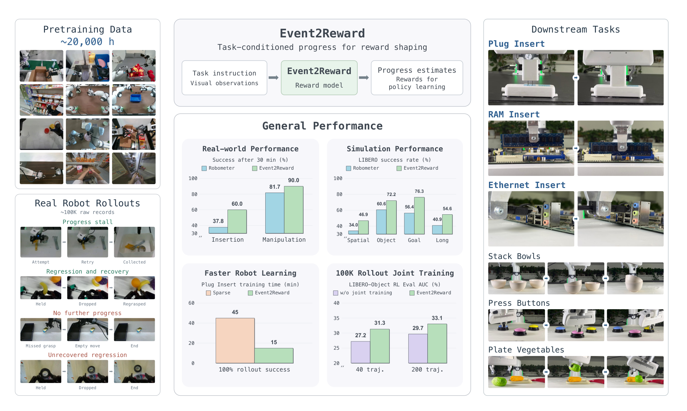

# Event2Reward: Learning Robotic Rewards from Progress Relations

用强化学习在真机上练操作，最贵的是交互，最省事的加速手段是奖励塑形。常见做法是从成功示教里学"任务进度"：把归一化时间当作进度标签，再用相邻两步进度的折扣差作为塑形奖励。问题在于，策略探索时会大量产生次优与失败执行，进度会停顿甚至回退，而时间标签仍然单调上升，于是奖励模型会给"把已经拿到的状态弄丢"的动作发正奖励。Event2Reward 的出发点是：绝对进度值很难标注，但真实执行中的事件能给出局部进度关系——杯子掉了之后重新抓住，这个状态显然比掉落前进度低，即使你说不出低多少。

论文：[arXiv:2610.39212](https://arxiv.org/abs/2610.39212)（cs.RO，2026-10-29 10:34 北京时间提交，补充窗口；44 页含附录）。作者构建了约十万条真机执行记录的事件标注数据集，并在 LIBERO 四十个任务与六个 Franka 真机任务上评估。

## 问题：时间标签在失败轨迹上会说谎

把成功示教的归一化时间当作进度，隐含假设是进度单调递增。真实执行不满足这个假设：抓取失败后重试会停顿，物体滑落会回退，重新抓稳是恢复。用这类轨迹训练奖励模型时，时间标签仍然给出上升的进度，塑形项就会奖励导致回退的动作。作者列出三种现有补救都不够：重复或倒放示教帧可以合成停顿与回退，但合成不出示教里不存在的失败状态；结果标签与轨迹级偏好能利用真实失败，但它们描述的是整条轨迹的质量，无法确定相邻观测之间进度变化的方向与时刻。

## 方法：用事件关系约束进度序

*论文原图编号：Fig. 1。左侧是约两万小时预训练数据与约十万条含成功、次优、失败的真机 rollout；中间是任务条件化的进度预测与奖励塑形接口；右侧是六个真机下游任务与主要结果面板。*

### 机制流程

1. 进度模型输入为任务指令 $\ell$、参考起始观测 $o_0$、截至当前时刻的短视觉历史 $H_t$ 与可选目标图 $g$，输出一个 $[0,1]$ 的标量进度 $p_\theta(x_t)$。实现用 Qwen3.5-4B 视觉语言骨干，加一个进度头（对离散化进度值输出分布，取期望）与一个辅助趋势头（判断历史窗口内进度上升、平稳或下降）。
2. 成功且无事件的轨迹用归一化时间作标签：$y_t=(t-t_0)/(t_S-t_0)$，对进度分布做软标签交叉熵，得到 $\mathcal{L}_{\text{progress}}$。这一步只负责锚定数值尺度。
3. 含事件的轨迹不标绝对进度，而是把事件转成同一轨迹内观测之间的比较关系。以"回退并恢复"事件为例，设 $\bar p_a$ 与 $\bar p_r$ 为回退前参考状态与恢复状态的预测分数（参考分数梯度截断），对事件区间内的每个观测：

$$
\ell_e(t)=\left[p_t-\min(\bar p_a,\bar p_r)+m_e\right]_+ ,
$$

其中 $[\cdot]_+=\max(\cdot,0)$，$m_e$ 是训练规则给定的 margin，而不是标注出来的进度损失量。对停顿事件允许参考附近的容差，对"无进一步进展"惩罚高于参考的预测，对"未恢复的回退"只要求下降 margin。事件内取平均、事件间再平均得到 $\mathcal{L}_{\text{rel}}$。
4. 总目标为 $\mathcal{L}=\lambda_p\mathcal{L}_{\text{progress}}+\lambda_{\text{rel}}\mathcal{L}_{\text{rel}}+\lambda_t\mathcal{L}_{\text{trend}}$。训练分预训练（约两万小时示教与人类操作视频）、rollout 联合训练（真实成功与失败 rollout 加预训练回放）与目标任务适配三步。
5. 策略学习时冻结奖励模型，按势函数塑形把进度差加进环境奖励：

$$
r^{\text{shaped}}=r^{\text{env}}+\beta\left[\gamma p_{t+1}-p_t\right],
$$

默认 $\beta=1$、终止状态势为零。执行时不需要在线事件类别或恢复标注，只用进度预测。

这里最关键的设计判断是"分工"：时间标签管数值尺度，事件关系管局部方向。塑形奖励的幅度依赖预测的绝对尺度，而方向只依赖相邻状态的序，两者恰好可以由同一标量头在不同监督下同时满足。

## 数据与标注协议

数据集从约十万条原始真机执行记录中整理，覆盖成功、次优与失败执行。标注只记录事件类别、参考状态与时间区间，回退并恢复事件额外标出恢复状态，不要求逐帧完成百分比。协议按执行结果组织事件：成功执行标"进度停顿"与"回退并恢复"，失败执行标"无进一步进展"与"未恢复的回退"。作者特别说明，失败本身不等于未恢复的回退——没有建立过抓取就谈不上回退；重新运动也不等于恢复——除非相关任务状态真的被还原。

标注用两遍流程：GPT-5.6 Sol 先找候选事件与时间锚点，再在更密的局部观测与后续上下文里细化；人工在不知道机器标签的情况下独立标注，分歧与未决案例进入第三方复核，一致案例分层抽检。在 8,146 条保留的 RoboArena 轨迹上，机器与独立人工对主类别的一致率为 87.56%。最终只有视觉上可支撑的进度比较进入监督。

## 实验：仿真与真机各自证明了什么

LIBERO 四十个任务上，Event2Reward 在四个套件都取得最高平均成功率，相对各套件最强基线分别提升 10.12、11.60、9.96 与 13.76 点。

| 套件 | Sparse | Robo-Dopamine | Robometer | Event2Reward |
|---|---:|---:|---:|---:|
| Spatial | 36.80 | 36.72 | 34.04 | 46.92 |
| Object | 47.40 | 57.56 | 60.56 | 72.16 |
| Goal | 66.36 | 64.00 | 56.44 | 76.32 |
| LIBERO-10 | 26.84 | 31.72 | 40.88 | 54.64 |

监督消融在 Qwen3-VL-4B-Instruct 上做（为了与 Robometer 同骨干），从同一个只用时间标签训练的检查点出发，在四个 LIBERO-10 任务上比"仅进度""仅关系""进度加轨迹偏好""进度加关系"四种监督。作者报告进度加关系优于其余三种，说明时间标签与关系约束互补；这部分的具体曲线只在原图 3 中，正文没有给逐任务数值。

rollout 联合训练的比较更干净：在 LIBERO-Object 十个任务上，相对跳过该阶段的变体，20 条适配轨迹下评估 AUC 高 3.39 点、成功率高 2.04 点；4 条轨迹下 AUC 高 4.13 点、成功率高 2.56 点，十个任务中九个的 AUC 改善。适配轨迹越少，联合训练的收益越大，这与"用真实失败补上示教覆盖不到的状态"的解释一致。

真机部分用六个 Franka 任务：三个精密插入（SERL 训练）与三个操作任务（DSRL 加 π0 基座）。每个奖励条件三次独立训练，30 分钟墙钟后各评估 20 回合。Event2Reward 在插入任务上把平均成功率从 37.8% 提到 60.0%，在操作任务上从 81.7% 提到 90.0%，六个任务中五个最高、Stack Bowls 与 Robometer 持平。不过 RAM Insert 上它只有 16.7%，低于部分基线，说明精密插入仍是弱项。另一个效率实验在插头插入上比较达到"连续十次自主训练成功"的时间：Event2Reward 15 分钟，稀疏奖励约 45 分钟。

## 边界：奖励模型仍然依赖什么

作者承认的边界不多，但证据结构上有几处需要读者自己补齐。

第一，监督消融用 Qwen3-VL-4B-Instruct，主实验用 Qwen3.5-4B，两者不是同一模型；消融证明的是"关系监督在这个骨干与这个检查点上更好"，不能直接推断最终系统的增益全部来自关系项。第二，真机每个条件只有三次独立训练、每次 20 回合评估，方差不会小；论文给了误差棒，但没有给置信区间或显著性检验。第三，15 分钟对 45 分钟的效率结论只各跑了一次训练，属于轶事级证据，不能当作稳定估计。第四，事件标注依赖 VLM 加人工，主类别一致率 87.56% 听起来不错，但真正影响关系监督的是"回退/恢复的时间锚点是否准确"，论文没有单独报告锚点一致率。第五，进度预测是否真的在回退片段上下降，论文用下游成功率间接证明，没有给出预测曲线与真实进度变化的对齐分析——这是因果链上最薄的一环。

对做机器人 RL 的研究者，这篇论文最可复用的想法是把"奖励需要绝对进度"换成"奖励只需要相邻状态的序"：一旦接受这个前提，标注成本从逐帧百分比降到事件与时间锚点，失败数据也从负担变成监督来源。这个思路能否推广到接触更密集、事件更连续的任务，取决于能否定义出足够稳定的"任务状态"。
