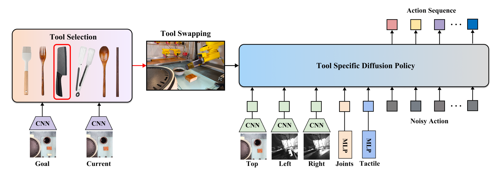

# SwapBot: Tool-Centric Robot Manipulation via Interchangeable End-Effectors and Tactile Sensing

这篇论文的核心主张不是"做一个更好的夹爪"，而是把机器人的能力从末端执行器转移到一组便宜、可更换、带触觉的工具上：机器人侧只保留一个固定的电磁耦合接口，工具侧用 3D 打印适配器把家里的刀、刷子、夹子、筷子变成末端执行器，再用人遥操作采集示教、训练分层策略。作者来自 University of Washington，工作尚未给出会议信息，[项目页](https://personalrobotics.github.io/SwapBot)提供了视频与硬件说明，代码在本次运行时尚不可得。

论文：[arXiv:2610.40646](https://arxiv.org/abs/2610.40646)（cs.RO，2026-10-30 01:59 北京时间提交）。

## 问题：夹爪与拟人手之间空缺的一层

通用平行夹爪便宜、可靠、易控制，但遇到切割、涂抹这类需要工具-物体界面持续接触的任务就无能为力；拟人手灵活，却把成本转移到维护、传感与控制上，数据采集也因此难以规模化。作者的判断是，人类处理这类任务本来也不是靠手本身，而是靠"手 + 工具"的组合，那么机器人也可以把复杂度放到工具侧。

这条路线要跨过两个具体障碍。第一，工业工具快换系统（CNC、UR5 上的那类）虽然成熟，但通常为特定机器人定制、价格高，而且很难兼容需要额外驱动的铰接工具，例如夹子与筷子。第二，已有工具使用研究大多把工具固定在夹爪上，缺少工具-物体界面的触觉测量；而切割与夹取恰恰依赖接触力与载荷分布。

## 系统：把工具变成带触觉的末端执行器

*论文原图编号：Fig. 2。左侧是机器人、机器人侧适配器、电磁耦合、工具坞与触觉 I/O 板；中间是刀、刷、夹子的压阻传感器叠层与布置；右侧是不同电极尺寸的力-响应标定曲线。*

### 换装是怎么发生的

机器人侧是一个自对准电磁耦合轮毂，配一圈运动学导向齿轮，允许在小范围对准误差下完成啮合与释放；电磁铁提供保持力，规格上最高 50 N。工具侧由 3D 打印的 PLA/TPU 适配器和硅胶填充组成：对尺寸接近的工具复用同一适配器，用软硅胶吸收手柄形状差异，只有明显更细的工具才需要换更小的适配器。这样机器人侧接口保持不变，工具侧成本压到约 10 美元，机器人侧电磁铁约 20 美元。

铰接工具的处理是这套设计里比较巧的一步。夹子、筷子本身没有电机，作者把驱动留在机器人侧：适配器顶部加轴承系统，把末端关节的旋转传下去；对于没有末端关节的机械臂（UR 系列），再补一个舵机。换装流程是机器人移动到工具坞、释放当前工具、对准并吸附新工具，作者报告整个过程约 10 秒。系统在 Franka、UR5 和 Tycho 三种平台上做了适配演示。

### 传感器叠层与 2 mm 的由来

触觉传感器是三明治结构：Velostat 压阻膜夹在上下两层铜镍导电布电极之间，受压时电阻下降。为了适应工具有限的表面积，电极做成正交行/列，交点即传感节点，$n \times n$ 的阵列只需要 $2n$ 根电极。厚工具（刀、夹子、勺子）在柄和刃/尖端都布置传感器；薄工具（筷子、刷子、叉子）只在柄上布置，测的是经过工具传递的间接接触。

电极宽度不是随便选的。作者用测力计做了标定：电极面积越大，同样力下响应越强、灵敏度越高，但信号会出现突跳，并且可能让 10-bit ADC 饱和；电极越小，信号越平滑、量程越宽，但灵敏度下降。最终选 2 mm 宽度作为灵敏度、量程与信号平滑度的折中。这个细节值得记下来，因为它说明触觉系统的性能上限往往由读出电路与传感器几何共同决定，而不是只看材料。

## 从遥操作示教到分层策略

*论文原图编号：Fig. 4。工具选择器根据目标图与当前自顶视图像选出工具，机器人换装后由该工具专用的扩散策略根据多视角图像、关节状态与触觉生成动作序列。*

### 机制流程

1. 操作者用与机器人工具同构的主手工具遥操作：T265 跟踪相机给出 6-DoF 位姿，铰接工具再用两个 IMU 的相对运动解出开合命令；多视角 RGB、触觉、关节状态、动作与任务标签以 20 Hz 同步记录。
2. 训练阶段，高层工具选择器 $\pi_{\text{sel}}(O_{\text{top}}, O_g)$ 以自顶视观测与目标图为输入，经 ResNet 特征与 MLP 输出候选工具上的概率分布，选出工具索引 $\tau$。
3. 低层策略 $\pi^{\tau}_{\text{tool}}(O_t, T_t, s_t)$ 是该工具专用的 U-Net 扩散策略，条件为多视角图像、触觉信号与本体感受，输出末端执行器动作序列。
4. 执行时，当连续 20 个控制步的末端位移都小于 0.005 m，判定当前技能完成；机器人回到初始位姿避免遮挡，再以新的目标图调用选择器，进入下一个工具技能。

### 这套分层买到了什么、没买到什么

把"选工具"和"用工具"拆开，使每个低层策略只需面对一种工具动力学，数据效率更高；代价是目标图序列必须由人预先给定，系统没有自主任务分解能力。换句话说，它解决的是技能组合，而不是长程规划。选择器只依赖自顶视图像，无法看到钳口内部的接触状态，这也解释了为什么它能把工具选对，却不能弥补低层策略在遮挡下的失败。

## 实验：触觉增益出现在哪里

策略实验在一道菜上展开：刷酱、用夹子把豆腐运到锅里、再运回砧板并切成两半。每个阶段采集 100 条示教，每个策略在 20 cm × 20 cm 工作区里跑 20 次试验；主比较用三个随机种子并做配对 t 检验。输入模态包括仅 RGB、RGB 加触觉、自顶视 RGB 加触觉、自我中心 RGB 加触觉与仅触觉。

| 输入模态（100 条示教） | 刷酱 | 夹取 | 切割 | 整任务串联 |
|---|---:|---:|---:|---:|
| 多视角 RGB + 触觉 | 85% | 70% | 90% | 60% |
| 多视角 RGB | 70% | 45% | 75% | 35% |
| 自顶视 RGB + 触觉 | 50% | 35% | 50% | 20% |
| 自我中心 RGB + 触觉 | 40% | 20% | 15% | 10% |
| 仅触觉 | 10% | 10% | 20% | — |

表里的数字来自单种子主表，整任务一列则来自串接各阶段最佳 checkpoint 后的 20 次 rollout；触觉带来的 15 到 25 点增益在三个技能上都成立，但分布并不均匀：夹取从 45% 提到 70%，增益最大，因为钳口接触点与初始滑移在 RGB 里被工具本体遮挡；刷酱与切割分别从 70% 到 85%、75% 到 90%，增益较小，因为视觉还能提供部分接触线索。仅触觉几乎学不会任务，说明触觉是补充而非替代视觉；自我中心视角因为俯角超过 45°、定位精度差，即使有触觉也接近失效，这反过来证明多视角几何对这套系统是必要的。

工具选择器在测试集上达到 96.8% 的分类准确率，整任务串联成功率为 60%，高于 RGB-only 的 35%。作者把失败归因于豆腐滑落与示教未覆盖的分布外状态，并给了一个扰动恢复的定性例子：豆腐被推走后策略会重新接近。用户研究部分，12 名受试者（初、中、高各 4 人）在刷酱与切割上各做 10 次试验，比较通用 VR 遥操作工具、无触觉可视化与有触觉可视化三种条件；正文只报告方向性结论——SwapBot 完成时间更短、成功率更高、NASA-TLX 负荷更低，具体数值只出现在原图 6 中，本次没有独立复核。

## 边界：这套系统没有证明什么

作者自己承认的局限包括：触觉传感器分辨率低且易磨损，传感器布置依赖人的直觉，策略学习依赖预定义的任务分段。这些是如实的工程边界，但还有几处是论文没有覆盖、也不应被读者自行补上的。

其一，所有策略实验都在同一台真机、同一工作区、同一道菜上完成，跨机器人迁移只演示了硬件适配，没有验证策略是否需要重新采数。其二，换装被报告为约 10 秒，但没有重复换装次数、对准失败率、电磁铁发热或不同工具姿态下保持力的定量数据，50 N 只是规格而非长期可靠性结论。其三，整任务的 60% 是把各阶段最佳 checkpoint 串起来得到的，属于偏乐观的组合估计；单阶段成功率与整任务成功率之间的落差，正好说明误差会在阶段边界累积。其四，触觉增益是在每阶段 100 条示教的中等数据量下测的，原图 7 显示低数据端增益更大，但绝对成功率也更低，因此"触觉能减少示教需求"这个结论成立的范围仍然有限。

对做具身操作的研究者，这套系统最可复用的部分不是某个网络结构，而是"把传感器随工具走到接触界面"这个设计选择，以及"工具库 + 选择器 + 每工具一个策略"的工程分解方式。它提示了一条与通用 VLA 不同的路线：不追求单一模型覆盖所有工具，而是让硬件与技能库承担多样性。
