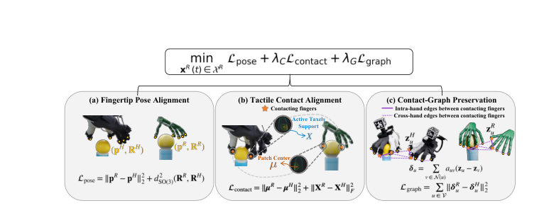

# TouchBridge: Tactile-Conditioned Human-to-Robot Transfer for Dexterous Manipulation

人类示教是扩大灵巧操作数据规模最自然的来源，但把人的手部动作搬到多指机器人手上时，运动学上"看着对"的轨迹经常在物理上不成立：指尖被推离支撑面、同时接触的空间关系被扭曲，甚至完全失去接触。TouchBridge 的出发点是，接触本身就是跨本体的天然对应量——触觉直接告诉你哪些指尖在接触、接触在指尖的哪个位置、载荷如何分布。作者用一套人机对齐的可穿戴采集硬件加上触觉条件化的重定向方法，把人类示教直接转成机器人域训练数据，不需要物体网格、物体位姿估计，也不需要物理仿真精炼。

论文：[arXiv:2610.40349](https://arxiv.org/abs/2610.40349)（cs.RO，2026-10-30 00:06 北京时间提交）。作者来自清华大学、浙江大学、南洋理工大学、湖南大学与北京大学，[项目页](https://touchbridge2026.github.io/)提供了硬件与数据说明。

## 问题：运动学对了，接触却丢了

传统重定向匹配的是手部姿态、指尖位置或手中心向量。这些目标对自由空间运动足够，但对接触密集任务不够：一个固定的人手指尖目标可能把正在接触的手指推离支撑区域，也可能破坏双手同时接触时的相对关系。C2Dex、TopoRetarget、RoboPaint 这类方法通过重建物体、估计位姿或在仿真里精炼来补上物理一致性，代价是每个任务都要建环境、估物体、跑 rollout，难以随人类数据规模一起扩展。

作者的选择是把"物理一致性"换成"测量到的接触"。因为触觉信号在示教时就已经被记录下来，它提供的是关于交互的约束，而不是需要被反推的隐变量；于是重定向可以在纯运动学与触觉测量的空间里完成，绕开物体建模。

## 硬件：让人的指尖和机器人的指尖对齐

TouchBridge-Cap 是一套可穿戴采集接口：Intel RealSense D455 记录自我中心 RGB-D，两个 Hikrobot 相机记录左右腕视角，Manus 手套以 130 Hz 给出双手关节姿态，每个指尖一枚 PaXini 霍尔效应触觉阵列以 90 Hz 记录接触响应。腕部附近贴多面 AprilTag，离线检测后把 Manus 估计的指尖位姿变换到 D455 相机坐标系。机器人侧使用 Moz1 双臂平台与两只 Wuji 手，配自我中心相机、双侧腕相机，以及每只手五枚同款触觉传感器；腕相机支架与指尖传感器位置都按人类侧几何定制。

这套共设计的目的不是让机器人"长得像人"，而是让两侧的观测在同一坐标系与同一触觉布局下可比。人手的尺寸、外观、关节结构仍然不同，这部分交给后面的视觉合成与重定向处理。多模态流用共享主机时钟打时间戳，触觉读数按视觉时间戳线性插值对齐。

## Tac-Retarget：把接触写进优化目标

*论文原图编号：Fig. 3。三项约束分别是指尖位姿对齐、接触块对齐与接触图保持；下方给出对应的目标项，权重与正则项在图中省略。*

### 机制流程

1. 输入是某一时刻的双手指尖位姿 $P^H(t)=(p^H(t),R^H(t))$ 与同步触觉 $S^H(t)$；机器人状态为 $x^R(t)=(T^R(t),q^R(t))$，其中 $T^R$ 是两只手的基座位姿，$q^R$ 是双手关节角，前向运动学给出机器人指尖位姿 $P^R(t)$。
2. 在可行双手机器人状态空间 $\mathcal{X}^R$ 内求解一个带约束的非线性最小二乘，目标由姿态项、接触项、接触图项与正则项组成：

$$
x^{R*}(t)=\arg\min_{x^R(t)\in\mathcal{X}^R}\ \mathcal{L}_{\text{pose}}+\lambda_C\mathcal{L}_{\text{contact}}+\lambda_G\mathcal{L}_{\text{graph}}+\mathcal{L}_{\text{reg}} .
$$

3. 解出的 $x^R(t)$ 同时给出两只手的基座位姿与全部关节角，前向运动学把它映射成机器人指尖轨迹，供后续视觉合成与动作构造使用。
4. 轨迹逐帧求解，时间平滑由 $\mathcal{L}_{\text{reg}}$ 中的一阶、二阶平滑项保证；接触状态变化时，各触觉项的激活与权重随之切换。

姿态项把机器人指尖拉到人类指尖在相机系中的位置与朝向：

$$
\mathcal{L}_{\text{pose}}=\sum_i w_i(t)\left[\left\|p_i^R-p_i^H\right\|_2^2+\lambda_{\text{rot}}\,d_{SO(3)}^2\!\left(R_i^R,R_i^H\right)\right],
$$

其中 $i$ 遍历双手指尖，$w_i(t)$ 是接触条件化的跟踪权重，$d_{SO(3)}$ 是旋转测地距离。关键在于 $w_i$ 不是常数：$w_i=\lambda_p(\beta_0+\beta_c c_i)\eta^{c_i}$，$c_i\in\{0,1\}$ 表示该指尖是否接触，取 $\beta_0=1$、$\beta_c=2$、$\eta=0.05$ 时，接触期间的跟踪权重只有非接触时的 0.15 倍。这个设计让触觉项在接触发生时"压过"姿态项，是整篇论文最值得复用的一个实现细节。

接触项比较的是响应加权后的接触块中心与活跃 taxel 云。对指尖 $i$，先由触觉响应 $s_{im}$ 与标定好的 taxel 局部位置 $r_{im}$ 算出局部接触中心

$$
\mu_{i,\text{loc}}(t)=\frac{\sum_m s_{im}(t)\,r_{im}}{\sum_m s_{im}(t)+\epsilon},
$$

再用人类传感器位姿与机器人前向运动学分别把它变换到相机系，得到 $\mu^H$、$\mu^R$；活跃 taxel 位置 $X^H$、$X^R$ 同样对齐。于是

$$
\mathcal{L}_{\text{contact}}=\left\|\mu^R(t)-\mu^H(t)\right\|^2+\lambda_x\left\|X^R(t)-X^H(t)\right\|_{\Omega(t)}^2,
$$

第一项对齐接触块中心，第二项在响应权重 $\Omega(t)$ 下保持活跃 taxel 的空间分布。因为人机两侧使用同一套标定好的 taxel 布局，人类测到的局部接触中心可以直接当作机器人的目标，不需要物体参与。

接触图处理的是"多个接触之间的相对关系"。把每个接触指尖作为节点，手内边连接同手接触指尖，手外边连接双手之间的接触，边的存在由触觉激活决定；边权按距离与触觉响应归一化：

$$
\tilde a_{uv}=\exp\!\left(-\kappa\left\|z_u-z_v\right\|\right)\left[1+\gamma(\phi_u+\phi_v)\right],
$$

再按邻域归一化：

$$
a_{uv}=\frac{\tilde a_{uv}}{\sum_{k\in\mathcal{N}(u)}\tilde a_{uk}+\epsilon},
$$

其中 $\phi_u$ 是节点 $u$ 的触觉响应。人类示教算出的拓扑与权重原样应用到机器人图上，再用加权相对偏移

$$
\delta_u=\sum_{v\in\mathcal{N}(u)}a_{uv}(z_u-z_v),\qquad
\mathcal{L}_{\text{graph}}=\sum_u\left\|\delta_u^R-\delta_u^H\right\|^2
$$

比较两张图。直观地说，它约束的不是单个指尖在哪，而是"接触之间的相对布局"是否被保留。

作者还加了一项响应相关的柔性补偿：接触建立后，按触觉响应大小把目标接触中心沿"传感器指向物体"的方向推进最多 1 cm，模拟指腹受压变形，让机器人不是刚好碰到物体，而是压进一点以获得稳定接触。这一项在消融中没有单独报告，因此它的贡献目前只有设计论证，没有独立证据。

## 从人视角到机器人视角的数据管线

重定向只给出机器人手的状态，策略还需要机器人视角的观测与动作。观测合成先用 SAM 2 分割人手与可穿戴硬件，再用 ProPainter 修补自我中心视频中被遮挡的区域，最后按标定内参与深度遮挡关系把机器人手网格渲染到修补后的画面上；腕视角图像直接保留。动作构造沿用 UMI 的做法：手臂动作表示成相对每个动作块起始时刻的末端位姿，手的动作使用重定向得到的绝对关节目标，相机运动则用工作区里一个固定的 AprilTag 估计，与腕部用于手部跟踪的标签分开。这样得到的训练序列在人手不出现、机器人手出现的前提下，保留了原示教的相机运动与接触时序。

## 实验：72.5% 与 77.5% 之间差的是什么

实验在四个接触密集任务上展开：翻书页、拧灯泡、挤酱、夹易碎的蛋卷。每个任务采集 60 条人类示教与 60 条遥操作示教，人类示教经管线转成机器人序列后微调 GR00T N1.7；每个策略在真机上跑 20 次，成功标准按任务定义。另取 20 条转换后示教做动作回放，平均回放成功率为 87.5%，说明转换出的动作本身在初始场景匹配时可执行。

| 方法 | 接触误差（mm，Isaac Sim 回放） | 真机策略成功率 |
|---|---:|---:|
| Tac-Retarget | 4.667 | 72.5% |
| 去掉接触图 | 6.659 | 48.8% |
| 去掉接触对齐 | 7.071 | 43.8% |
| 仅运动学 | 7.540 | 38.8% |
| DexPilot | 6.354 | 47.5% |
| UniDex | 7.715 | 30.0% |

接触误差在 Grasp Egg Roll 上测，因为作者认为这个任务的接触在仿真里最容易可靠复现；误差定义为响应加权的人类接触中心与仿真接触中心在对应指尖局部系里的欧氏距离。两个触觉项都不是装饰：去掉接触图或接触对齐，误差都上升，真机成功率掉到 40% 到 50% 区间；只保留运动学时误差最大、成功率最低。与 DexPilot、UniDex 相比，完整方法的接触误差更低，真机成功率高 25.0 与 42.5 个百分点。

数据来源的对比是另一条主线。人类数据微调的策略平均 72.5%，等量遥操作数据为 77.5%，翻书页任务两者持平，其余三个任务差距都在 10 点以内；采集时间从每条 81.7 秒降到 11.7 秒，加速 7.0 倍（各任务 5.7 到 8.1 倍，含失败尝试与场景重置）。这条结果支撑的是"人类数据可以替代大部分遥操作数据"，而不是"完全等价"。

预训练依赖值得单独看：同一个 GR00T N1.7，从零训练只有 6.2%，预训练后微调是 72.5%；π0.5 从零 3.8%，预训练后 38.8%；Diffusion Policy 作为额外基线是 13.8%。也就是说，这套数据管线放大的是预训练 VLA 的能力，而不是从零学出一套策略。

## 边界：这套管线依赖什么

作者承认示教规模仍然有限，扩展到更大、更多样的人类数据是后续工作。除此之外，还有几处边界是论文没有覆盖、但读者容易忽略的。

第一，触觉只用于重定向，不作为策略输入；因此这篇论文证明的是"触觉可以帮助把人的接触搬到机器人上"，不能推出"触觉输入能提升策略本身"。第二，所有真机实验都在同一台 Moz1 加同一款 Wuji 手上完成，换手型意味着指尖传感器布局、taxel 标定与接触图节点定义都要重做，论文没有验证这套迁移成本。第三，视觉合成的质量依赖 SAM 2 与 ProPainter，在背景杂乱、人手与物体严重重叠时修补失败会直接污染观测；论文用 VLM 特征分布重叠作为整体证据，但没有按场景难度分层报告失败率。第四，接触误差的仿真测量需要精确重建的物体网格，这恰恰是方法本身声称要避免的东西——它作为评测手段是合理的，但不能反过来证明方法在无网格场景下同样精确。

对做灵巧操作数据的研究者，这篇论文最值得带走的是两个判断：跨本体迁移时，接触位置比指尖位姿更接近任务不变量；以及在优化目标里用接触状态动态调整运动跟踪权重，是一种不需要额外学习、却能显著改变解的实现手段。
