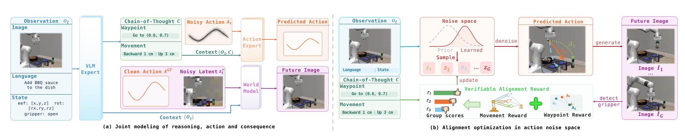

# From Reasoning to Action: Consequence-Grounded Alignment for Vision-Language-Action Models

CoRAct 抓住的是一个很容易被忽略的裂缝：具身思维链（Embodied Chain-of-Thought, ECoT）让 VLA 先写出一段推理再出动作，但推理只是作为条件拼进上下文，模型从未被显式要求"动作必须兑现这段推理"。于是会出现推理说得通、动作却偏离的情况。论文把 ECoT 里的运动意图与空间后果改写成两条可计算的奖励，在动作噪声空间里优化采样起点，让执行向推理靠拢。

作者与机构：Yixue Zhang、Wenke Xia、Kun Wu 等，北京大学、北京人形机器人创新中心、中国人民大学等；2026-10-29 提交；[arXiv:2610.39543v1](https://arxiv.org/abs/2610.39543)；[项目页](https://onlyxingxingzyx.github.io/CoRAct/)。本次未确认公开代码。

## 推理与执行之间缺一条显式约束

现有 ECoT 方法大致分两类：一类把推理写成文本或视觉子目标，作为动作专家的条件；另一类把推理压进潜表示。两者的共同点是"条件化"——推理影响动作，但没有任何项去检查生成的动作是否真的执行了这段推理。在接触密集的操作里，这个缺口很具体：模型可能说"向右 3 厘米"，动作却偏了；也可能给出一个合理的航点，执行后物体根本没到那里。

CoRAct 的选择是把 ECoT 中两个物理上可核对的字段抽出来。movement 由相对末端位姿与夹爪动作规则化得到，描述"要往哪走、转多少、夹爪开合"；waypoint 把未来夹爪位置投影到相机画面，描述"执行后应该到哪里"。前者约束动作本身，后者约束动作造成的空间后果。二者都不依赖额外的语言模型打分，因此可以批量构造。

## 把运动意图和空间后果变成可验证信号

模型以 JanusFlow-1.3B 为骨干，外加一个动作专家与一个图像专家，组成三个专家的 Mixture-of-Transformers。给定多模态输入 $o=(I,s,\ell)$、结构化推理 $C$、动作块 $A=(a_1,\dots,a_H)$ 与后续观测 $I^+$，第一条训练流联合建模推理与动作：

$$p_\theta(C,A\mid o)=p_\theta(C\mid o)\,p_\theta(A\mid o,C).$$

VLM 专家用逐词交叉熵自回归生成 $C$；动作专家在 $o$ 与 $C$ 的条件下，用条件流匹配把动作噪声送到示教动作块，损失为

$$\mathcal L_{\text{act}}=\mathbb E\left\|v^{\text{act}}_\theta(A_t,t\mid o,C)-u^{\text{act}}\right\|^2.$$

第二条流建模"执行这个动作会发生什么"：把后续观测编码进 SDXL VAE 的潜空间，图像专家在 $o$ 与干净示教动作 $A_{gt}$ 的条件下预测未来潜变量，损失为

$$\mathcal L_{\text{world}}=\mathbb E\left\|v^{\text{img}}(z^+_t,t\mid o,A_{gt})-u^{\text{img}}\right\|^2.$$

这里有一个关键设计：第二条流显式排除了 ECoT 词元。否则图像专家可以直接从航点抄答案，后果预测就失去验证意义。两条流按概率 $\eta$ 交替采样：

$$\mathcal L_{\text{base}}=\eta\,\mathbb E_{\mathcal D_{RA}}\left[\mathcal L_{\text{CoT}}+\mathcal L_{\text{act}}\right]+(1-\eta)\,\mathbb E_{\mathcal D_{AW}}\left[\mathcal L_{\text{world}}\right].$$

*论文原图编号：Fig. 2。(a) 三个专家联合建模 ECoT、动作与动作条件未来预测；(b) 冻结骨干后，用运动奖励与航点奖励优化动作噪声空间中的条件噪声策略。*

## 在动作噪声空间做组相对优化

对齐阶段冻结整个 MoT 骨干与航点定位器，只训练一个 512 维的条件噪声策略。它把原来与上下文无关的高斯先验换成依赖上下文表示 $h$ 的对角高斯：

$$q_\phi(\epsilon_a\mid h)=\mathcal N\left(\mu_\phi(h),\operatorname{diag}\left(\sigma^2_\phi(h)\right)\right).$$

对每个上下文采样 $G=8$ 个初始噪声，交给冻结的动作专家做 10 步去噪，得到 8 个候选动作块。每个候选算两项奖励。

运动奖励把候选动作块的端点平移、旋转与夹爪量与 ECoT 的 movement 逐项比较，按尺度归一化后加权：

$$R^{\text{MOV}}=-\sum_{k\in\{p,r,g\}}\lambda_k\frac{\left\|M_k(A_i)-m_k\right\|_2}{\tau_k}.$$

后果奖励则把候选动作送进图像专家，生成未来图，再用 Grounding DINO 定位器取出预测航点 $\hat u_i$，与 ECoT 指定的航点 $u^{\text{ECoT}}$ 比较：

$$R^{\text{vis}}_i=\exp\left(-\frac{\left\|\hat u_i-u^{\text{ECoT}}\right\|_2}{\tau_u}\right),\qquad R_i=R^{\text{MOV}}_i+\lambda_{\text{vis}}R^{\text{vis}}_i.$$

组内用均值做基线，优势为 $\hat A_i=R_i-\frac1G\sum_j R_j$，且刻意不做方差归一化——作者的理由是保留奖励尺度，避免组内方差小时放大噪声。策略用带裁剪的组相对目标更新：

$$\mathcal J(\phi)=\mathbb E\left[\frac1G\sum_i\min\left(\rho_i\hat A_i,\ \bar\rho_i\hat A_i\right)\right]+\beta H\left(q_\phi(\cdot\mid h)\right),$$

其中 $\rho_i=q_\phi(\epsilon_{a,i}\mid h)/q_{\phi_{\text{old}}}(\epsilon_{a,i}\mid h)$，$\bar\rho_i$ 是裁剪后的比值。梯度不穿过动作生成、未来预测与定位器，因此改变的是"从哪里开始采样"，而不是特征本身。部署时只采一个初始噪声、做 10 步去噪，不需要多候选验证。

## 增益来自对齐，而不只是多写一段推理

| 配置 | VLABench | RoboCasa |
|---|---|---|
| 无 CoT、无对齐 | 39.2% | 68.6% |
| + Movement CoT | 44.3% | 72.9% |
| + Waypoint CoT | 47.5% | 73.5% |
| + Movement 对齐 | 49.3% | 74.6% |
| + Waypoint 对齐（完整） | **51.8%** | **75.5%** |

这张逐级消融是全文最关键的证据。只加结构化 CoT 能把 VLABench 从 39.2 推到 47.5，说明"让模型先写运动与航点"本身就有用；但把 CoT 变成奖励、显式对齐动作后还能再涨 4.3 点，RoboCasa 上再涨 2.0 点。完整模型相对起点是 +12.6 与 +6.9。

需要保留的疑问是：消融是累积式的，没有"只加对齐、不加 CoT"的对照。因此严格说，论文证明的是"CoT + 对齐"优于"CoT"优于"都没有"，而不能完全分离对齐目标与推理输入之间的交互。

主结果上，CoRAct 在 VLABench 的五个设置（类别、常识、语义、纹理、分布内）分别为 51.8、24.3、34.4、36.2、30.0，在 RoboCasa 的分布内与四个 OOD 设置为 75.5、70.3、65.9、66.9、60.0。跨两个基准、两种难度结构都领先，说明它不是只对某一类任务有效。

## 一致性指标与闭环纠错

任务成功率之外，论文用四个指标直接测"动作是否兑现推理"：位置误差、旋转误差、夹爪一致率、航点像素误差。四项对齐组合的结果是位置 0.401→0.171 cm、旋转 0.534→0.420 度、夹爪 69.8%→91.8%、航点 5.998→0.542 px。

| 对齐方式 | 位置误差（cm） | 旋转误差（度） | 夹爪一致率 | 航点误差（px） |
|---|---|---|---|---|
| 无 | 0.401 | 0.534 | 69.8% | 5.998 |
| 仅 Movement | 0.209 | 0.478 | 87.7% | 2.904 |
| 仅 Waypoint | 0.232 | 0.494 | 85.2% | 2.706 |
| 两项 | **0.171** | **0.420** | **91.8%** | **0.542** |

单项对齐会顾此失彼：只开 Waypoint 时位置误差 0.232，差于只开 Movement 的 0.209；只开 Movement 时航点误差 2.904，差于只开 Waypoint 的 2.706。两项合用才同时压到最低。这比单一成功率更能说明奖励确实在约束不同的量。

闭环纠错是另一条线。后训练只见过专家轨迹，失败状态下的 ECoT 往往不可靠。作者外挂一个代理（论文用 GPT-5.6）检查当前观测与推理，必要时改写 ECoT 再喂回策略。在 Insert Flower 与 Chem. Tube 上，基线为 24.0%/22.0%，加入对齐后 26.0%/30.0%，加入代理纠错后 52.0%/40.0%，两者都加达到 66.0%/52.0%。这说明 CoRAct 的对齐能力可以接收外部推理，而不限于自己生成的 CoT；代价是部署时需要额外的模型调用。

## 真机结果与这套框架的边界

真机用三个任务各 30 次试验：桌面整理、图像引导的单词拼装、语言引导的水果挑选。CoRAct 的成功率为 56.6%、46.6%、63.3%，π0.5 为 33.3%、26.6%、56.6%，LaST0 为 40.0%、33.3%、50.0%，CoVer-VLA 为 33.3%、26.6%、50.0%。三个任务都领先，其中图像引导拼装与桌面整理的提升最大。

真机协议与仿真并不完全一致：由于主从遥操作的限制，movement 改成每个关节的运动，waypoint 改成法兰中心在顶视相机上的投影，并用专用预测头替代自回归 CoT 以降低延迟。这些适配是合理的工程选择，但也意味着真机结果不能直接当作仿真结论的复现。

边界主要有三层。第一，可验证信号只覆盖能直接落到动作上的量：位移、旋转、夹爪、像素航点；子目标与长程计划没有被纳入，作者也把它列为未来工作。第二，后果奖励依赖未来图预测与 Grounding DINO 定位器，定位误差会进入奖励，论文没有单独量化这部分噪声。第三，评测是离线专家轨迹加 2,500 次 GRPO 更新，没有真实失败恢复数据；闭环纠错必须依赖外部代理。

我的判断是：这篇论文真正的贡献是把"推理"从提示词变成了可核对的监督量。movement 与 waypoint 的选择未必是唯一解，但"先把推理字段写成规则可检查的量，再在噪声空间做偏好优化"这条路径，对算力有限、又想让 VLA 更听话的团队很有参考价值。复现时最该先验证的是：去掉 CoT 输入只留对齐奖励，增益还剩多少；以及定位器噪声占后果奖励方差的多大比例。
