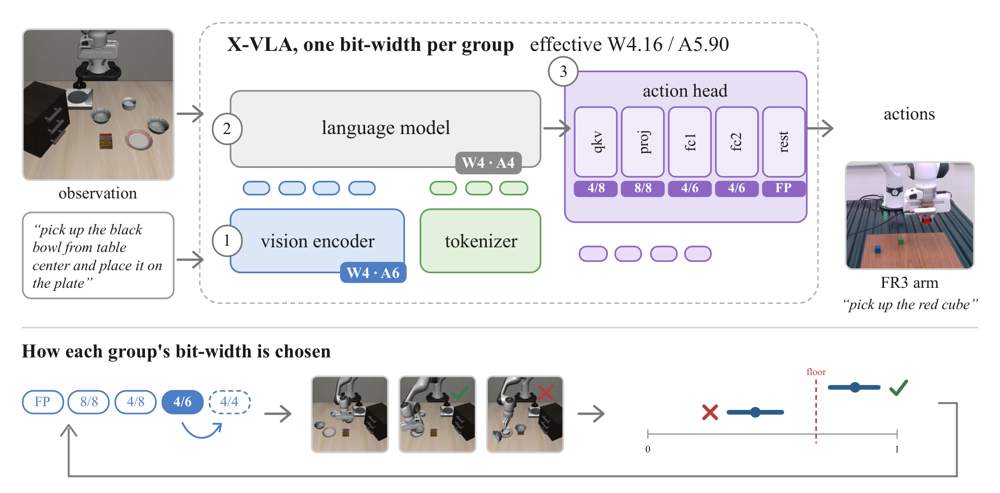
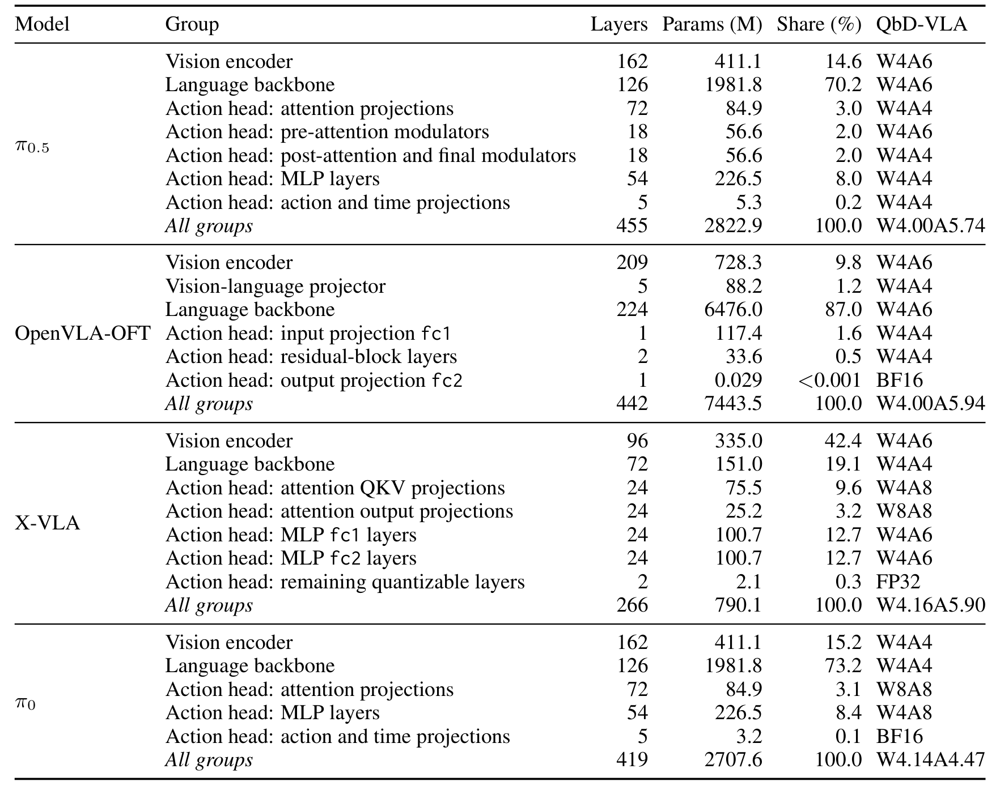
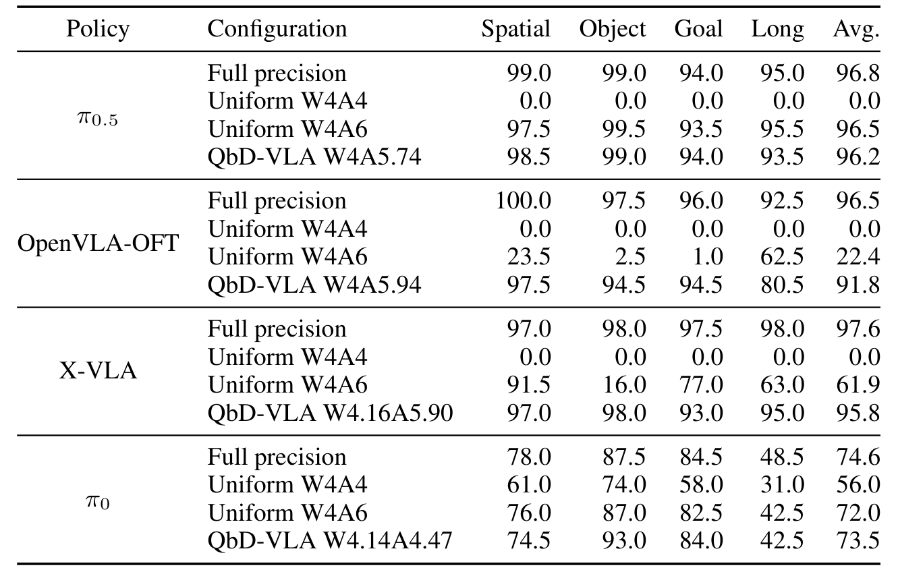
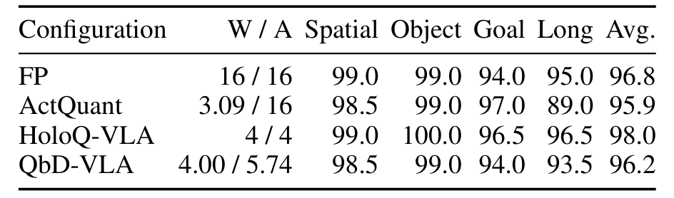
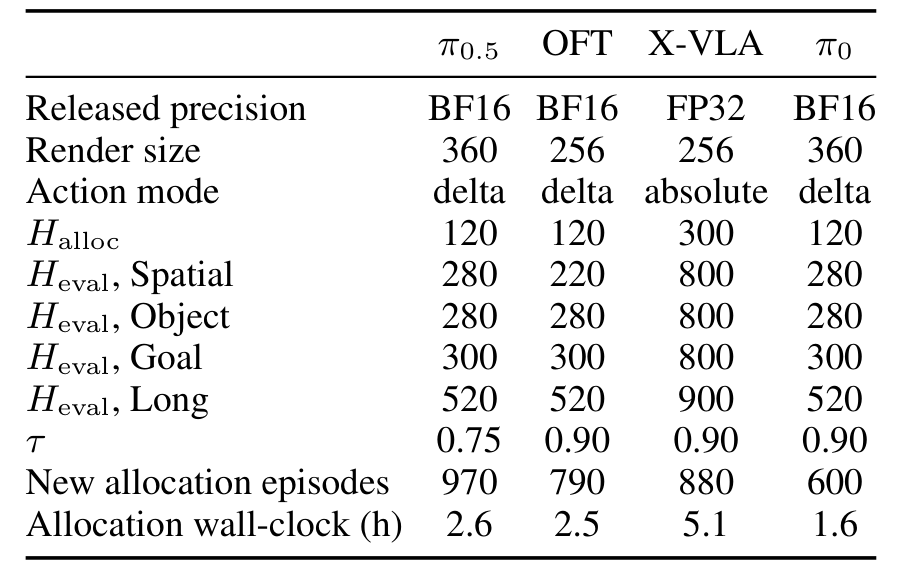
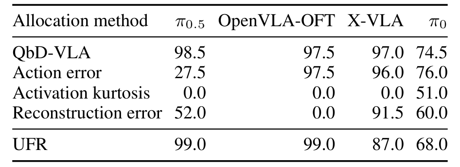
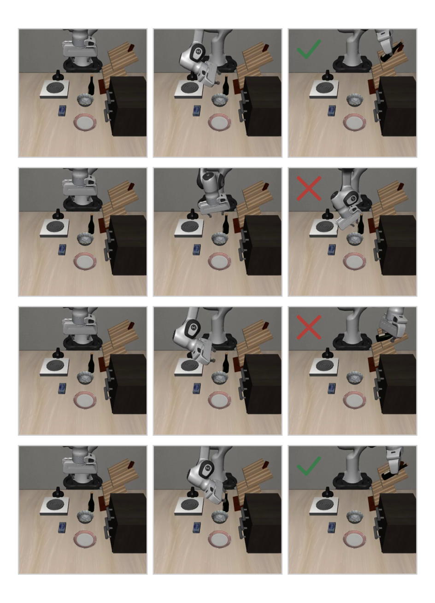
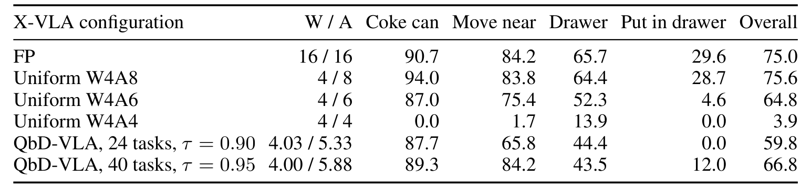
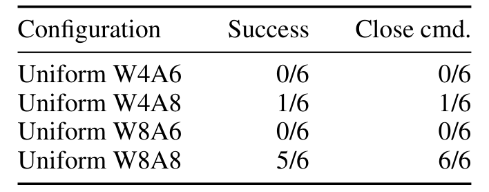

# Quantize by Doing: Task-Guided Mixed-Precision Quantization of Vision-Language-Action Models

QbD-VLA 的核心主张很朴素：量化哪一层该保留高精度，不该由校准集上的敏感度分数决定，而该由"降下去之后任务还能不能做成"决定。作者从全精度出发，每次只把一个层组降一档，在仿真里跑少量回合，用成功率的 Wilson 界决定接受还是拒绝。这样做的代价是需要闭环仿真器，收益是能把均匀 4 位直接归零的策略拉回可用区间。

作者与机构：论文未在提取文本中列出完整机构；2026-10-28 提交；[arXiv:2610.38661v1](https://arxiv.org/abs/2610.38661)；[代码](https://github.com/jiuyixu25/QbD-VLA)。

## 混合精度真正的难点是组合效应

现有方法通常用 Hessian、重建误差或固定输入上的动作偏差给每层打分，再按分数分配比特。这些分数便宜，但和闭环成功率并不一致；更关键的是，它们一次只看一个组，而量化一个组的代价取决于其他组已经在什么精度。论文给了一个很直观的例子：π0.5 动作头的两组单独量化时分别损失 1.0 与 5.5 个成功点，一起量化却损失 97.5 点。

这就解释了为什么"逐组敏感度相加"会失效：交互项可能远大于主效应。QbD-VLA 因此不在离线数据上打分，而是把"当前完整混合配置"拿去跑闭环，每次只改一个组。

## 用闭环成功率做逐组贪心搜索

配置 $c$ 为每个层组 $g$ 指定权重位宽 $w_g$ 与激活位宽 $a_g$。有效位宽按参数量加权：

$$W(c)=\frac{1}{N}\sum_{g=1}^{G}N_g w_g,\qquad A(c)=\frac{1}{N}\sum_{g=1}^{G}N_g a_g,\qquad C(c)=W(c)+A(c).$$

这里的 $C$ 是"名义精度成本"，不是实测显存或延迟；论文明确把它当作分配与比较的代理。可选档位是有序的：FP → W8A8 → W4A8 → W4A6 → W4A4。

每次评估用缩短的回合数 $H$，每批每个任务一个回合，第 $i$ 批用每个任务的第 $20+i$ 个初始状态，与最终评测用的 0–19 号状态不相交。候选 $c$ 的成功率估计为 $\hat s_H(c)=k_c/n_c$，接受阈值由全精度参考固定：

$$f=\tau\,\hat s_H(c_{\text{FP}}).$$

判定用 Wilson 界，且接受与拒绝采用不同的分位数：

$$L_{z_{\text{acc}}}(k_c,n_c)\ge f\ \Rightarrow\ \text{接受},\qquad U_{z_{\text{rej}}}(k_c,n_c)\le f\ \Rightarrow\ \text{拒绝}.$$

作者的解释是两类错误的代价不对称：误接受的配置后面还有最终评测兜底，误拒绝的组则永远从搜索路径上消失，所以拒绝需要更强的证据。若一批之后既不满足接受也不满足拒绝，就再跑一批，最多 $B$ 批；到上限仍无结论时按点估计是否超过阈值决定。

搜索从全精度开始，对当前配置生成所有"单组降一档"的候选，按成本下降从大到小评估，接受第一个通过判定者，然后重新生成候选。已经被拒绝的组在新配置下会重新变为可选——这正是为了捕捉"先降 A 组后 B 组才变得可降"的交互。最终不是取最后一个配置，而是取所有被接受配置中"成本最低、且单侧 Wilson 上界达到最高估计成功率"的那个：

$$c^\star\in\arg\min_{c\in P:\ U_{z_{\text{acc}}}(k_c,n_c)\ge s_{\max}} C(c).$$

*论文原图编号：Fig. 1。X-VLA 的每个层组使用一组权重/激活位宽；搜索从全精度逐档下降，只有成功率估计不低于下限的移动才被保留，最终分配原样部署到 FR3。*

*论文原图编号：Table 7。四个模型的层组、参数量、占比与 QbD-VLA 选出的位宽；动作头内部可以出现 W4A4 与 W8A8 并存。*

## LIBERO 主结果：把 0% 拉回可用区间

| 模型 | 全精度 | 均匀 W4A4 | 均匀 W4A6 | QbD-VLA（W/A） |
|---|---|---|---|---|
| π0.5 | 96.8 | 0.0 | 96.5 | 96.2（4.00/5.74） |
| OpenVLA-OFT | 96.5 | 0.0 | 22.4 | 91.8（4.00/5.94） |
| X-VLA | 97.6 | 0.0 | 61.9 | 95.8（4.16/5.90） |
| π0 | 74.6 | 56.0 | 72.0 | 73.5（4.14/4.47） |

*论文原图编号：Table 1。四个 VLA 在全精度、均匀 4 位与 QbD-VLA 分配下的成功率；QbD 分配在三个模型上把均匀 4 位的 0% 拉回 90% 以上。*

三个模型上均匀 W4A4 直接归零，QbD 分别回到 96.2、91.8、95.8。但表里还有两个不该被忽略的对照：π0.5 上 QbD 的 96.2 其实略低于均匀 W4A6 的 96.5；π0 上均匀 W4A4 本来就有 56.0，QbD 只比全精度低 1.1 点。换句话说，"救回 0%"是真实收益，但不是所有模型都需要这套搜索。

OpenVLA-OFT 是退化最大的一个：平均 91.8 对 96.5，Long 套件从 92.5 掉到 80.5。这也是论文没有回避的代价。

*论文原图编号：Table 2。π0.5 上 FP、ActQuant、HoloQ-VLA 与 QbD-VLA 的对照；HoloQ-VLA 以 4/4 达到 98.0%，高于 QbD 的 96.2%。*

HoloQ-VLA 这一行很关键：它用 4/4 的均匀精度达到 98.0%，比 QbD 更高。这说明"均匀 4 位一定崩"只对部分模型成立；对不同量化器与不同模型，任务成功率搜索未必是最优解。

*论文原图编号：Table 8。四个模型的发布精度、渲染尺寸、动作模式、分配与评测回合数、以及分配耗时；每次分配约 1.6 到 5.1 小时。*

## 敏感性分配为什么失败

同成本下，作者把 QbD 与三种敏感度分配放在一起比。在 π0.5 上，动作误差分配只有 27.5%，激活峰度 0.0%，重建误差 52.0%，而 QbD 是 98.5%。这不是"敏感度分数略有偏差"，而是完全选错了组。

*论文原图编号：Table 3。四种分配方法在四个模型上的 LIBERO-Spatial 成功率；敏感性分配在 π0.5 上几乎全部失效。*

原因在因子实验里：π0.5 动作专家 MLP 从 A6 降到 A4，其他三组在 A6 时损失 23.5 点，其他三组在 A4 时只损失 0.5 点。同一个组、同一档位，代价相差 47 倍，取决于邻居的精度。任何"逐组独立打分再排序"的方法都无法表达这种条件依赖。

*论文原图编号：Fig. 2。π0.5 在同一任务上的四组 rollout；成功与失败的分叉往往出现在接触与放置阶段，而不是动作序列的开头。*

## SIMPLER 与真机：模拟成功不等于硬件可用

SIMPLER 是这篇文章最诚实的部分。搜索在 variant-aggregation 划分上做，评测在不相交的 visual-matching 划分上做：

| X-VLA 配置 | W/A | 可乐罐 | 靠近 | 抽屉 | 放入抽屉 | 总体 |
|---|---|---|---|---|---|---|
| FP | 16/16 | 90.7 | 84.2 | 65.7 | 29.6 | 75.0 |
| 均匀 W4A8 | 4/8 | 94.0 | 83.8 | 64.4 | 28.7 | 75.6 |
| 均匀 W4A6 | 4/6 | 87.0 | 75.4 | 52.3 | 4.6 | 64.8 |
| QbD（40 任务） | 4.00/5.88 | 89.3 | 84.2 | 43.5 | 12.0 | 66.8 |

*论文原图编号：Table 4。SIMPLER visual-matching 划分上各配置的分任务族成功率；QbD 比均匀 W4A6 高 2 点，但比均匀 W4A8 低近 9 点。*

QbD 只比均匀 W4A6 高 2.0 点，远低于均匀 W4A8。作者归因于搜索分布：抽屉类失败只在 visual-matching 划分出现，搜索时看不到。这是一个典型的"选分配时用的分布 ≠ 部署分布"问题，也说明任务成功率准则本身不能弥补搜索覆盖的缺口。

真机更直接。用同一批 411 条 FR3 抓取示教分别 LoRA 微调 X-VLA 与 π0.5，冻结仿真选出的分配：

| 策略 | 配置 | 成功 | 夹爪闭合指令 |
|---|---|---|---|
| X-VLA | 全精度 | 11/30 | 28/30 |
| X-VLA | QbD-VLA | 13/30 | 29/30 |
| π0.5 | 全精度 | 6/6 | 6/6 |
| π0.5 | QbD-VLA | 0/6 | 0/6 |

π0.5 的分配从未发出夹爪闭合指令，每次试验的峰值输出都低于 0.5。后续的均匀精度诊断显示，W8A8 能恢复到 5/6，W4A8 只有 1/6，W4A6 与 W8A6 都是 0/6。也就是说，问题更像是比特预算不足，而不是分配算法选错了组；但同一个分配在 X-VLA 上却略优于全精度，说明这种失败是策略相关的。

*论文原图编号：Table 6。π0.5 在 FR3 上的四组均匀精度结果；只有 W8A8 恢复到 5/6。*

这张表是全文最有价值的负面证据：LIBERO-Spatial 上 98.5% 的分配，在真机上可以一次都夹不起来。仿真成功率与真机可用性之间没有可替代关系。

## 这套分配方法的边界

第一，搜索是贪心的，只沿当前路径评估候选，不保证全局最优；已被拒绝的组虽然会在新配置下重试，但搜索不会回头枚举其他分支。第二，分配空间固定为预定义层组与五档位宽，量化器固定为无校准的 RTN；换分组、换量化器，结论可能不同。第三，成本不低：每次分配 600–970 个仿真回合、1.6–5.1 小时；没有仿真器的任务无法使用。第四，最终评测每配置 200 回合，1–2 点差异落在采样噪声内，而序贯检验只控制单个候选决策，不控制整条搜索的联合误差。

我的判断是：这篇论文最值得带走的是"在闭环里做比特分配"这个范式，以及"接受宽松、拒绝严格"的非对称检验——它把误拒不可恢复的代价写进了统计规则。但它也清楚地展示了这个范式的两个硬约束：搜索分布必须覆盖部署分布，仿真成功必须在目标机器人上复测。π0.5 的 0/6 不是一个小瑕疵，而是对整个"仿真选型即可部署"假设的反例。
