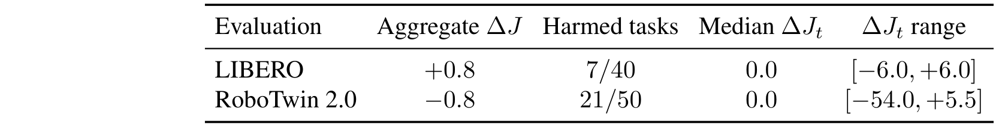
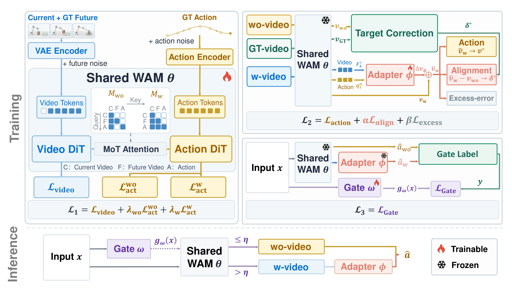
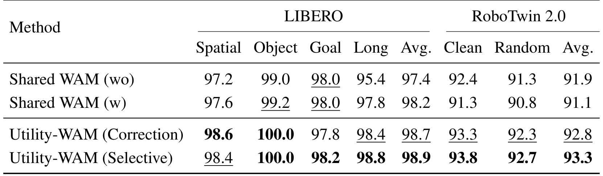
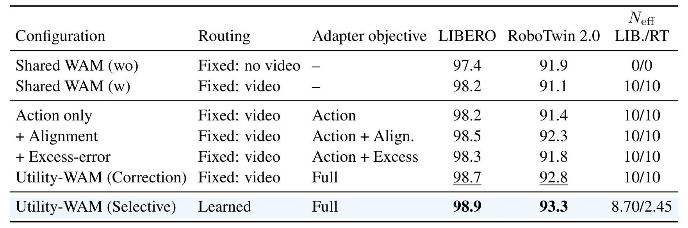
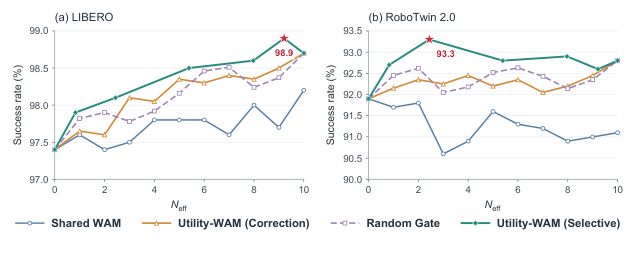
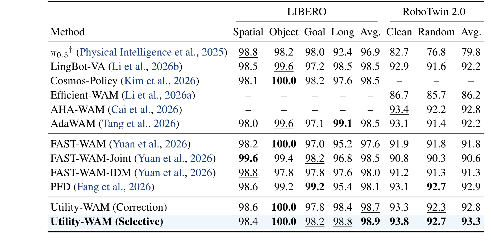
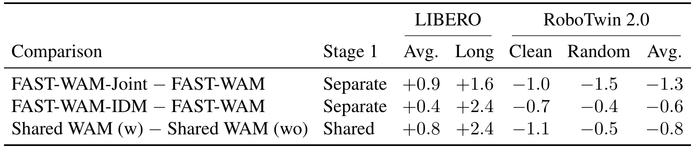
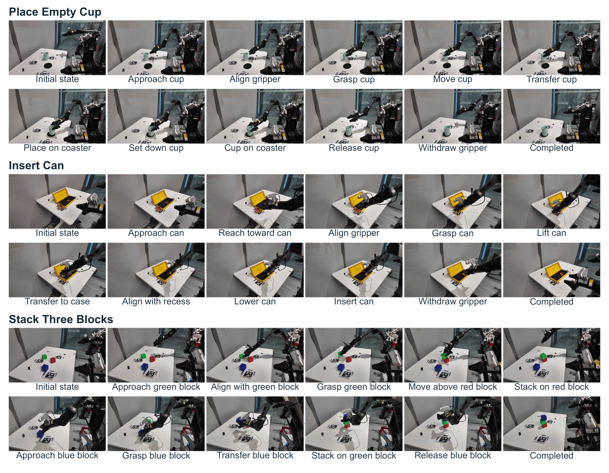

# Utility-WAM: Correcting Future-Induced Action Changes

这篇论文问的不是"要不要让世界动作模型生成未来"，而是一个更细的问题：生成出来的未来，究竟把动作改了多少，这些改动是帮忙还是添乱。作者把未来条件路径与同检查点的无未来路径配成一对，用两者的动作差 $\Delta a$ 作为研究对象，发现平均值几乎不动，但两个精度任务出现 30 到 54 点的崩塌。Utility-WAM 的做法是先修这个动作差，再用配对结果学一个门决定这次要不要真的生成视频。

作者与机构：Zihao Liang、Yinuo Wang、Zhaowen Li 等，华为；2026-10-29 提交；[arXiv:2610.39367v1](https://arxiv.org/abs/2610.39367)。本次未确认公开代码或项目页。

## 未来条件到底改变了什么

设当前观测、指令与本体状态为 $x=(o,c,s)$，动作块为 $a_{1:H}$，未来视频为 $V$。共享 WAM 用流匹配同时建模视频与动作词元；两条动作路径共享全部参数，只靠注意力掩码区分：$\pi_{wo}$ 阻止动作看到未来视频，$\pi_{w}$ 允许。对任意配置 $\pi$，论文用闭环成功率相对无未来路径的变化来定义影响：

$$\Delta J_{\mathcal D}(\pi)=J_{\mathcal D}(\pi)-J_{\mathcal D}(\pi_{wo}).$$

未来导致的负迁移就是 $\Delta J_{\mathcal D}(\pi_w)<0$。这个定义的关键在于"同参数、同数据、同初始状态"——它把"未来"当成唯一的额外信息源，而不是拿两个独立训练的模型比较。

单条查询上的对应量是两条分支的动作差。两条分支共享初始动作噪声，各自走 $N$ 步 Euler 更新，于是

$$\Delta a=\hat a_w-\hat a_{wo}=\sum_{i=0}^{N-1}\Delta_i\left(\hat v_{w,i}-v_{wo,i}\right),$$

其中 $\Delta_i$ 是第 $i$ 步的步长，两个速度各自沿自己的轨迹演化。训练时两条分支都跑，推理时只跑被选中的那条。

## 负迁移集中在两个精度任务上

聚合数字确实很平：LIBERO 平均从 97.4 升到 98.2（+0.8），RoboTwin 2.0 从 91.9 降到 91.1（-0.8）。但把 50 个任务逐个拆开，RoboTwin 有 21 个任务变差，中位数是 0，范围却从 -54.0 拉到 +5.5。

| 评测 | 聚合 $\Delta J$ | 受害任务 | $\Delta J_t$ 中位数 | $\Delta J_t$ 范围 |
|---|---|---|---|---|
| LIBERO | +0.8 | 7/40 | 0.0 | [-6.0, +6.0] |
| RoboTwin 2.0 | -0.8 | 21/50 | 0.0 | [-54.0, +5.5] |

*论文原图编号：Table 1。两项基准上未来条件带来的任务级成功率变化；聚合值接近零，但 RoboTwin 的尾部到 -54.0。*

真正吃掉性能的是 Press Stapler（-54.0）与 Place Can Basket（-34.0）：其余 19 个受害任务每个最多掉 2.5 点。这两个任务在 FAST-WAM 的 Joint 与 IDM 变体里也排进最受损的前三，说明它不是某一个训练配置的偶然。作者由此把修正目标锁定在这两个任务上，而不是追求全任务均匀提升。

## 冻结 WAM，先修速度再决定要不要想象

### 从速度差到"这次修正值多少"

给定专家残差 $r_a^*=a_{1:H}-\hat a_{wo}$，动作差 $\Delta a$ 的效用可以用配对动作误差的改善来衡量：

$$u_{\text{act}}=\ell(\hat a_{wo},a_{1:H})-\ell(\hat a_w,a_{1:H})=\underbrace{2\langle r_a^*,\Delta a\rangle}_{\text{对齐}}-\underbrace{\|\Delta a\|^2}_{\text{幅度}}.$$

这个式子说明两件事：动作差的方向要与专家残差一致才有正收益；幅度过大会被二次项惩罚。接近零的 $\Delta a$ 效用约为零，方向错的 $\Delta a$ 直接为负。适配器要学的就是同时控制方向与幅度。

### 三项损失与门控

适配器挂在冻结的共享 WAM 上，输入是动作查询与第 $k$ 次视频更新后的池化未来特征 $F_k^+$，输出一个残差：

$$\hat v_w=v_w+\Delta v_\phi\left(q_\tau^a,F_k^+\right).$$

监督信号来自同一冻结 WAM 在三种条件下的速度：无未来 $v_{wo}$、预测未来 $v_w$、加噪真值未来 $v_{GT}$。当真值未来确实比无未来更好（相对 margin $\rho=0.05$）时，目标修正取 $\delta^*=v_{GT}-v_{wo}$，否则取零：

$$\delta^*=\begin{cases}v_{GT}-v_{wo}, & d(v_{GT},v^*)<(1-\rho)\,d(v_{wo},v^*)\\ 0,&\text{otherwise}\end{cases}$$

适配器的损失由三项组成：

$$\mathcal L_2=\mathbb E\left[w(\tau)\,d(\hat v_w,v^*)+\alpha\,d(\hat v_w-v_{wo},\delta^*)+\beta\max\{d(\hat v_w,v^*)-\ d(v_{wo},v^*),0\}\right].$$

第一项拟合专家动作速度，第二项把"相对无未来路径的偏移"拉向真值未来支持的偏移，第三项是过误差惩罚：只要适配器后的局部误差超过无未来基线，就线性罚。这个设计的好处是当未来没有增益时 $\delta^*$ 自动为零，适配器会退回无未来路径，而不是强行模仿一个不可靠的预测。

第三阶段训练门控。标签是 $y=\mathbf 1[u_{\text{act}}>0]$，用适配器修正后的 $\Delta a$ 计算；门控只看当前输入 $x$，因此可以在视频生成之前执行。推理时若 $g_\omega(x)>\eta$ 就生成未来并走修正路径，否则直接走无未来路径、跳过视频计算。

*论文原图编号：Fig. 1。Stage 1 用两种注意力掩码训练共享 WAM；Stage 2 冻结 WAM、用真值未来支持的速度差训练适配器；Stage 3 用配对端点结果训练门控；推理时门控先于视频生成执行。*

## 主结果与逐项消融

| 方法 | LIBERO Avg. | RoboTwin Clean | RoboTwin Random | RoboTwin Avg. |
|---|---|---|---|---|
| Shared WAM (wo) | 97.4 | 92.4 | 91.3 | 91.9 |
| Shared WAM (w) | 98.2 | 91.3 | 90.8 | 91.1 |
| Utility-WAM (Correction) | 98.7 | 93.3 | 92.3 | 92.8 |
| Utility-WAM (Selective) | **98.9** | **93.8** | **92.7** | **93.3** |

*论文原图编号：Table 2。同一 Stage-1 检查点下四条路径的成功率；Correction 始终生成未来，Selective 额外加门控。*

修正把 RoboTwin 从 91.1 拉回 92.8，两个严重任务的损失从 54.0/34.0 收窄到 6.0/14.0，贡献了 1.7 点总增益中的 1.36 点（80%）；其余 48 个任务平均还涨 0.35 点，LIBERO-Long 保持在 98.4（无未来路径是 95.4）。这正是作者想要的形态：收益集中在原本受损的地方，长程收益不被牺牲。

逐项消融更值得看：

| 配置 | LIBERO | RoboTwin 2.0 |
|---|---|---|
| Action only | 98.2 | 91.4 |
| + Alignment | 98.5 | 92.3 |
| + Excess-error | 98.3 | 91.8 |
| Correction（两项都加） | 98.7 | 92.8 |

*论文原图编号：Table 3。相同评测回合与随机种子下，对齐项、过误差项与门控的逐级贡献。*

单独加过误差项反而低于只加对齐项（91.8 对 92.3），说明它不是独立的正则，而是给对齐项踩刹车的非对称约束；两项合用才到 92.8。只看主结果很容易把"三项损失"当成一个整体功劳，这张表把它拆开了。

## 选择性想象省下了多少算力

门控阈值在验证集上固定为 $\eta=0.439$（LIBERO）与 $0.541$（RoboTwin），测试时不再调整。在 RoboTwin 上只有 24.5% 的查询真的生成视频（$N_{\text{eff}}=2.45$），平均成功率反而从 92.8 升到 93.3，延迟相对始终生成降 38%；在 LIBERO 上未来平均有用，门控保留 87% 的查询，只省 6.7%。

*论文原图编号：Fig. 2。成功率随平均视频生成步数 $N_{\text{eff}}$ 的变化；红星为验证集校准的工作点，曲线为阈值扫描。*

这张图真正的信息是曲线位置：在每个中间预算上，学习到的门控都高于"固定截断前 $n$ 步"与"以概率随机路由"两条算力匹配基线。随机路由在 LIBERO 最高 98.4%、RoboTwin 最高 92.6%，都低于门控工作点。也就是说，收益不只是"少算"，而是"算在值得的地方"。

## 与已报告方法和真机的对照

Table 4 把 Utility-WAM 与 π0.5、LingBot-VA、Cosmos-Policy、AdaWAM、FAST-WAM 及其 Joint/IDM 变体、PFD 放在一起。Selective 的 LIBERO 平均 98.9、RoboTwin 平均 93.3，高于表中所有已报告值；Correction 单独也已有 98.7 与 92.8，后者只比最好的 PFD 低 0.1 点。跨论文比较毕竟不是同一训练管线，作者把 FAST-WAM 作为主要参照，因为数据与评测流程一致。

*论文原图编号：Table 4。LIBERO 与 RoboTwin 2.0 上各方法的已报告成功率；† 表示原论文未报告。*

符号反转不是单个检查点的偶然。Table 7 用三组独立训练的对照复现了同一模式：FAST-WAM-Joint 相对 FAST-WAM 在 LIBERO 平均 +0.9、长程 +1.6，但在 RoboTwin 平均 -1.3；IDM 变体是 +0.4/+2.4 与 -0.6；共享检查点的 w 对 wo 是 +0.8/+2.4 与 -0.8。三组都呈现"长程受益、RoboTwin 受损"。

*论文原图编号：Table 7。三组独立训练对照的 $\Delta J$；未来条件在 LIBERO 上为正、在 RoboTwin 上为负的模式重复出现。*

真机用两台 AgileX PiPER、三个 RGB 视角，三个任务各 200 条遥操作示教、各 20 次试验。Selective 成功 53/60（88.3%），FAST-WAM 43/60（71.7%），提升 16.7 点，未调整的两侧 95% Newcombe 区间为 [2.3, 30.4]。Place Empty Cup 两者打平（18/20），增益来自 Insert Can（+4，需要把罐子对准凹槽）与 Stack Three Blocks（+6，最长程的多阶段任务）。这与仿真里"未来在长程任务上最有价值"的判断一致。

*论文原图编号：Fig. 4。三个真机任务的执行序列；Insert Can 与 Stack Three Blocks 是 Selective 相对 FAST-WAM 的主要增益来源。*

## 这套修正能推广到哪里

最硬的限制是所有受控比较共享同一个 Stage-1 检查点。作者在局限里明确承认，5B 扩散骨干的预训练成本使他们无法重训多个骨干，独立重训之间的方差没有被刻画。对读者来说，这意味着"负迁移集中在这两个任务"目前是一个检查点上的强证据，而不是跨模型分布的定律。

第二是门控标签。$u_{\text{act}}$ 是离线动作误差代理，不是闭环任务回报；阈值在验证集上按数据集单独校准。换一个基准或换一套相机配置，需要重新标定 $\eta$，否则 24.5% 这个工作点不一定成立。

第三是统计粒度。任务级统计只在 RoboTwin 的 50 个任务上完整给出，LIBERO 只报告了 7/40 受害任务的聚合；真机每组 20 次、三个任务，置信区间下界只有 2.3 点。这些都不妨碍"修正是有效的"这个结论，但不足以支撑"对任意精度任务都有效"。

我的判断是：这篇论文最可复用的不是适配器结构，而是"用同检查点的两条掩码路径构造反事实"这个实验范式。它让"某个条件到底带来什么"变成一个可以逐任务测量、可以用配对标签学习的量。适配器只是把这个量用起来的第一种方式；把 $u_{\text{act}}$ 换成闭环回报、把门控换成在线策略，都是自然的下一步。
