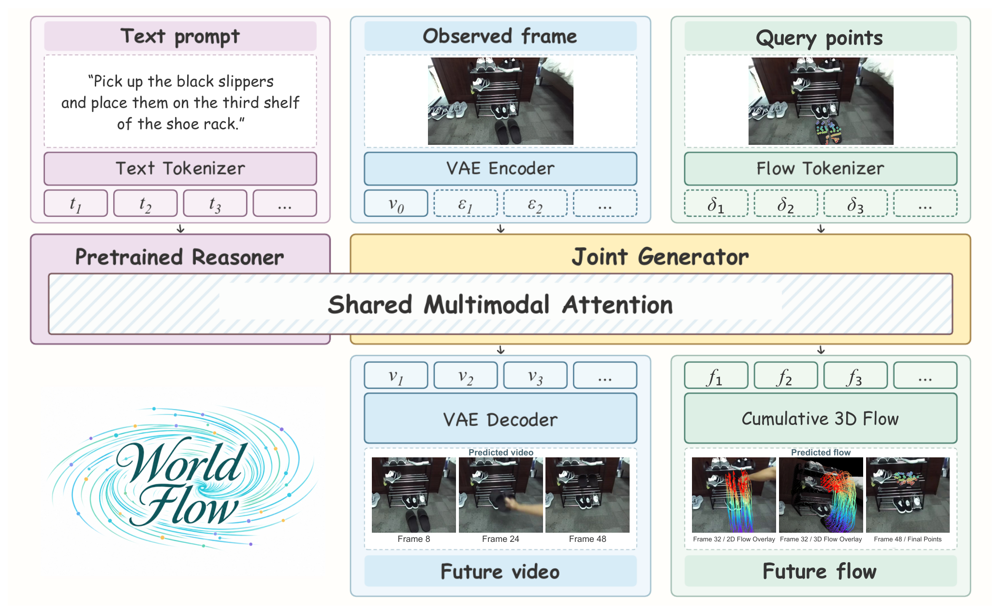
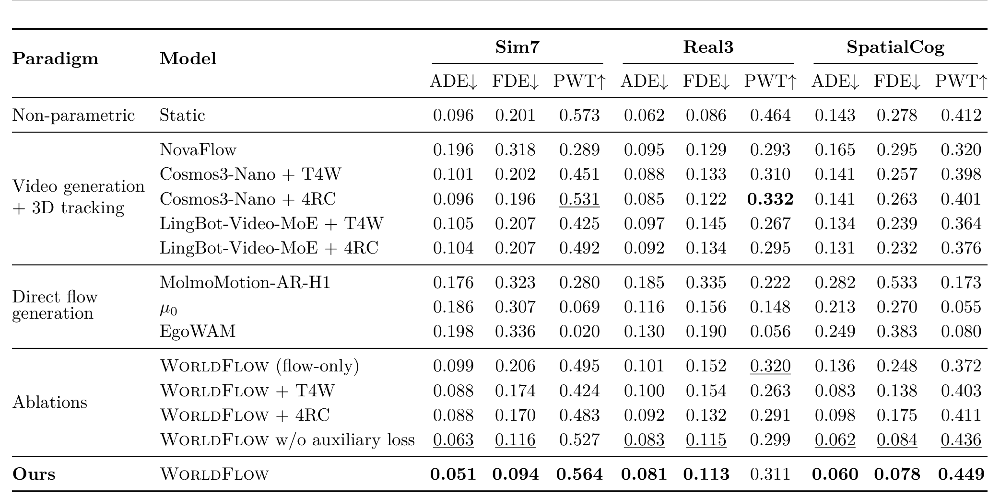
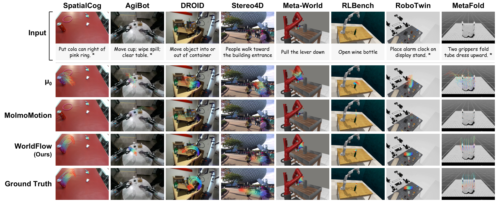

# WorldFlow: Joint Video and 3D Motion Prediction via Large-Scale Pretraining

WorldFlow 想解决的是一个很具体的接口问题：如果世界模型只生成像素，机器人拿不到可以直接用于规划的几何量；如果只预测 3D 轨迹，又缺少稠密视觉信号来约束物理合理性。论文的做法是把两者放进同一个去噪过程——给定一帧观测、一句指令和一组 3D 查询点，模型同时生成未来视频与这些查询点的逐帧 3D 位移，再把位移累加成米制轨迹。理解这条主线之后，后面的数据工程、时空对齐和消融才有位置。

作者与机构：Yuhao Lu、Jiongxu Chen 等，RoboScience 与新加坡国立大学；2026-10-29 提交；[arXiv:2610.39278v1](https://arxiv.org/abs/2610.39278)；[项目页](https://worldflow-rbs.github.io/)；[代码](https://github.com/worldflow-rbs/worldflow)。

## 从像素未来到可执行的 3D 运动

现有工作大致分三支。视频世界模型能生成越来越连贯的未来画面，但 3D 动力学藏在像素里，必须再做重建或跟踪才能变成动作参考。世界动作模型把动作空间写进预测，可动作标注昂贵，且动作表示往往绑定具体本体，跨平台迁移困难。直接 3D 流预测则绕开视频，但已有方法要么预测粗网格上的稀疏场景流，把容量浪费在与任务无关的区域，要么只用 flow 监督，学习信号偏窄。

论文选择的折中是以查询点为条件的位移：只对任务相关的 3D 点分配运动词元，同时把整幅画面作为上下文。这样既避免稠密场景流的计算开销，又保留全局视觉信息。真正的难点有两个：高质量 3D 轨迹标注很贵；只监督 flow 不足以让模型学到可泛化的物理动力学。把视频生成拉进来，正是为了给几何预测增加一路稠密监督。

## 把 3D 位移做成寄生在视频网格上的词元

设观测帧为 $I_0$，语言指令为 $c$，查询点为 $Q=\{p_{0,i}\}_{i=1}^{N}$，它们在初始帧的像素坐标为 $S_0=\{s_{0,i}\}$。所有 3D 坐标都表达在初始相机坐标系下。第 $t$ 帧第 $i$ 个点的位移定义为

$$f_{t,i}=p_{t,i}-p_{t-1,i},\qquad t=1,\dots,T,$$

轨迹由累加恢复：

$$p_{t,i}=p_{0,i}+\sum_{\tau=1}^{t} f_{\tau,i}.$$

模型要建模的是条件联合分布

$$p_\theta\left(I_{1:T},\,f_{1:T}\mid I_0,\,Q,\,S_0,\,c\right).$$

这组定义看似平常，却决定了后面所有设计：预测目标不是绝对坐标，而是逐帧位移；绝对位置只作为初始条件进入几何编码。这样不同域的运动尺度可以通过一个标量归一化，而轨迹的累积误差则交给辅助损失去约束。

### 位移归一化与几何编码

不同数据源的物理尺度差异很大，直接用米制位移混合训练会让大幅运动主导梯度。论文为每个域估计一个固定标量 $a_d>0$，把位移压到统一量级：

$$\bar f_{t,i}=\frac{f_{t,i}}{a_d}.$$

查询点的初始几何用两个并行编码器处理：一个编码绝对位置，一个编码相对查询集质心 $\mu$ 的位置，再拼接后过 MLP：

$$e^{3D}=\mathrm{MLP}\left(\left[E_{\text{abs}}(p_{0,i});\,E_{\text{rel}}(p_{0,i}-\mu)\right]\right).$$

绝对项保留点在场景中的位置，相对项保留同一组查询点之间的构型。二者缺一，模型要么分不清物体在房间里的哪一侧，要么在多物体场景里失去局部几何关系。

### 时空对齐：让几何词元落在正确的图像 patch 上

这是整篇论文最值得复用的设计。位移词元不是独立序列，而是被赋予与视频词元相同的旋转位置编码坐标。第 $t$ 帧、第 $i$ 个点的位置坐标为

$$r_{t,i}=\left(\frac{t}{q_t},\,\frac{v_{0,i}}{q_s p_s},\,\frac{u_{0,i}}{q_s p_s}\right),$$

其中 $(u_{0,i},v_{0,i})=s_{0,i}$ 是初始像素坐标，$q_t,q_s$ 是 VAE 的时间与空间压缩因子，$p_s$ 是 latent patch 大小。注意力里的查询向量与键向量分别做旋转：

$$\tilde q_{t,i}=R(r_{t,i})\,q_{t,i},\qquad \tilde k_{t,i}=R(r_{t,i})\,k_{t,i}.$$

直观地说，每个几何词元都"钉"在它所属的未来帧和初始图像 patch 上。视频词元与几何词元因此在同一坐标系里计算相对位置，跨模态注意力不需要额外学习一张对齐表。对做 3D 预测的读者，这个技巧可以直接迁移到点云、光流或触觉阵列等任何需要与图像网格对齐的模态。

*论文原图编号：Fig. 2。文本经预训练 reasoner 编码，观测帧经 VAE 编码为 clean latent，查询点位移经 Flow Tokenizer 与几何编码进入共享多模态注意力；生成端同时解码未来视频与累积 3D flow。*

## 一次去噪里同时生成视频与运动

生成器建立在 Cosmos-Nano 之上，保留预训练 reasoner 处理语言，视频 VAE 编码观测帧，flow tokenizer 嵌入带噪位移。词元构造为

$$h^{(\sigma)}_{t,i}=\mathrm{Linear}\left(\bar f^{(\sigma)}_{t,i}\right)+e^{3D}+e_{\text{cond}}(\sigma),$$

其中 $\sigma$ 是去噪噪声水平，与物理帧索引 $t$ 无关；$e_{\text{cond}}$ 合并模态嵌入与噪声水平嵌入。视频与几何词元在 Mixture-of-Transformers 中通过全注意力互相可见，并共同 attend 到 reasoner 的因果上下文。推理时两路都从噪声初始化，联合去噪，最后由 VAE 解码视频、由位移累加恢复轨迹。整个过程没有单独的跟踪阶段。

### 联合整流流

训练目标是加权整流流：

$$\mathcal L_{\text{FM}}=\lambda_{\text{video}}\mathcal L_{\text{video}}+\lambda_{\text{flow}}\mathcal L_{\text{flow}}.$$

两模态共享每个样本的噪声水平，联合去噪，但损失分别计算，并把条件位置排除在监督之外。这里"共享噪声水平"不是实现细节，而是让两路在同一噪声尺度上对话的前提：如果视频与几何各自采样噪声，共享注意力看到的两个模态就处在不同的信噪比阶段，联合去噪会退化成两个独立任务的拼接。

### 三项辅助损失

只有向量场监督时，模型只需在局部把速度场拟合对，累积轨迹仍可能整体偏转。论文因此从预测速度场重建 clean flow，再在重建结果上加三项约束：逐帧位移误差、累积位移方向误差、相对端点误差。

$$\mathcal L=\mathcal L_{\text{FM}}+\lambda_{\text{dir}}\mathcal L_{\text{dir}}+\lambda_{\text{vmag}}\mathcal L_{\text{vmag}}+\lambda_{\text{end}}\mathcal L_{\text{end}}.$$

方向项用余弦距离，并按真实累积位移的模长加权，避免几乎静止的点主导；端点项用相对误差，且只让净位移超过阈值 $\delta=0.1$ 的点参与，防止"回到起点"的轨迹产生不稳定分母。所有辅助项都在归一化坐标下计算，并按 $1-\sigma$ 加权，让低噪声样本承担更多轨迹级约束。实现上这只改变训练损失，不改变推理路径，因此是一个低风险的增量。

## WorldFlowBench 主结果与两组关键消融

训练语料约 144 万个对象级样本，标准化后为 1,438,379 个片段、约 1,223.6 小时（49 帧、16 FPS），包含 9,205 万个点轨迹与 44.2 亿个 3D 位移向量。来源分四组：Sim7 合并七个仿真数据集；Real3 由 AgiBot World、EPIC-KITCHENS 与 Something-Something V2 组成；SpatialCog 是自采的桌面与家居交互数据；MolmoMotion-1M 复用已发布的运动标注。Sim7 与 Real3 的轨迹由 Track4World 提取，说明文字由 Gemini-2.5 Pro 生成；SpatialCog 用人工说明文字配 Track4World 轨迹。

评测集 WorldFlowBench 共 1,678 个样本：Sim7 396、Real3 882、SpatialCog 400，全部从训练中排除。指标是米制平均位移误差 ADE、末帧位移误差 FDE，以及 1/2/5 cm 三阈值平均命中率 PWT。

### 主结果

| 方法 | Sim7 ADE / FDE / PWT | Real3 ADE / FDE / PWT | SpatialCog ADE / FDE / PWT |
|---|---|---|---|
| Static（参考） | 0.096 / 0.201 / 0.573 | 0.062 / 0.086 / 0.464 | 0.143 / 0.278 / 0.412 |
| Cosmos3-Nano + 4RC | 0.096 / 0.196 / 0.531 | 0.085 / 0.122 / **0.332** | 0.141 / 0.263 / 0.401 |
| LingBot-Video-MoE + 4RC | 0.104 / 0.207 / 0.492 | 0.092 / 0.134 / 0.295 | 0.131 / 0.232 / 0.376 |
| MolmoMotion-AR-H1 | 0.176 / 0.323 / 0.280 | 0.185 / 0.335 / 0.222 | 0.282 / 0.533 / 0.173 |
| WorldFlow（flow-only） | 0.099 / 0.206 / 0.495 | 0.101 / 0.152 / 0.320 | 0.136 / 0.248 / 0.372 |
| WorldFlow w/o 辅助损失 | 0.063 / 0.116 / 0.527 | 0.083 / 0.115 / 0.299 | 0.062 / 0.084 / 0.436 |
| **WorldFlow** | **0.051 / 0.094 / 0.564** | **0.081 / 0.113 / 0.311** | **0.060 / 0.078 / 0.449** |

WorldFlow 在三套集上都是学习类方法里 ADE 与 FDE 最低的。相对各集最强外部基线，ADE 在 Sim7 降 46.9%、Real3 降 4.7%、SpatialCog 降 54.2%。但 Real3 的领先幅度只有 4.7%，PWT 还低于 Cosmos3-Nano+4RC 的 0.332；真实域的多尺度与标注噪声显然没有被完全解决。这一点比"SOTA"标签更值得记住。

*论文原图编号：Table 1。三套评测集上各方法的 ADE、FDE 与 PWT；粗体与下划线标出非静态方法中的最好与次好结果。*

### 视频监督到底贡献了什么

flow-only 变体使用同一骨干、同一数据与同一优化配方，只去掉视频生成。完整模型把 ADE 从 0.099 降到 0.051（Sim7）、从 0.101 降到 0.081（Real3）、从 0.136 降到 0.060（SpatialCog），对应降幅 48.5%、19.8%、55.9%；SpatialCog 的 FDE 从 0.248 降到 0.078，降幅 68.5%。这说明视频分支不是"顺便多生成一个模态"，而是实质性地约束了几何预测。

需要保留的疑问是：这个对照没有匹配算力。联合模型多了一个模态的解码路径，参数量与训练计算都更大；论文没有给出"同等算力只训 flow"的对照，因此不能把全部增益归因于视觉常识。更稳妥的解读是：稠密视觉监督在这套数据规模下是一路有效的正则信号。

### 直接生成与事后跟踪

第二组对照更能说明接口选择的价值。作者用同一个 WorldFlow 检查点生成视频，再用 Track4World 或 4RC 从生成像素里恢复轨迹，与直接生成的 flow 比较。结果直接生成在三套集上都更低：SpatialCog 上 ADE 0.060 对 0.083（Track4World）与 0.098（4RC）。这隔离了"生成质量"与"跟踪误差"两个因素，说明把 3D 运动作为生成目标，比生成后再反解更不容易累积误差。

*论文原图编号：Fig. 3。SpatialCog、AgiBot、DROID、Stereo4D、Meta-World、RLBench、RoboTwin 与 MetaFold 八个场景上，µ0、MolmoMotion 与 WorldFlow 的预测轨迹对比；轨迹被投影回输入帧。*

## 真机操作：只换预测器，管线不变

真机实验用 7 自由度 xArm、XHand 灵巧手与 ZED Mini RGB-D。给定 RGB-D 与指令，先用 Qwen3.8-27B 定位目标物体并取 mask，结合深度反投影得到查询点；WorldFlow 预测物体轨迹；T(R,O) Grasp 生成初始抓取位姿；最后按 Dream2Flow 的做法，用局部刚体拟合把预测轨迹转成机械臂轨迹。也就是说，WorldFlow 只负责"物体该怎么动"，抓取与控制由现成模块承担。

12 个任务覆盖 pick-and-place、stacking 与 relative placement，每个任务 3 次随机初始布局，共 36 次执行。作者把"flow 预测是否合理"与"机器人是否完成任务"分开计分：WorldFlow 的 flow 预测成功 35/36（97.2%）、执行成功 24/36（66.7%）；µ0 为 9/36（25.0%）与 4/36（11.1%）。配对试验只替换 flow predictor，初始布局、指令、抓取结果与控制参数都保持一致。

这组数字同时说明了两件事。第一，预测质量的差距确实能传导到执行：执行成功率从 11.1% 提到 66.7%。第二，预测到执行之间仍有 30.5 个百分点的落差，抓取失败、轨迹优化失败与堆叠时的放置不稳都会吞掉收益。论文没有报告每个失败案例的归因比例，也没有与端到端 VLA 策略或人类示教比较，因此这更像"预测器是有效组件"的证据，而不是"这套管线已经可用"的结论。

## 这套表示能走多远

最直接的边界是查询点。训练与推理都需要预先给定 3D 点，论文的流程是从目标 mask 与深度反投影得到；自动选点被列为未来工作。这意味着系统仍依赖一个可靠的分割与深度前端，前端错了，后面的轨迹预测再准也没有意义。

第二层边界在监督。Sim7 与 Real3 的轨迹来自 Track4World 的自动提取，说明文字来自 Gemini-2.5 Pro，MolmoMotion-1M 复用发布标注。论文在结论里承认会继承自动轨迹监督的噪声。附录的数据统计还显示，多个 MolmoMotion 子集需要大量尾部填充：DROID 97.8%、EgoDex 97.9%、Xperience 93.1% 的记录被补齐到 49 帧，填充帧的零位移目标会稀释真实运动信号。这些处理是规模化训练的必要代价，但也会让模型在短片段上偏向"不动"。

第三层是评测协议。所有方法都在单帧协议下预测 48 步（16 FPS 下约 3 秒），不使用运动历史；更长时域、闭环反馈与多模态未来都没有验证。论文也没有给出推理延迟或显存占用，40 步采样的实际耗时未知，因此"能否用于实时闭环"目前无法判断。

我的判断是：WorldFlow 最重要的贡献不是某个数据集上的小数点，而是把"几何量如何寄生在视频词元坐标系里"这件事做成了一个可复用的接口。它让 3D 运动预测可以同时吃到视频预训练的稠密先验，又不必在推理时跑一个跟踪器。复现时最该先验证的假设有三个：查询点质量对最终误差的敏感度、自动标注噪声在真实域的上限，以及去掉视频分支后性能下降有多少来自监督而非算力。论文给出的消融已经回答了第三个问题的一半，前两个仍然是开放的。
