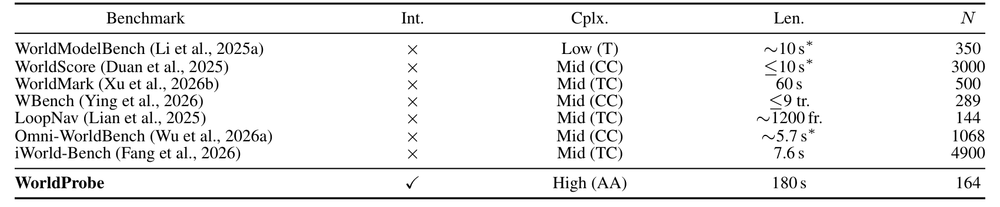
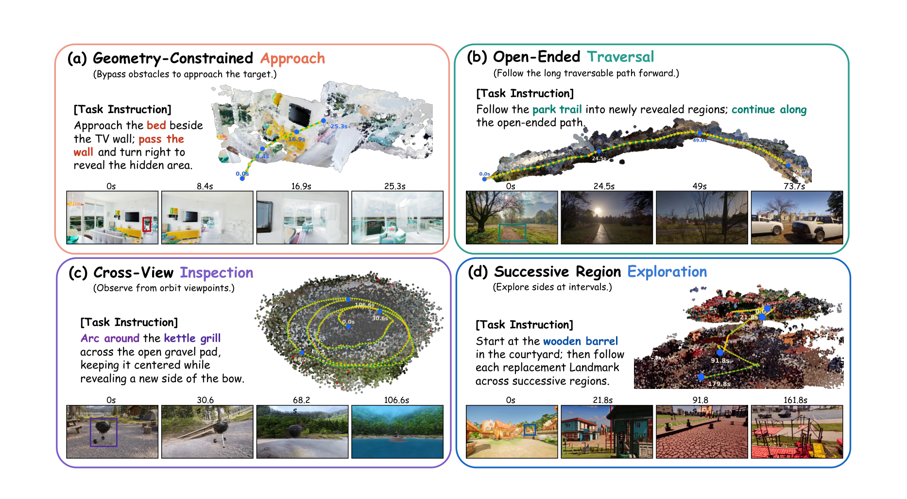
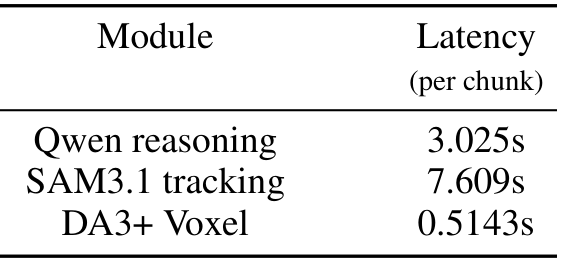
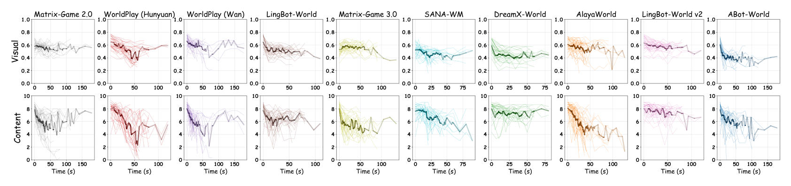
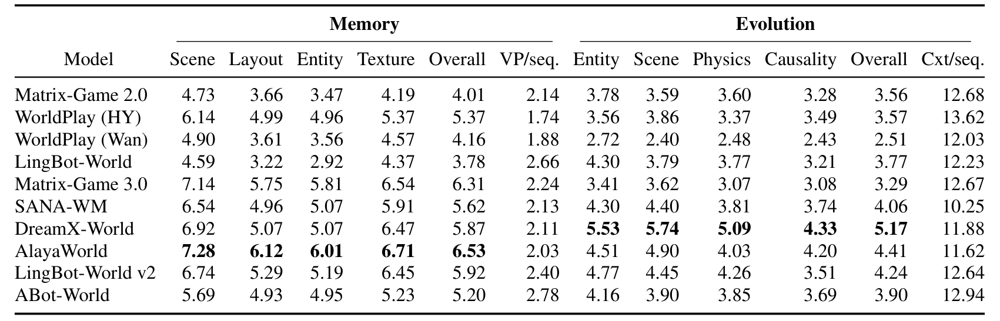
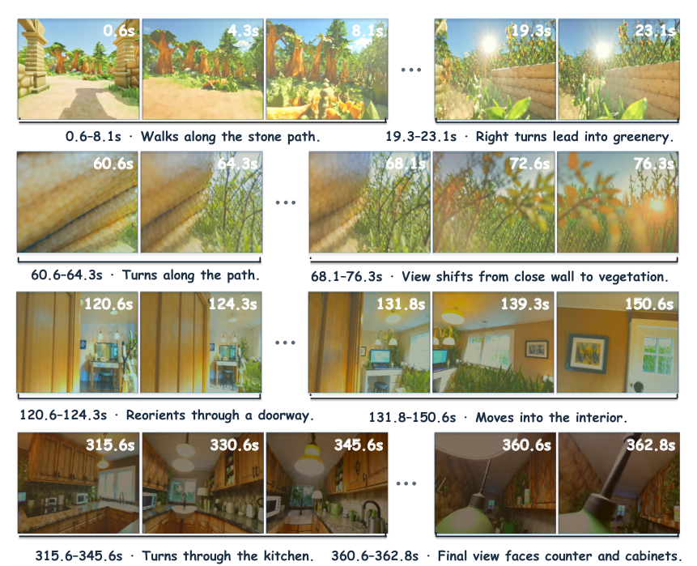

# WorldProbe: When Video World Models Fall Apart under Long-Horizon Spatial Exploration

WorldProbe 要回答的是一个被短程基准掩盖的问题：当相机不是按预设轨迹走，而是由一个代理根据刚生成的画面不断改方向，视频世界模型还能维持同一个世界多久。作者的答案是"比看起来短得多"——局部画面可以一直好看，但空间记忆与场景演化在几十秒到几分钟内就会崩。

作者与机构：WorldProbe 团队（论文未在提取文本中列出完整机构）；2026-10-29 提交；[arXiv:2610.39721v1](https://arxiv.org/abs/2610.39721)；[代码与基准](https://github.com/Untitled-W/WorldProbe)。

## 为什么现有基准测不到长期世界

作者把缺口归结为三点。第一，多数基准只测很短的 rollout，相机运动幅度有限，而记忆、一致性与场景演化的问题往往要在长时程、大范围移动后才出现。第二，相机轨迹在生成前就固定，无法根据新露出的几何改道，也无法在发现目标后重新选择探索方向。第三，现有指标多在同一视角或相邻帧上做成对比较，天然看不到跨房间、跨时间的一致性矛盾。

Table 1 把七个既有基准与 WorldProbe 放在一起：WorldModelBench 与 WorldScore 的交互性为否、时长约 10 秒；WorldMark 到 60 秒；WBench 约 3.7 轮交互；LoopNav 约 1,200 帧但沿预设回路；Omni-WorldBench 约 5.7 秒；iWorld-Bench 7.6 秒。WorldProbe 是唯一把"代理动作"作为探测复杂度、并把时长拉到 180 秒的。

*论文原图编号：Table 1。交互性、探测复杂度、时长与用例规模四个维度的对照；WorldProbe 是唯一由代理动作驱动、时长为 180 秒的基准。*

## 四类任务与闭环探测代理

基准包含 164 个测试用例，分四类。Geometry-Constrained Approach 要求绕过遮挡接近部分可见的目标，测试新露出的几何是否与先前观测一致；Open-Ended Traversal 沿道路、走廊等开放结构一直走，测试长程连续性与布局保持；Cross-View Inspection 从不同视角看同一局部场景，测试多视角一致性与新视角内容生成；Successive Region Exploration 依次转向新的边缘区域，测试能否把局部揭示的区域拼成连贯环境。

*论文原图编号：Fig. 2。四类任务各自的指令、3D 轨迹与时间戳帧序列；每类任务诱导不同的空间探索模式。*

每个决策步，代理接收任务说明、最近若干帧与辅助空间状态，输出一个离散相机动作；动作被转换成模型特定的控制格式，作用到下一个生成块，新帧再加入上下文。这里有一个容易被忽略的工程点：长时程下仅靠文本描述目标不够，场景一变，目标就"丢"了。作者因此维护一个在线分割跟踪器，用 SAM3.1 的记忆与文本条件跟踪保持目标身份，并用几何门过滤帧间位移过大的 mask。局部几何则由 Depth-Anything-3 重建。

## 四个维度各自依赖什么

视觉质量用三个无参考 IQA 模型 MUSIQ、MANIQA、Q-Align，各自归一化到 0–1 后平均。内容质量由 VLM 对单帧的几何有效性、物体有效性与场景丰富度打 0–10 分，逐帧独立、不带历史上下文。记忆评测先用 ViPE 从生成帧估计相机位姿，把整条位姿序列对齐到 1 fps 的候选轨，再用最远点采样选最多五个相隔至少 3 米的锚点；每个锚点内选最多八帧，要求视角差 30 度以内、视场重叠超过 0.30、帧间隔至少 8 秒，然后让 VLM 从场景、布局、实体、纹理四个维度打分。演化评测把采样帧与控制序列摘要一起交给 VLM，从实体演化、场景演化、物理合理性、动作—结果因果四个维度打 rollout 级分数。

这里的设计选择值得单独说：用重建位姿而不是指令位姿选锚点，是为了把"控制没跟上"从"记忆失败"里剥离出去。否则相机没走到指令位置，也会被算成场景不一致。这个细节决定了记忆分数能不能解释为空间记忆。

代价是评测链变长。代理侧 Qwen 推理每块 3.025 秒、SAM3.1 跟踪 7.609 秒、DA3+ 体素 0.514 秒，全部模型跑完约需 24 张 A100 四天。

*论文原图编号：Table 3。代理侧三个模块的单块延迟；跟踪模块是主要开销。*

## 局部质量：退化变慢，但没有消失

10 个模型、超过 1,600 条 rollout、约 800 分钟，单条最长 180 秒。图 4 按发布时间从左到右排列，早期模型经常在某个时刻突然崩掉，视觉与内容分数一起趋近零；近期模型则大多维持一个非零的质量下限。

*论文原图编号：Fig. 4。十个模型的视觉与内容分数随 rollout 时间的变化；模型按发布时间从左到右排列。*

表 4 把这组现象量化成均值与斜率。视觉斜率从 Matrix-Game 3.0 的 +0.76×10⁻³/s 到 ABot-World 的 -5.48×10⁻³/s，跨度很大；内容斜率则全部为负，范围 -0.015 到 -0.093 分/秒。作者的解读是：感知上继续生成合理画面比维持几何与语义结构容易，所以内容质量掉得更快。这个判断对做具身评测的人很重要——只看画质指标会高估世界模型的可用性。

## 长期一致性：记忆与演化仍然薄弱

Table 5 是全文最不乐观的一张表。记忆 Overall 在 4.01 到 6.53 之间，演化 Overall 在 2.51 到 5.17 之间（满分 10）。分层很清楚：场景与布局通常高于实体与纹理。短时遮挡或小幅换视角时，模型还能保住粗粒度布局，但细粒度纹理、物体外观与局部几何会漂；一旦离开一个区域较久、或从完全不同的方向重访，模型经常生成与先前观测不兼容的内容，甚至整段换成另一个场景。

*论文原图编号：Table 5。十个模型在记忆四个维度与演化四个维度上的得分，以及每个序列的视角数与上下文长度。*

演化维度更糟：物体会变形、分裂、消失、复制或换身份，场景会逐渐漂到不相关的内容，静态物体可能随相机运动而移动，场景变化可能找不到对应的动作原因。Table 5 里 WorldPlay (Wan) 的演化 Overall 只有 2.51，而 DreamX-World 是 5.17，同代模型之间的差距可以很大。

一条非受限的 DreamX rollout 持续了 367.9 秒、由 491 个代理动作驱动，直到生成本身崩溃才停止。这说明代理并不天然是瓶颈：只要模型还能用，闭环探测可以远超 180 秒。

*论文原图编号：Fig. 5。一条 367.9 秒 DreamX rollout 的采样帧与阶段描述；代理在 491 个动作后仍能维持探索。*

## 这套基准测到了什么、没测到什么

WorldProbe 测到的是"局部稳定"与"全局持久"之间的差距：画面可以一直合理，但模型并不维持一个可重访、可扩展的世界。这是短程基准与画质指标都看不到的。它最可复用的设计有两个：闭环代理让轨迹随生成内容自适应；用重建位姿选记忆锚点，避免把控制误差算进记忆分数。

边界同样明显。第一，内容、记忆、演化三类分数全部由 VLM 打分，论文没有报告与人评的一致性，也没有换一个评分模型做稳健性检查；而代理本身也是 VLM，评分与探测共享同一种空间推理短板。第二，视觉分数来自无参考 IQA，衡量感知质量，不衡量几何正确性；这正好解释了为什么视觉分数可以高而记忆分数很低。第三，评测覆盖 10 个公开模型与 164 个用例，成本约 24 张 A100 四天，重复运行的方差没有报告。第四，代理的能力上限会影响可达时长，作者用一条超长 rollout 说明代理不是硬瓶颈，但那是单条示例。

我的判断是：这篇论文的价值不在"哪个模型排第一"，而在给出了一套能把"世界是否持久"变成可测量量的协议。它最该被追问的是评分器的可靠性——如果换一个 VLM 当裁判，模型排序是否稳定？在回答这个问题之前，表 5 的绝对分数应当当作相对信号，而不是世界模型能力的终局排名。
