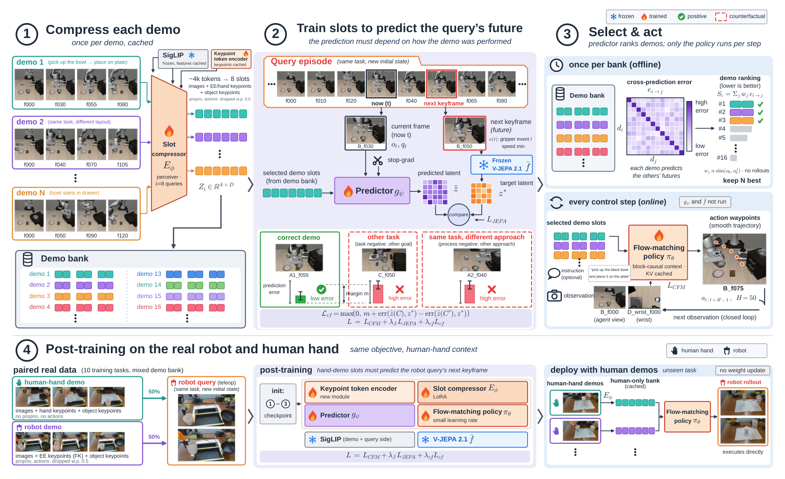
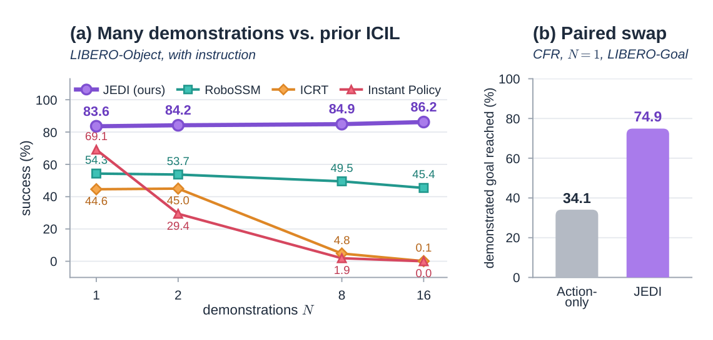
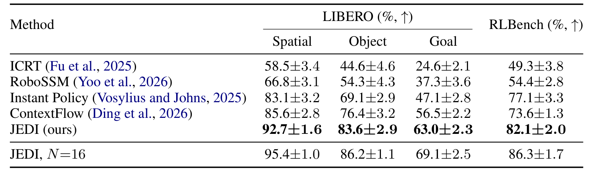
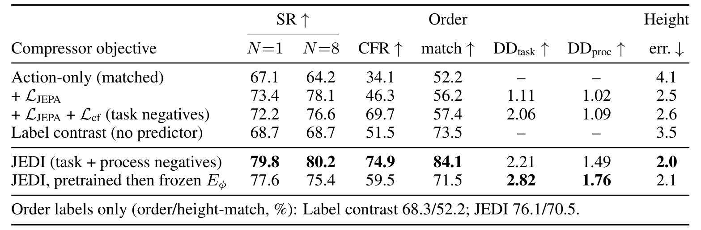
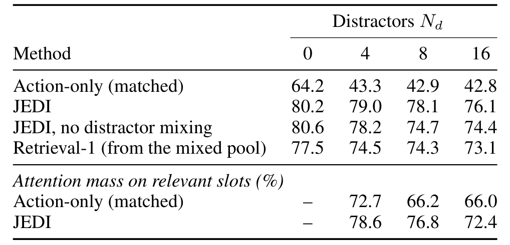
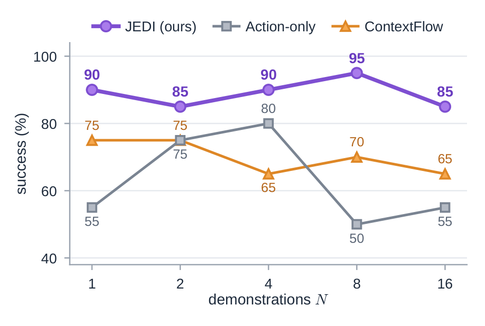
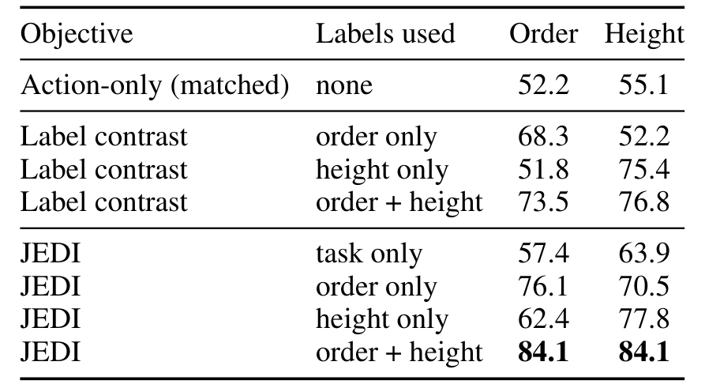
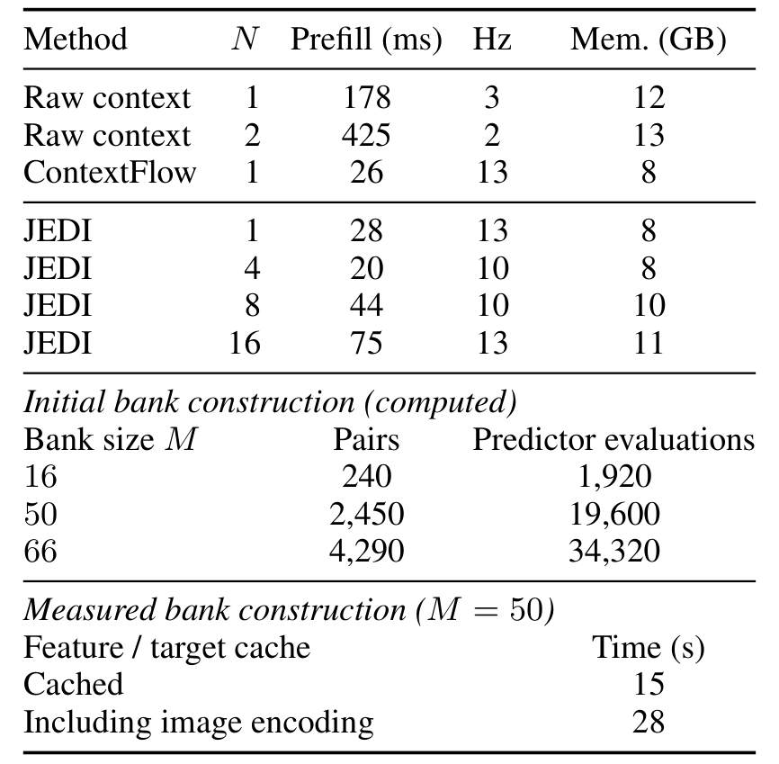

# JEDI: Joint-Embedding Demonstration Compression for In-Context Imitation Learning

在测试时给机器人看几条演示、不更新任何权重就执行新配置，这是上下文模仿学习（in-context imitation learning，ICIL）想要的能力；但一条多视角轨迹动辄数百个控制步，降采样后仍有数千个标记，上下文很快被一两条演示占满。JEDI 的出发点不是换一个更强的压缩器，而是重新定义压缩器应该保留什么：把每条演示压成 k 个槽（slot），要求这些槽能预测查询回合的下一个关键帧；再用任务与过程两类反事实样本，逼槽保留「这条演示是怎么做的」，而不只是「这是什么任务」。由于每条演示独立压缩，槽可以缓存，策略因而能同时看十几条演示。

Jiazhao Liang、Zhewen He、Shuaihang Yuan、Huang Hao、Yi Fang（纽约大学 Tandon 工学院；NYUAD CAIR 与 AIR 实验室）。2026 年 10 月 29 日发布，arXiv:2610.40356。以下页码均对应这一版本。

## 演示压缩的真正问题是保留什么

先看问题的量级。一个任务配置由目标、物体集合与场景组成，演示则是一条包含多视角图像、本体感觉与动作的轨迹。当前 ICIL 策略通常只放一两条演示进上下文，原因很直接：完整轨迹太长，而 transformer 策略在超过训练时见过的提示长度后会明显退化。压缩是自然的出路，但已有的两条路线都不理想。池化的任务嵌入很便宜，却几乎只留下任务意图；完整的传感器运动上下文保留了控制所需的分阶段细节，代价却随演示数线性增长。

ContextFlow 处在两者之间：它用 perceiver 式的压缩器把每条演示压成少量槽，但压缩器只通过动作损失训练，而且评测基本停留在单条演示。这就留下一个没有被回答的问题：压缩后的演示到底应该保留什么，才能让策略在测试时真正用上它？论文的观察是，压缩器的训练目标而不只是结构，决定了哪些信息被留下。仅用动作损失时，槽只要对动作预测「够用」就行，物体处理顺序、抓取高度、接近方向这些过程信息没有动力被保留。

JEDI 的核心主张是把「让策略预判自己回合的下一阶段」作为压缩目标。这里有一个容易被忽略的陷阱：视频的下一帧大部分可以从当前帧预测出来，如果只最小化预测误差，预测器完全可以无视演示槽。为此论文加入反事实项：当支持集被换成另一个任务的演示，或同一任务但执行过程不同的演示时，预测必须变差。这样槽才被迫携带目标物体、目标状态以及顺序、抓取与接近方式。另一个设计后果是，压缩器一次只看一条演示，所以槽可以离线算好、缓存、复用，策略的上下文成本从「原始标记数」变成「演示数乘以槽数」。

论文据此给出四项贡献：预测式压缩、按预测误差选择演示、用关键点标记把人类手部演示接入上下文，以及在指令与演示冲突时观察策略到底听谁的。后文会逐项检查这些主张各自被哪组实验支撑，以及哪些地方仍然只是合理猜测。

## 任务设定与数据

形式化地看，任务配置 $\tau$ 是一个目标加上物体集合与场景；演示 $d=\{(I_t,q_t,a_t)\}_{t=1}^{T}$ 由多视角图像、本体感觉与动作组成，在真实机器人上也可以是一段没有 $q_t$ 与 $a_t$ 的人类手部视频。给定支持集 $C=\{d_1,\dots,d_N\}$ 与可选指令 $\ell$，策略 $\pi_\theta(a_{t:t+H-1}\mid I_t,q_t,Z_C,\ell)$ 在新的初始状态上行动，构成一个查询回合，$Z_C$ 是由 $C$ 构建的上下文，$\theta$ 在测试时固定。支持集从规模不少于 $N$ 的演示库 $B$ 中抽取，库里也可能混有其他配置的演示。论文把 $N\ge 4$ 称为 many-shot 区间。

「过程」在这篇论文里有明确所指：物体处理的先后顺序、抓取位置与高度、接近方向。一个忠实的策略不仅要到达目标，还应该按演示的方式到达。这个区分是后面所有诊断指标的支点：只看成功率，无法判断策略是识别了任务后按自己的先验执行，还是真的在模仿演示的过程。

仿真评测覆盖 LIBERO-Spatial、LIBERO-Object、LIBERO-Goal 与 RLBench。LIBERO 有三种设置：标准划分把每个套件的十个任务分成六个训练、四个留出；目标歧义设置利用 LIBERO-Goal 十个任务共享一个场景的特点，评测四个留出目标；LIBERO-Order 则构造双物体收纳任务，每个物体对按两种顺序各生成 50 条演示，并给高物体增加「靠近顶部抓取」的变体，顺序标签由构造直接给出。RLBench 把 100 个任务随机分成 60 个训练、40 个留出。每个未见配置有一个 50 条演示的池子，多样池则用 LIBERO-Plus 式的布局扰动重新生成，用来测试上下文覆盖而非测试条件变化。

指标不止成功率。成功率是四个留出任务上的宏平均，每个任务每个训练种子 100 次 rollout，三个种子共 1,200 次试验；上下文跟随率（CFR）衡量在演示目标与默认目标不同的配对交换中，有多少回合达成了演示所示的目标；顺序匹配率与高度匹配率衡量 LIBERO-Order 中是否跟随了演示的顺序与抓取高度变体；演示依赖度 DD 则是把支持集换成反事实后预测误差与原始误差的比值，接近 1 意味着演示被忽略。真实机器人实验另有一套协议，稍后单独说明。

基线设计得比较干净。动作-only（matched）与 JEDI 使用同一骨干、同一压缩器结构、同一数据与训练计划，只把 $\lambda_J$ 与 $\lambda_{\mathrm{cf}}$ 置零，因此它回答的是「只改损失会怎样」。Label contrast 拿到完全相同的任务与过程标签，用监督对比损失训练槽，但没有预测器，用来区分「标签告诉模型两条演示不同」与「预测告诉模型这种不同如何影响未来」。检索基线 Retrieval-n 按初始帧的 DINOv2 或 SigLIP 相似度取前 n 条演示，与 JEDI 共用检查点，因此比较的是「选哪几条」而不是「模型多强」。

真实机器人部分使用 reBot Arm B601-RS 双臂系统，外部 RGB-D 与腕部相机观测共享工作区，遥操作采集机器人演示，人类手部演示由作者本人演示；策略跑在工作站上，经网络控制机械臂，含网络往返约 10 Hz。十个任务用于后训练，另外十个未见任务分成三组：R1 是普通未见操作，R2 是指令与演示在目标或顺序上冲突，R3 是演示之间存在竞争目标。每个条件五次试验，R1 共 25 次、R2 共 10 次、R3 共 15 次；每个任务收集八条机器人演示与八条人类手部演示。成功率由不知道方法归属的人按事先固定的评分标准看视频判定。

## 方法主线

JEDI 有三个可训练部件：每条演示独立的压缩器 $E_\phi$、预测器 $g_\psi$ 与 flow-matching 策略 $\pi_\theta$；冻结的视频编码器 $\bar f$ 只提供预测目标。它是一个视频 JEPA（joint-embedding predictive architecture），在特征空间而不是像素空间做预测，因此槽对齐的是未来的特征表示，而不是重建像素。理解这套方法的关键不是记住模块名，而是看清一条演示从进入系统到变成策略上下文，再到影响动作的完整路径。

### 机制流程

1. 输入一条演示的 8 帧双视角图像、128 步本体感觉与动作；由 SigLIP 特征与 MLP 编码后送入 4 层 perceiver，用 $k=8$ 个可学习查询做交叉注意力压缩；输出每条演示独立的 $k\times D$ 槽并加槽索引嵌入，缓存进演示库，供选择与策略的上下文注意力使用。
2. 输入查询当前帧的 SigLIP 标记、本体感觉，以及从库中取出的演示槽；4 层、宽 512 的预测器输出下一关键帧的 patch 布局，与冻结 V-JEPA 2.1 的目标 latent 做 SmoothL1，并用任务与过程反事实拉开错误预测；梯度只回传到压缩器与预测器，更新槽的编码方式而不改查询观测编码器。
3. 输入建库后的全部演示槽与各自关键帧；把每条演示当作伪查询，计算跨演示预测误差矩阵，再按初始帧相似度加权得到选择分数；每个查询保留分数最低的 $N$ 条演示槽，在线只做加权排序，不运行预测器。
4. 输入机器人遥操作与人类手部演示、共享的腕/拇指/食指/物体关键点；等比例混合两种本体的演示做后训练，人类手部槽被要求预测机器人查询的下一关键帧；部署时可用纯人类手部演示库作为上下文，无需测试时更新权重。

*论文原图编号：Fig. 2。该图把「压缩并缓存」「用冻结 V-JEPA 预测查询未来」「预测器排序」「真实机器人与人类手部后训练」放在同一条数据流上；放在这里是因为后文的每个机制都能在图上找到对应位置。*

图 2 值得按阶段细看。左上角的压缩阶段刻意把「每条演示只压一次」写在标题里，因为这是整个缓存与 many-shot 经济性的来源；中间阶段把「预测必须依赖演示是怎么做的」写成副标题，对应下面的正确演示、其他任务负样本、同任务不同过程负样本三张对比图；右侧则明确区分了离线建库与在线控制，预测器与冻结编码器都不在控制回路里。

### 从演示到槽：压缩器的输入与缓存

压缩器的输入是一条演示的标记序列：8 帧双视角图像的 SigLIP patch 标记，加上 128 个均匀采样的本体感觉与动作步的 MLP 嵌入。每个标记带有模态嵌入、视角嵌入（适用时）与归一化进度 $t/T$ 的正弦嵌入。$k$ 个可学习查询在 4 层中先对输入做交叉注意力，再在查询之间做自注意力；输出槽被投影到策略上下文专家的宽度，并加上一个可学习的槽索引嵌入。注意这里没有「演示编号」嵌入：重排演示只会重排槽块，不会改变每条演示的语义。

这个设计有两个直接后果。其一，压缩器看不到其他演示，所以每条演示的槽可以离线计算并缓存，策略训练时不必反复跑视觉编码器；论文正是靠这一点把演示侧的 SigLIP 特征与 V-JEPA 目标都预计算成缓存。其二，槽的数量 $k$ 成为上下文压缩率的旋钮，默认 $k=8$；后文的一槽消融显示这个瓶颈不能压得太狠。

### 预测目标：让槽回答「下一步会发生什么」

目标不是重建演示，而是预测查询回合的下一个关键帧。论文用一套关键帧启发式把回合切成阶段：夹爪开合事件、末端速度的局部极小点、以及回合结束。设 $\kappa(t)$ 是查询步 $t$ 之后的第一个关键帧，目标就是该关键帧处两帧片段在冻结 V-JEPA 2.1 中的 patch 标记：

$$z^{\star}=\bar{f}\left(I^{\mathrm{query}}_{\kappa(t)-1:\kappa(t)}\right)\in\mathbb{R}^{P\times D_z},\qquad \mathcal{L}_{\mathrm{JEPA}}=\frac{1}{P}\sum_{p=1}^{P}h\left(\mathrm{LN}(\hat{z}_p)-\mathrm{LN}(z^{\star}_p)\right)$$

其中 $P$ 是 patch 数，$D_z$ 是特征宽度，$\hat z$ 是预测器输出，$\mathrm{LN}$ 是层归一化，$h$ 是逐特征求和的 SmoothL1。预测器接收槽 $Z_C$、查询当前观测标记 $o_t$ 与本体感觉 $q_t$，输出与目标相同 patch 布局的 latent。一个容易被忽略的细节是，预测器不接收关键帧偏移 $\Delta=\kappa(t)-t$：这个量来自查询自己的未来，一旦输入，预测器可以靠它降低损失而完全不使用演示。

工程上，这个损失只训练预测器与压缩器。$o_t$ 以停梯度进入，因此预测损失不会去塑造策略的观测编码器。论文选择确定性回归而不是扩散或采样，理由是给定演示过程与当前状态，下一个关键帧接近确定，而确定性 latent 预测在多模态目标上容易失败。

### 反事实项：为什么仅预测不够

只看 $\mathcal{L}_{\mathrm{JEPA}}$ 会得到一个虚假的解法：当前帧已经包含了目标的大部分信息，预测器可以无视槽。论文的对策是要求「换掉支持集后预测必须更差」。任务负样本来自同一场景的另一个任务，迫使槽编码目标物体与目标；过程负样本来自同一任务但不同过程的演示，且要求查询的下一关键帧确实不同，迫使槽编码顺序、抓取与接近方式。

$$\mathcal{L}_{\mathrm{cf}}=\frac{1}{|\mathcal{N}|}\sum_{C'\in\mathcal{N}}\max\left(0,\;m+\mathrm{err}(C)-\mathrm{err}(C')\right)$$

这里 $\mathrm{err}(C)$ 是支持集为 $C$ 时单个样本的预测误差，$\mathcal{N}$ 是负样本集合，$m$ 是 margin，默认 $0.1$。总损失是 $\mathcal{L}=\mathcal{L}_{\mathrm{CFM}}+\lambda_J\mathcal{L}_{\mathrm{JEPA}}+\lambda_{\mathrm{cf}}\mathcal{L}_{\mathrm{cf}}$，默认 $\lambda_J=1$、$\lambda_{\mathrm{cf}}=0.1$。过程标签在 LIBERO-Order 上由构造给出，其他套件则把每个关键帧的 V-JEPA 标记池化成向量、拼接后做任务内 $k$-means，用轮廓系数选簇数；标签只用于挑选负样本，正支持集始终与查询同过程。

为了单独观察「演示到底被用了多少」，论文报告 DD：任务负样本下的误差比 $\mathrm{DD}_{\mathrm{task}}$ 与过程负样本下的 $\mathrm{DD}_{\mathrm{proc}}$。接近 1 意味着预测器几乎不看演示；大于 1 且越大，说明反事实确实让预测变差。这个诊断是后面解释消融的关键，因为它把「成功率涨了」拆成「模型是否真的依赖演示」与「预测是否变准」两件事。

### 策略训练：固定查询编码器，只让槽和预测器学习

策略沿用 π0 与 ContextFlow 的骨架：一个 flow-matching 动作专家，动作视界 $H=50$，推理用 10 个 Euler 步，从 π0 初始化并用 LoRA 适配。它通过一个上下文专家对 $[Z_C;o_t;\ell]$ 做块因果注意力，上下文键值在多个 flow 步之间缓存。动作损失是标准的 flow matching 目标：把真实动作 $a_t$ 与噪声 $\epsilon$ 按 flow 时间 $s$ 插值成 $a_t^s=s a_t+(1-s)\epsilon$，让网络预测 $a_t-\epsilon$。

训练时的采样策略对结果影响很大。演示数 $N$ 从 $\{1,\dots,16\}$ 均匀抽取，而不是固定长度，因为固定提示长度训练无法外推到更长上下文。以 0.2 的概率混入 1 到 4 条其他配置的干扰演示；以 0.5 的概率把指令替换为空串，让「只靠演示」落在训练分布内；以 0.1 的概率丢掉某条演示的槽。优化用 AdamW（$\beta=0.9,0.95$），新模块学习率 $10^{-4}$、LoRA $5\times10^{-5}$、查询侧 SigLIP $10^{-5}$，余弦退火；训练 10k 步、批大小 32。这些比例与超参在复现时不能省，后文的「去掉指令 dropout」消融会说明原因。

### 预测式选择：用库内的互相预测代替查询未来

测试时演示库可能比上下文大得多，而且混有无关或过程不同的演示。查询的未来未知，但库里每条演示的未来是已知的，于是可以把每条演示 $d_j$ 当作伪查询，用另一条演示 $d_i$ 的槽去预测它的关键帧，得到跨演示误差：

$$S_i=\sum_{j\ne i}w_{ij}\,e_{i\to j},\qquad w_{ij}\propto\exp\left(\mathrm{sim}(o_0,o_0^{j})/\eta\right)$$

$e_{i\to j}$ 就是训练损失在库内的翻版，$\mathrm{sim}$ 是初始帧池化特征的余弦相似度，$\eta=0.01$。分数越低越好，每个查询取分数最低的 $N$ 条。权重有两种极端：均匀权重衡量「这条演示与库中其他演示是否一致」，能过滤干扰项；尖锐权重偏向与查询初始布局相似的演示。这个分数假设库中多数演示属于查询的目标配置；当库里有多种过程时，论文在每个阶段完成后再把已完成阶段作为额外伪查询重选，称为在线承诺。它能让上下文保持在策略已经开始的过程上，但无法纠正最初选错的过程。

### 人类手部后训练：让另一种本体预测机器人的未来

真实场景里更常见的演示是人类手部视频，它没有机器人本体感觉与动作。论文在后训练阶段加入一个关键点标记编码器，输入两种本体都有的量：腕、拇指尖、食指尖与捏合开度，机器人的对应量由正运动学得到，物体关键点由离线跟踪器给出；机器人的本体感觉与动作标记以 0.5 的概率丢弃。每个训练库等比例混合人类手部与机器人演示，但查询始终是同一任务的机器人回合。于是人类手部演示的槽被训练去预测机器人的下一关键帧——预测目标问的是「这条演示对查询的未来意味着什么」，而不是「它看起来像什么」，这也顺带把两种本体连了起来。后训练时预测器与关键点编码器正常训练，压缩器用 LoRA 更新，策略只用更小的学习率（$10^{-5}$）微调。

## 关键结果

仿真主结果使用三个训练种子，每个 LIBERO 套件的每个留出任务、每个种子各 100 次 rollout，四个任务共 1,200 次试验；RLBench 每个种子对 40 个留出任务各 100 次 rollout。所有方法共享同一套查询布局与支持集抽样，因此表内的差异是配对差异。真实机器人则是每个条件五次试验的小样本，读数字时要一直记住这一点。

### 主结果与强基线

*论文原图编号：Fig. 3。左图是 LIBERO-Object 成功率随演示数的变化，右图是无指令配对交换下的上下文跟随率；放在这里是因为它同时给出「多演示是否继续有用」与「策略是否真的跟随演示」两个答案。*

*论文原图编号：Table 1。该表报告 LIBERO 三个套件与 RLBench 上未见配置的成功率，前五行使用单条演示，最后一行是 N=16 的 JEDI；放在这里是为了让主比较的数值可以被逐格核对。*

在单条演示设定下，JEDI 相对各列最强基线提高 5.0 到 7.2 点：Spatial 92.7% 对 ContextFlow 的 85.6%，Object 83.6% 对 76.4%，Goal 63.0% 对 56.5%，RLBench 82.1% 对 Instant Policy 的 77.1%。到 $N=16$，四个数字变成 95.4%、86.2%、69.1% 与 86.3%，相对单演示 ContextFlow 提高 9.8 到 12.7 点。作者报告的配对 95% 区间在单演示时分别是 $[2.5,11.7]$、$[0.7,13.7]$、$[0.9,12.1]$、$[3.2,13.8]$：四个区间都不含零，但 Object 与 Goal 的下界只有 0.7 与 0.9，说明这两列的增益并不宽裕。

图 3 左图把「多演示是否继续有用」讲得更清楚。LIBERO-Object 上 JEDI 从 $N=1$ 的 83.6% 缓慢升到 $N=16$ 的 86.2%，只涨 2.6 点，但同图里的 RoboSSM 从 54.3% 降到 45.4%，ICRT 与 Instant Policy 在超过两条演示后迅速崩到接近零。论文提醒这两条曲线超出方法的设计范围，不能当作公平比较；它们真正说明的是，按单演示或少演示设计的策略无法把额外演示转化为性能，而 JEDI 至少不会因为上下文变长而退化。$N=16$ 时 JEDI 比 RoboSSM 高 40.8 点，这个数字更多反映基线在长上下文下的失效，而不是 JEDI 的绝对能力。

图 3 右图是配对交换实验：在 LIBERO-Goal 的共享场景里，不给指令，只把演示的目标从默认目标 $G$ 换成 $G'$。JEDI 有 74.9% 的回合达成演示目标，动作-only 只有 34.1%，相差 40.8 点。这个实验的价值在于它绕开了成功率的一个歧义：两套方法都可能完成默认目标，但只有真正读取演示的方法才会去完成被交换的目标。

### 压缩目标消融

*论文原图编号：Table 3。该表固定骨干、数据与训练计划，只改变压缩器目标；放在这里是因为它把「预测」「反事实」「标签监督」三件事拆成了可比较的行。*

这张表是全文最关键的证据。动作-only 在 $N=8$ 是 64.2%，只加 $\mathcal{L}_{\mathrm{JEPA}}$ 就升到 78.1%（+13.9），但它的 $\mathrm{DD}_{\mathrm{task}}=1.11$、$\mathrm{DD}_{\mathrm{proc}}=1.02$，几乎等于「演示被忽略」——预测器主要靠当前帧完成了任务。加上任务负样本后，CFR 从 46.3% 跳到 69.7%，$\mathrm{DD}_{\mathrm{task}}$ 升到 2.06；再加过程负样本，CFR 到 74.9%，顺序匹配从 57.4% 升到 84.1%，$\mathrm{DD}_{\mathrm{proc}}$ 从 1.09 升到 1.49，抓取高度误差则从动作-only 的 4.1 cm 降到 2.0 cm。完整 JEDI 的 $N=8$ 成功率是 80.2%。

同一张表里还有两个容易被略过的对照。Label contrast 拿到完全相同的任务与过程标签，却没有预测器，成功率只有 68.7%，CFR 51.5%，顺序匹配 73.5%；这说明「知道两条演示不同」本身不够，模型还需要一个把差异与查询未来联系起来的预测目标。把预测预训练后的压缩器冻结、再单独训练策略，$N=8$ 只有 75.4%，CFR 59.5%，低于联合训练的 80.2% 与 74.9%；这一行说明冻结的预测槽并非不可用，但联合训练更好，论文没有进一步拆解这点差距来自容量、优化还是槽与动作目标的耦合。

$N=1$ 与 $N=8$ 的排序并不完全一致：只加 $\mathcal{L}_{\mathrm{JEPA}}$ 在 $N=1$ 是 73.4%，比完整 JEDI 的 79.8% 低 6.4 点；在 $N=8$ 是 78.1% 对 80.2%，只差 2.1 点。Label contrast 在两个上下文规模下都停在 68.7%。这提示反事实项对成功率的边际收益随上下文规模变化，不能简单外推成「任何演示数下都同等有效」。

另一组关键消融（表 11）还换了预测目标与压缩瓶颈。把 V-JEPA 2.1 换成 DINOv2，$N=8$ 降到 74.3%；把「下一关键帧」换成「最终帧」，降到 76.4%，说明目标表示与预测时机都在起作用。每个演示只留一个槽时降到 66.0%、CFR 51.3%，说明 $k=8$ 的瓶颈不能压得太狠；去掉指令 dropout 后成功率 78.2% 接近默认的 80.2%，但 CFR 只有 45.1%，再次说明成功率会掩盖上下文使用的退化。

### 选择、干扰项与上下文规模

*论文原图编号：Table 13。该表在 8 条相关演示之外加入 0 到 16 条其他配置的演示，并报告动作专家落在相关槽上的注意力比例；放在这里是因为它把「选择」与「策略抗干扰」分开测量。*

在 $N=8$ 且混入 16 条干扰演示时，动作-only 从 64.2% 掉到 42.8%（−21.4），JEDI 只从 80.2% 掉到 76.1%（−4.1）；JEDI 的动作专家仍有 72.4% 的注意力落在相关槽上，动作-only 是 66.0%。这不是说 JEDI 对干扰免疫，而是说预测式压缩让相关槽在注意力竞争中更容易被区分出来。表 13 底部还显示，即使不做干扰项混合训练，JEDI 在 16 条干扰下仍有 74.4%，说明收益不只来自训练时见过干扰项。

*论文原图编号：Fig. 4。该图在 LIBERO-Object 的两个留出任务上固定指令与查询布局，只改变演示数；放在这里是因为它提供了与 ContextFlow 在相同上下文规模下的直接对照。*

图 4 是另一条独立的对照：在两个留出任务、每个点 20 次配对试验下，JEDI 在 $N=1,2,4,8,16$ 分别为 90%、85%、90%、95%、85%，ContextFlow 为 75%、75%、65%、70%、65%，动作-only 为 55%、75%、80%、50%、55%。JEDI 的曲线整体更高，但在 $N=16$ 反而从 95% 回落到 85%，而 ContextFlow 在 $N=1$ 就到 75%；每个点只有 20 次试验，这种非单调更可能是小样本波动，不宜解读成「更多演示一定更好」。

选择实验则把「选哪几条」单独拿了出来。在标准池上，预测式选择 85.5% 对随机 80.2%（+5.3）；多样池上 74.0% 对 55.1%（+18.9）；含 16 个干扰项的池上 82.7% 对 66.9%（+15.8）。与最佳图像检索相比，预测式在多样池高 8.0 点（74.0 对 66.0），因为初始帧相似度看不出执行细节。干扰项对预测式的代价是 2.8 点，对随机选择是 13.3 点；在线承诺把混合顺序库的成功率从 55% 提到 62%，代价是总体成功率变化在 −0.1 到 +1.0 点之间。

### 语言与演示冲突

当指令明确说出顺序时，JEDI 在有对齐演示的情况下成功率 70.0%，动作-only 60.0%；换成同义改写后 JEDI 仍有 71.7%，说明它没有死记某一种句式。真正有区分度的是冲突列：演示展示相反顺序、指令仍要求指定顺序时，JEDI 有 78.8% 的回合按指令完成，动作-only 只有 45.0%。反过来，在指令不透露顺序的标准 LIBERO-Order 上，JEDI 跟随演示顺序的比例是 84.1%，动作-only 是 52.2%。这组结果支持作者的判断：指令留白处 JEDI 从演示取信息，指令明确处它服从指令；动作-only 压缩则更容易把两者混在一起。

不过这里仍有一个替代解释没有完全排除：JEDI 的指令 dropout 让策略在训练中见过「无指令」条件，而动作-only 使用同样的 dropout，所以差异不能只归因于「更会读指令」。更准确的说法是，预测目标让槽保留了顺序信息，从而在指令缺省时有一个可用的信息源；它是否真的按人类的方式解析「after/before/not until」，这组实验并没有回答。

### 真实机器人

真实机器人上，$N=1$ 时 JEDI 与动作-only 在 R1 都是 15/25，JEDI 只在 R2 多成功两次（6/10 对 4/10）。到 $N=8$，人类手部上下文带来 21/25、8/10、10/15，机器人上下文是 23/25、8/10、11/15，混合上下文 22/25、8/10、10/15。人类手部演示没有全面追平机器人演示，但在 R1 与 R3 上只差一到两次成功，而且部署时不需要任何权重更新。

| 方法（上下文） | R1 未见操作 | R2 指令冲突 | R3 演示冲突 |
| --- | --- | --- | --- |
| Retrieval-1（1 条人类手部） | 13/25 | 4/10 | — |
| 动作-only（1 条人类手部） | 15/25 | 4/10 | — |
| JEDI（1 条人类手部） | 15/25 | 6/10 | — |
| JEDI（8 条人类手部） | 21/25 | 8/10 | 10/15 |
| 机器人上下文（8 条机器人） | 23/25 | 8/10 | 11/15 |
| 混合上下文（4+4） | 22/25 | 8/10 | 10/15 |

匹配对照（表 14）更能说明各部件的作用：完整 JEDI 在 R1/R2/R3 的子集上是 15/20、8/10、5/10；去掉关键点标记是 11/20、5/10、5/10；去掉预测损失是 9/20、6/10、3/10；动作-only 是 11/20、5/10、2/10；只用指令、把演示槽遮住是 10/20、4/10、4/10。关键点标记与预测损失各自都贡献了一部分，但每个条件只有 10 到 20 次试验，这些差值只能当作方向性证据。

## 为什么这个目标函数有效

把结果串起来看，最有解释力的是 DD 这个中间量。只加预测损失时，成功率涨了 13.9 点，但 DD 接近 1：预测器基本没用演示，涨点更可能来自预测任务对槽表示的塑形，而不是演示信息的注入。加入任务负样本后 DD 升到 2.06，CFR 从 46.3% 跳到 69.7%；加入过程负样本后 DD 升到 1.49，顺序匹配从 57.4% 跳到 84.1%。这条链条说明，反事实项不是「再加一个正则」，而是把「必须使用演示」写成了可优化的约束。作者主张这正是压缩器该学的目标；我的分析是，至少在这套评测里，DD 与 CFR 的同向变化支持这一解释，但它仍是相关性证据，不是因果拆解。

*论文原图编号：Table 10。该表分别只用顺序标签或只用高度标签构造负样本，再在两种过程变化上评测；放在这里是因为它检验预测目标能否泛化到标签没有覆盖的过程属性。*

表 10 是这套论证里最巧妙的一步。只用顺序标签时，JEDI 的顺序匹配 76.1%、高度匹配 70.5%；Label contrast 是 68.3% 与 52.2%。只用高度标签时，JEDI 的顺序匹配仍有 62.4%、高度匹配 77.8%；Label contrast 是 51.8% 与 75.4%。两种标签都给时，JEDI 是 84.1% 与 84.1%，Label contrast 是 73.5% 与 76.8%。差别在于：对比学习只被告知「这两条演示在某个属性上不同」，预测目标则要求模型说明「这种不同会怎样改变查询的未来」，所以它能迁移到没有被标签直接监督的那个属性上。这个结果并不能证明模型理解了物理，但能证明它学到的不是一张标签查找表。

另一组控制（表 9）针对「收益是不是来自辅助损失对观测编码器的正则化」。如果预测器不使用槽，只把预测损失当作观测编码器的辅助任务，$N=1$ 是 64.2%，比动作-only 的 67.1% 低 2.9 点，CFR 与顺序匹配也基本停在动作-only 水平；如果让梯度穿过 $o_t$，$N=8$ 是 83.9%，但 $N=1$ 只有 77.5%，抓取高度误差反而降到 1.4 cm。完整 JEDI 用停梯度切断了这条通路，$N=1$ 是 79.8%、$N=8$ 是 80.2%。这组对照说明，槽确实携带了信息，但「让观测编码器也参与预测」在某些上下文规模下会有取舍，不能简单说停梯度处处更优。

从机制到结果的映射可以写得更具体。压缩器独立处理每条演示，所以每条演示只产生固定 $k$ 个槽，$N=16$ 的上下文仍远小于原始标记流；这解释了为什么 $N=16$ 仍能保持 75 ms prefill、11 GB 显存与 13 Hz 控制频率。预测目标要求槽携带「演示如何影响查询未来」，所以收益应集中在 CFR、顺序匹配、抓取高度这些过程指标，而不是只体现在终点成功率，表 3 正是这个模式；反事实项把「换掉演示必须变差」写进损失，所以 DD 与 CFR 同向上升；选择规则用同一误差做库内交叉预测，所以它在布局多样的池上比初始帧检索更稳，因为后者只看外观相似度。

这些都还没有回答一个问题：槽到底编码了什么。论文没有做线性探针或消融式可视化，DD 只是行为层面的比值；因此「槽保留了过程」是一个由行为指标支撑的推断，而不是对表示内容的直接观测。尚不能确定：如果把关键帧换成更细的阶段划分，DD 与 CFR 的关系是否仍然成立。

## 边界、代价与复现注意

作者明确承认的边界有四条。第一，泛化限于训练中见过的运动基元所组成的新物体、新布局与新目标，不声称新运动基元或其他机器人本体；评测也限于桌面操作。第二，人类手部演示只在同一平台、同一任务分布上后训练后可用，关键点来自离线跟踪器，不声称能从无约束人类视频迁移。第三，标准划分每个套件只有四个留出任务，重复采样支持集与布局不能建立对更多任务的泛化。第四，真实机器人只覆盖一个双臂平台上的十个未见任务。

方法本身还有几处需要注意的依赖。关键帧由夹爪事件与末端速度阈值定义，论文给的阈值是 $v_{\min}=0.00153$ m/step、$\delta=8$，LIBERO 回合平均有 3.3 到 5.8 个关键帧；擦拭、倒水这类没有明显夹爪事件的任务可能需要学习式分割或不同的预测目标。预测目标建立在冻结 V-JEPA 2.1 的表示上，编码器对某类场景表示不好时，槽能保留的信息上限也随之受限。演示选择假设库中多数演示属于查询的目标配置；库被系统性污染时，均匀权重会失效，而在线承诺只能保持已经开始的错误过程，不能纠正最初的选择。

*论文原图编号：Table 12。该表对比原始上下文、ContextFlow 与 JEDI 的 prefill、控制频率与显存，并给出建库成本；放在这里是因为 many-shot 的价值取决于它是否付得起。*

成本方面，JEDI 在 $N=16$ 时 prefill 75 ms、显存 11 GB、缓存槽下控制频率 13 Hz；ContextFlow 单演示是 26 ms、8 GB、13 Hz；原始上下文单演示就要 178 ms、12 GB，控制频率只有 3 Hz，两条演示时降到 2 Hz。建库是一次性开销：$M=50$ 时要做 $M(M-1)\times 8$ 次预测器前向，缓存 SigLIP 特征与 V-JEPA 目标后约 15 秒，算上图像编码约 28 秒；$M=66$ 时有 4,290 个有向对、34,320 次预测器评估。这个二次成本在库更大时会迅速变重，论文没有给出增量更新或近似检索的方案。训练一个模型约 29 GPU-hours，全部实验约 2,800 GPU-hours（2,200 训练、600 评测）。

复现时有几个容易漏掉的点。指令 dropout 不能省：去掉它之后成功率仍有 78.2%，但 CFR 从 74.9% 掉到 45.1%，说明策略会转向语言捷径，这时用成功率判断「是否用了演示」会得出错误结论。消融必须用同一检查点与同一支持集抽样，否则「选择」与「压缩」的效应会混在一起；论文的表 2 明确固定了策略与 $N=8$，只改变选择。DD 是在训练批次上算的，CFR 与顺序匹配是在留出回合上算的，两者不是同一个分布，不能把 DD 当作部署指标。演示侧的 SigLIP 特征缓存约 61 GB、V-JEPA 目标约 17 GB（针对 LIBERO 的 6.5k 条演示），复现前要预留存储。真实机器人每条件五次试验的样本量很小，R1 与 R2 的一两次差异不足以支撑强结论。

如果只带走一个可复用的工程结论：压缩器的训练目标比压缩器结构更值得先调；验证时不要只看成功率，而要用交换目标与「固定终点、只改过程」的配对实验检查槽是否真的被使用。这条结论不依赖 JEDI 的具体实现，也适用于其他把长演示塞进上下文的策略。

如果要把这篇论文继续做下去，我会先问三个问题。没有过程标签时，关键帧聚类得到的伪标签误差会不会让过程负样本失效？把关键帧启发式换成学习式分割后，擦拭与倒水类任务能否获得同样的 CFR 收益？演示库远大于 50 条、且多数演示与查询配置无关时，预测式选择是否仍然比检索稳？这三个问题都直接指向方法成立的边界，而不是单纯的规模扩展。

延伸阅读：ContextFlow（Ding 等，2026）给出了本文对照的 perceiver 压缩与 flow matching 骨架；V-JEPA 2（Assran 等，2025，arXiv:2506.09985）提供冻结预测目标；LIBERO（Liu 等，2023）与 RLBench（James 等，2020）是主要仿真基准；π0（Black 等，2025）是策略初始化来源。论文本身见 [arXiv:2610.40356](https://arxiv.org/abs/2610.40356)。
