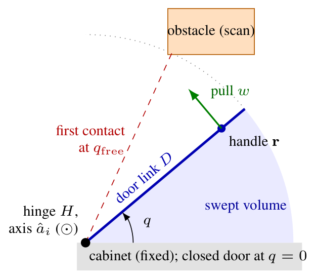
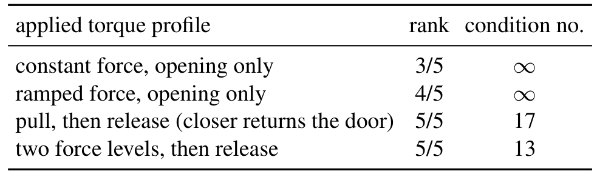
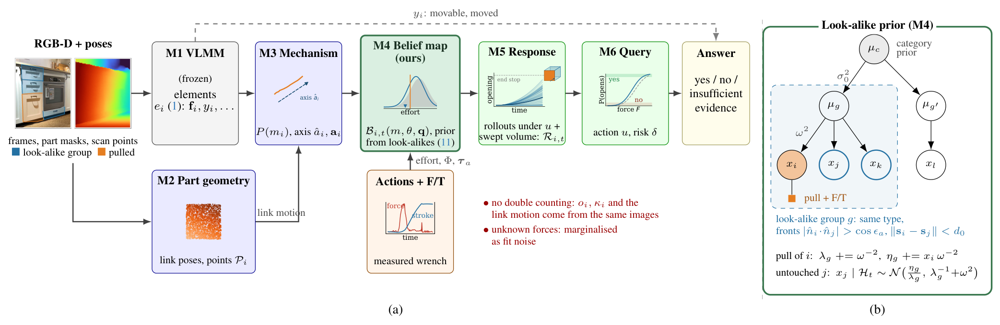
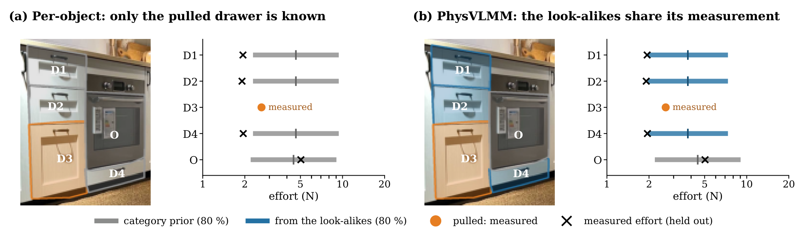
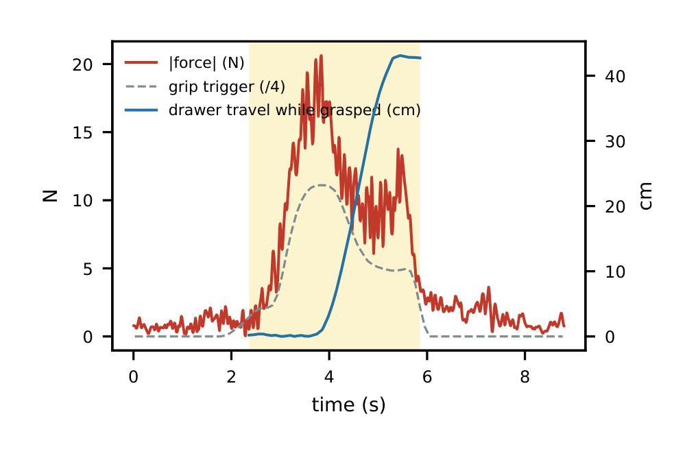
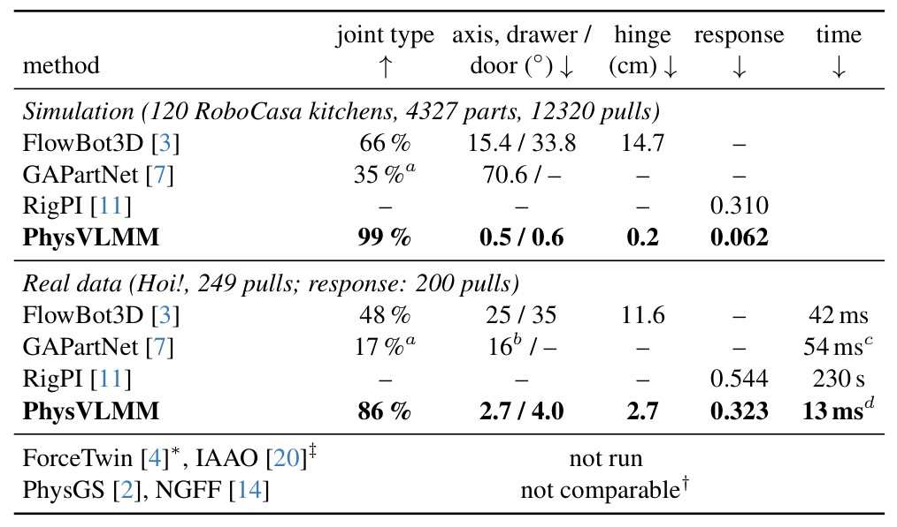
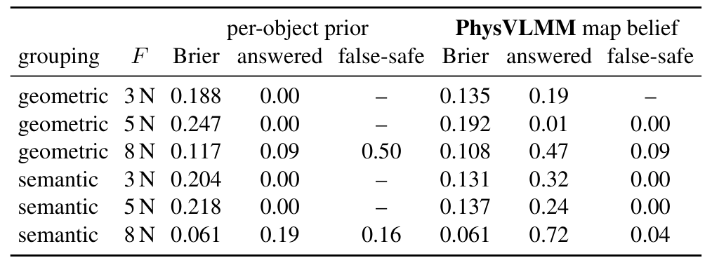
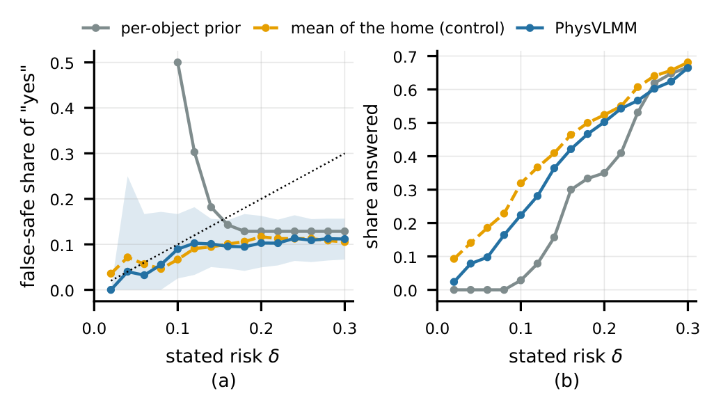
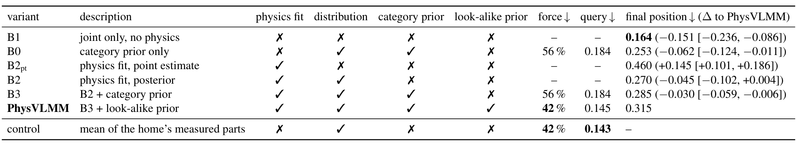
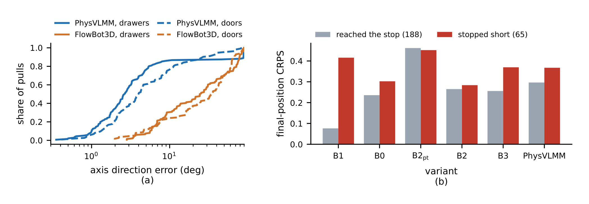

# PhysVLMM: Interaction-Conditioned Physical Belief Maps for Articulated Objects in Robot Scene Maps

移动机器人要打开一扇门或一个抽屉，场景地图通常只告诉它“这是什么、在哪里、有没有动过”，却不告诉它“我拉一下，它会怎么响应”。这篇论文的出发点就是补上这层缺失：为地图里每一个铰接部件维护一个物理信念，并让规划器在拉动之前就能问到“这个力会不会让它继续走、会不会撞到东西”，答案还必须是带风险约束的，或者在证据不足时明确弃权。

作者是 Dibyendu Ghosh，论文以 arXiv:2610.40539 公开于 2026 年 10 月 29 日，属于 cs.RO 方向的单作者预印本。全文的核心论证不是“再训一个更大的模型”，而是先证明两件事：只看部件运动无法辨识它的动力学；一次测量拉动也只能辨识被拉的那个部件。两条命题把问题逼到一个很窄的出口——未触摸部件的唯一证据只能来自其他已测部件——整篇方法就是围绕这个出口设计的。

## 地图知道“是什么”，却不知道“拉一下会怎样”

论文把开门任务拆成四个问题：这个部件是否可动、是否移动过；它朝哪个方向开；机器人能施加的拉力是否足以让它继续运动；它在运动途中会不会撞到障碍。前两个问题关于对象本身，后两个关于对象对动作的响应。已有工作分别覆盖了其中一部分：概率运动学模型跟踪关节类型与轴，主动感知方法选择动作降低不确定性，单视角学习方法从静态扫描预测点运动，开放词汇地图与 Vision-Language-Motion Map（VLMM）回答“是什么、是否可动”，铰接场景图补上关节类型与轴，交互式重建则把部件做成数字孪生。

这些地图的共同缺口是：它们不预测“对某个提议动作的响应”。真正估计动力学的方法又大多一次只处理一个物体。ForceTwin 用带力传感的夹爪辨识惯性、摩擦、阻尼与闭合器力；RigPI 用可微分仿真把视觉语言先验与力数据对齐；Heiden 等人的方法则对仿真器参数保留后验。它们都要求先探测目标部件，ForceTwin 甚至明确把“迁移到未探测部件”留作未来工作。于是问题变成：在一个有几十个门和抽屉的住宅里，机器人不可能把每个部件都拉一遍，地图能不能从已经拉过的部件推断没拉过的？

论文的答案建立在一个看起来有点反直觉的判断上：与其为每个部件单独拟合一组动力学参数，不如把“一次拉动到底确定了什么、没确定什么”显式建模，再把确定的那部分证据传给同类部件。这个判断由两条可辨识性命题支撑，也直接决定了后面的三个设计步骤：保留不可辨识方向的后验、在 look-alike 组内共享证据、只在给定风险下回答。

需要一开始就说明一个边界：所有实验都使用 oracle 的部件身份、描述与三维扫描点，PhysVLMM 与对比方法读同一份输入。论文刻意把物理推断与感知分开，因此它证明的是“给定正确部件与几何，物理信念能做什么”，而不是一个端到端机器人系统。这个选择让比较更干净，但也意味着分割、部件识别、描述生成出错时会发生什么，论文没有回答。

## 两条可辨识性命题：为什么必须保留一个方向的后验

先把部件写成一根刚性连杆 D，通过一个关节连接到固定机体，关节类型 $m_i\in\{\text{fixed},\text{revolute},\text{prismatic}\}$，单位轴 $\hat a_i$ 过点 $a_i$。关节坐标 $q$ 在关闭时为 0，连杆位姿与连杆上任意点 $x_D$ 的世界坐标为

$$T_{WD}(q)=T_{WH}\exp(\hat\xi_i q)T_{HD}(0),\qquad x_W(q)=T_{WD}(q)x_D,$$

其中 $H$ 是关节轴上的一个参考系，$\hat\xi_i$ 是关节 twist。这个模型覆盖绕一个铰链转动的门、沿一条轨道滑动的抽屉、盖子、窗户与阀门；自由物体、可变形物体、多关节或带锁机构不在其中。几何量 $G_i=(m_i,\hat a_i,a_i,P_i,[q_i^-,q_i^+])$ 还包含运动连杆的点集 $P_i$ 与关节限位，前者用于碰撞扫掠。

关节运动满足单自由度动力学

$$I\ddot q+b\dot q+\tau_c\,\mathrm{sgn}(\dot q)+kq+\tau_0=J(q)^\top w+\tau_{ext}+\tau_{con},$$

其中 $I$ 是广义惯量，$b$ 是黏性阻尼，$\tau_c$ 是库仑摩擦，$k$ 与 $\tau_0$ 是闭合器刚度与预紧，$\theta_i=(I,b,\tau_c,k,\tau_0)$。作用在把手上的力旋量 $w=(F,M)$ 通过 $J(q)^\top w$ 进入；实验只用力和夹爪位置，不用力矩。$\tau_{ext}$ 是机器人测不到的外力，比如人的手；$\tau_{con}$ 是障碍与限位的接触反力，满足互补条件。

在没有接触时，方程对 $\theta_i$ 是线性的：

$$\varphi(t)^\top\theta_i=\tau_a(t)+\tau_{ext}(t),\qquad \varphi=(\ddot q,\dot q,\mathrm{sgn}\,\dot q,q,1)^\top.$$

这条式子是把动力学变成回归问题的关键：每个时间采样给出一行 $\varphi(t)^\top$，未知量只有五个。论文的 Proposition 1 说，如果 $\tau_a+\tau_{ext}$ 没有被测量，那么对任意 $\theta$，都可以构造一条分段连续的力轨迹让同一个 $q(t)$ 精确成立；因此被动观看只能识别几何 $G_i$，不能识别 $\theta_i$。直观上，摩擦、阻尼、惯量之间可以互相补偿，只要外力任意，任何运动都能被无数组参数解释。

Proposition 2 进一步说，即使测到了 $\tau_a$，也只有当回归矩阵 $\Phi=[\varphi(t_1),\dots,\varphi(t_N)]^\top$ 满列秩时 $\theta_i$ 才可辨识。对恒定拉力，$\Phi(\theta_i-\tau_a e_5)=0$，回归矩阵秩亏，最多只能识别 $(I,b,\tau_c,k,\tau_0-\tau_a)$ 的某个公共尺度；对单向运动，$\tau_c$ 与 $\tau_0$ 无法分开，只能识别它们在开启时的和、或关闭时的差。更关键的是，部件 $i$ 的测量对 $\theta_j$ 没有信息，除非两者的参数在统计上相关。两条命题的证明均在附录 A。

*论文原图编号：Fig. 7。门板绕铰链轴转动、把手受力、扫掠体积与首次接触 q_free 的平面示意；它把式 (4) 的广义力与碰撞查询的几何关系画在一起。*

这两条命题并没有把问题封死，反而指出了唯一可走的路线。单向拉动虽然留下一个不可辨识方向，但开启努力量只依赖 $\tau_c$ 与 $\tau_0$ 的和：

$$\bar F_i=\frac{b\bar v+\tau_c+k\bar q+\tau_0}{r_i},$$

其中 $\bar v$ 是稳态速度、$\bar q$ 是中段行程、$r_i$ 是转动关节的把手半径（移动关节取 1）。也就是说，$\theta_i$ 仍然未知，但“让这个部件继续走需要多大力”这件事，被一次开启拉动固定住了。这个区分是整篇论文的支点：不需要知道完整动力学，只需要知道对规划器有用的那个标量，以及它还有多少不确定性。

表 4 用一个仿真单转动关节检查了秩条件：恒定力开启只有 3/5 秩，斜坡力 4/5，拉动后释放 5/5，两个力级再释放也是 5/5。它支持的是“单向拉动确实秩亏”，而不是“真实住宅里的所有拉动都只有 3/5 信息”；真实人类拉动的力剖面更丰富，但方向仍然单一，所以 $\tau_c$ 与 $\tau_0$ 的不可分性依然存在。

*论文原图编号：Table 4。表中给出单转动关节在四种力矩剖面下的 Fisher 信息秩；恒定力只有 3/5，拉动后释放才满秩。它支撑命题 2 的秩亏论证，但只是仿真单关节检查。*

## 方法主线：一次拉动如何变成全图的物理信念

地图元素原本是 VLMM 的七元组 $e_i=(p_i,f_i,o_i,\kappa_i,\rho_i,y_i,c_i)$，包含位置、语义特征、观测运动分数、可靠性、可动先验、融合运动类别与置信度。PhysVLMM 不改这七项，而是把每个铰接元素扩展为

$$\langle e_i,G_i,B_{i,t}(m_i,\theta_i,q_{i,t}),R_{i,t}\rangle,$$

其中 $B_{i,t}$ 是给定全部因果可用证据 $H_t$ 的后验，$R_{i,t}$ 是对提议动作的响应分布。这个表示的关键在于：地图不再只存“状态”，而是存“状态 + 对动作的预测分布”。

论文把这条链路写成两个算法：地图更新（Algorithm 1）负责从观测运动与测量拉动写入 $G_i$ 与 $B_{i,t}$，查询（Algorithm 2）只读地图，按动作、目标开度与风险返回三值答案。下面的四个步骤对应这两个算法的执行顺序。

### 机制流程

*论文原图编号：Fig. 1。该图把 M1–M6 的执行链与 look-alike 先验放在同一张总览里；(a) 是从 RGB-D 到三值回答的模块流，(b) 是一次拉动如何经组均值 µ_g 传到未触摸的 x_j。放在机制流程开头，是因为后文四个步骤正好对应这六个模块。*

整条链路可以按一次真实拉动的顺序走一遍。

1. **输入与语义层。** RGB-D 帧、部件掩码与扫描点进入 M1，冻结的 VLMM 给出语义特征 $f_i$、运动类别 $y_i$ 与可靠性 $\kappa_i$；M2 从扫描点提取连杆位姿与点集 $P_i$。这里有一个容易忽略的实现约束：观测运动 $o_i$、可靠性 $\kappa_i$ 与连杆运动来自同一批图像，所以它们只用来参数化先验或做分类，绝不能再作为一份独立似然乘进去。图中那句“no double counting”说的就是这件事。
2. **关节几何。** 一次拉动中观测到连杆位姿序列 $(c_t,R_t)$，M3 分别拟合直线路径（移动关节）与绕固定轴的刚体旋转（转动关节）。每个模型算一个 profile log-likelihood 与 BIC；再用位置-only 的直线/圆弧检验、旋转幅值 $\psi_i$ 与路径长度 $s_i$ 组成特征，经 L2 正则逻辑回归给出 $P(m_i=\text{rev})$。轴从圆弧拟合的平面法向与圆心得到，或从路径主方向得到。输出 $G_i$ 进入 M4 的回归坐标与 M5 的碰撞扫掠。
3. **物理后验与证据共享。** 抓取相位的力/力矩 $f(t)$、夹爪轨迹 $c(t)$、夹持信号 $\gamma(t)$ 进入 M4。先由 $\gamma(t)>\gamma_0$ 与速度阈值得到 grasped phase 与 moving set，取运动段 log 中位力作为努力量 $x_i$；再用类别先验与已测 look-alike 构造 $\theta_i$ 的高斯先验，用回归量 $\Phi$ 与广义力 $\tau_a$ 做 5×5 后验。同时，$x_i$ 以两个加法写入组自然参数 $(\lambda_g,\eta_g)$，未触摸的同类部件立刻得到预测分布。
4. **风险查询。** 规划器给出动作 $u$、目标开度 $q^*$ 与风险 $\delta$，M5/M6 从 $x_j$ 或后验样本算成功概率，对后验样本 rollout 关节方程，并把 $P_j(q)$ 沿关节扫掠得到首次接触开度 $q_{free}$；最后按 $p=p_{succ}\cdot\mathbf{1}[q_{free}\ge q^*]$ 与 $\delta$ 比较，返回 yes、no 或 insufficient evidence。

这条链路的一个工程含义是：真正昂贵的部分不是查询，而是一次拉动后的拟合。一次拉动只花一个有界最小二乘、一个 5×5 求解与两个加法；查询只花一个正态 CDF 与每个扫掠点的一次 k-d 树搜索；响应则是对每个后验样本积分一维关节方程。没有任何环节通过仿真器做优化，所以延迟是毫秒级，而不是秒级。

复杂度上，分组在每张地图上做一次 $O(n^2)$ 的单连接，努力量更新与查询是 $O(1)$，动力学后验是 $O(N)$（$N$ 为一次拉动的样本数），响应是 $S$ 次 rollout，接触查询是一次 k-d 树扫掠。这个代价结构解释了为什么它适合地图级在线更新：昂贵的部分只在“拉动”发生时才付出，查询本身几乎是常数。

### 关节类型与轴：几度运动就够，但人的手不够硬

M3 的拟合并不复杂：移动关节假设“直线、无旋转”，残差是点到主线的垂距与旋转角；转动关节假设“绕固定轴旋转”，用相对旋转向量的角度加权均值估计 $\hat a$，再用最小二乘解圆心 $a$。两个模型各自估计残差方差，算 BIC；逻辑回归的特征是 $\Delta\mathrm{BIC}$、圆弧检验的 $\Delta\mathrm{BIC}_{arc}$、旋转幅值 $\psi_i$ 与路径长度 $s_i$。

论文给了一个理想化检查：在 1° 位姿噪声下，开启 1°、2°、5° 时，转动关节被正确偏好的概率分别是 0.68、0.84、0.99。也就是说，几度运动原则上就足以判断类型。但真实数据里人的握持不是刚性的，夹爪路径会拟合出错误的关节；论文报告当类型判错时，错误类型仍然得到平均 0.83 的概率。这不是一个可以用更多数据自动消失的误差，而是观测模型本身的偏差。

### 被拉部件的后验：让数据决定能决定的方向

一次拉动给出 $\Phi$ 与 $\tau_a$。以高斯先验 $(m_0,V_0)$ 起步，其中 $m_0$ 是类别中位数、$V_0$ 是类别方差并按已测 look-alike 收缩，后验为

$$V=\left(V_0^{-1}+\Phi^\top\Phi/\sigma_{eff}^2\right)^{-1},\qquad m=V\left(V_0^{-1}m_0+\Phi^\top\tau_a/\sigma_{eff}^2\right).$$

这里 $\sigma_{eff}^2$ 是残差方差乘以固定因子 15，约等于 31 个采样平滑窗口的一半。这个因子不是从数据估的，而是人为放大后验，用来吸收“平滑后的导数进入回归量”所带来的误差；论文说在 Hoi! 的位姿与力噪声下，如果不放大，拟合出的惯量会低约 30%。这是一个诚实的实现细节，但也意味着后验宽度有一部分是调出来的，换数据或换平滑窗口需要重新确认。

后验最重要的性质在不可辨识方向上：沿该方向 $\Phi^\top\Phi$ 近似奇异，后验精度等于先验精度，所以数据不会在那里随便选一个值。点估计则必须选一个值，这个任意选择会在 rollout 中放大。论文的消融正是用 B2pt 与 B2 的对比来检验这一点。

响应 $R_{i,t}(u)$ 是对后验样本的 rollout 平均：每个样本 $\theta^{(s)}$ 代入关节方程，用半隐式步长 $\Delta t=0.01$ s 积分，遇到静摩擦时保持 $\dot q=0$，关节限位取训练拉动达到的范围并向两端扩 5%。这一步得到的是运动分布，不是一条确定性轨迹。

### 相似件之间的证据共享：一次拉动如何惠及未触摸部件

共享的前提是分组。分组只用“任何部件移动之前就能看到”的信息：部件描述与扫描点 $P_i$。类型由描述决定，出现 drawer、sliding、pull-out 就判为移动关节，否则为转动关节；部件正面是 $P_i$ 的 RANSAC 主平面，法向 $\hat n_i$、中心 $s_i$。同屋同类型的两个部件满足

$$|\hat n_i\cdot\hat n_j|>\cos\epsilon_a,\qquad \|s_i-s_j\|<d_0,$$

就建一条边，取连通分量作为组；默认 $\cos\epsilon_a=0.98$、$d_0=1.5$ m，语义变体则用 CLIP 特征相似度超过 0.9。少于 50 个扫描点或没有描述的部件不进入分组，也不参与超参数拟合。关节标注不参与分组，这一点保证了“未触摸部件”的信息不是从标签泄漏来的。

组内努力量用层级高斯模型：

$$\mu_g\sim\mathcal N(\mu_c,\sigma_0^2),\qquad x_i\mid\mu_{g(i)}\sim\mathcal N(\mu_g,\omega^2),$$

其中 $\mu_c$ 是其他住宅中该类型的平均努力量，$\sigma_0^2$ 是组间方差，$\omega^2$ 是组内方差。自然参数从 $(1/\sigma_0^2,\mu_c/\sigma_0^2)$ 起步，每测到一个部件就加 $(1/\omega^2,x_i/\omega^2)$。于是未触摸部件 $j$ 的预测为

$$x_j\mid H_t\sim\mathcal N\!\left(\frac{\eta_{g(j)}}{\lambda_{g(j)}},\ \lambda_{g(j)}^{-1}+\omega^2\right).$$

一次拉动只改两个数，却更新整个组，这是“闭式共享”的字面含义。它的上限也由这个式子决定：Proposition 3 指出预测方差随组内实测数 $n$ 单调下降，但下界是 $\omega^2$；即使组均值完全已知，组内个体差异仍然存在。Hoi! 拟合出的组内 effort 乘性离散 $e^\omega$ 约为 1.56，所以理论上最多约 39% 的未触摸部件能被预测到 1.25 倍以内（只有先验时 31%）。实测是 PhysVLMM 41%、同屋均值 43%、先验 26%——共享确实有用，但离“精确预测”还很远，而且同屋均值已经能做到 43%。

*论文原图编号：Fig. 2。左图只有被拉的 D3 有实测，右图把这次拉动共享给 D1、D2、D4，另一个组的烤箱 O 仍保留类别先验。它直观展示共享的方向，但真实增益要看表 2 的数值。*

这张图值得和上面的数字一起看。左图中 D1、D2、D4 的区间几乎就是类别先验的宽度；右图把 D3 的实测传到同组后，区间明显收窄，但 D1、D2、D4 的实测点并没有全部落进区间。这正是 $\omega^2$ 下界的直观表现：共享能把“这个组大概需要多大力”告诉你，却不能保证“这个具体抽屉一定在这个范围内”。

### 风险约束查询与碰撞：把“不知道”作为合法输出

对提议动作 $u$，查询要回答的是

$$P(\text{success}_q\wedge\neg\text{collision}\mid u,H_t)\ge 1-\delta,$$

其中 $\text{success}_q$ 是任务谓词，比如“部件继续运动”或“到达目标开度 $q^*$”。碰撞项由扫掠 $P_j(q)$ 与扫描场景决定；当碰撞被排除后，“力 $F$ 能让部件在中段继续运动”这个谓词退化为 $P(\bar F_j\le F\mid H_t)\ge 1-\delta$。用预测分布 (11) 的均值 $\hat x_j$ 与方差 $v_j$，它有闭式

$$P(\bar F_j\le F\mid H_t)=\Phi_N\!\left(\frac{\log F-\hat x_j}{\sqrt{v_j}}\right).$$

判定规则是三值的：概率至少 $1-\delta$ 返回 yes，至多 $\delta$ 返回 no，否则返回 insufficient evidence。这个设计的价值不在于“更准”，而在于它把弃权变成一等公民。对机器人来说，一个明确说“我不知道”的地图，比一个自信地给出错误 yes 的地图更安全；论文的 false-safe 指标就是围绕这一点设计的。

碰撞部分是一个确定性的几何检查：把连杆点集降到主平面，附上把手前方的点，沿关节扫掠，找到第一个与扫描点距离小于 1 cm 的开度 $q_{free}$。查询返回的 $p$ 是成功概率乘以“$q_{free}$ 是否达到目标”的指示。这个模块的代价是每个部件约 2.5 ms，远高于 0.03 ms 的力查询，但仍然是毫秒级。

需要明确的是，这里评估的查询只是“中段继续运动”，不覆盖拉动开始时的 breakaway force；碰撞也只是几何扫掠，不包含摩擦、变形或可推动的障碍。论文在结论里把这两点都列为边界。

## 实验：真实住宅与仿真各证明了什么

实现是 Python 3.10 + NumPy/SciPy，跑在一台笔记本上（AMD Ryzen 7 7840HS，8 核，32 GB 内存，RTX 4060 Laptop 8 GB）；物理信念层 M2–M6 只用 CPU。真实数据来自 Hoi!：夹爪带 6 轴力/力矩传感器（100 Hz）、Aria 头显的 SLAM 轨迹与夹持触发器，住宅激光扫描提供每个部件的关节类型、轴、三维点与描述；20 个释放的住宅中 18 个有力量记录，2 个开发住宅只用来定对比方法的输入与碰撞容差；关节类型与碰撞在其余 16 个家上评分，力与查询在 17 个有 look-alike 组的家上评分，最终位置用全部 18 个家。共 249 次 held-out 拉动，响应比较用其中 200 次。仿真用 120 个 RoboCasa 厨房（10 种布局 × 12 种风格），4327 个部件、12320 次拉动，另有 503 个 blocked 部件，其中 471 个有轴估计可做碰撞检查。

协议有三个值得肯定的地方。第一是 oracle 感知：部件身份、描述、三维点都来自扫描标注，所有方法共享，物理推断与感知被分开评估。第二是无泄漏：关节标注只用于评分与一项数据检查；窗口选择、look-alike 分组、运动分数只用夹爪路径、描述与扫描点；所有学习量（校准、类别先验、组方差）都在被评估住宅之外拟合。第三是 known-answer tests：每个组件先在有已知答案的合成案例上检查，测试发现了三个错误（端限位接触样本污染动力学回归、1 cm 接触距离未生效、31 采样平滑把端限位冲击扩散到回归样本），都在正式结果前修掉了。这种自曝其短的做法在机器人论文里并不常见。

真实数据的一个关键细节是只使用 grasped phase。每段记录都包含走向把手与离开把手的过程，图 3 展示了一次衣柜抽屉拉动：力、夹持触发与抽屉位移在时间上并不同步，阴影标出真正抓住并运动的区间。努力量取的是这个区间内 log 中位力，而不是整段记录的平均力；这个选择直接决定了 $x_i$ 的噪声水平。

*论文原图编号：Fig. 3。一次衣柜抽屉拉动的力、夹持触发与抽屉位移；阴影是抓取相位。它说明为什么只使用 grasped phase，以及努力量为什么取运动段的中位力。*

### 主结果与强基线

表 1 把仿真与真实数据放在同一张表里，列分别是关节类型准确率、抽屉/门轴误差、响应 CRPS 与单案例时间。真实数据上，PhysVLMM 的关节类型是 86%，FlowBot3D 是 48%，GAPartNet 是 17%；轴误差是抽屉 2.7°、门 4.0°，FlowBot3D 是 25°/35°。响应 CRPS 是 0.323 对 RigPI 的 0.544，论文报告约低 41%；时间 13 ms 对 230 s，约四个数量级。仿真上 PhysVLMM 是 99%、0.5°/0.6°、0.2 cm、0.062 CRPS，优势更大，但仿真的关节是从受控 20 N 拉动估计的，比人类拉动容易。

*论文原图编号：Table 1。上块是 120 个 RoboCasa 厨房的仿真结果，下块是 Hoi! 真实住宅；列分别是关节类型、抽屉/门轴误差、响应 CRPS 与单案例时间。它是主结果表，也是后文所有比较的基准。*

读这张表时要注意三点。第一，FlowBot3D 与 GAPartNet 都是单视角静态方法，它们没有观察连杆运动，而 PhysVLMM 观察了；这不是同等信息条件下的比较，论文也承认 FlowBot3D 在真实数据上还不如“永远回答 drawer”的 55%。第二，GAPartNet 只在 42% 的部件/45% 的拉动上给出答案，没答案按错误计；它的抽屉轴误差来自 106 次拉动，门铰链则没有释放代码规则。第三，RigPI 的模型没有阻尼、弹簧与预紧，而门闭合器和抽屉滑轨恰恰有这些；它的视觉语言先验也未公开，论文只能用扫描面板尺寸重建先验（18 mm 木、650 kg/m³）。所以“快四个数量级”是可靠的工程结论，“误差低 41%”则是在一个模型表达力不对等的比较里得到的。

运行时间的拆解也值得记住：一个 PhysVLMM 案例里，机构与轴 1.2 ms、物理信念 1.5 ms、响应 4 ms 每秒动作（50 个 rollout）；查询 0.03 ms，碰撞检查每部件 2.5 ms。瓶颈在响应与碰撞，而不是后验本身。

### 查询校准：false-safe 是否真的被 δ 约束

表 11 把查询按几何/语义分组与 3、5、8 N 三个力级拆开，报告 Brier、回答率与 false-safe 比例（δ=0.1）。最直观的对比是：per-object 先验在 3 N 与 5 N 从不回答（answered 0.00），几何分组的地图信念在 3 N 回答 19%、5 N 只回答 1%；到 8 N，它回答 47%，其中 9% 是 false-safe。论文报告在 96 个部件上，语义分组与几何分组的力误差差异不显著（+0.04 [−0.00,+0.08]），但两者的回答率并不相同：8 N 时语义分组回答 72%、false-safe 4%，几何分组回答 47%、false-safe 9%；回答率差异不能单独当作分组优劣的证据。

*论文原图编号：Table 11。表里按几何/语义分组与 3、5、8 N 三个力级，列出 per-object 先验与地图信念的 Brier、回答率与 false-safe 比例；δ 固定为 0.1。*

图 6 把 δ 从 0.02 扫到 0.30，覆盖 420 个未触摸部件查询。PhysVLMM 的 false-safe 率始终在 δ 以下，per-object 先验则在 δ=0.10–0.14 第一次回答时就超过了 δ；同屋均值也接近 δ，且回答得略多。这个结果支持“校准后的三值回答”这一核心主张，但它是在 Hoi! 的 17 个家上、用同一套拟合协议得到的，跨建筑与跨部件类型的校准还没有被检验。

*论文原图编号：Fig. 6。(a) 是 false-safe 比例随声明风险 δ 的变化，(b) 是回答率；灰色带是 PhysVLMM 的 95% 置信带。它检验的是校准，而不只是平均误差。*

### 碰撞：能减少误报，但还远不能提供安全保证

真实住宅里没有碰撞真值，所以只能测误报：把人在实际开启过程中到达的 90% 之前就预测碰撞算作 false alarm。PhysVLMM 的扫掠点让 23% 的部件误报，包围盒基线是 40%；用 oracle 关节轴时降到 19%，说明轴误差贡献了一部分误报。仿真里有 471 个 blocked 部件可测漏检：PhysVLMM 漏掉 59%，包围盒漏掉 61%，同时对 13% 的自由部件误报。作者自己的结论是“碰撞模块还不够可靠，不能提供安全保证”。这句话很重要，它把前面的风险约束限定在“力是否足够”这一维，而不是完整的动作安全。

## 消融与失败边界：哪些增益是真的，哪些只是先验

表 2 是全文最值得细读的表。它只切换一个组件：B1 只用机构、不拟合物理，直接预测部件跑到限位；B0 只用类别先验；B2pt 是物理拟合的点估计；B2 是物理拟合的后验；B3 在 B2 上加类别先验；PhysVLMM 在 B3 上加 look-alike 先验；control 用同屋已测同类型部件的均值替代 look-alike 组。指标是 140 个未触摸部件的力误差、查询 Brier，以及 253 次 held-out 拉动的最终位置 CRPS。

*论文原图编号：Table 2。每一行只切换一个组件，最后一行 control 用同屋已测部件的均值替代 look-alike 组。它同时给出力、查询与最终位置三组指标，是判断各组件真实贡献的关键表。*

先看最刺眼的一行：B1 的最终位置 CRPS 是 0.164，比 PhysVLMM 的 0.315 好得多。原因不是 B1 更懂物理，而是 Hoi! 的人类拉动大多到达限位——74% 的拉动在限位 20% 以内结束——所以“总是预测跑到限位”在这个数据分布上几乎总是对的。论文没有回避这一点，而是把拉动分成“到达限位（188 次）”与“中途停下（65 次）”：在中途停下的子集上，B1 与 B2pt 是最差的，B2 最好；B1 减 PhysVLMM 的差值为 +0.048，95% CI [−0.039,+0.126] 跨零，所以“PhysVLMM 显著优于无物理基线”这句话在真实数据上不成立。

第二个反直觉结果是后验的代价。B2pt→B2 把最终位置从 0.460 降到 0.270，这是后验的直接收益；但整条轨迹的 RMSE 从 0.468 升到 0.608（表 6）。解释并不矛盾：最终位置只关心“停在哪”，不可辨识方向对它的影响可以被边缘化掉；整条轨迹则同时受这个方向与样本散布的影响，保留后验反而让平均轨迹更宽、RMSE 更大。论文没有把这一点藏起来，而是明确写了“whole-trajectory error rises”。

第三个结果是先验的分工。B2→B3 把最终位置从 0.270 升到 0.285，PhysVLMM 再升到 0.315；也就是说，类别先验与 look-alike 先验对被拉部件自己的最终位置没有帮助，因为它的自身数据已经占主导。但在整条轨迹上，两个先验把 RMSE 从 0.608 降到 0.502、再到 0.488。先验不是“让所有指标都更好”的万能项，它改善的是数据稀疏的方向，代价是可能把有数据的方向也拉向组均值。

第四个结果是共享的对照。PhysVLMM 的力误差 42%、查询 Brier 0.145；control 的力误差也是 42%、Brier 0.143。差值分别是 −0.00 [−0.03,+0.02] 与 −0.002 [−0.012,+0.006]，都跨零。论文的结论很直接：“在这些住宅里，look-alike 组相对同屋所有已测同类型部件的平均，没有可测的额外增益。”这句话削弱了“分组算法”的贡献，但没有削弱“共享”本身：control 也是一种共享，只是更粗。真正被数据支持的是“从已测部件向未测部件传递证据”，而不是“必须用几何/语义 look-alike 分组”。

仿真表 3 给出了另一面：在固定 3–12 N 拉动下，PhysVLMM 的最终位置 0.062，B3 0.064，B2 0.169，B2pt 0.208，B1 0.743；力 50%（用真实组时 41%）、查询 Brier 0.165（真实组 0.133）。仿真里 look-alike 先验连被拉部件的最终位置都能改善，但这不能当作真实住宅的证据，因为仿真的物理参数正是从 Hoi! 的组模型拟合出来的；论文自己说，这个增益“显示的是当组模型成立时分组能带来什么，而不是它在真实住宅成立”。

图 4 把真实数据的边界画得很清楚。(a) 是轴误差分布，PhysVLMM 的曲线整体左移；(b) 按“到达限位/中途停下”拆开最终位置，B1 在灰色柱（到达限位）上极低，在红色柱（中途停下）上很高，PhysVLMM 则在红色柱上略好于 B1，但差距不大。读这张图时，如果只看整体 CRPS，会得出“B1 更好”；如果只看 stopped-short 子集，会得出“PhysVLMM 更好”；两个结论都只对相应子集成立，真正的结论是“当前数据分布让一个强数据先验基线很难被显著击败”。

*论文原图编号：Fig. 4。(a) 是 FlowBot3D 与 PhysVLMM 的轴误差分布；(b) 把最终位置误差按“到达限位/中途停下”拆开。后者是理解 B1 为什么整体更强、PhysVLMM 只在 stopped-short 子集更好的关键。*

## 我的判断：这篇论文真正改变了什么

这篇论文最有价值的地方，不是某个数字，而是把“地图里的物理知识”重新表述成一个可辨识性问题。已有方法要么只存语义与运动属性，要么对每个物体单独做系统辨识；PhysVLMM 指出，在单次交互下完整动力学本来就不可辨识，所以正确的地图表示不是一组点估计参数，而是一个保留不可辨识方向的后验，加上一个只依赖可辨识标量的查询接口。这个思路可以迁移到其他欠约束的物理推断：先问“这次观测到底确定了什么”，再设计表示与查询，而不是先假设参数可辨识再硬拟合。

第二个可复用的点是闭式共享。组层级高斯让一次拉动只改两个自然参数，就能更新整个组，计算代价是常数级；这对地图级、在线、低算力的机器人很合适。但论文的对照也提醒我们：共享的收益来自“统计依赖”，不来自“分组有多聪明”。如果同屋同类型平均已经足够，复杂的 look-alike 规则未必值得；反过来，如果建筑里同类部件分布很散，分组可能才真正有价值，而这篇论文的数据没有展示这种情形。

第三个点是风险约束与弃权。把 false-safe 率作为一等指标、把 insufficient evidence 作为合法输出，这比单纯报告平均误差更接近机器人部署的需求。但这条保证目前只在“力是否足够”这一维成立，碰撞模块的漏检率让完整动作安全仍然不成立；论文对此的坦白是加分项，也说明它离“可部署的安全保证”还有距离。

从证据边界看，至少还有五件事没有被证明。其一，所有实验用 oracle 感知，真实分割与描述错误的影响未知。其二，真实数据只有门与抽屉，且每个部件都移动，fixed 关节、盖子、窗户、阀门、多关节与带锁机构都未评估。其三，Hoi! 缺少固定机器人动作与碰撞真值，最终位置与碰撞结论受人类拉动分布限制；B1 的整体优势很大程度上是“多数拉动到限位”这一数据特征。其四，look-alike 分组相对同屋平均没有显著增益，分组算法的必要性没有被建立。其五，碰撞模块漏检 59%，作者明确说还不能提供安全保证。

和强基线相比，PhysVLMM 的位置应该这样理解：相对 FlowBot3D/GAPartNet，它的优势主要来自“观察运动”而不是“更好的静态先验”，所以比较不是同等信息条件下的；相对 RigPI，它的优势是速度与模型形式（显式阻尼/摩擦/弹簧），代价是单自由度与线性假设；相对 ForceTwin，它没有在相同数据上运行（代码未释放），只做了定性定位；IAAO 也因代码未释放未运行，PhysGS 与 NGFF 则因没有关节响应而不可比；相对 VLMM，它把“是否可动”推进到“对提议动作的响应”，这是概念上的增量。论文没有声称自己解决了端到端机器人操作，这个克制是准确的。

如果要继续做，我会优先追三个问题。第一，把 oracle 部件换成真实分割与开放词汇描述，看 look-alike 分组与物理后验的增益还剩多少；这决定了方法能否离开标注数据。第二，在固定机器人动作、包含碰撞与部分开启的真实数据上重做 B1 对比；只有在动作分布不再偏向“到限位”时，物理信念的价值才会显出来。第三，把碰撞漏检拆成扫描稀疏、点集降维与扫掠几何三部分，定位 59% 的主要来源；否则风险约束只能停留在力这一维。

## 参考资料

论文主页：[arXiv:2610.40539](https://arxiv.org/abs/2610.40539)。数据集 Hoi! 见 [arXiv:2512.04884](https://arxiv.org/abs/2512.04884)；对比方法 FlowBot3D、GAPartNet、RigPI、ForceTwin 与 VLMM 的出处分别在论文参考文献 [3]、[7]、[11]、[4]、[8]；仿真平台是 RoboCasa 与 ManiSkill 3。本文所有页码、数值与消融结论均取自上述论文正文与附录，未引入外部数据。
