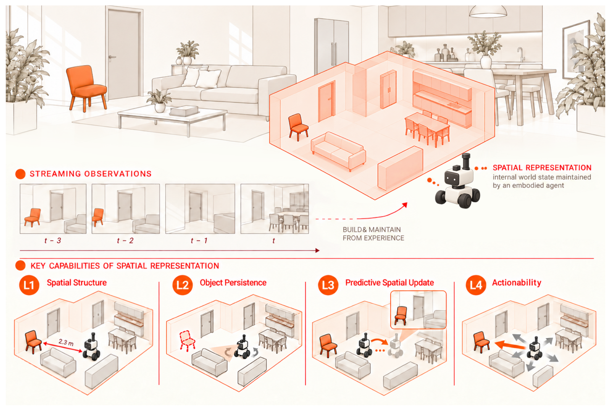
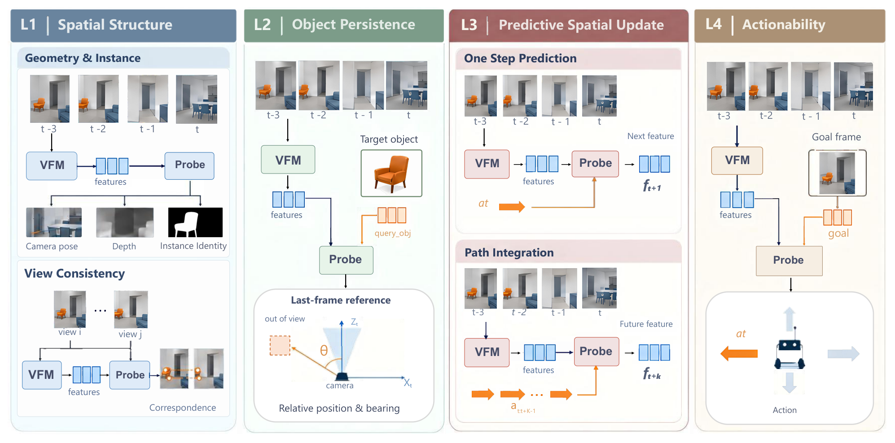
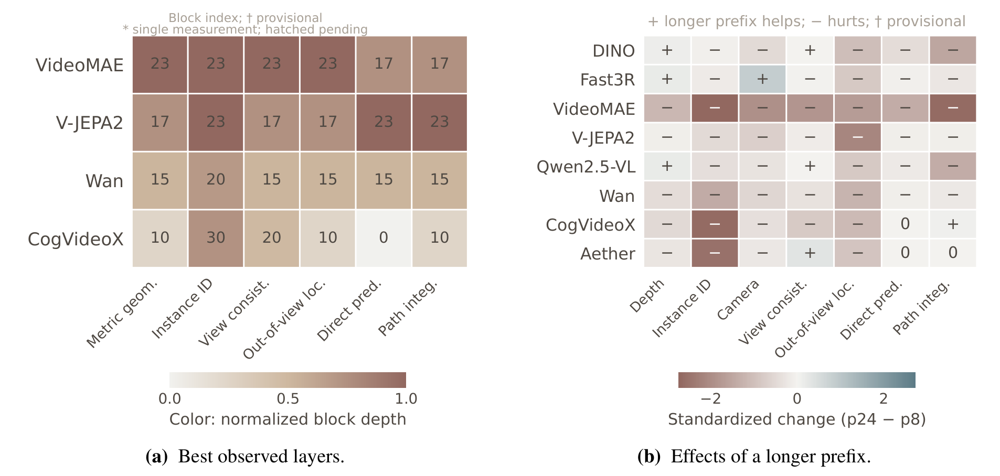
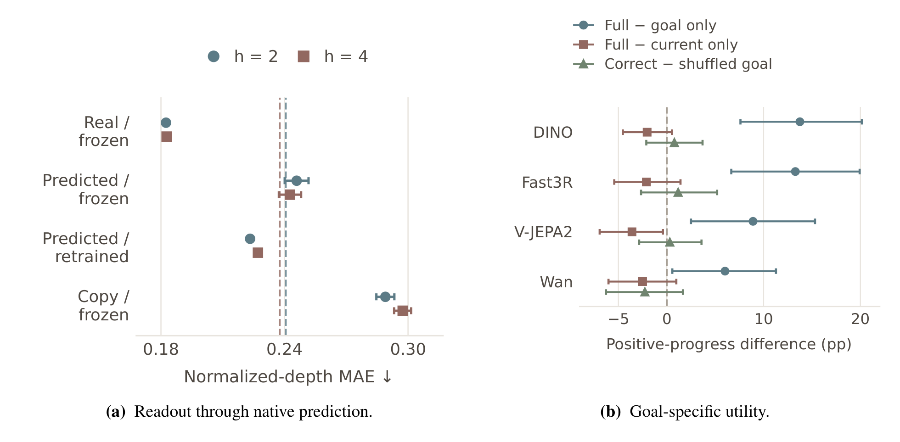

# Probing Spatial State Representations in Visual Foundation Models

一个观察者永远只看到周围世界的一部分，却要记住视野之外的沙发、门和餐桌在哪里，并在移动之后继续用这些信息选下一步动作。这篇论文问的是：今天这些视觉基础模型的内部特征，是否真的支持这样一种「空间状态」——不只是把当前画面读出来，而是把看过的物体留在表征里、在自运动下预测状态如何变化、并最终拿来服务目标。作者没有提出新模型，而是把这个问题拆成四个功能层级，用冻结特征的浅层探针在十个表示上逐层测量，并且用一组匹配控制把「读得出来」与「真的用了这些输入」分开。

作者 Baiqiao Yin、Zhongang Cai、Ruisi Wang、Qiwei Liang、Lei Yang、Ziwei Liu，来自纽约大学、南洋理工大学、香港科技大学与香港中文大学；2026 年 10 月 29 日提交，[arXiv:2610.40636](https://arxiv.org/abs/2610.40636)。

## 从「看见」到「维持一个空间状态」

把空间能力等同于「单帧识别得准」是这类研究最容易犯的错。作者给出的定义很克制：空间状态是周围环境相对观察者的构型，包括已经离开视野、但先前被观察到的物体；空间状态表示则是从观察者的视觉历史中推断出来的这种构型的内部编码。他们刻意不规定这必须是显式三维地图、物体中心场景图、某个坐标系或某种网络结构，只按功能有用性来评判。这一步很关键，因为它把「模型内部长什么样」这个难以回答的问题，换成了「从这组特征里能稳定读出什么、这些读数依赖哪些输入」这个可以实验的问题。

四个层级按「比当前观测多要求了什么」排序。L1 空间结构只读可见场景：度量几何（相机位姿与深度）、实例身份、视角一致性。L2 物体持续性要求在物体离开视野后仍保留其相对位置。L3 预测性空间更新要求在没有看到未来帧的情况下，根据自运动预判观察者相对状态会怎么变。L4 可行动性要求把表示与一个指定目标连起来，选出一个能朝目标推进的动作。这个排序是一个待检验的假设，而不是论文的结论：高层到底建立在哪些低层成分上，作者留到第 4.6 节用相关性回答。

实验范围也被明确限定了。观察者在一个静态室内环境里运动，模型收到的是因果的视觉前缀，没有任何未来帧；每个前缀被独立编码，因此测的是「一段因果前缀的表示能提供什么」，而不是模型是否维护了一个在线更新的状态。物体动力学、接触物理与完整世界建模都不在范围内。这个限定后面会反复出现，因为它决定了「持续性变差」不能被读成「模型没有记忆机制」。

## 四个层级如何变成可测任务

L1 用三个探针共用同一批前缀特征。度量几何同时回归当前相机位姿与场景深度，前者用 AUC@30（误差 30 度以内的位姿准确率曲线下面积）衡量，后者用尺度归一化后的深度损失衡量。实例身份在逐像素嵌入上做交叉熵分类，原型来自当前样本内的真实实例分组；论文特意说明它测的是身份可分性，不是掩码质量或分割 IoU。视角一致性则要求模型把同一场景两个视角的特征对应起来，用角误差衡量对应是否在视角变化下仍然成立。

L2 的设计是全文最值得细看的一处。目标物体先在一段早期帧里被看到，用一个对象查询 $q_{\text{obj}}$ 表示，这个查询从目标可见的帧中池化得到；到前缀末尾，相机运动已经把目标移出视野，探针要用整段前缀的冻结表示加上 $q_{\text{obj}}$，回归目标在最终相机坐标系下的方位角。可见性掩码与目标真实位置都不给探针。这样一来，「定位准」就必须依赖两件事的联合：表示里保留了目标曾经在哪，以及表示能表达当前相机相对早先视角的姿态。它不假设表示是槽位式的，也不要求输出三维坐标，只问一个操作性问题：物体不在画面里时，它的方位还能不能被读出来。

L3 分成两种读出结构。直接预测把前缀表示和从终点到某个未来观测的相对相机运动一起输入，一次更新就预测那个观测的特征；主实验把预测时域 $h\in\{1,2,4\}$ 的目标混在一起评估，MiniMax-H3 因为只训练了下一帧预测，单独限定在 $h=1$。路径积分则用一个递归探针，沿同一轨迹依次施加相对运动，在偏移 1、2、4 的路点上报误差。两者测的是「一次端点预测」与「顺序积分运动」两种能力，但读出结构不同，所以论文自己承认这个对比无法单独隔离递归的作用。

L4 用目标条件动作预测落地，并且分成两个设置。候选选择设置给两个 9D 相机运动，让浅层打分器按「朝目标推进多少」排序，推进量定义为到目标的位姿距离的减少，而位姿距离是平移距离加上 0.5 倍弧度制旋转角，即 $D=\lVert\Delta\mathbf{t}\rVert+0.5\,|\Delta\theta|$。连续输出设置不给候选，直接从当前历史表示与一个独立编码的目标帧特征回归四步轨迹里的第一个 9D 运动，两路投影按 $[c,\,g,\,g-c,\,c\odot g]$ 融合。这一层问的不是「能不能描述空间」，而是「这份空间信息能不能被目标调制并转成行为」。

具体执行时，一条样本要依次经过四步。第一步，取同一段 ScanNet++ 轨迹的起始帧，截出长度 $p\in\{8,12,16,24\}$ 的前缀，每个前缀独立送入冻结编码器，得到该层该前缀的特征图；第二步，按任务拼接额外输入——L2 拼对象查询，L3 拼相对运动，L4 拼目标帧特征；第三步，用该模型该任务共享的浅层读出结构回归对应目标，L1 回归位姿、深度、实例与对应关系，L2 回归方位角，L3 回归未来特征，L4 回归动作或动作排序；第四步，把预测与目标比对，得到该单元的指标，再按前缀聚合进入主表。前缀与未来目标的编码方式可以写成

$$Z_{m,\ell}=E^{m}_{\ell}(I_{1:p}),\quad p\in\{8,12,16,24\}$$

$$Z^{\,\mathrm{tar}}_{m,\ell,p+h}=E^{m}_{\ell}(I_{p+h}),\quad h\in\{1,2,4\}$$

其中 $E^{m}_{\ell}$ 是模型 $m$ 第 $\ell$ 层的冻结编码器，$I_{1:p}$ 是第 1 到第 $p$ 帧，$I_{p+h}$ 是前缀之后第 $h$ 帧。第一式的工程含义是「每次查询都重新编码整段前缀」，不携带任何跨前缀的递归状态；第二式的含义是「未来目标也用同一个冻结编码器单独编码」，因此 L3 的检索目标始终落在该模型自己的特征空间里。这也解释了为什么跨模型的 R@1 不能直接比：它们各自在不同的目标空间里做最近邻。

*论文原图编号：Fig. 1。一个移动观察者从局部视角建立内部空间表示，L1 到 L4 依次要求读出可见结构、保留离开视野的物体、预测自运动后的状态、并按目标选择动作；这张图是理解全文任务划分的入口。*

*论文原图编号：Fig. 3。每一栏对应一个层级，画出冻结编码器、探针、额外输入与回归目标的关系；它把「同一批特征如何被不同任务读出」具体化，适合与上面的执行步骤对照阅读。*

## 十种表示与同一套读出协议

被比较的十个表示覆盖了五类来源：图像编码器 DINOv2-L，视频编码器 V-JEPA2 ViT-L 与 VideoMAE-L，三维重建模型 Fast3R ViT-L，视频生成器 Wan2.1-T2V-1.3B、CogVideoX-5B-I2V、MiniMax-H3 与 LingBot-video MoE-30B-A3B，世界模型 AetherV1，以及多模态模型 Qwen2.5-VL-7B-Instruct。所有骨干参数冻结，只训练浅层读出结构；同一模型、同一任务在不同层与前缀上共享同一套读出结构与目标，避免「为每个设置单独调一个头」带来的不公平。

提取点本身是实验变量。V-JEPA2 与 VideoMAE 扫第 5、11、17、23 层，Fast3R 用第 24 层，Wan 扫 0 到 29 的七个层并在调度步 749 取特征，CogVideoX 扫 0 到 40 的七个层，Aether 只有第 1 层，MiniMax-H3 扫第 10 到 50 层、流坐标为 0.25，LingBot-video 扫第 10 到 48 层，Qwen2.5-VL 取视觉融合器输出。层号是模型特定的，跨架构的「第 23 层」并不代表同等深度；生成式模型还多了一个去噪或流坐标的维度。

数据来自带位姿的 ScanNet++ 轨迹，每条样本提供 RGB 观测、相机位姿、实例几何与可见性标注，训练与验证场景不相交。主表在每个前缀的 276 个验证窗口上评估；物体持续性只统计有合格且先前可见目标的窗口，前缀 8 有 80 个，前缀 12、16、24 各有 171 个。区间是 69 个验证场景上的场景聚类自助区间，1,000 次重采样由所有单元格共享，因此模型间、前缀间、坐标间的差异是配对的；它反映评测抽样不确定性，不反映训练 seed 的方差。探针训练用 seed 42。

主表的聚合规则是

$$\bar{s}_{m,t}=\frac{1}{|P_{m,t}|}\sum_{p\in P_{m,t}} s_{m,t}(\ell_m,p)$$

即模型 $m$ 在任务 $t$ 上，对指定层 $\ell_m$ 与所有被评估前缀 $P_{m,t}$ 取平均。这条式子看似只是求平均，实际是在约束解释：不允许事后挑最好的层或最好的前缀作为主分数，层扫描与前缀扫描只作为单独分析出现。否则任何一个模型都能通过「挑一个好看的提取点」赢下比较。

## 没有全能选手：能力画像为何错位

主结果最清楚的一点是任务之间不共享同一个赢家。Fast3R 的相机位姿 AUC@30 是 0.3870，DINOv2 只有 0.0412，差了将近一个数量级；但两者的深度损失几乎相同（0.1386 对 0.1422），实例身份损失反而是 DINOv2 更低（1.3828 对 1.6072）。也就是说，视角一致性好或实例分得开，并不意味着相机位姿读得准，反之亦然。只看每列的第一名，会以为 Fast3R 与 DINOv2 各自全面领先；把四列并排看，才发现两者的强项完全不同。

| 模型（层） | 深度损失 ↓ | 相机位姿 AUC@30 ↑ | 持续性角误差 ↓ | 直接预测 R@1 ↑ | 路径积分 R@1 ↑ |
| --- | --- | --- | --- | --- | --- |
| Fast3R (24) | 0.1386 | 0.3870 | 32.79° | 0.0133 | 0.0190 |
| DINOv2-L (0) | 0.1422 | 0.0412 | 65.38° | 0.2373 | 0.0900 |
| VideoMAE-L (23) | 0.2968 | 0.2026 | 36.45° | 0.0531 | 0.0685 |
| V-JEPA2-L (23) | 0.2708 | 0.1854 | 45.31° | 0.0625 | 0.1588 |
| Qwen2.5-VL | 0.2244 | 0.0269 | 68.59° | 0.1712 | 0.0903 |
| Wan (20) | 0.3609 | 0.0650 | 62.38° | 0.0260 | 0.0405 |

物体持续性的排序与可见场景指标明显不同。最准的是 Fast3R 的 32.79°，其次是 VideoMAE 的 36.45°，然后 V-JEPA2 的 45.31°；而深度、实例、视角一致性都不错的 DINOv2 与 Qwen2.5-VL 分别落到 65.38° 与 68.59°。VideoMAE 是一个很能说明问题的例子：它的深度损失 0.2968、实例损失 4.1571 都明显差于 DINOv2，却能把离开视野的物体定位得更准。三个定位最准的模型，恰好就是相机位姿 AUC@30 最高的三个；跨十个表示，持续性与相机位姿的秩相关是 $\rho=0.76$，与深度、实例、视角一致性则都不超过 0.43。深度、实例、视角一致性三者彼此排序几乎一致（两两 $\rho\ge 0.91$），相机位姿却不与它们同步（$\rho\le 0.62$）。这组相关是后面「持续性建立在位姿读数上」那条链的直接依据。

预测任务又是另一套排序。DINOv2 的直接预测 R@1 是 0.2373，排第一，但它的路径积分只有 0.0900；V-JEPA2 刚好反过来，直接预测 0.0625、路径积分 0.1588 排第一。Qwen2.5-VL 在直接预测上以 0.1712 排第二，路径积分 0.0903 与 DINOv2 几乎打平。九个走共同预测协议的表示上，直接预测与路径积分的模型排序高度一致（$\rho=0.93$），但这两个排序与持续性排序几乎无关（$|\rho|<0.1$）。定位准、一次预测准、顺序积分准，是三件需要分别评估的事。

这里有一个容易被忽略的公平性问题。主表的直接预测把 $h=1,2,4$ 的目标混在一个候选池里，而附录把时域统一成下一帧后，DINOv2 与 Qwen2.5-VL 的 R@1 分别达到 0.6126 与 0.5322，远高于所有视频表示。论文的解释是：下一帧与最后一个前缀帧在视觉上太接近，这部分优势可能来自特征连续性而不是运动条件预测，复制基线才能把两者分开。这提醒读者，主表的直接预测分数不能直接当作「预测未来」的能力，候选池的时域构成会改变排序。

最后，表示家族并不决定能力画像。VideoMAE 与 V-JEPA2 的视角一致性很接近（0.9118 对 0.9256），但前者强在相机位姿与持续性，后者强在深度与路径积分；生成式模型里，Aether 在其余六项都弱，持续性 61.18° 却好于 CogVideoX 并与 Wan 的 62.38° 相当，MiniMax-H3 在同组里最好（55.97°）。这些比较描述的是所选表示与提取点，不能隔离训练目标的作用，因为架构与训练数据同时不同。

## 提取位置本身就是评估的一部分

如果只读主表，很容易把「某个模型擅长某个任务」当成固定属性。层扫描给出的结论更保守：不同读数偏好不同层。V-JEPA2 在直接预测、路径积分与实例身份上都以第 23 层最好，物体持续性却在第 17 层最好；VideoMAE 在第 23 层定位与实例最好，两个预测任务却在第 17 层最好；Wan 六项读数里有五项的最佳层是第 15 层，而主表指定的是第 20 层；CogVideoX 的度量几何、持续性与两个预测任务都在第 10 层或更早达到峰值。生成式模型的曲线更倾向于在中间层达到峰值，再向输出端下降，而两个视频编码器在 L1 读数上随深度单调改善。层号不能跨架构对齐，所以「第 17 层比第 23 层好」这种说法只在同一模型内部有意义。

这种设置依赖会直接反转模型排序。论文给了一个很具体的例子：在第 17 层、前缀 8 的条件下，V-JEPA2 的定位误差是 28.8°，低于 VideoMAE 的最好单元格 29.4°；但在各自指定的层上，VideoMAE 的定位误差反而低约 9°。同一批模型、同一批数据，只换提取层，结论就反过来。这正是为什么主表要固定指定层、并对前缀取平均：否则比较的其实是提取点的运气。

前缀的影响更反直觉。论文用方向校正后的标准化差值比较前缀 24 与前缀 8：

$$\Delta_{m,t}=\frac{d_t\left[s_{m,t}(\ell_m,24)-s_{m,t}(\ell_m,8)\right]}{\sigma_t}$$

其中 $d_t$ 对越大越好的指标取 $+1$、对损失与误差取 $-1$，$\sigma_t$ 是该指标在所有模型—层—前缀单元格上的标准差。在八个模型、七项指标构成的 56 个端点上，45 个偏向较短的前缀 8，8 个偏向较长的前缀 24，3 个持平；其中 33 个与 5 个的配对区间分别排除零。物体持续性八个端点全部随前缀变长而变差，且都超出区间；路径积分有六个模型变差，其中 DINOv2、Qwen2.5-VL 与 VideoMAE 超出区间，CogVideoX 在区间内改善，Aether 持平。典型幅度是 VideoMAE 的定位误差从 29.55° 升到 54.80°，DINOv2 的路径积分 R@1 从 0.1256 降到 0.0713。

*论文原图编号：Fig. 4。(a) 四个多层骨干在各读数上的最佳层，颜色表示归一化深度；(b) 八个表示在前缀 24 与前缀 8 之间的标准化变化，加号表示更长前缀更好、减号表示更差；这张图把「提取设置是评估的一部分」量化了。*

为什么更长前缀大多更差？论文没有把原因说死，但机制上有两条线索。第一，前缀变长时终点相机也移动了，历史帧与终点之间的视角差更大，而对象查询仍来自早期可见帧，表示需要在更大的视角变化下把同一物体绑定住，难度上升。第二，除了 CogVideoX 的路径积分，所有偏爱前缀 24 的端点都属于可见场景读数（深度、相机位姿、视角一致性），这类读数确实可能从更多视角受益；而非可见读数要靠历史与运动，反而被终点漂移拖累。也正因为前缀变长同时移动了终点，这个比较不能隔离「历史长度」本身。作者明确承认这一点，并把跨前缀差异解释为设置效应，而不是「历史越多越糟」的因果结论。

退化形状在模型之间也不同。VideoMAE 在第 23 层的读数到前缀 16 还稳定，到前缀 24 突然塌陷：实例损失从 2.47 升到 9.98，定位误差从 32.1° 升到 54.8°；V-JEPA2 则是随前缀逐渐退化。这种「断崖式」与「渐进式」的差别，本身就说明两个表示对长历史的鲁棒性不是同一种机制。附录里的生成坐标分析提供了另一个旁证：物体持续性在 Wan、CogVideoX、MiniMax-H3 三者上都偏好较早的去噪坐标，例如 Wan 的定位误差在早期坐标是 59.2°、晚期是 78.0°。也就是说，层、前缀、生成坐标三者都会改变读数，提取设置不是可以随手替换的接口。

## 探针究竟用了哪些输入

到目前为止，所有指标都只说明「信息在特征里」，不说明探针真的用了任务相关的输入。论文用一组匹配控制来拆这个问题。第一步是动作控制：在一步预测协议里给八个位姿位移匹配的候选，比较正确运动与错误运动的检索率。V-JEPA2 的正确运动带来 18.84 个百分点提升（区间 13.04 到 25.36），VideoMAE 提升 10.51（6.16 到 15.22），CogVideoX 提升 4.35（0.35 到 7.97），Wan 只有 2.90 且区间跨零（−1.45 到 7.25）。所以前三个模型确实在用运动信息，Wan 在这个控制下测不出来。

第二步是历史控制：保留同一个历史对象查询，比较完整历史与只用当前帧的定位误差。V-JEPA2 用完整历史把误差降低 10.26°（3.51 到 16.80），Wan 降低 10.01°（3.42 到 16.69），VideoMAE 只有 2.08° 且区间跨零（−6.10 到 9.97），CogVideoX 甚至是 −3.41°（−9.39 到 2.39）。进一步的历史干预更清楚：对 V-JEPA2，移除目标可见帧使误差增加 9.22°，把视觉特征全部置零增加 9.66°，但打乱帧顺序只改变 0.04°、反转顺序改变 2.15°。打乱与反转都保留了最后一帧和时间标识，所以它们测的是「历史内容是否被使用」，而不是「顺序状态是否被更新」。这一步区分很细，但结论很硬。

第三步是复制基线。在一步预测的全局检索里，Wan 用学习预测得 15.22%、直接复制最后一帧特征得 11.96%，学习预测确实更好；V-JEPA2 则相反，学习预测 13.04%、复制 19.93%，复制反而更高。这个反例说明「能预测未来特征」这个说法必须加限定：至少对 V-JEPA2，在这个协议下，学到的运动条件更新没有超过一个不用运动的简单时间基线。

还有一层更细的动作敏感性检查。在三个观测端点构成的候选集里，给每个模型正确的相对运动，看它预测的特征是否更接近对应端点。九模型里匹配准确率都高于 1/3 的随机水平，但余弦边际普遍很小：只有 DINOv2（0.0292）与 V-JEPA2（0.0060）明显高于零，其余七个都在 ±0.005 以内。也就是说，运动输入对预测特征的影响，相对相邻端点之间的距离而言很微弱。运动组合的顺序效应同样不显著：解析的 SE(3) 参考有 0.1107 米的正顺序边际，而用同一位移目标训练的几何 GRU 序列 RMSE 是 0.7010 米、测不出可靠顺序边际，因此弱顺序效应不能归因于表示本身。

把这些放在一起，论文的核心方法论主张就成立了：可解码性、输入使用与功能效用是三件不同的事。VideoMAE 是表 2 里定位最准的模型之一，却测不出历史带来的增益；V-JEPA2 的一步预测不如复制；这些都只有在匹配控制下才看得见。

## 预测保留了结构，却换掉了读取接口

L3 还有一个更严格的问题：如果模型自己会预测未来特征，那么在真实未来特征上训练的空间读数器，能不能原样用在预测出来的特征上？论文在 V-JEPA2 上做了这个迁移实验，用同一个在真实未来状态上训练好的深度读数器，分别读真实特征、原生预测特征、在预测特征上重训的读数器、复制上下文，以及只用训练集布局统计的先验。

在 h=2 上，结果是：真实特征 0.1824，原生预测加冻结读数器 0.2459，原生预测加重训读数器 0.2233，复制上下文 0.2890，布局先验 0.2406；h=4 的模式相同（0.1827、0.2427、0.2271、0.2974、0.2377）。三 seed 的标准差很小，说明这不是训练噪声。读法要分两层：一方面，预测特征并非没有结构，重训读数器能从 0.2459 恢复到 0.2233，明显好于复制上下文，也略好于布局先验；另一方面，冻结读数器直接迁移会退化到比布局先验还差一点，说明预测改变了特征的读取接口，而不是无损地把真实特征往前推了一步。

*论文原图编号：Fig. 5。(a) 同一冻结读数器在真实、预测、重训与复制条件下的归一化深度 MAE，虚线是训练集布局先验；(b) 四种表示在连续输出设置下三种差值的 95% 区间；它同时支撑「结构还在但接口变了」与「目标敏感但目标不可用」两个结论。*

我的判断是，这个结果更像协变量偏移而不是信息丢失：读数器是在真实特征流形上拟合的，预测特征整体偏移，线性或浅层读数器就会失准；重训能拉回一部分，说明偏移后的流形仍保留深度信息。但证据范围很窄：只有 V-JEPA2 一个预测器，只有深度一项 L1 读数，只有两个时域。尚不能确定换用更强的非线性读数器、或换成相机位姿与实例身份，是否也会得到同样的「可恢复但接口变了」。作者自己的措辞也很克制：预测既不支持无损的空间传播，也不支持「空间信息已经消失」的强结论。

## 目标敏感不等于目标可用

L4 的两个设置给出了全文最值得记住的分离。候选选择设置里，模型在两个给定动作之间排序，直接打分的准确率是 75.9% 到 79.9%，高于只用动作特征的 67.8% 基线；把目标打乱后，准确率下降 12.2 到 20.7 个百分点。这说明打分器确实在用目标信息。先预测每个候选的结果再打分并没有稳定收益，Wan 上甚至降到 63.6%；而观察真实结果的端点参考是 68.3% 到 85.5%，只能作为诊断上界，不是可选择的方法。

连续输出设置里，情况就变了。模型要直接回归一个 9D 运动，FULL 的正向推进率是 50.2% 到 59.8%，比 GOAL-ONLY 高 6.0 到 13.8 个百分点，说明当前状态有用；但相对 CURRENT-ONLY 是 −3.6 到 −2.0 个百分点，四个表示全为负，只有 V-JEPA2 的区间排除零。Fast3R 的正向推进率最高（59.8%），也是唯一一个「FULL 减 CURRENT-ONLY」的目标缩减区间包含零的表示。更关键的是同权重替换目标：保持当前状态与权重不变，换成一个难度匹配的其它场景目标，预测动作方向改变 29.8° 到 45.6°；但正确目标相对打乱目标的推进差只有 −2.3 到 +1.2 个百分点，目标缩减差只有 −0.006 到 +0.001，所有区间都含零。

这组数字合起来给出一个很清楚的判断：动作对目标敏感（换目标动作会转），但目标信息没有转化为稳定收益（正确目标并不比打乱目标推进得更多）。机制上可以这样理解：候选选择只是在两个给定动作上排序，目标特征作为条件直接进入打分器，信息瓶颈小；连续输出要从当前与目标特征回归具体运动，融合方式只是 $[c,\,g,\,g-c,\,c\odot g]$ 的拼接与逐元素运算，浅层读数器的容量与监督都不足以把目标转成正确的动作幅度。论文也承认，关系头相对拼接能改善部分指标，但没有填上这个缺口。

需要强调边界：两种设置都是离线监督诊断，不是闭环策略；候选选择的高准确率不能推出「目标条件控制可用」，连续输出的失败也不能推出「这些表示无法支撑目标条件控制」。它说明的是，在当前浅层读数器、当前目标编码与当前特征下，目标敏感性没有兑现为功能效用。这个区分对做具身策略的人很重要：用候选排序准确率来证明表示可用于规划，会高估它的实际价值。

## 两条成分链，以及它们不能证明的事

把四层连起来看，论文给出两条成分链。第一条是相机位姿读数支撑物体持续性，持续性再支撑目标条件动作：三个定位最准的模型就是三个位姿读数最高的模型（$\rho=0.76$），四个做 L4 的表示里 Fast3R 在候选选择（79.9%）与连续输出（59.8%）都最好，V-JEPA2 次之（78.1%、53.8%），Wan 两项都最后（75.9%、50.2%）；这个分组与持续性（32.79°、45.31°，然后是 62.38° 与 65.38°）以及组内相机位姿读数的分组一致，而与直接预测的顺序不一致——直接预测第一的 DINOv2 在组内动作表现并不是第一。第二条是可见场景读数支撑特征预测：直接预测与路径积分和深度、实例、视角一致性相关（$\rho=0.52$ 到 0.63），与相机位姿不超过 0.25，与持续性几乎无关（$|\rho|<0.1$）；四个最好的预测器（DINOv2、Qwen2.5-VL、V-JEPA2、VideoMAE）也正是 Fast3R 之外深度与视角一致性最好的四个，而各项 L1 都强的 Fast3R 在直接预测排第八、路径积分排第七。低层能力像是高层的必要条件，但不是充分条件。

这套结论的价值在于把「空间表示好不好」拆成可分别检验的四个问题，并且证明三者会分离：读得出来（主表分数）、用了输入（匹配控制）、有用（目标效用）。相对只解码深度与位姿的探测工作，它多了持续性与动作两层；相对语言问答式的空间评测，它绕开了语言解码器；相对把对象槽写进架构的对象中心方法，它不假设表示形式，只问操作性问题；相对端到端世界模型，它不训练策略，因此结论更保守也更可比。这些定位让它更像一套测量协议，而不是一个排行榜。

但它的边界必须说清楚。第一，所有结论都限定在冻结特征接口、训练好的浅层探针与 ScanNet++ 的静态室内轨迹上，作者明确把物体动力学与接触物理排除在外。第二，前缀独立编码、不含未来帧，测的是「一段因果前缀的表示能提供什么」，不是在线状态更新；前缀变长又同时移动终点，跨前缀比较不能隔离历史长度。第三，直接预测与路径积分的 R@1 是各自特征空间里的检索率，不在同一物理误差尺度上，跨模型只能比排序，不能比绝对预测精度。第四，区间只反映 69 个验证场景的评测抽样，不反映训练 seed 的方差；主结果只有一个训练 seed。第五，Fast3R 的训练数据包含 ScanNet++，部分验证场景可能出现在它的训练集里，它的位姿、持续性与动作优势可能部分来自场景熟悉度，这一条作者自己就点明了。第六，层号是模型特定的，生成式模型还有去噪坐标这个额外维度，跨架构的深度不可比。

如果要继续做，我认为有三个实验最值得做：把持续性读数接进一个闭环导航策略，看离线方位角更准是否真的转化为更高的成功率；固定前缀终点、只改变历史长度，把「历史长度」与「终点漂移」拆开；以及在排除 Fast3R 训练场景后重跑主表，看那条位姿—持续性—动作的链是否还成立。可复用的经验则更直接：报告任何探针分数时同时报告层、前缀与读出容量；用无动作、打乱动作、只用当前帧、复制上一帧这些替换控制来判断表示是否真的被使用；在跨模型比较未来特征检索前，先固定候选池与时域，并用复制基线锚定。
