# Is It the Curriculum or Just the Easy Start? Benchmarking Unsupervised Environment Design on Quadrupeds

这篇论文把四足机器人训练里一条几乎靠口口相传的经验——“先把地形调简单，让机器狗先学会走，再逐步加难”——变成了一个可以被对照检验的问题。作者没有提出新的课程算法，而是搭了一个基准：五台形态不同的四足、十四种无监督环境设计（Unsupervised Environment Design，UED）、域随机化与机器人地形课程，全部驱动同一个 PPO 学生，共享同一个八维地形空间和同一套统计协议。作者称，据他们所知此前还没有基准把 UED 家族放在 3D、contact-rich 的 legged locomotion 上跑过；这使“课程设计到底带来了什么”第一次可以在这一设定下被拆开来看。

读这篇论文时最值得先记住的结论不是“哪个方法最好”，而是三个互相牵制的观察。第一，在分布内的随机关卡上，使用简单或低难度训练 level 的方法——不管它有没有“课程”机制——几乎占满了 Go1 与 Barkour 的 top group；训练在完整 uniform 范围上的 DR 反而落后很多。第二，没有任何方法能在五台机器人和四类关卡集上同时进入 top group，出现次数最多的是来自机器人实践的成功驱动地形课程 Terrain-CL。第三，分布内领先的方法与 held-out 结构化地形上领先的方法，在三台机器人上并不是同一个；这意味着只报分布内结果会系统性地选错课程。

## 核心信息

- 标题: Is It the Curriculum or Just the Easy Start? Benchmarking Unsupervised Environment Design on Quadrupeds
- 作者: Jakub Gilewicz, Dominik Galus, Piotr Wojdas
- 机构: Wrocław University of Science and Technology；Machinekind；Koło Naukowe Solvro
- arXiv: 2610.40364（cs.LG，arXiv v1 于 2026-10-29 提交，论文标注 Preprint, October 30, 2026）
- 代码 / 项目: https://github.com/Solvro/ml-wojtek-ued （MIT）；W01-TEK 机器人模型见 https://github.com/machinekind/w01-tek （Apache 2.0）

## 一个已经存在的分歧：课程到底有没有用

UED 研究的是这样一个一般性问题：让一个 teacher 提出环境参数（level），使 student 在这些 level 上训练后能泛化到没见过的环境。PAIRED 用一个学习到的 level 生成器对抗两个 student，以两者的回报差（regret）作为训练信号；PLR 与 PLR⊥ 从随机 level 池里按 regret 回放高价值 level，ACCEL 在此基础上对 level 做突变，SFL 则指出常见的 regret 估计其实在追踪成功率，改用 learnability 打分。这些方法主要在 2D 迷宫、grid world、赛车和 BipedalWalker 上比较，minimax 与 JaxUED 提供了快速参考实现。

另一条线来自 legged robotics 本身。真实训练管线通常用手工设计的地形课程：Rudin 等人的 rows 课程让机器人沿难度网格上下移动，Lee 等人的自适应采样器在一个参数化地形族上调整分布，LP-ACRL 按学习进度采样地形任务。这些工作各自带着自己的机器人、baseline 和评测协议，极少有机会把 UED 家族与机器人课程放进同一个 level space 里正面对比。论文要填的正是这个空位：把 14 种方法放到 3D 四足上，让它们只通过“提出哪些 level”与基准交互，其余部分——地形参数化、学生、预算、评测——全部固定。

这个设定带来的关键概念是“简单起点”与“课程化”的分离。DR-easy 每轮都从 d = 0.1 的简单 level 采样，它没有任何回放或打分机制；DR-mixed 每轮给每个 level 抽一个难度 d ∼ U(0, 1)，同样没有课程。把这两个基线放进来，才能回答标题里的问题：如果 DR-easy 已经能赢，那么 ACCEL 或 Terrain-CL 的收益究竟来自“课程”，还是仅仅来自“训练分布更简单”。作者的贡献因此可以概括为四件事：五台共享 level space 的四足、十四个只改 level 提议方式的课程、一套同时覆盖分布内与 held-out 的评测协议，以及按机器人划分的选型指南。

## 基准的骨架：五台四足、一个八维地形空间

整个基准的最小闭环可以用一句话概括：课程模块提出一个八维地形参数 θ，环境把 θ 渲染成一块地形，同一个 PPO 学生在五台四足上训练，评测则在随机关卡、held-out 结构化地形、满难度关卡和能力包络上进行。自适应课程还能读取学生的 rollout 来选下一个 level，非自适应课程则不能；这条信息通路是后面所有比较的前提。

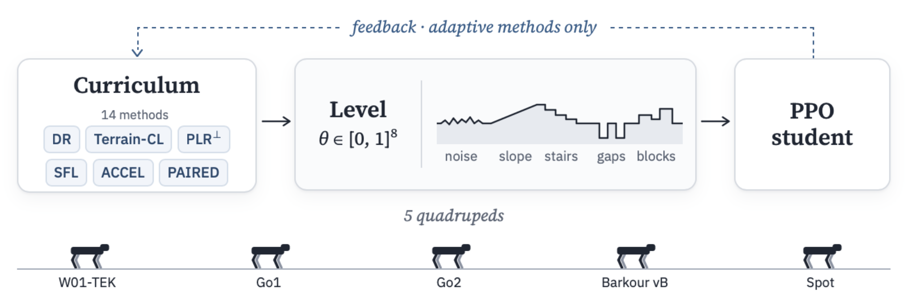
*论文原图编号：Fig. 1。课程模块提出 θ ∈ [0, 1]^8 的地形参数，同一个 PPO 学生在五台四足上训练；只有自适应课程才有从学生回到课程的虚线反馈。它放在这里，是因为这张图把 level space、学生与机器人三个对象一次对齐，后文的每个方法都可以挂到这条通路上。*

### 五台机器人与统一的成功判据

五台机器人里只有 W01-TEK 是闭链结构：它由 Wrocław 理工大学制造，12 个驱动关节，每条腿通过一个被动四杆机构闭链，在 MuJoCo 里用每条腿一个 connect equality constraint 表示。Go1、Go2、Barkour vB 与 Spot 都是开链，沿用 MuJoCo Playground 的 joystick 奖励与观测；Go2 没有现成的 Playground 环境，于是跑 Go1 的环境但换用 Menagerie 的模型，并把位置增益加倍、速度增益与关节阻尼按 √2 缩放。所有机器人共用同一条跌倒判据：躯干低于站立高度的 0.6，或重力向量在躯干坐标系下的 z 分量超过 −0.4。成功则要求整个回合不跌倒，并且从出生点至少走出 s 米，s 按机器人站立尺寸缩放。

这套判据的一个直接后果是回合长度并不统一。Spot 相对其尺寸的最高指令速度更低，6 秒的回合会让成功距离占到最高速度行驶距离的 72%，连完美走平地都只能过一半左右的 level；作者因此把 Spot 的回合延长到 780 步（15.6 秒），把比例拉回与其他机器人相近的 28%。这也是为什么读表时不能把 Spot 的绝对成功率与其它机器人直接横向比较——论文自己也只在每台机器人内部比较方法。

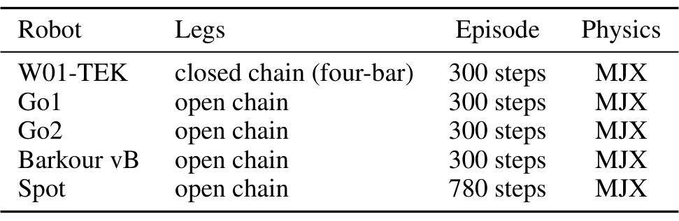
*论文原图编号：Table 1。表里列出五台机器的腿型、回合长度与物理后端：W01-TEK 是闭链四杆，其余为开链，Spot 的回合是 780 步而其它是 300 步。它放在这里，是为了说明后文所有“同一协议”的比较都建立在按尺寸归一化的成功判据上。*

### 八维地形参数与难度插值

一个 level 是 θ ∈ [0, 1]^8 再加一个噪声种子。八个坐标线性映射到八种可解释地形：径向坡度（−20° 到 +18°）、径向台阶（高度 −8 到 +5 cm，宽度 15–60 cm）、平滑噪声（振幅 0–10 cm，波长 0.2–1 m）、沟槽（宽 0–6 cm）以及分段常值方块（高 0–6 cm，单元 15–60 cm），长度单位再乘以机器人的尺寸因子 s。每个参数都有一个“平坦值”：坡度、台阶高度、噪声振幅、沟槽与方块高度取 0，台阶宽度、波长与方块尺寸取区间中点，因为高度为 0 时它们本来就不起作用。

难度 d 不是重新采样一个 level，而是把 genome 往平坦值收缩：

$$
\theta_d=\theta_{\mathrm{flat}}+d\left(\theta-\theta_{\mathrm{flat}}\right)
$$

当 d = 1 时得到原始 genome，d = 0 时退化成平地；DR-easy 与 ACCEL 使用的 easy generator 就是 d = 0.1。这个设计的妙处在于“难度”与“地形内容”被分开了：同一个 genome 可以在不同 d 下使用，于是评测时可以用同一批 2048 个 genome 分别渲染 d = 0.25 与 d = 0.5，比较的是难度而不是抽样噪声。

地形本身由一个共享 heightfield 渲染，公式把坡度、台阶、噪声、方块与沟槽叠加在一个从出生圆盘向外过渡的场里：

$$
h(x,y)=\tau(r)\left[\tan\phi\,\delta+h_s\left\lfloor\frac{\delta}{w_s}\right\rfloor\right]+A\,n_\lambda(x,y)+h_b\,b_c(x,y)-D\,\mathbf{1}\left[\delta>0,\;(\delta\bmod P)<g\right]
$$

其中 $r$ 是到地块中心的距离，$\delta=\max(r-r_0-w,0)$，$\tau(r)=\operatorname{clip}((r-r_0)/w,0,1)$ 负责把平坦出生盘（$r_0=0.55$ m，过渡宽 $w=0.2$ m）平滑地接到地形上；$\phi$ 是坡度，$h_s$ 与 $w_s$ 是台阶高度与宽度，$A$ 与 $\lambda$ 是噪声振幅与波长，$h_b$ 与 $b_c$ 是方块高度与分段常值场，$g$ 是沟槽宽度，沟槽深度固定 $D=0.15$ m、周期 $P=0.6$ m。实现上最关键的并不是这条公式，而是“所有 level 共享一个 heightfield”：竞技场是 16×16 个 tile，每个 level 写进自己的 tile，heightfield 数据是 MJX model 的一个 array leaf，因此每轮写入 256 个新 level 不需要重新编译模型。

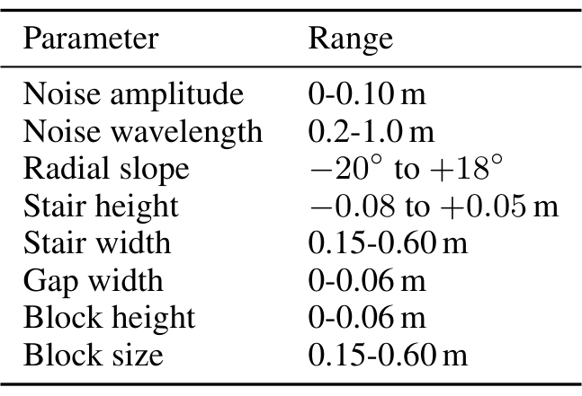
*论文原图编号：Table 6。八个参数各自对应噪声、坡度、台阶、沟槽与方块的一个物理量，所有长度再乘以机器人尺寸 s。它放在这里，是因为后文的“能力包络”就是逐个把其中一个特征推到范围末端，看机器人还能不能过。*

### 一个 PPO 学生，256 条 lane

所有方法训练的是同一个学生：brax 的 PPO 网络与损失，加上 MuJoCo Playground 的 locomotion 超参——512-256-128 的 MLP、ELU、观测归一化、20 步 unroll、4 个 epoch × 32 个 minibatch，γ = 0.97、λ = 0.95、学习率 3×10⁻⁴、熵系数 0.01、clip 0.2、梯度范数 1.0。一轮迭代同时跑 256 条 lane、每条 32 个环境，正好 8192 个环境；每条 lane 的所有环境重置到同一个 level 上，跑完一个回合，在每个 unroll 之后做一次 PPO 更新。按 300 步的回合算，一轮约 2.46M 环境步（Spot 是 6.4M）。

这个训练循环有两个容易被忽略的细节。其一是 actor 是盲的，只有 critic 额外看到机器人前方 5×5 的地形高度扫描；这样基于价值的 level 打分才能区分不同地形，但策略本身并不能“看见”地形。其二是物理随机化：W01-TEK 会随机化地形摩擦、基座与连杆质量、执行器增益与阻尼，其它机器人只在 Playground 定义了的范围内随机化。W01-TEK 跑 300M 环境步，其余机器人跑 1B，每个方法每台机器人 5 个种子，合计 350 次训练；在单张 H100 上总共 306 GPU-hours。

## 十四种课程法，差异只在四个接口

把 14 种方法放在一张表里之后，会发现它们的差别其实非常局部：新 level 从哪里来、是否维护一个回放缓冲区、回放时是否编辑 level、以及用什么分数决定谁被回放。剩下的部分——学生、回合、PPO 超参、环境步预算——全部相同。这种“只改接口”的设计既是基准的优点（新课程可以即插即用），也是它的边界（它检验的是 level 提议策略，而不是课程与学生学习能力的联合设计）。

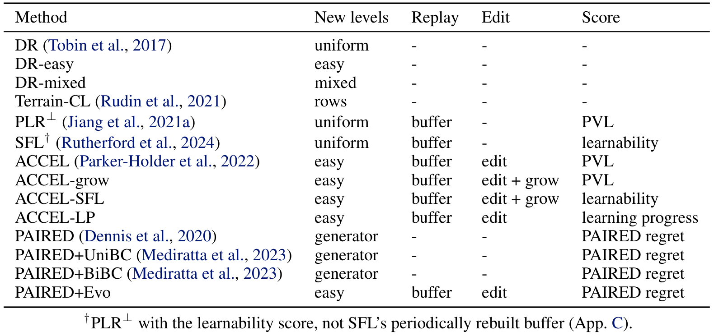
*论文原图编号：Table 2。四列分别对应新 level 来源、是否回放、是否编辑与打分函数；DR-easy 与 DR-mixed 是隔离“简单起点”的对照，PAIRED+Evo 则把生成器换成 ACCEL 的缓冲区。它放在这里，是为了让后文每次提到某个方法时都能回到同一张分类表。*

### 十四个方法的设计轴

最基础的三个是 DR 家族。DR 每轮从完整 uniform 范围采样 256 个新 level；DR-easy 把同样采样的 level 收缩到 d = 0.1；DR-mixed 给每个 level 抽一个 d ∼ U(0, 1)。三者都没有缓冲区、没有编辑、没有分数，因此它们之间的差异纯粹来自训练分布的难度，这也是论文用来回答标题问题的核心对照。

Terrain-CL 是 Rudin 等人 rows 课程的 lane 化改编。每条 lane 在整次运行中保留一个 uniform genome 作为它的“列”，另外维护一个行号 r ∈ {0, …, 10}，初始 r ∼ U{0..5}；每轮训练时把该列收缩到 d = r/10。一轮结束后，如果这条 lane 至少一半的环境成功，就升到 r+1；如果平均行驶距离不到指令位移的一半，就降到 r−1（下限 0）；如果越过第 10 行，就随机换一行。它不需要缓冲区，也不需要分数网络，但需要任务本身的成功判据与 legged_gym 的行驶阈值。

PLR⊥ 与 SFL 都使用一个容量 4000 的缓冲区，但各自维护自己的副本。缓冲区里不足 256 个 level 时，它们采样新的 uniform level、打分但不训练；满 256 个之后，以 0.8 的概率进入回放：按 rank（温度 0.3）混合 staleness（权重 0.3）采样 256 个 level，训练并刷新分数；否则继续给新的 uniform level 打分。PLR⊥ 用 positive value loss 打分，SFL 用 learnability 打分。这里的 SFL 是一个近似：真正的 SFL 会周期性从一个大随机池里重建 top-K 缓冲区，并在缓冲与随机 level 的混合上训练，本文则把两者都塞进同一个缓冲区。

ACCEL 可以看成 PLR⊥ 的两处修改：新 level 来自 easy generator（d = 0.1），并且每个被回放的 level 都会突变——随机选两个参数，各加 U(−0.1, 0.1) 的扰动，clip 到 [0, 1]，种子保留。下一轮不训练的打分迭代会给上一批回放 level 的子代打分；如果没有排队的子代，就采样新的 easy level。ACCEL-grow 在此基础上加一步“grow”，把突变 genome 到平坦值的距离再乘 U(1, 1.3)；ACCEL-SFL 用 learnability 替换 PVL；ACCEL-LP 用学习进度替换 PVL。

PAIRED 走的是另一条路：一个学习到的生成器把 16 维高斯潜变量经 MLP 映射成八个参数的 sigmoid 高斯，再附一个随机种子；每轮提出 256 个 level，protagonist 与 antagonist 两个独立学生在各自 rollout 上训练，生成器用 PAIRED regret 做单步 PPO（熵系数 0.1、学习率 10⁻⁴）。PAIRED+UniBC 与 PAIRED+BiBC 加入行为克隆损失（权重 0.5，每轮都加），分别把 antagonist 蒸馏给 protagonist、或双向蒸馏；PAIRED+Evo 则干脆去掉生成器，改用 ACCEL 的缓冲区与编辑，但仍用 regret 打分。这四种方法都因为 antagonist 而模拟两倍的环境步，后面算成本时要单独记账。

### 分数函数：PVL、learnability、学习进度与 regret

四个分数函数对应四种“什么是一个好 level”的假设，值得逐个说清楚因为它们直接决定了回放什么。Positive value loss（PVL）是一条 lane 在本轮内正 GAE advantage 的均值，直觉是“学生在这里还有正优势可学”，它偏向那些学生能拿到奖励但还没学好的 level。Learnability 是 $p(1-p)$，其中 $p$ 是这条 lane 的环境里“没有跌倒且走到成功距离”的比例；它在成功率为 0 或 1 时都给出 0，因此天然把注意力放在“半会半不会”的 level 上。学习进度则是本条 lane 的首次回合回报减去该 level 上一次访问时的回报，带符号，首次访问记 0；负分意味着这个 level 比上次更差，在缓冲区里会被排到最后并优先淘汰。PAIRED regret 是 best antagonist return 减去 mean protagonist return，再 clip 到 0，衡量的是“对手能比主角多拿多少”。

分数函数之外还有一个预算口径问题。所有方法拿到相同的环境步数，但缓冲区方法的“打分迭代”也算进预算，所以它们真正用于更新学生的步数更少；PAIRED 的预算只计 protagonist 步数，于是它实际模拟的环境步是别人的两倍。这个口径差异在结果里会以两种方式出现：缓冲区方法的学生梯度步少 20% 左右，PAIRED 的墙钟时间是别人的 1.8–1.9 倍。

## 评测协议：为什么不能只看平均成功率

如果只用“在 2048 个随机关卡上的平均成功率”排名，会同时遇到三个问题：关卡难度可能刚好落在某些方法的舒适区；同一批回合既用来排序又用来打分会让鲁棒性指标偏低；平均成功率看不出一个方法是“到处都好一点”还是“在少数关卡上碾压、在多数关卡上打平”。这篇论文的评测协议基本上是围绕这三个问题设计的，因此它本身就是论文的主要贡献之一，而不只是结果的附属。

### 四个关卡集与一个“平地”对照

评测包含四类关卡集。第一类是随机关卡：2048 个 uniform genome，分别渲染到 d = 0.25 与 d = 0.5，两档使用同一批 genome；另外再独立抽 2048 个 uniform genome，作为满难度集。第二类是 held-out suite：七类结构化地形（上/下台阶、上/下坡、沟槽、波浪、随机方块），每类四个强度，每个强度 64 个实例，共 28 个单元；这些地形族没有任何方法在训练中见过。第三类是平地：64 个没有地形的 level，用来检查地形技能是不是用基本行走能力换来的。第四类是能力包络：逐个把七个特征之一推到范围末端、其余特征保持平坦，每个特征六个等距幅度、每档 64 个 level，包络就是“还能以 50% 成功率通过的最大幅度”。

把 d = 0.25 作为头条难度是一个被迫但合理的选择。满难度 level 在开链机器人上几乎解不动：最好的方法在 Go1 上只有 19%，在 Go2、Barkour、Spot 上不超过 5.0%，而在 W01-TEK 上有 43%。如果直接把满难度作为主表，大部分机器人上所有方法都会挤在 0–5% 的区间里，排名完全被噪声主导。d = 0.25 则落在“有区分度但又不是全 0”的区间；满难度结果被放进附录，作为“方法在真正困难时是否还有差别”的补充。

### 交叉拟合 CVaR：为什么同批评估会低估鲁棒性

鲁棒性被定义为最差 25% level 上的平均成功率，也就是 CVaR25。直接的做法是：用全部回合算出每个 level 的成功率，挑出最差的 25%，再在这些 level 上取平均。问题在于“挑最差”和“估成功率”用的是同一批回合，选择噪声会让被挑中的 level 系统性地偏低。论文给了一个很具体的模拟：2000 个真实成功率为 0.5 的 level、每个 4 个回合，同批 CVaR25 读出来只有 0.19，而交叉拟合的估计是 0.49。

修正方法是两遍独立评估：每个 level 跑两遍、每遍四个回合；在一遍上排序、在另一遍上打分，两个方向各做一次再平均。用公式说，若 $L_{25}$ 是在 pass A 上排出的最差 25% level 集合，则

$$
\mathrm{CVaR}_{25}=\frac{1}{2}\left(\frac{1}{|L_{25}^{A}|}\sum_{\ell\in L_{25}^{A}}\hat p_{\ell}^{B}+\frac{1}{|L_{25}^{B}|}\sum_{\ell\in L_{25}^{B}}\hat p_{\ell}^{A}\right)
$$

其中 $\hat p_{\ell}^{A}$ 与 $\hat p_{\ell}^{B}$ 分别是 level $\ell$ 在两遍评估上的成功率。这个估计仍然有噪声，但不再把“被选中的水平低”误当成“模型在该 level 上真的差”。读结果时要注意，CVaR25 的分母是“最差 25% 的 level”，而不是“所有 level 的成功率”；它回答的是“在最难的角落里还能保住多少”，不是整体水平。

### top group、支配比较与 IQM

方法之间的显著性比较用的是每台机器人内部的 Welch t 检验（双侧，5 个种子的均值）。一个关卡集上的 top group 定义为“均值最好的方法，加上所有不显著低于它的方法”（p ≥ 0.05）；换句话说，top group 是一个“没有被证明更差”的集合，而不是“与最优等价”的集合。论文明确说不做多重比较校正，并把 p 值留给正文里点名的成对比较。这个定义对种子方差很敏感：W01-TEK 的 d = 0.25 上 PAIRED+BiBC 是 70.3 ± 26.4%，均值比 DR-easy 的 90.2% 低很多，但因为方差大，它仍然进了 top group；作者自己用这个例子提醒读者，top group 的成员资格同时取决于均值与种子离散度。

平均成功率还有第二个盲点：它分不清“到处都好一点”和“少数关卡碾压、多数关卡打平”。逐 level 支配比较就是为此设计的。对方法 $A$ 与 $B$，每个 level 的成功率把 5 个种子 × 2 遍 × 4 个回合共 40 个回合池化，然后报告 $A$ 更高、更低、打平的 level 比例，平均逐 level 差 $A-B$ 及其 95% bootstrap 区间，以及平均绝对差 $|A-B|$ 与一个二项噪声参考的对比。噪声参考的做法是：在每个 level 上假设两个相同策略的成功率为 $(A+B)/2$，从 $\mathrm{Binomial}(n,p)/n$ 采样，算出“两个完全相同的策略也会表现出的平均绝对差”的精确期望，再对所有 level 取平均。如果实测 $|A-B|$ 接近这个参考，就说明两个方法在 level 层面不可区分。

跨机器人的聚合则遵循 Agarwal 等人的建议。每台机器人先在自己的方法均值上做 min-max 归一化（0 = 最差方法，1 = 最好方法），得到 25 个 robot-seed 分数；然后报告这些分数的 25% 截尾均值（IQM）与以机器人为层的 95% 分层 bootstrap 区间（10 000 次重采样），以及 P(X > Y)——同一台机器人上 X 的种子胜过 Y 的种子的 Mann-Whitney 概率，再对机器人取平均。归一化的边界依赖“参与比较的方法集合”，所以 IQM 的绝对值不能跨论文比较，只能在同一张表内部读。

## 结果：分布内是“简单起点”的胜利，分布外不是

结果部分按六个问题组织，每个问题都在每台机器人内部回答。读的时候最好一直带着两个背景数字：同一批 d = 0.25 关卡对 DR 来说，在 W01-TEK 上有 84.5% 能解，在其余机器人上只有 14.9–34.9%；以及 top group 的判定用的是 5 个种子的 Welch 检验。前者说明不同机器人的绝对成功率不可比，后者说明“进入 top group”并不等于“与最优相同”。

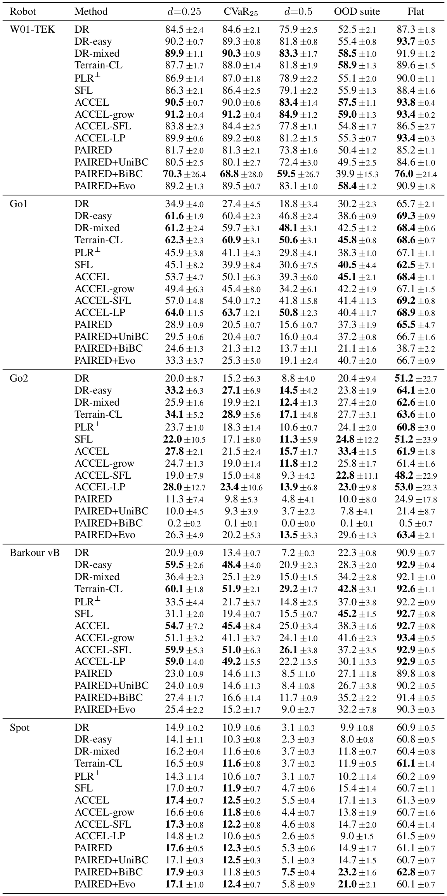
*论文原图编号：Table 8。每台机器人一块，列出 d = 0.25、交叉拟合 CVaR25、d = 0.5、held-out suite 与平地五列，加粗的是该列的 top group。它放在这里，是因为后文所有关于“谁领先”的陈述都可以在这张表里逐格核对。*

### Q1 分布内随机关卡

在 W01-TEK 的 d = 0.25 上，除 PAIRED+BiBC 外的所有方法都落在 80.5–91.2%，top group 是 ACCEL-grow（91.2%）、ACCEL（90.5%）、DR-mixed（89.9%）与 PAIRED+BiBC（70.3 ± 26.4%）。PAIRED+BiBC 的入选正是前面说的方差效应：它的均值远低于另外三个，但 26.4 个点的标准差让 Welch 检验无法把它判为显著更差。这个例子说明 top group 不是“最好的几个”，而是“没有被证明更差的那些”。

Go1 与 Barkour 的图景更能说明问题。Go1 的 top group 是 ACCEL-LP（64.0%）、Terrain-CL（62.3%）、DR-easy（61.6%）与 DR-mixed（61.2%）；训练在完整 uniform 范围上的 DR 只有 34.9%，PLR⊥ 45.9%，SFL 45.1%，PAIRED 家族在 24.6–33.3%。Barkour 的 top group 是 Terrain-CL（60.1%）、ACCEL-SFL（59.9%）、DR-easy（59.5%）、ACCEL-LP（59.0%）与 ACCEL（54.7%），而 DR 只有 20.9%。Go2 的 top group 是 Terrain-CL（34.1%）、DR-easy（33.2%）、ACCEL-LP（28.0%）、ACCEL（27.8%）与 SFL（22.0%）；Spot 上 14 种方法全部落在 14.1–17.9%，极差只有 3.8 个点，top group 是 PAIRED+BiBC（17.9%）、PAIRED（17.6%）、ACCEL（17.4%）、ACCEL-SFL（17.3%）与 PAIRED+Evo（17.1%）。

把这些放在一起，模式很清楚：在 Go1、Barkour 以及 W01-TEK（除 PAIRED+BiBC 外），top group 的每一个成员都使用了简单或低难度的训练 level——easy generator、mixed difficulty，或 Terrain-CL 的低行；而训练在完整 uniform 范围上的 DR、PLR⊥、SFL 在三台机器人上都不在 top group。这就是标题里“easy start”那半句的实证来源。但要注意它只覆盖分布内的 d = 0.25；d = 0.5 时 top group 在 W01-TEK、Go1、Barkour、Spot 上是 d = 0.25 组的子集，在 Go2 上反而变宽到八个方法，原因是有些种子根本没学会走路，方差被放大。

### Q2 迁移到 held-out 地形

held-out suite 上的 top group 与分布内明显不同。W01-TEK 是 ACCEL-grow（59.0%）、Terrain-CL（58.9%）、DR-mixed（58.5%）、PAIRED+Evo（58.4%）与 ACCEL（57.5%）；Go1 是 Terrain-CL（45.8%）、ACCEL（45.1%）与 SFL（40.5%）；Go2 是 ACCEL（33.4%）、SFL（24.8%）、ACCEL-LP（23.0%）与 ACCEL-SFL（22.8%）；Barkour 是 SFL（45.2%）与 Terrain-CL（42.8%）；Spot 是 PAIRED+BiBC（23.2%）与 PAIRED+Evo（21.0%）。

这张表最重要的信息不是“谁第一”，而是“分布内打平的方法在分布外可以差很多”。Go1 上 DR-easy 与 Terrain-CL 的 d = 0.25 成功率几乎相同（61.6 对 62.3），held-out 上却相差 7.2 个点（38.6 对 45.8）；Barkour 上 ACCEL-LP 与 Terrain-CL 在 d = 0.25 上打平（59.0 对 60.1），held-out 上相差 12.7 个点（30.1 对 42.8）。SFL 则给出反向案例：它在 Go1 与 Barkour 的 d = 0.25 上都不在 top group，却在两地的 held-out 上都进了 top group，而且在 Barkour 上是 held-out 第一。Go1、Go2、Barkour 三台机器人上，分布内的领先者都不是 held-out 的领先者；W01-TEK 与 Spot 没有出现这种反转。

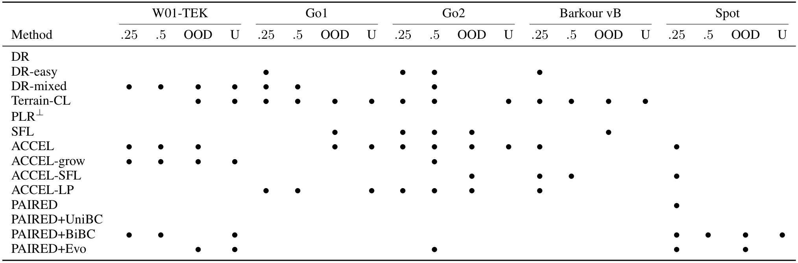
*论文原图编号：Table 4。行是 14 个方法，列是五台机器人各自的 .25、.5、OOD、U 四个关卡集，圆点表示进入该列 top group。它放在这里，是因为它把“哪种方法在哪个机器人的哪类关卡上有效”压缩成了一张可以横向扫视的矩阵。*

### Q3 满难度关卡

满难度 uniform 关卡把方法差距放大到可以肉眼分辨，但只在 W01-TEK 与 Go1 上有效。W01-TEK 上最好的是 Terrain-CL 的 43.5%，Go1 上是 Terrain-CL 的 19.1%；Go2、Barkour、Spot 上没有任何方法超过 5.0%。Terrain-CL 进入了四台机器人的 uniform top group：W01-TEK 上与 DR-mixed、ACCEL-grow、PAIRED+BiBC、PAIRED+Evo 一起，Go1 上与 ACCEL-LP、ACCEL 一起，Go2 上与 ACCEL 一起，Barkour 上单独入选。反过来，DR 训练的就是这些满难度 level，却在任何机器人的 uniform top group 里都没有出现——这是一个很值得注意的反例：直接在高难度上训练，并不等于在高难度上表现最好。

CVaR25 给出了另一个角度。在最难的 25% 的 d = 0.25 level 上，top group 与均值 top group 相同或是它的子集（Spot 除外）；也就是说，在这些机器人上，均值更高的方法并没有靠牺牲最难的 level 来换取平均分。这个结论对“简单起点只会挑软柿子”的直觉是一个反驳：至少在 d = 0.25 的范围内，简单起点方法在难角落里的表现也没有塌掉。

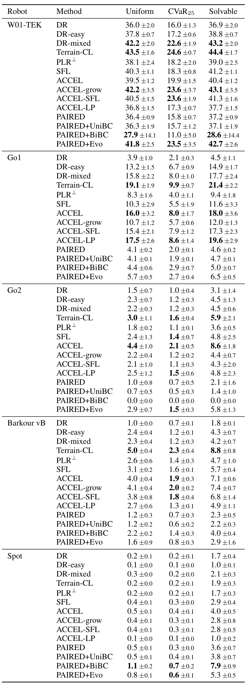
*论文原图编号：Table 9。每台机器人一块，列出 2048 个 uniform level 上的均值、交叉拟合 CVaR25 与 solvable 子集成功率；加粗的是该列 top group。它放在这里，是因为“困难关卡上谁还能撑住”这个问题只能在这张表里逐行核对。*

### Q4 能力包络

能力包络回答的是“每个方法具体卡在哪个地形特征上”。W01-TEK 上除 PAIRED+BiBC 外的所有方法都能走到粗糙地面、下坡与下台阶的末端，真正拉开差距的是上台阶高度：DR-mixed、Terrain-CL、ACCEL、ACCEL-grow、ACCEL-SFL 与 PAIRED+Evo 都到 5.0 cm，DR 只到 4.0 cm。Go1 上约束来自上台阶（Terrain-CL 4.1、ACCEL 3.9、SFL 3.6 cm）与沟槽（最高只有 2.7 cm，由 ACCEL-LP 达到）。Barkour 上只有 SFL 单独达到最好的方块高度 4.0 cm，并与 PAIRED+Evo 共享上台阶的 top group。Go2 与 Spot 上没有任何方法能过沟槽；Spot 的上坡包络最多只有 5.2°。这些数字解释了为什么 held-out suite 的沟槽族对开链机器人几乎是“全员零分”，也说明能力包络比一个平均成功率更能定位失败原因。

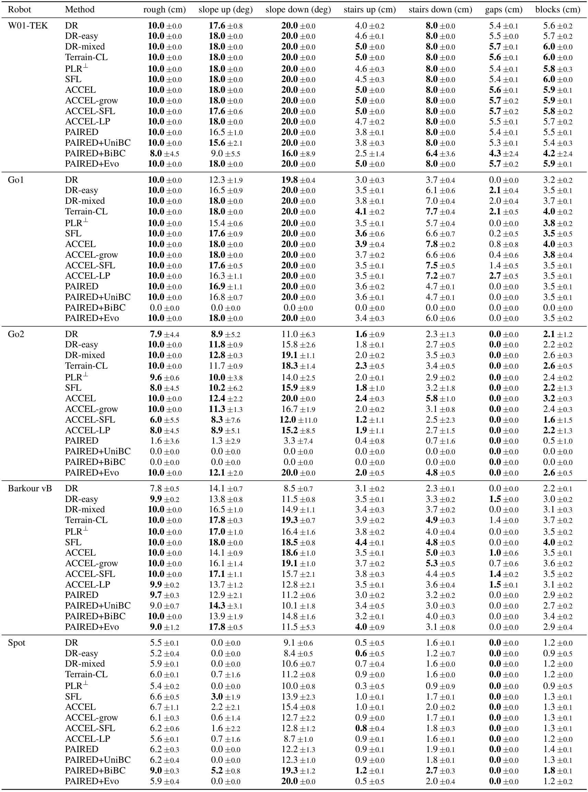
*论文原图编号：Table 11。行是方法与机器人，列是粗糙度、上/下坡、上/下台阶、沟槽与方块七个特征，数值是还能以 50% 成功率通过的最大幅度，加粗为该列 top group。它放在这里，是因为它把“方法差在哪里”从平均分拆成了可解释的地形维度。*

### Q5 学习速度与算力

W01-TEK 上除了 PAIRED+BiBC，所有方法都在大约 100M 步内进入平台；Go2 与 Spot 很早就停在低成功率；Go1 与 Barkour 的曲线到 1B 步仍在上升。这意味着 Go1 与 Barkour 的排名是“这个预算下”的排名，而不是收敛后的排名——作者自己明确这样限定。成本方面，非 PAIRED 方法在给定机器人上每次运行约 0.5–0.9 GPU-hours，PAIRED 及其变体因为要模拟 antagonist，墙钟是其他方法的 1.8–1.9 倍。缓冲区方法把大约五分之一到四分之一的环境步花在不更新学生的打分迭代上：ACCEL 在 Go1 上 1B 环境步里只有 786M 学生步，PLR⊥ 与 SFL 是 797M；PAIRED 的学生步仍是 1000M，因为它的预算只计 protagonist。

把这两个事实放在一起，会得到一个对实践很重要的结论：在“环境步匹配”的口径下，PAIRED 看起来只是慢一点；但在“总模拟步”与“学生实际更新步”这两个口径下，它同时付出了双倍模拟与（相对缓冲区方法）更多学生步的代价，却并没有在大多数机器人上换来更好的结果。这不是说 PAIRED 的方法思想错了，而是说它的成本结构在这个基准里没有被“匹配环境步”完全公平地刻画。

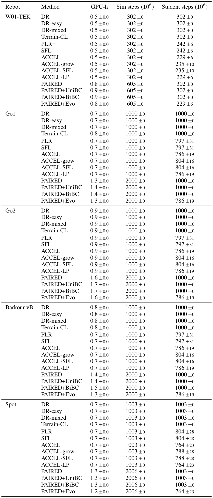
*论文原图编号：Table 12。每台机器人一块，列出 GPU-hours、模拟环境步与学生更新步；PAIRED 的模拟步是其他方法的两倍，缓冲区方法的学生步明显少于其模拟步。它放在这里，是因为“环境步匹配”并不等于“总成本匹配”，这张表把差额摊开了。*

### Q6 种子间可重复性

Go2 是方差最大的机器人：多个方法出现“从未学会行走”的种子，d = 0.25 上 ACCEL-LP 的标准差达到 12.7 个点，top group 也因此变宽。除 Go2 外，d = 0.25 与 held-out 上最大的标准差（除 W01-TEK 的 PAIRED+BiBC 外）是 SFL 在 Go1 的 8.2 与 4.4、ACCEL 在 Barkour d = 0.25 的 7.2、PAIRED+Evo 在 Barkour held-out 的 7.8。相对稳定的是 Terrain-CL（Go2 之外不超过 3.1 个点）与 DR-mixed（每台机器人不超过 2.8 个点）。这说明“某个方法在某台机器人上领先”这句话，在 Go2 上需要打很大的折扣；而在 W01-TEK 上，PAIRED+BiBC 的 26.4 个点标准差会让任何基于均值的排名都变得可疑。

### 跨机器人聚合

把五台机器人按 min-max 归一化后聚合，d = 0.25 上 IQM 最高的是 ACCEL-LP（0.94）、DR-easy 与 Terrain-CL（都是 0.92）；held-out 上是 Terrain-CL（0.89）、ACCEL（0.87）与 PAIRED+Evo（0.86），区间互相重叠。按机器人平均排名，ACCEL 与 Terrain-CL 在 d = 0.25 上并列第一（都是 4.0），held-out 上 Terrain-CL 是 3.0、ACCEL 是 3.4；DR 在 held-out 上垫底（12.2）。W01-TEK、Go1、Go2、Barkour 四台机器人之间的排名相关性为 Spearman ρ = 0.53–0.86（除 W01-TEK 与 Barkour 的 p = 0.05 外都显著），而 Spot 的排名与其他机器人无关甚至反向（ρ = −0.61 到 −0.28）。这再次说明聚合分数只能作为“总体倾向”，不能替代按机器人选型。

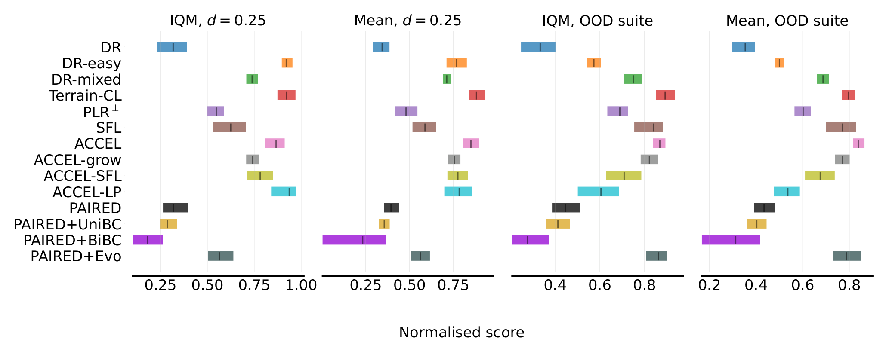
*论文原图编号：Fig. 8。四个面板分别是 d = 0.25 与 OOD suite 上的 IQM 和均值，横轴是每台机器人内部 min-max 归一化后的分数，误差条是 95% 分层 bootstrap 区间。它放在这里，是因为它把“聚合之后谁靠前”与“区间是否重叠”同时呈现出来。*

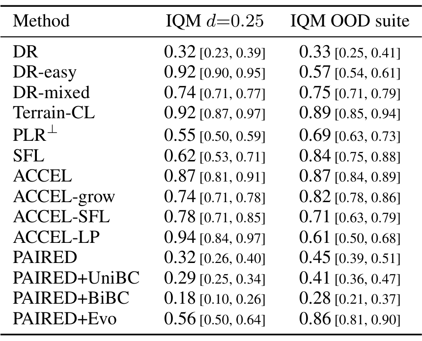
*论文原图编号：Table 10。两列分别是 d = 0.25 与 OOD suite 上的归一化 IQM 及其 95% 分层 bootstrap 区间，覆盖 14 个方法。它放在这里，是因为正文里“谁在聚合上靠前”的具体数值需要可核对的来源。*

## 这些数字真正证明了什么

如果只记住一个结论，那应该是：在这个基准里，“训练分布更简单”是一个比“课程机制更聪明”更强的预测变量，但它只在分布内成立；一旦换到 held-out 结构化地形，领先者就会换人。这个结论有两层，第一层是描述性的（哪些方法在哪些关卡集上进入 top group），第二层是机制性的（为什么简单起点会在分布内赢、又为什么会在分布外失去优势）。两层都需要各自的证据，不能互相替代。

### 核心主张与证据边界

第一，关于“没有万能方法”。论文报告的是 20 个 robot × level-set 组合上的 top group 成员：Terrain-CL 13 次、ACCEL 11 次、DR（uniform）0 次、PAIRED 除 Spot 的 d = 0.25 外 0 次。这个证据足以支持“在这套协议下没有方法覆盖全部组合”，但不足以支持“不存在普遍更好的课程”——后者需要更大的方法空间、更多的学生与预算，而本文只检验了 14 个固定实现。

| 方法 | top group 次数（20 个组合） | 主要出现位置 | 主要缺口 |
| --- | --- | --- | --- |
| Terrain-CL | 13 | Go1 与 Barkour 全部四类、Go2 三类、W01-TEK 的 OOD 与 uniform | Spot 全部缺席 |
| ACCEL | 11 | 除 Go1 外四台机器人的 d = 0.25；W01-TEK、Go1、Go2 的 OOD；Go1 与 Go2 的 uniform | Go1 的 d = 0.25，Barkour 与 Spot 的 .5/OOD/U 未入选 |
| DR（uniform） | 0 | 无 | 所有关卡集都不在 top group |
| PAIRED | 0（Spot d = 0.25 除外） | 只在 Spot 的 d = 0.25 出现 | 其余机器人全部落后于回放型方法 |

第二，关于“简单起点”。论文证据是：Go1、Barkour 与 W01-TEK（除 PAIRED+BiBC）的 d = 0.25 top group 全部由使用 easy/low-difficulty 训练 level 的方法组成，而完整 uniform 训练的 DR、PLR⊥、SFL 在三台机器人上都不在 top group。这证明了“在这个难度与这套预算下，低难度训练分布是分布内成功率的强预测变量”，但它没有把“低难度”与“课程化”完全分开：ACCEL 家族与 Terrain-CL 同时具备两者，DR-easy 只具备前者，而论文没有报告一个“固定低难度、无任何自适应”与“低难度 + 自适应”的完整 2×2 对照。

第三，关于“leader 反转”。Go1、Go2、Barkour 三台机器人上分布内与 held-out 的领先者不同，Go1 上 DR-easy 与 Terrain-CL 的 7.2 点差距、Barkour 上 ACCEL-LP 与 Terrain-CL 的 12.7 点差距，是最直接的证据。它证明了“只报分布内会选错课程”，但没有证明 held-out suite 就代表真实部署分布——这只是一个作者定义、所有方法都没见过的结构化地形集合。

第四，关于“满难度瓶颈”。W01-TEK 43.5%、Go1 19.1%、其余三台不超过 5.0%，说明在这个预算下满难度关卡对开链机器人几乎不可解。它证明的是“当前预算下的可学性边界”，不是“这些方法永远学不会”。

第五，关于“成本”。0.5–0.9 GPU-hours、PAIRED 的 1.8–1.9 倍墙钟、缓冲区方法 20–25% 的打分步，都是可以复核的工程数字；但它们只覆盖训练，不覆盖评测与调参，也不覆盖推理，因为所有方法共用同一个学生。

### 为什么“简单起点”会赢

从机制上看，PPO 需要非零的回报信号才能区分动作。当地形太难时，机器人很快跌倒，回报几乎恒定，advantage 接近 0，策略更新没有方向；当地形太简单时，机器人轻松成功，回报同样饱和。简单起点的作用是把训练初期推离“全失败”的区域，让成功信号先出现，再逐步扩展。DR-easy 每轮都从 d = 0.1 采样，等于把整个训练过程锚定在训练分布的低难度一端；Terrain-CL 则用行号把每条 lane 维持在“大约一半环境能成功”的带子里，这两种机制都能提供更密集的学习信号，但前者不随学生进步而变难，后者会。

这也解释了为什么“简单起点”在分布内强、在分布外弱。d = 0.25 的随机关卡与训练分布的形状高度重叠：它们都是从同一批 uniform genome 收缩而来，只是难度低；模型只要在低难度上把基本步态学好，就能在这些关卡上拿到高分。held-out suite 则是单一特征拉满的结构化地形（例如以 2k cm 为步高的连续上台阶、5k° 的上坡），它们要求的是对某个特征的专门适应，而不是“在平均地形上走得好”。在低难度分布上训练的方法没有见过这些极端特征，因此在 held-out 上被那些在更高/更多样难度上训练过的方法（SFL、Terrain-CL、ACCEL）反超。

还有一个更微妙的机制：top group 的定义会把“方差大”变成一种优势。W01-TEK 上 PAIRED+BiBC 的 70.3 ± 26.4% 之所以能进 top group，是因为 Welch 检验在方差大时更难判定“显著更差”。这不是论文的统计错误，而是“不显著低于最优”这一操作化定义的固有性质；它提醒读者，top group 成员数会随种子噪声增加，不能把“进入 top group”直接读成“与最优相当”。

### 与 2D UED 结论的对照

在 BipedalWalker 上，ACCEL 曾被认为优于 PLR⊥、PAIRED 与 DR；在这篇论文里，ACCEL 进入 11/20 个 top group，而来自机器人实践的 Terrain-CL 进入 13/20，ACCEL 不再是第一。JaxUED 与 SFL 曾把 DR 报告为 2D 领域的强 baseline；在这里，uniform DR 一个 top group 都进不去，但 DR-easy 与 DR-mixed 在四台机器人的随机关卡上进入了 top group——差别不在“DR 这个名字”，而在它采样的难度分布。PAIRED 在 2D 上就落后于回放型方法，在这里同样落后；为它设计的行为克隆修正（UniBC、BiBC）在 Spot 之外没有改变这个格局，BiBC 甚至在 Go2 上崩溃到 0.2%。这些对照说明，2D UED 的排名不能直接搬到 contact-rich 的 3D 四足上，而“DR 是强 baseline”这个结论对训练分布的选择高度敏感。

## 局限、复现成本与可带走的东西

这篇论文的诚实之处在于它没有把“基准”包装成“结论”：作者明确说所有陈述都只对“一个 PPO 学生、这个预算”成立，并在正文里反复提醒 top group 不等于等价、排名是预算内的排名。它没有回避的局限包括：机器人结构与制造差异会影响它能解多少 level，所以只能在每台机器人内部比较；Terrain-CL 与 ACCEL-LP 都是改编版，前者的列是 level space 的 uniform genome 而不是 legged_gym 的地形类型，后者的学习进度是单次访问而非 LP-ACRL 对固定任务集的 softmax。

### 作者承认的局限

作者承认的第一点是“机器人本身决定了解题率”。同一批 d = 0.25 关卡，DR 在 W01-TEK 上能解 84.5%，在其余机器人上只有 14.9–34.9%；因此论文不做跨机器人的原始成功率比较，聚合时也先用每台机器人内部的方法均值做 min-max 归一化。第二点是两个课程是改编的：Terrain-CL 把 legged_gym 的地形类型换成了 level space 的均匀 genome，并按 32 个环境的 lane 而非单个环境决定晋级；ACCEL-LP 则把 LP-ACRL 的“固定任务集上的 softmax”换成了“演化缓冲区上的单次访问学习进度”。这两点会直接影响“Terrain-CL 的 13/20 有多少来自原始 rows 课程、多少来自 level space 的均匀列”这类问题，论文没有拆开。

### 我的判断：还缺哪些实验

以下是我基于协议与数字做出的判断，不是作者的主张。第一，单一学生与单一预算会限制外推：所有方法共享 512-256-128 的 PPO 与同一组超参，而课程与学生的交互很可能随容量变化；论文没有做学生容量或 PPO 超参的扫描，因此“easy-start 优势”目前只在这个配置下被证明。第二，5 个种子与不做多重比较校正意味着 3–4 个点的差异很容易落在噪声里；Go2 的 12.7 点标准差与 Spot 的 3.8 点极差是两个极端例子，前者说明排名不可靠，后者说明 top group 几乎没有区分度。第三，held-out suite 是作者定义的结构化地形，不是真实野外分布；没有实机、没有视觉、没有负载/摩擦的系统性偏移，因此“OOD 领先者”只能读成“在这七族地形上领先”。第四，easy-start 与 curation 的 2×2 对照仍然缺失：DR-easy 是纯 easy-start，Terrain-CL 是 easy-start + 自适应晋级，ACCEL 是 easy-start + 回放 + 编辑，三者之间的差异不能全归给“课程”。第五，Terrain-CL 需要任务自身的成功判据与行驶阈值，这在真实任务上不一定可得；它的“无需缓冲区、无需分数网络”的优点同时也意味着它依赖一个可靠的成功检测器。

可带走的工程建议有四条。其一，比较课程法时至少同时报告分布内与 held-out 两组结果，否则会在三台机器人上选错 leader。其二，把 DR-easy 或 DR-mixed 作为正式基线；没有它，就无法区分“课程设计的收益”与“训练分布变简单的收益”。其三，报告 top group、种子方差与逐 level 支配比较，而不是只报一个均值排名；W01-TEK 上 PAIRED+BiBC 的入选就是“只看均值会误判”的现成案例。其四，匹配环境步的同时报告学生步与模拟步；PAIRED 的 2 倍模拟与缓冲区方法的 20–25% 打分步，都会改变“同等预算”的含义。

如果只能再做三个实验，我会选：把预算提高到 3B–10B，看 Go1 与 Barkour 上仍在上升的曲线是否改变 leader；把 Terrain-CL 拆成“固定低难度行”与“按成功晋级”两个因子，量化 13/20 中有多少来自 easy-start；以及在带视觉的 actor 或实机上重跑 held-out，检验分布内/分布外的 leader 反转是否仍然存在。

## 引用与资源

论文的正式入口是 arXiv 页面 https://arxiv.org/abs/2610.40364 ，代码、level space 与评测套件在 https://github.com/Solvro/ml-wojtek-ued （MIT 许可），W01-TEK 的模型在 https://github.com/machinekind/w01-tek （Apache 2.0 许可）。如果只想复核本文的某一条结论，优先读表 8 与表 4：前者给出五台机器人 × 四类关卡集的全部均值与标准差，后者给出每个 top group 的成员矩阵。

下面七条是理解本文方法谱系时最值得顺藤摸瓜的引用。Rudin 等人的 rows 课程是 Terrain-CL 的直接来源，也是 legged_gym 里最常见的地形课程实现；Jiang 等人的 PLR 代表“按 regret 回放”这条路线，Dennis 等人的 PAIRED 代表“学习一个 level 生成器”这条路线；Parker-Holder 等人的 ACCEL 是本文 ACCEL 家族的母算法；Rutherford 等人的 SFL 提供了 learnability 这一打分函数；Agarwal 等人的统计建议则是 IQM、分层 bootstrap 与 P(improvement) 的方法论出处。

读这些引用时不必重新推导每个算法，关键是看清它们各自假设了什么样的 level 表示与预算口径。本文的贡献是把这些假设压缩到同一个 level space 与同一套预算下，因此引用列表本身也可以当作一张“哪些设计选择被固定了”的清单。

例如，Terrain-CL 的 rows 晋级与 ACCEL 的突变都假设 level 参数是连续可插值的，PAIRED 的生成器则假设 regret 可以被一个学习到的对手可靠估计；这些假设在 contact-rich 的 3D 四足上是否成立，正是本文要用统一协议去检验的东西。

- Gilewicz, Galus, Wojdas. *Is It the Curriculum or Just the Easy Start? Benchmarking Unsupervised Environment Design on Quadrupeds*. arXiv:2610.40364, 2026.
- Rudin, Hoeller, Reist, Hutter. *Learning to Walk in Minutes Using Massively Parallel Deep Reinforcement Learning*. CoRL, 2021.
- Dennis, Jaques, Vinitsky, Bayen, Russell, Critch, Levine. *Emergent Complexity and Zero-shot Transfer via Unsupervised Environment Design*. NeurIPS, 2020.
- Jiang, Dennis, Parker-Holder, Foerster, Grefenstette, Rocktäschel. *Replay-Guided Adversarial Environment Design*. NeurIPS, 2021.
- Parker-Holder, Jiang, Dennis, Samvelyan, Foerster, Grefenstette, Rocktäschel. *Evolving Curricula with Regret-Based Environment Design*. ICML, 2022.
- Rutherford, Beukman, Willi, Lacerda, Hawes, Foerster. *No Regrets: Investigating and Improving Regret Approximations for Curriculum Discovery*. NeurIPS, 2024.
- Agarwal, Schwarzer, Castro, Courville, Bellemare. *Deep Reinforcement Learning at the Edge of the Statistical Precipice*. NeurIPS, 2021.
