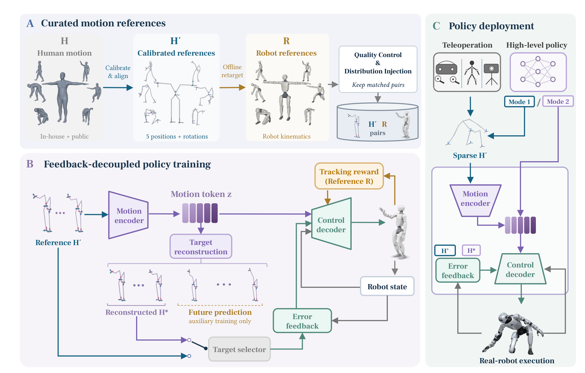

# Anchor 1: Precise and Stable Humanoid Control for Whole-Body Manipulation

人形机器人能复现丰富动作，不等于能在弯腰、行走和支撑切换时精确保持手部位置。Anchor 1 把任务意图压缩为五个身体部位的目标姿态，同时通过离线数据筛选约束未指定关节的协调方式，并把执行误差从动作表示中分离。理解它需要区分三件事：人想怎样动、机器人如何补全全身协调，以及执行偏差如何被纠正。

Archon Robotics 团队；[arXiv:2611.00193v1](https://arxiv.org/abs/2611.00193)，首次提交北京时间 2026-10-31 01:56:53；[作者项目页](https://archon.tech/research/anchor1)。以下依据论文方法、仿真与硬件实验及补充材料，不把公开视频中的演示数量视为独立成功率证据。

## 五个姿态为什么需要离线分布约束

把人体骨架直接转成机器人全关节轨迹，可能引入身体比例、关节限制和求解器不稳定造成的偏差。只给手脚几个位置又可能欠约束：多个全身姿态都能满足相同端点，但其中有些会滑脚、抖动或出现不自然支撑。因此，稀疏命令需要配合可靠的运动先验，而不是简单删掉关节目标。

作者先用人体与机器人的 T 姿态求固定的缩放、旋转对齐和位置偏移，得到机器人尺度的校准人体参考 $H'$。从中抽取骨盆、双腕和双踝的三维位置与朝向，形成五姿态接口 $H'_5$。这一步不求机器人关节；它保留任务相关的几何意图，让躯干和其他关节有完成动作的自由度。

训练时仍对同一人体动作做离线重定向，得到机器人参考 $R$，并保留与 $H'$ 对应的时间配对。自动检查长时间悬空、关节不连续、自碰撞、周期抖动及穿地；内部采集数据还要人工检查动作回放。这样，五姿态作为输入，质量较高的机器人动作作为跟踪奖励与训练目标，模型学到如何使用剩余自由度。在线无需重定向的主张只适用于部署路径，不能扩展成训练也完全摆脱重定向。

含左右镜像的训练集有 406222 条序列、约 1.168 亿帧和 1081.4 小时，其中内部数据占时长 77.3%。镜像会扩大统计规模，并非增加同等数量的独立原始人体采集。大量数据整理与人工复核也是实现成本，不能只根据较短的在线参考窗口判断训练很轻。

*原图 10：离线校准和重定向形成配对数据；动作编码与显式误差反馈走不同支路，部署可接稀疏姿态或动作 词元。*

## 把动作命令与纠错信号分开

同一参考动作在两次执行中会有不同误差。若编码器同时吸收动作目标和显式误差信号，产生的 词元 就会混合“命令是什么”与“现在偏离多少”。高层策略若直接预测 词元、绕过编码器，纠错信息也可能随之丢失。Anchor 1 因此把显式腕踝误差送入控制解码器，而非动作编码器。

编码器输入当前及未来 20、40、60 毫秒的四帧五姿态，在当前机器人根坐标下表示。有限标量量化器把其压成离散运动表示：

$$
z_t=Q(E(x_t)),\quad a_t=D(z_t,o_t,e_t).
$$

$x_t$ 是四帧参考窗口，$E$ 是动作编码器，$Q$ 是量化器，$z_t$ 是动作 词元；$o_t$ 包含本体状态历史，$e_t$ 是当前腕踝与近时目标之间的位置及相对朝向误差，$D$ 产生关节动作。这个安排保留同一控制器的两种入口：遥操作直接给稀疏参考，高层策略也能直接给 词元。这里的解耦特指显式误差支路，不能说 词元 完全不依赖机器人坐标或任何状态。

没有显式参考随 词元 一起输入时，轨迹头从 词元 重建近时五姿态，目标选择器据此计算误差。未来轨迹预测只作为训练辅助，不直接进入控制解码器。训练用 PPO，奖励对齐离线机器人参考；近时重建、未来预测和循环一致性监督来自校准人体参考：

$$
\mathcal L=\mathcal L_{\mathrm{PPO}}+\lambda_{\mathrm{near}}\mathcal L_{\mathrm{near}}+\lambda_{\mathrm{future}}\mathcal L_{\mathrm{future}}+\lambda_{\mathrm{cycle}}\mathcal L_{\mathrm{cycle}}.
$$

三个辅助项分别维护近时目标精度、长一些的动作结构，以及重建后重新编码的表示一致性。$\lambda$ 控制它们相对 PPO 的权重；论文当前方法描述没有给出此处可直接照抄的完整权重配置，因此不能据这条总目标就宣称足以逐参数复现。重建目标分支的策略梯度会通过误差计算进入轨迹头，使其同时服务于控制而非仅降低姿态重建损失。

部署的 global 模式保持初始对齐后的原参考根轨迹，需要根定位；re-locate 模式将参考窗口整体平移到当前机器人根位置，保留窗口内相对几何和逐帧位移。这两种是输入处理方式，与评测的全局、局部坐标不是同一概念。重新定位可以容纳操作者和机器人的行进差异，也弱化了原始世界轨迹上的漂移约束。

## 全局精度与局部精度不能混读

评测包含三组训练留出数据：内部 15342 条操作相关动作、外部公开数据 2230 条，以及五种姿态下的可达性 3210 条参考。全局评分在初始水平骨盆位置和朝向对齐后比较完整轨迹；局部评分再移除每时刻水平骨盆平移，但不移除高度和朝向差。因此，局部手腕误差低不必然意味着手在世界坐标中准确到达目标。

内部与公开轨迹的成功要求整段动作中腕踝位置误差不超过 10 厘米、朝向误差不超过 1 弧度，其他跟踪点位置误差不超过 25 厘米。仿真平均误差只在首次某点超过 25 厘米之前统计，不同控制器的窗口可能不同；成功率则包含失败动作。真机误差使用所有有效记录，不采用这个截断。两者数值不能混在一张“精度提高”图里直接比较。

| 实验与指标 | Anchor 1 | 对照或解释 |
|---|---:|---|
| MuJoCo 内部集全局 SR | 88.7% | ScaleBFM global 为 22.8%，完整配置比较 |
| MuJoCo 公开集全局 SR | 54.2% | 绝对能力明显下降，非全面解决动态动作 |
| 真机 51 条站立可达参考，腕全局位置误差 | 44.58 mm | MimicLite 53.59 mm，SONIC-G1 98.15 mm |
| 真机 72 条内部动作，腕全局位置误差 | 75.69 mm | MimicLite 105.74 mm，SONIC-G1 234.37 mm |
| MuJoCo 可达性每动作脚事件 | 滑脚 0.06，额外踏步 0.53 | 除跟踪精度外还观察支撑稳定性 |

硬件对照的最大前瞻窗口不同：Anchor 1 为 0.06 秒，MimicLite 0.08 秒，SONIC-G1 0.90 秒；输入表示及在线重定向要求也不同。因此，数字支持完整系统的效率和跟踪价值，无法隔离每个训练组件的独立贡献。真机 44.58 mm 相对 MimicLite 的降低约 17%，也说明摘要“30%–80%”不应泛化成表中每个方法、每个指标都在该范围。

反馈消融更直接解释架构。在 MuJoCo 内部集的 global 输入、直接参考目标下，无显式反馈全局 SR 为 70.9%，编码端反馈 62.7%，解码端反馈 88.7%。编码端反馈虽改善局部指标，却恶化全局指标；不能仅凭局部提升说它全面有效。目标改为 词元 重建时，解码端反馈的全局 SR 降至 76.0%，说明灵活接口确实付出精度代价。补充材料还显示 Isaac Sim 与 MuJoCo 存在差异，应优先看跨仿真器与硬件是否共同支持结论。

## 作为高层策略执行接口的价值和边界

作者用遥操作示范微调 GR00T N1.7，测试踢纸箱和取拖鞋。稀疏接口预测五姿态与手部命令，50 Hz 发送四帧参考窗口；词元 接口可绕过编码器，但仍用重建目标提供纠错。报告中，编码端误差版本直接输入 词元 时两任务都失败，解耦版本的 词元 接口获得 0.90 和 0.45 的成功率。各配置报告 20 次试验及表中波动，但比较同时涉及接口与反馈来源，不能解释成单一控制器更换带来的纯净效应。

作者承认目前只评估一种人形本体，稀疏运动学目标没有显式对象几何、接触力和抓取稳定性。即使腕部轨迹准确，也可能推倒物体或丢失抓握；公开视频中的快速拦截更不能代替统计化安全评价。重建支路的误差、全局定位与高层预测偏差仍可能在长时任务中相互放大。

我的判断是，最值得借鉴的是把“可供高层策略组合的动作表示”与“当前执行必须依赖的反馈”分开，同时用全程成功率约束平均误差。复现应保留配对数据筛选、四帧参考、两种反馈目标及两种定位模式，分别报告完整配置和受控消融。接下来最有价值的问题是：在同一动作意图下改变负载、接触和抓取条件，这条以姿态为主的误差支路能否仍维持支撑与物体稳定；这项能力尚未由当前跟踪基准证明。
