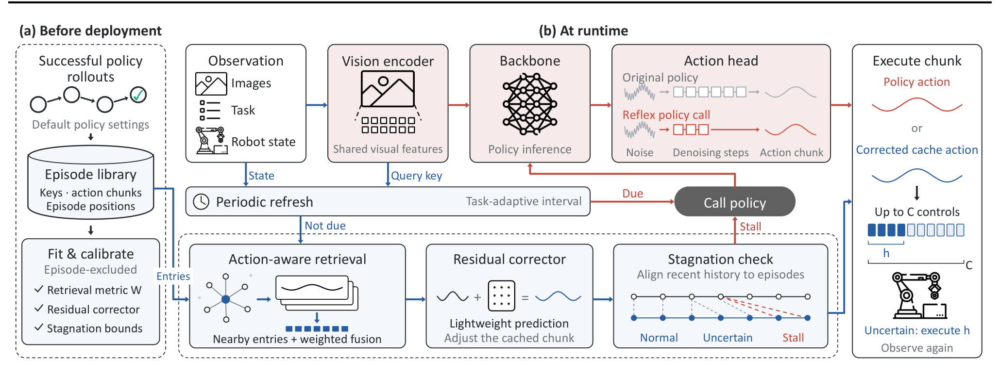

# Reflex: Fast Robot Policy Serving by Reusing and Correcting Past Actions

重复工位里的机器人经常遇到相近的决策情境，却每次都重新运行昂贵策略。Reflex 缓存成功执行中的完整动作块，用控制相关的距离寻找可以复用的决定，再修正和监测偏差。它改变的是策略的服务方式：命中缓存时绕过主干和动作头，仍保留视觉编码与必要的原策略回退。

Ziyang Lin、Zixuan Sun、Rami Nasser、Jianli Jin、Xuanle Li、Jayanth Srinivasa、Fan Lai；[arXiv:2611.00524v1](https://arxiv.org/abs/2611.00524)，首次提交北京时间 2026-10-31 09:28:56。以下依据正文和附录，区分仿真、请求回放及 SO-101 真机证据。

## 为什么减少去噪步数还不够

动作分块策略一次生成未来若干控制步，扩散或流匹配动作头需要多次计算。既有缓存常复用中间去噪状态，但作者重新比较后发现，单纯减少去噪步数也能取得相近收益；更重要的是，即使动作头变快，视觉语言主干仍可能占去多数 GPU 时间。

缓存整个动作块可以跳过更多计算，但图像相似不等于动作相同：背景变动可能不影响抓取，物体几毫米的变化却可能需要完全不同的手部运动。连续执行近似动作还会积累漂移，最后变成“手一直在动、任务却没有进展”。因此，检索精度和执行恢复必须一起设计，不能只追求缓存命中率。

*原图 4：蓝色路径检索、融合和修正动作；红色路径在定期刷新或停滞时调用原策略，视觉编码器仍被共享。*

## 从成功轨迹构造控制相关的缓存

部署前收集原策略成功轨迹。每个条目保存任务、观察键、完整动作块和其在轨迹中的位置。键拼接本体状态与策略自己的视觉特征，并投影到 PCA 基。这里没有微调原策略，但仍要拟合检索度量、残差模型和阈值，也需要先获得足够的成功轨迹。

度量学习使用同任务、不同轨迹中动作相近的条目对。如果某个状态特征方向在动作相同的条目之间仍变化很大，它就不是决定当前动作的可靠维度，应当降低权重。令 $S$ 为这些标准化键差的平均外积，维度为 $D$，则：

$$
WW^\top=\left(S+\lambda\frac{\mathrm{tr}(S)}{D}I\right)^{-1},\quad d(q,z_i)=\|W^\top(q-z_i)\|_2.
$$

$q$ 是当前键，$z_i$ 是库内键；正则系数默认 $\lambda=0.1$，防止样本少的方向获得过大权重。工程上预先变换所有库内键，每次仅变换当前查询并扫描当前任务的条目。跨轨迹构造训练对，避免只是记住同一段视频中相邻的近重复帧。

检索后不是直接重放最近一条，而是默认对 16 个动作相容邻居逐步加权融合。权重尺度由最近邻与中位邻居距离之差自适应设置，使不同缓存密度下仍能强调最近条目。这要求动作坐标与时间位置相容；一般语义近邻不能自动满足这个前提。

融合仍有系统偏差，所以作者以“当前条目的原动作减去跨轨迹检索动作”为监督目标，拟合轻量残差修正器。它对状态、候选动作与决策位置做高斯核特征变换，再用线性回归预测修正；训练按轨迹平衡权重，避免长轨迹支配。运行时离缓存越远，修正越衰减，减少在陌生状态中放大错误的风险。

单步动作接近并不能保证任务前进。Reflex 将最近一段观察历史与成功轨迹做单调对齐：匹配位置可重复或跳过，但不能倒退。参考轨迹位置的前进量给出任务进度，阈值由成功校准窗口的低分位数确定，默认使用第十百分位。附录实现还估计进度低估量的第九十百分位上界：即使加上这个乐观修正仍低于慢速成功窗口阈值，才调用原策略；若只在不确定带内，则缩短执行长度、尽早重新观察。该检查需要至少四条可校准轨迹，历史窗口不足时不会启用。这种检测仍是反应式的，因此另外定期刷新原策略，并按任务调节刷新间隔，在实测成功率容差内逐渐增加复用。

实现基于 openpi 服务接口，需要暴露视觉编码器、条件前缀和动作采样器三个钩子。GPU 仍运行视觉编码，CPU 负责检索、融合、修正和进度检查。一次缓存命中因此不是零计算；它的上限受视觉编码耗时制约，库规模扩大还会提高 CPU 扫描与对齐成本。

## 服务成本与闭环成功率必须一起看

评估覆盖 π0.5、GR00T N1.5、Diffusion Policy、Fast-WAM 和 Cosmos Policy，使用 LIBERO-Spatial、LIBERO-Long 与 MetaWorld MT50。LIBERO 每个套件评估全部 500 个官方测试集，MT50 为 2500 集；缓存初始状态与评估分开，每种策略使用三份独立收集的库。主要设置每任务 20 条成功轨迹。

“摊销推理时间”是总 GPU 推理时间除以默认执行长度下的决策数量，按 RTX 4090、batch size 1 的阶段时延估算。它允许公平比较扩展执行长度带来的决策减少，但不能等同所有系统端到端墙钟时延，更不能把最大加速值理解为机器人完成任务的倍数。

| 证据层次 | 对照结果 | 应如何解释 |
|---|---|---|
| 默认策略设置的仿真评估 | 摊销推理加速 1.4–11 倍，平均 3.3 倍 | 缓存本身的主要加速范围 |
| 叠加减少去噪和延长执行 | 对默认纯推理极值 129 倍，平均 9.3 倍 | 多项优化的合并收益，非缓存单独贡献 |
| 单卡并发请求回放 | 约 42.5 升至 87–97 决策/秒 | 高并发吞吐，不是百台真机闭环试验 |
| SO-101 两任务真机 | 成功 174/200 对 172/200；66.5 对 21.8 ms | 决策时延约降至三分之一，有限任务内成功接近 |

主结果图中每任务 20 条成功轨迹、默认设置的各组合，成功率下降均不超过两个百分点；附录扩大配置后，最差下降为 4.3 个百分点。真机缓存命中率为 79.3%，但 172 与 174 次成功不能证明严格等价或安全性。并发实验回放 500 个 LIBERO-Long 集记录的请求，在至少 60 个并发机器人请求源时完成负载快 2.0–2.2 倍；20 个请求源时 p99 时延为 511 对 225 ms。真实机器人之间的调度、网络和环境反馈仍需要单独验证。

逐项消融说明为什么不能删掉恢复机制。以下为同一 LIBERO-Long、π0.5、减少去噪并扩展执行长度的设置：

| 累计加入的机制 | 成功率 | 命中率 | 摊销时延 |
|---|---:|---:|---:|
| 欧氏最近条目 | 55.8% | 100% | 5.1 ms |
| 动作感知距离 | 62.8% | 100% | 5.2 ms |
| 16 邻居融合 | 77.0% | 100% | 5.2 ms |
| 残差修正 | 84.6% | 100% | 5.2 ms |
| 停滞检查 | 86.2% | 94% | 6.1 ms |
| 周期刷新，完整系统 | 91.2% | 65% | 10.6 ms |

这组数据最有用的含义是，允许少量昂贵调用能恢复闭环可靠性；100% 命中率反而对应更差的系统。完整系统的对照纯推理成功率为 91.8%。不过该表是累积添加，增益依赖前面的配置，不是每个模块独立、可相加的因果效应。换用 CLIP 键、保持检索方法，其成功率明显下降，也支持控制特征而非一般图像语义的重要性。

## 缓存失效的边界与复现顺序

LIBERO-Plus 的场景扰动把未适配缓存成功率降到 62.6%，而原 π0.5 为 79.5%。每个新场景补三条策略轨迹后为 74.9%，加停滞检查到 77.1%；仍比原策略低 2.4 个百分点。这个结果证明可用少量经验适配，不能写成旧缓存天然具备跨环境泛化。附录还区分新增物体等难情形，不能只引用汇总数字掩盖扰动差异。

缓存库增加也不是无限获益：5000 集、228160 条缓存决策时，表中总 CPU 开销约 3.58 ms，其中检索 1.55 ms、停滞检查 1.39 ms。这些数字来自空闲 Xeon 单绑核；超过 500 集的库由复制原库构造，验证的是计算扩展成本，并非新增经验的质量收益，不保证繁忙服务器同样成立。视觉编码成本对 π0.5 的缓存加速构成明显下限，扩展库也无法绕过。

我的判断是，Reflex 的可复用贡献在于把缓存当作有误差的控制器，而不是答案查表。复现应先记录同策略成功轨迹，严格按轨迹隔离拟合和校准，然后固定策略设置比较缓存、简单减步及两者组合；同时报告成功率、GPU 摊销时间、真实请求尾时延和 CPU 成本。接下来应检查缓存遇到相似但动作不同的陌生状态时，错误在多少个控制步内被识别，以及这一段延迟是否会造成不可逆的接触后果。本文的成功率与停滞恢复尚不能代替这种安全评估。
