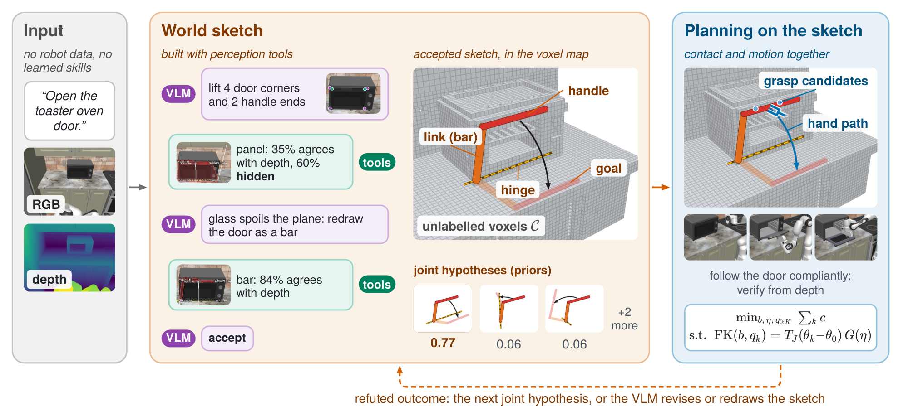

# WorldSketch: Sketching World Models for Zero-Shot Mobile Manipulation

让视觉语言模型直接写机器人动作，看似省去了中间表示，却把识别部件、估计尺寸、选择接触和求解运动学全压进了同一次生成。WorldSketch 把接口移到更容易检查的位置：模型描述任务需要的世界，几何规划器决定怎么动。这里的世界模型是可以画出来、用深度检验、被执行结果推翻的稀疏运动学假设，并非预测未来视频的神经网络。

Jiaming Wang；[arXiv:2611.00513v1](https://arxiv.org/abs/2611.00513)，首次提交北京时间 2026-10-31 09:06:20。以下依据全文正文、实验表和附录，结果均为作者报告的仿真实验。

## 把动作生成改成建模问题

以打开烤箱门为例，机器人首先需要知道哪个部分是门、抓哪里、转轴在哪，以及目标是打开到某个角度还是机械限位。让语言模型直接写一条手部轨迹，很容易把这些不确定判断当作已经准确的几何事实。另一种常见做法是调用预定义开门技能，但技能库又限制了可处理的机制。

作者用 $M=(C,E,g)$ 表示任务草图。$C$ 是从深度构建、没有语义标签的碰撞体素；$E$ 仅包含任务涉及的实体及其几何、关节和交互部位；$g$ 是实体的目标状态。无关物体只需作为障碍物存在，不必全部做语义重建。这个划分使小把手得到精细建模，而厨房里大量其他物体仍保持粗粒度。所谓最小充分模型是设计目标，并不是对所有任务都成立的数学最优保证。

对于铰接实体，关节类型只覆盖移动或旋转，配上轴、原点和关节状态；运动连杆由面板、杆、盒等基本体组成，交互部位可以是把手、旋钮或按钮。图中先把玻璃门拟合成面板，深度不一致后改画为杆，说明模型表示可以围绕规划需要修订。

*原图 2：VLM 请求测量并检查草图，规划器联合选择接触与运动；执行反驳当前假设时回到建模阶段。*

## 从稀疏测量到可执行接触

VLM 接收语言指令和头部、腕部图像，标出角点、表面点或部件端点，并请求近景、裁图或正对控制面板的视角。后端利用深度把这些点提升到三维，再按点的类型拟合平面或突出的小部件，同时返回拟合失败的原因。这样，模型回答“该测哪里”，尺寸和位置由测量给出；它不应编造能够从深度求得的米制数值。

后端把草图、轴线、目标姿态和抓取点路径叠画回原图，并检查基本体是否与深度一致、悬空或被遮挡。VLM 在同一会话中修订或接受模型。选择点而非一开始分割全场景，是因为按钮等小部件可能只需要一个稳定的点，而掩码容易漏掉。这个选择仍依赖相机标定与可靠深度，不能理解为感知问题已经解决。

同一外观可能对应不同关节。草图因此保留多个机制假设及先验概率，执行结果再按贝叶斯规则更新其可信度。这里关键的验证对象是物体效果：深度是否显示门已打开、炉灶或水槽的效果区域是否改变。仅看到夹爪运动不足以证明物体跟随，因为抓取可能打滑。所有假设都不再可信时，系统带着尝试证据修改草图；整个尝试失败后可以回到初始姿态并重新建模。

规划器同时决定接触点、底座和躯干位置以及手臂轨迹。先固定抓取再规划往往会在门转到一半时撞到柜面，或者耗尽手臂可达范围。其联合优化可以概括为：

$$
\min_{b,\eta,q_{0:K}}\sum_k c_q(q_k,q_{k+1})+c_b(b)+c_\eta(\eta),\quad \mathrm{FK}(b,q_k)=T_J(\theta_k-\theta_0)G(\eta),\quad h(\eta)\ge m_h,\ d(b,q_k,\theta_k)\ge m_a.
$$

$b$ 是底座和躯干位移，$\eta$ 控制沿把手的位置、接近角、抓取深度和指距，$q_k$ 是沿部件运动采样的机械臂构型。等式要求每个采样处的手部正运动学与关节带动的抓取位姿一致；两个不等式约束手部、手臂及底座的安全间隙。代价分别限制不自然的关节运动、过多底座移动和不稳的抓取。实现采用多初值的增广拉格朗日求解，找不到全程可行解时先执行可行前缀再规划，而非保证一次求得全局最优。

最后，柔顺操作空间控制按实测手部姿态小步移动，沿执行轨迹重拟合铰链。这样，模型中几厘米的轴线误差不必逐步积累为同样大的手部误差。桌面任务则从深度簇中选择对象；导航把门、通道和楼梯放进占据地图并改变规划代价。三种任务共享的是语义建模与几何执行的分工，具体后端并不完全相同。

## 成功率提升由哪些比较支撑

RoboCasa365 使用 PandaOmron 移动机械臂、三台底座 RGB-D 相机和腕部相机。30 个原子任务分成六类，每项三个初始条件，共 90 集；零样本方法统一使用同一个 VLM。成功按最终状态判定，按钮任务对零样本方法放宽了“手离开按钮 15 厘米”的额外条件；该调整影响 CaP-Agent0 五集。因此，跨训练策略与零样本方法的比较并非完全同一成功协议。

| 方法 | RoboCasa 成功 | 每集输入词元 | 每集时间 |
|---|---:|---:|---:|
| WorldSketch | 82/90，91% | 88k | 7.1 分钟 |
| CaP-Agent0 | 30/90，33% | 872k | 17.0 分钟 |
| Code as Policies | 8/90，9% | 31k | 1.9 分钟 |
| ReKep | 5/90，6% | 6k | 至少 97 分钟 |
| GR00T N1.5 | 均值 40/90，44% | 不适用 | 0.8 分钟 |
| π0.5 | 35/90，39% | 不适用 | 1.2 分钟 |

这些结果支持草图接口在本组铰接任务上的价值，但不支持“零样本也比训练策略快”：VLA 明显更快。WorldSketch 的 7.1 分钟包括约 1.5 分钟 VLM、0.6 分钟建模、2.6 分钟规划和 2.4 分钟执行。两次运行在 90 集中有 12 集结果不同，少量集数差异应结合这种波动解释。

LIBERO-PRO 只抽取三个任务套件中的位置与任务扰动，共 150 集。WorldSketch 成功 146/150，CaP-Agent0 为 23/150，但作者自己的另一编码代理达到 147/150，时间 0.9 分钟也低于 WorldSketch 的 1.4 分钟。作者还发现 CaP-X 的接口文档与逆运动学实现存在指尖偏移重复应用问题。因此，不能把对某个基线的巨大差值解释成所有写代码代理都天然不足。

导航在 100 个 Open-Nav 集上三次运行，成功率为 75.7%、标准差 1.2，路径长度加权成功率 SPL 为 57.5%。该 SR 接近逐步调用 VLM 的代理，但后者一个对照的 SPL 为 65.6%，说明少调用模型没有同时带来更短路径。另一个未用于开发的 376 集集合得到 76.9% SR。

机制证据比总分更有解释力。回放最终系统的 VLM 输出、不再做叠图检查，首个草图正确率由 80% 降到 58%；这测的是建模准确率，不是闭环任务成功率。联合接触与运动规划在固定 VLM 输出下把成功由 55/90 提到 62/90。其余掩码、全场景清单和重启消融不少来自早期版本与不同样本，只能各自与对应参考组比较，不能拼成一个统一递增实验。

## 迁移到真实机器前仍缺什么

作者明确指出全部评估使用模拟深度和标定。附录的早期版本回放在一厘米深度噪声下仅成功 9/23，对应干净条件成功 16 集；组合轻度噪声更只成功 2/30。这不是一次真实传感器测试，而且固定回放无法重新选择观察点，但足以限制“容易直接落地”的判断。

模型仅表达刚体单关节，柔性、关节链与动态交互都不在范围内。执行器还包含为 RoboCasa 家电设计的接触策略，换一种卡扣或工具可能需要新策略。两次厨房运行的 18 个失败中 16 个来自执行，小薄部件打滑、开口宽度不足和放置偏差仍是主要问题；其中还有六次被错误宣布成功。

我的判断是，最值得复用的是可反驳的中间模型接口：把语义假设、几何测量、可行运动和成功验证拆成可检查的责任。复现应先固定相机标定、点拟合、接触库及基线接口，再比较模型提示词；否则大幅成功率差可能混入后端和协议差异。下一步最有信息量的验证是：在修正相同接口偏差后，加入真实深度噪声和新关节机制，检查草图修订能否恢复，而不只报告干净仿真中的总成功率。
