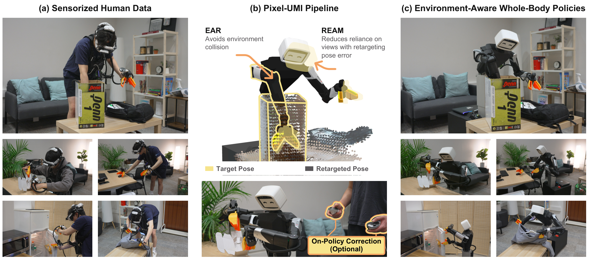

# Pixel-UMI: Learning Environment-Aware Whole-Body Manipulation from Sensorized Human Demonstrations

人类示范记录了头和手的轨迹，却没有规定机器人肘部、躯干和底座应该怎样绕过椅子与箱沿。Pixel-UMI 的核心是把环境几何加入离线重定向，再同时处理机器人动作延迟、相机视角错配和接触纠正。它说明“无机器人采集”并不意味着整个训练与部署流程都不需要机器人数据。

Jason Jingzhou Liu、Tony Tao、Deepak Pathak、Ruslan Salakhutdinov，CMU；[arXiv:2611.03647v1](https://arxiv.org/abs/2611.03647)。[项目页](https://pixel-robot.com/pixel-umi)。以下依据全文方法与实验，所有结果均为作者报告，未独立复现。

## 从人体示范恢复机器人全身动作

传感接口记录头部和双夹爪位姿、夹爪开度以及同步 RGB-D。头部深度用于离线重建，机器人策略执行只用头部和腕部 RGB。重建先过滤人体附近点，以时间持续性寻找静态表面，再用点到面 ICP 与位姿图优化修正 VR 漂移；地面观察负责把绝对高度放到机器人基座可解释的坐标系。

离线环境感知重定向 EAR 在场景点云中跟踪头和双手，把环境碰撞、自碰撞、关节限位及名义姿态一起纳入 geometric fabrics 的加速度组合。机器人用连杆上的球近似碰撞体，球心到静态点云的距离减去球半径给出间隙，间隙缩小时增加排斥。上一帧构型初始化下一帧，使整段示范转成连续的机器人姿态，而不是逐帧各自求一个逆运动学解。

*原图 1：人体示范经环境感知重定向和视角误差处理成为机器人训练数据，接触任务再加入在线人工纠正。*

这里的避障是软约束。噪声点不会成为绝不可穿越的边界，但求解器也没有提供硬安全证书。静态地图通过多帧占据与空闲射线剔除运动物体；未观察到运动的操作对象仍可能被当作静态障碍，因此重建质量和接触对象分离都是复现的前提。

姿态不是动作。各关节响应不同，直接拿下一帧状态当命令会错配时间。作者从真实机器人命令与响应轨迹校准关节延迟，再把未来状态提前作为监督：

$$
k_i^*=\arg\min_k\sum_{n,t}(q^n_{t+k,i}-a^n_{t,i})^2,\qquad \hat a_{t,i}=\hat q_{t+k_i^*,i}.
$$

$i$ 是关节，$n$ 是校准轨迹，$q$ 是实测位置，$a$ 是发出的目标，$\hat q$ 是重定向状态。第一项寻找最合适的离散滞后，第二项将对应未来位置提前发布。校准轨迹不必与人体示范配对，但这个近似主要补偿自由空间跟踪滞后：接触面阻止关节运动时，继续施力所需的目标无法仅从状态恢复。

最终动作是 20 个绝对关节目标加三个机器人坐标系底座速度，23 维；策略以 50 Hz 预测一秒、50 步动作块，直接发送给低层控制器，不再在线调用任务空间全身控制器。

## 误差感知视角屏蔽与在线纠正

机器人不能总把头和腕摆到人的位置，训练图像与执行图像因此不同。REAM 用每帧每相机的位姿重定向误差决定训练时屏蔽概率，而不是永久删掉头部图像。位置误差与旋转误差分别换成训练集百分位，平均为 $r$；高误差才被屏蔽：

$$
p(r)=0\ (r\le\rho),\qquad p(r)=p_{\max}\left(\frac{r-\rho}{1-\rho}\right)^\gamma\ (r>\rho).
$$

实验取 $\rho=0.8$、$p_{\max}=0.9$、$\gamma=2$。被屏蔽相机的视觉键和值不参与注意力，动作标签保持原样。部署保留全部视角，也不需要人体参考来实时算误差。因而它训练的是对错配视角少依赖的策略，不是在线识别当前哪台相机失效。

接触密集的折箱与挂衣任务再用 DAgger：操作者纠正策略自己走到的状态，完整保存策略段与人工段，每轮把这些机器人观察—动作与人体数据合并，从头重训。两轮每任务各收 60 条成功纠正轨迹，并非只加入几个短片段就达到结果。

## 实验指标与各模块的真实贡献

五项任务的人体示范数量分别是整理鼠标100、装网球罐178、取饮料219、折箱393、挂外套261。前三项用于人体数据消融，后两项评估在线纠正。每配置在四个随机初始条件上做20次试验，报告按难度加权的离散阶段任务进度。87.0% 的五任务平均进度不等于87.0%的完整成功率。

| 比较 | 报告结果 | 说明 |
|---|---|---|
| 绝对关节／相对关节／任务空间动作 | 77.74%／27.50%／25.12% | 同样使用 EAR，绝对动作更好保留离线姿态 |
| 有无延迟校准 | 平均进度增加24.05个百分点 | 在固定绝对关节动作下比较 |
| EAR+REAM 与 EAR | 91.79% 对77.74% | 三项人体训练任务，非五项总体 |
| 两轮完整纠正 | 6.82%→50.68%→79.77% | 仅折箱与挂衣两项 |
| 仅人工干预片段 | 第二轮69.77% | 低于保留完整rollout的79.77% |

头部图像的价值随任务变化。只用腕部在取饮料表现好，却在整理鼠标仅有20%进度，而保留全部图像的 EAR 为82.5%。这说明“删掉错配视角”会丢失身体避障所需上下文，误差指导的训练屏蔽提供了更合理折中。反过来，注意力下降的案例只能说明行为符合设计意图，不能单独证明因果机制。

## 复现边界与后续验证

作者使用 DINOv3 ViT-B/16 与流匹配解码器，视觉骨干共同微调，单任务消融训练150000步。头部输入384平方，腕部224平方。复现应同时保留地面标定、静态几何筛选、23维动作接口和真实关节延迟；仅复刻网络结构不足以复现数据管线。

最终机器人数据单独训练也有73.41%两任务进度，但这些数据由人体初始化策略协助收集，不能推出人体数据从一开始就可省略。我的判断是，该工作最可复用的是将跨本体误差拆成几何、时间、观察和接触四个来源。下一步应在相同数据预算下改变场景几何、低层控制器与材质，测试延迟校准和视角屏蔽是否还有效；当前五任务和单一本体并不能保证这种迁移。
