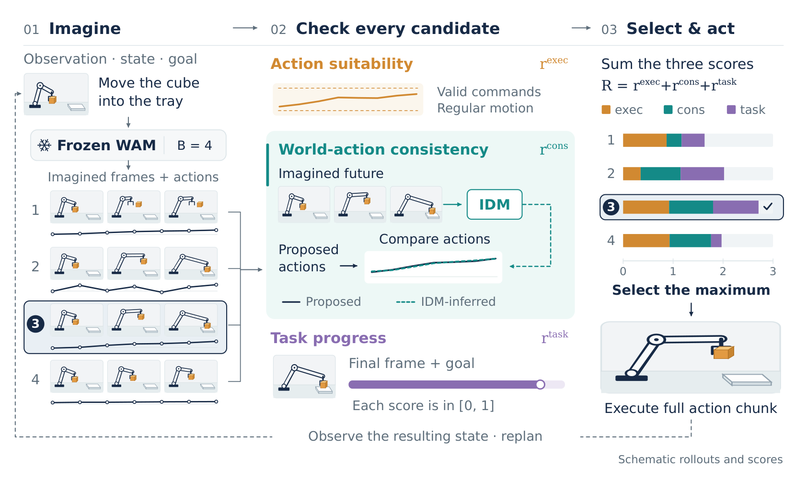

# Seeing Through the Illusion: Test-Time Scaling for World Action Models

世界动作模型同时生成视频和动作，但两者一起生成并不保证相互一致。WISE 在真正执行前检查四组候选动作—未来对，结合控制合理性、逆动力学一致性和任务进度选择一个动作块。它改善的是冻结模型的推理选择，并不把想象视频变成物理正确性的保证。

Cheikh Ahmed、Mahdi Mostajabdaveh、Milad Yazdani、Zirui Zhou；[arXiv:2611.03585v1](https://arxiv.org/abs/2611.03585)。以下依据全文第3至5节及对照表，实验平台为 RoboLab 与 LIBERO，未进行独立复现。

## 为什么想象视频不能直接当执行证据

如果模型画出物体随夹爪移动，实际动作可能只是把它撞走；反过来，视频里物体大幅移动，动作却几乎不产生效果。单看视频逼真程度、候选未来彼此一致或动作是否平滑，都不足以排除这种跨输出矛盾。

WISE 要求模型在执行前给出时间对齐的动作与图像未来。每次从当前观察、本体状态和指令采样四对候选，分别打分后执行得分最高的一整块动作，再从真实反馈重新规划。这不是外部物理模拟，也没有在每个控制步继续修正已选块，因此块内意外事件仍是风险。

*原图 2：四个候选分别经过动作、动作—未来一致性与进度检查，三个有界得分相加后选择执行。*

## 三个评分如何筛选动作未来对

执行评分首先检查命令范围；如果动作有明确的位置语义，还检查相邻命令隐含的速度、加速度和 jerk。每个违反量经指数映射变成软分，而非硬拒绝。因此，一个超限候选仍可能被其他评分抵消，不能把这个模块当作严格安全过滤器。

跨输出一致性由每种本体单独训练的逆动力学模型 IDM 提供：从候选想象视频恢复动作，再与原候选动作比较。连续通道按训练集尺度标准化后求平均绝对差 $L$，夹爪通道按离散状态匹配比例 $r_g$，得到：

$$
r_{\mathrm{cons}}=\tfrac12 e^{-L}+\tfrac12 r_g,\qquad R=r_{\mathrm{exec}}+r_{\mathrm{cons}}+r_{\mathrm{task}}.
$$

三个 $r$ 各在零到一之间，$R$ 用于四个候选之间相对排序。指数项惩罚视频隐含动作与实际命令的差异，离散项保留夹爪状态信息。归一化和连续／离散各半权重决定尺度，换本体时应重新检查动作统计，而不是直接套同一个误差数值。

任务进度使用冻结 Robometer，评估候选最后一帧与指令的关系。RoboLab 用4B版本，LIBERO用对应专门版本。WAM虽冻结，IDM仍需要示范训练：前者使用DROID的21000训练、1000场景分离验证集；后者使用1693集、5%验证。部署成本包含这两个辅助评估器，不能将“没有更新WAM”写成“无需训练”。

## 匹配预算对照与消融

RoboLab选10任务、各5次，共50集；LIBERO四套件每套500集，共2000集。直接执行只采一个候选，其余选择器均采四个，因此应分别看增加采样预算的收益和同预算选得更好的收益。

| 方法 | RoboLab 成功率 | LIBERO 平均成功率 |
|---|---:|---:|
| 单候选直接执行 | 6.0% | 75.1% |
| Future Consensus | 18.0% | 75.9% |
| GeoBoN | 20.0% | 77.3% |
| Robometer | 20.0% | 77.4% |
| WISE | 24.0% | 78.3% |

WISE相对单候选增加18与3.2个百分点；相对最佳同预算对照仅增加4与0.9个百分点。RoboLab差值是50集中多成功两次，LIBERO差值约一个标准误，不能直接声称稳定显著优势。它也不是每个套件最强：Goal由GeoBoN领先，Long由Robometer领先。

单组件闭环实验在RoboLab得到执行分10%、一致性分16%、进度分20%、联合24%。这支持三者组合有用，但没有完整回答“在另外两项存在时，单独移除某项导致多少成功率损失”。论文日志中删除某项再重算选择，仅测候选改变比例，不是让机器人沿新选择重新执行的闭环消融。

进度评分与最终选择的一致比例约65%至67%，移除它会改变约一半决定；三个组件都偏好同一候选只占约7%。这些数字说明它们提供了不同排序，不能仅凭不一致就推出每种分数都正确或相互独立。

## 评估器误差及推理成本

单候选到WISE的每集平均耗时在RoboLab由892.5秒升至3062.5秒，LIBERO由7.1秒升至25.2秒，分别约3.4和3.5倍。前者比其他四候选选择器更慢，后者接近Robometer。收益不免费，真实系统需要同时检查完成率、反应时延及单位GPU成本。

IDM可能误读生成视频，进度模型也可能被逼真但不实现的图像欺骗。高一致性仅表示同一候选内两种输出相容，不表示它们与真实物理相符。我的判断是，最值得复用的是把“这个动作看起来有效”和“这个视频看起来有进展”之间加一项可测兼容性约束。复现应先对齐动作时间窗与训练归一化，再比较四候选的同预算选择；后续还需要更大样本、多随机种子、成对组件消融，以及低分触发提前重规划的真实闭环测试。后者是作者提出的未来方向，当前实验没有验证。
