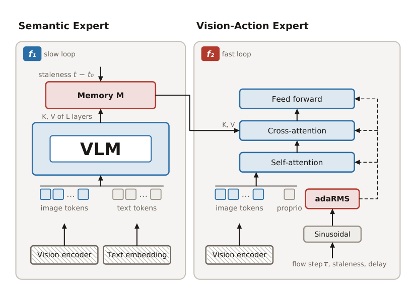

# Asynchronous Robot Policies

大视觉语言模型能提供更好的任务语义，但同步等待它完成推理，会让机器人反应受慢路径限制。ARP把语义更新与视觉动作生成做成两个独立频率的过程。真正重要的设计不只是缓存语义，而是让快专家看见最新图像，并在训练时习惯语义已经陈旧、动作到达时执行已经推进的情形。

Sombit Dey、Luc Van Gool、Danda Pani Paudel，INSAIT；[arXiv:2611.05155v1](https://arxiv.org/abs/2611.05155)。以下依据正文及附录，区分受控仿真扰动、RoboLab与三项真机评估。

## 把慢语义与快视觉动作分开

传统VLA的观察—动作时延包含VLM和动作头两段。ARP的慢循环从视觉语言Transformer多层键值激活取语义，通过归一化和线性适配器压成固定宽度记忆。快循环则自己编码当前图像和本体状态，每层通过交叉注意力读取最近可用记忆，独立生成动作块。

*原图 2：慢语义循环发布记忆，快视觉动作专家结合记忆年龄与执行延迟，通过独立视觉路径响应当前环境。*

设当前控制时刻为$t$，记忆来自$\tau(t)$，年龄$d_t=t-\tau(t)$，快专家推理延迟为$\ell_t$，则动作接口为：

$$
a_{t:t+H-1}=\pi_{\mathrm{VA-E}}(I_t,s_t,M_{\tau(t)},d_t,\ell_t).
$$

$I_t$是实时图像，$s_t$是本体状态，$M$是语义记忆，$H$是动作预测长度。模型不仅知道“该做什么”，也知道这个语义判断有多旧。固定宽度保证快路径不会因为语言骨干参数更多而直接扩大，但并未自动消除共享GPU竞争或跨进程通信延迟。

快专家输入视觉、本体、寄存器和带噪动作词元，使用双向Transformer和流匹配生成轨迹。AdaRMS把流匹配时间、记忆年龄和执行延迟一起注入归一化。最新视觉负责目标突然移动等局部变化，旧语义继续提供相对慢变的任务上下文；两条信息路径承担不同职责。

## 陈旧语义训练为什么不可省略

若训练时图像与记忆总同步，部署时突然降低VLM刷新频率，模型并不知道如何处理错配。训练因此从同一示范中取一个较早观察产生记忆，再用后续帧的图像、状态和动作训练快专家。年龄分布包含同步点质量以及非零延迟范围，执行时延也从运行延迟分布采样。一次昂贵VLM前向可监督多个后续快专家目标，减少训练中重复语义计算。

流匹配用真实动作$a$和高斯噪声$\epsilon$构造$x_r=(1-r)a+r\epsilon$，目标速度为$\epsilon-a$。网络回归这一速度，推理时从$r=1$积分到零。这里的$r$是生成过程的噪声时间，不是机器人控制时刻$t$。区分这两个时钟是实现延迟条件时容易出错的地方。

为跨动作块平滑执行，训练还会固定一段无噪声动作前缀并排除其损失，让新生成的后缀接续已经执行的动作。它补偿动作块交接，而陈旧记忆增强处理慢语义更新，两者不是同一个机制。

| 陈旧年龄训练范围 | 同步评估 | VLM 0.5 Hz |
|---|---:|---:|
| 始终为零 | 81.8% | 2.0% |
| 1–8步 | 79.5% | 5.0% |
| 默认1–40步 | 85.2% | 81.8% |
| 1–80步 | 81.0% | 86.5% |

表中每格500集；仅改变年龄训练范围而架构相同。这个消融支持“缓存接口本身不够”的结论。更宽范围在低频下更好，但同步精度并非单调上升，因此不能简单把最大陈旧范围设得越大越好。

## 反应性、成功率与计算预算

LIBERO使用40任务、2000示范训练，四套件各评估500集。为隔离语言规模，视觉编码器固定且冻结；不同ARP规模与复现π0骨干因此构成受控对照，不等同所有公开策略的完整训练条件。

| 设置 | ARP | 对照 |
|---|---:|---:|
| LIBERO，8B平均成功率 | 89.3% | 复现π0-8B为82.7% |
| LIBERO，原公开π0 | — | 94.2%，高于ARP |
| LIBERO-Perturb，1B | 51.5% | π0-1B为9.5% |
| Dynamic-Bump，必然扰动 | 44.7% | 12.7% |
| Dynamic-Bump，半概率扰动 | 46.7% | 20.0% |

扰动测试是仿真。LIBERO-Perturb在末端接近目标10厘米时，把目标沿垂直接近方向移动5厘米；另有120步的确定性兜底触发，已抓起则跳过。Bump在20 Hz下让滚动物体方向突然变化，不能把这一设置描述成任意真实碰撞下的鲁棒性。

RoboLab全120任务、960集评估中，ARP-3B平均成功率20.0%，LAP-3B为18.4%，π0.5为37.9%。这比摘要中“更高成功率”的表述更能显示外推边界：ARP的反应性贡献并不等于整体任务泛化全面超过强策略。DROID覆盖子集也只是词汇共现代理，不能当作人工逐任务核验的训练分布匹配。

同一ARP检查点加入前缀条件后，RoboLab成功率31.9%→37.5%，每集时间19.5→17.1秒，末端积分平方jerk由456降至296。这一比较比跨架构总分更直接支持动作交接机制。附录报告A6000上的视觉动作专家均值约55 ms；“高频”是相对慢语义路径，不能据此承诺所有机器人和分辨率都达到任意控制频率。

## 部署条件与证据边界

真机只有三项桌面任务，每项10次、90秒上限，采用终态进度分：五个蔬菜入碗、四杯套叠和三个记号笔入碗。图中的百分比不应全部解释成全任务二元成功率。训练ARP-DROID用了TPU v5p-256、30000步、batch2048，结构轻量化的快路径也不意味着整个训练预算低。

作者把通信、双工记忆流和长时持久记忆列为未解决工程问题。我的判断是，最值得复用的不是“首次完全异步”的宣传性排序，而是明确描述两个时钟及其训练错配。复现先固定视觉输入、记忆尺寸、年龄单位和动作前缀，再测端到端感知—执行时延分布；下一步应测试语义本身突变时，旧记忆会不会继续把快而准确的局部动作引向错误任务。当前局部目标扰动实验尚不能回答这个问题。
