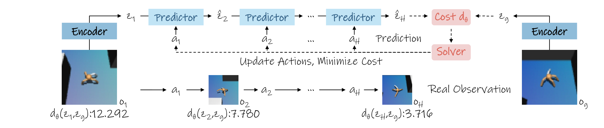

# Time-to-Goal: Learned Temporal Metrics for Long-Horizon Planning with JEPA World Models

能预测未来潜表示，不代表潜空间里离目标更近就意味着任务快完成。T2G冻结JEPA编码器和预测器，只学习一个小距离映射，让同一轨迹中时间较近的状态获得更低代价。它改变的是规划器如何评价未来，而不是增加世界模型层数或重新学习动力学。

Ruilong Yu、Fei Ye，电子科技大学；[arXiv:2611.05847v1](https://arxiv.org/abs/2611.05847)。[作者代码](https://github.com/yrluestc/T2G-JEPA)。以下依据正文与附录训练细节，四组结果全部来自仿真，未独立复现。

## 为何潜空间欧氏距离缺乏远期方向

JEPA编码器把观察变成潜状态，预测器在动作条件下预测下一潜状态。预测损失与避免塌缩的分布正则并没有要求“距目标更少步数”对应“欧氏距离更小”。长时规划于是可能准确预测一些变化，却无法判断哪个候选真的推进了任务。

作者把成对状态的平均平方距离展开成均值、边缘协方差和跨状态协方差项。在相邻长时间偏移下，如果这些项变化都很小，平均代价差也就很小。这个推导给出弱时间对比出现的条件，不是证明所有JEPA或所有欧氏距离都不可用于规划。

经验诊断使用AntMaze与FourRoom各50条规划执行，固定相同未来目标比较不同时间偏移。远期段欧氏排序逐渐接近随机，而T2G保持较清晰的近远区分。诊断针对保存的执行轨迹，仍不能单独推出所有候选动作上的因果收益，后面的闭环实验才检验其控制价值。

## 时间排序监督如何形成规划代价

离线轨迹先由冻结编码器转成潜表示。从同一片段采样锚点$z_t$、近状态$z_{t+k}$和远状态$z_{t+k+\Delta}$，只要求远状态距离大于近状态一定间隔：

$$
d_\theta(a,b)=\alpha_\theta\|f_\theta(a)-f_\theta(b)\|_2,\quad \mathcal L=\mathbb E\max(0,m+d_\theta(z_t,z_{t+k})-d_\theta(z_t,z_{t+k+\Delta})).
$$

$f_\theta$是小MLP，$\alpha_\theta>0$是可学习尺度，$m$是排序间隔。只更新这个映射和尺度，编码器与动作预测器固定。欧氏范数保留对称与三角不等式，但学习映射不保证一一对应，因此不应把它当作环境真实最短路径的精确度量。尤其机器人任务可能不可逆，而对称距离无法天然表达方向性到达成本。

损失没有监督确切剩余步数，所以名字Time-to-Goal表示相对时间接近性，不是校准后的倒计时。离线轨迹中存在停顿、绕路和速度变化时，时间顺序也可能只是执行习惯的代理，而不是最优控制代价。

*原图 4：冻结模型预测候选动作的潜状态，小映射计算到目标的代价，求解器更新动作并在新观察后重新规划。*

映射为两个256宽隐藏块，含LayerNorm与GELU，输出256维；仅新增约0.182M参数。附录用AdamW、学习率五乘十的负五次方、batch128、五轮训练，间隔$m=1$。每个模型步对应五个环境步，训练采样最大偏移与规划时域不是同一个超参数。

## 末段与全轨迹聚合的不同后果

规划器沿候选动作预测潜状态，然后对最后$n$个状态的目标距离取平均：

$$
C_{\mathrm{last-}n}=\frac1n\sum_{t=H-n+2}^{H+1}d_\theta(\hat z_t,z_g).
$$

$H$是预测时域，$z_g$是目标图像编码，$n$决定看多长的末段。全轨迹平均是$n=H$的特例。对每一步都要求靠近目标，会惩罚抓取前必要的接近与准备；只评价终端则允许中途短暂“离目标远一些”，只要最终更可达。

| 方法 | AntMaze | Cube | FourRoom | Push-T |
|---|---:|---:|---:|---:|
| 基础平面LeWM | 18.0% | 32.0% | 40.7% | 40.0% |
| T2G全轨迹 | 48.3% | 4.0% | 81.3% | 42.0% |
| T2G末段 | 58.7% | 63.3% | 78.7% | 51.3% |
| 三层H-JEPA | 73.3% | 60.0% | 96.0% | 17.3% |

四环境算术平均由32.7%升至63.0%，但没有一个版本在所有设置占优。Cube全轨迹代价仅4%，是理解方法最重要的负结果；三层层级模型仍在两项导航上更强。因此结论是改善代价能补回平面模型一部分规划能力，而不是层级预测已无必要。

## 比较协议、失败边界与复现

每环境使用相同50组留出起点与目标，种子42、43、44，报告均值与标准误。模型只接目标图像，AntMaze另用本体信息；成功由各环境目标判据与执行预算决定。末段窗口在三个环境为2、Cube为1；Cube的初始规划时域同时由基线4改成2，因此该处提升不完全是“只换代价”的受控比较。

规划候选数按环境为100至800，基础模型、求解器和动作预算应同时记录，不能只根据额外参数少就推断整个规划轻量。训练在A100完成；论文没有真机、真实深度噪声或接触动力学迁移实验。附录将远偏移截断到最大值，实际会提高最大偏移被采到的概率，这也属于复现采样分布的一部分。

我的判断是，此文最实用的启发是先诊断评价函数，再决定是否给世界模型增加层级。复现可以先记录同目标下近远状态的排序准确率，检查代价是否远期饱和，再做相同预算下的闭环比较。后续应将定向或非对称代价与当前对称距离比较，并固定Cube时域做代价消融；这比直接把63%的仿真均分外推到真实长时机器人任务更有信息量。
