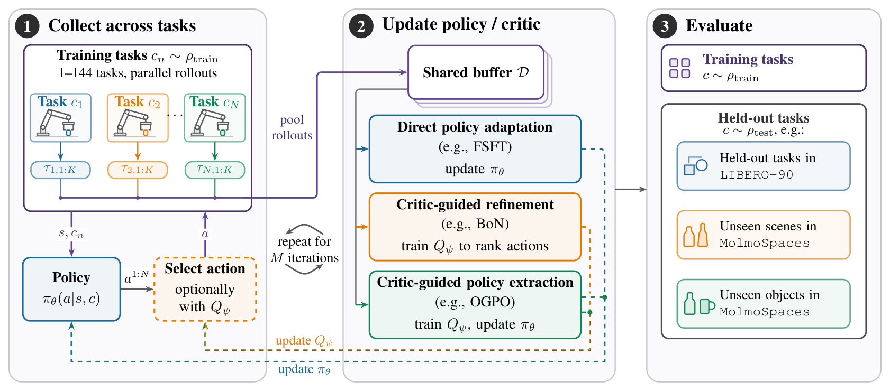

# Reinforcement Learning Enables Scaling Generalist Robot Policy Improvement

把通用机器人策略在一个任务上训练得更好，可能让它忘记其他任务。这篇论文把“自我改进”拆成三个可以对照的机制：拟合成功轨迹、学习价值并重排动作、把价值偏好再写回策略。它的主要贡献是受控的多任务后训练研究，而不是发明一个全新的强化学习算法。

Michal Korniak 等；[arXiv:2611.06905v1](https://arxiv.org/abs/2611.06905)，首次提交北京时间 2026-11-05；[官方代码](https://github.com/lasgroup/generalist-improvement)。以下页码对应 57 页 PDF。全部评估在仿真进行。

## 训练任务变多，测试的究竟是哪种泛化

论文以预训练 π0.5 为起点，分别使用 MolmoSpaces 的 droid 检查点和 LIBERO 检查点。MolmoSpaces 聚焦抓起物体，可独立改变物体和场景，因此“新的房间外观”和“需要不同抓取策略的新物体”能分开测。主实验训练任务为 1、4、16、64、144 个，逐步包含更多物体和场景，基础策略平均成功率约 30%；这是一组刻意保证有非零成功的任务，不代表从完全不会的任务开始探索。

上下文 $c$ 表示任务，$s$ 是状态，策略为 $\pi(a\mid s,c)$，任务分布为 $\rho$。评价目标写作：

$$J(\pi;\rho)=\mathbb E_{c\sim\rho,\ s_0\sim\mu_0(c)}[V^\pi(s_0,c)]$$

其中 $\mu_0$ 是任务的初始状态分布，$V^\pi$ 表示预期折扣回报。训练使用 $\rho_{train}$，测试既看相同任务也看留出分布 $\rho_{test}$。这个表达的作用是提醒复现者：训练成功率升高与留出任务的性能提升是两个不同问题；任意不相关的测试分布并不受保证（第 4 页）。

## 只改价值函数，为什么也能改变机器人行为

*原图 Figure 2：共享回放缓冲区连接多任务交互与三类更新机制，右侧把训练任务、新场景和新物体分别评估。*

每一轮先冻结当前行为策略，在各训练任务收集二十个 episode，合并进共享缓冲区，再做更新。通常重复十轮；附录 D.3 明确最大 144 任务的 BoN 和 OGPO 延长到十五轮，因为仍未收敛。最终另做每任务三十二次评估，三个训练 seed，报告 95% 分层 bootstrap 置信区间。不能把这套协议描述成所有配置都只有同样十轮。

第一个对照 FSFT 只保存成功轨迹，用原有流匹配损失微调整个 VLA。这最接近“把自己做对的动作再学一遍”，但没有直接学习失败动作与成功动作之间的价值差异。第二个对照 BoN 完全冻结 VLA，利用所有采集轨迹训练 Q/V，再从基础策略的多个候选动作块里挑最好的一条：

$$a^*=a^{i^*},\qquad i^*=\arg\max_i Q_{targ}(s,a^i,c),\quad a^i\sim\pi_{gen}(\cdot\mid s,c)$$

这里 $Q_{targ}$ 是慢更新的目标价值网络，$N$ 个 $a^i$ 使用独立初始噪声生成，默认 $N=32$。这没有为基础策略添加新的动作支持集，收益来自把已有候选排序得更准确；如果候选都无法解决任务，重排不能凭空生成缺失的能力。

BoN 的 critic 输入是冻结 VLA 的平均池化末层表示、本体状态与展开后的动作块，采用 BroNet 残差 MLP。冻结特征可以在采集时缓存。正文用单步式子解释 TD 学习，实际实现按整个动作块累计奖励并自举：

$$y_t=\sum_{j=0}^{h-1}\gamma^j r_{t+j}+\gamma^h V_{targ}(s_{t+h},c)$$

$h$ 为动作块跨度，$\gamma=0.995$，$r$ 为逐步奖励，Q 回归到 $y_t$，V 再回归缓冲区动作对应的 Q。BoN 使用每步负一、成功为零的到达时间奖励，超时按截断处理而非成功终止；V 不是最大动作价值或上分位回归，因此作者将其解释为数据采集策略的 SARSA 风格评价（第 33 页）。这比只写“训练一个成功分类器”更接近可复现实现。

第三类 OGPO 同时学习 critic 和更新生成策略。它在一个状态采样动作组，用 $\widehat A_i=Q_{targ}(s,a_i)-G^{-1}\sum_jQ_{targ}(s,a_j)$ 构造组内相对优势；$G$ 是动作组大小。正优势动作的去噪路径获得更高概率，负优势则受抑制，PPO 式裁剪限制更新，成功轨迹 BC 与保守优势提高稳定性。这里更新的是动作专家，主干保持冻结；采集仍用三十二候选，最终评估只用一个候选。它把一部分筛选计算转移到训练，不能误写成评估时也必须与 BoN 一样采样三十二条（附录 B、D）。

## 收益来自任务数，还是来自任务的变化方向

训练任务上三种机制都能提升，OGPO 和 BoN 在多任务设置分别比 FSFT 高约 43–50 和 15–21 个百分点。但单任务专家的平均成功率仍略高，多任务训练没有完全消除任务干扰。固定采集预算下，一个十六任务 BoN 训练达到相近性能所需梯度步数，比十六个单任务训练少 2.9 倍；这个数字不是端到端墙钟或真机数据成本的加速比（第 8 页）。

在 MolmoSpaces 留出评估中，价值方法相对基础策略的新场景增益最高为 58 个百分点，新物体最高为 39 个百分点。作者进一步固定任务数，比较增加同一物体的场景与增加不同物体：前者主要帮助场景泛化，后者更能帮助跨物体迁移，也能改善场景表现。因此数据规模的单位不应只看 episode 总数，还要看是否覆盖了目标测试需要的抓取策略。

并非所有物体受益。酒瓶上 OGPO 从 64 到 144 任务只由约 0.09 升到 0.12，BoN 却恢复到约 0.44；更新策略可能让远离训练分布的物体遗忘，冻结策略只更新 critic 有时更保守。LIBERO 的反证更明确：最多六十四训练任务时，新任务泛化仍未出现，BoN 主要表现为比 FSFT 少遗忘。论文据此支持的是相关任务分布上的泛化，不能据此声称广泛开放任务自我进化。

## 消融和推理预算决定该选哪种机制

受控消融表明，BroNet 相比普通 MLP 的收益超过十个百分点；TD 加回归比 MC 或分布式分类目标更稳定。FSFT 全模型微调比只改动作专家在训练分布和新场景高超过十二个百分点，但新物体相对基础策略下降 10.6 个百分点，专家单独微调只下降 2.2 个百分点。这是表达能力与遗忘之间的实测折中，不是“训练越多越好”。附录还报告预训练 critic 仅初始领先，下一轮便被从头训练追上甚至反超，具体机制尚未确定。

表 2 在单张 GH200 上测量一次 BoN 查询：

| 候选数 | 墙钟时间 | 相对单候选 |
|---|---:|---:|
| 1 | 146.3 ± 2.1 ms | 1.00 倍 |
| 8 | 232.9 ± 2.6 ms | 1.59 倍 |
| 16 | 325.2 ± 2.2 ms | 2.22 倍 |
| 32 | 510.7 ± 2.8 ms | 3.49 倍 |

三十二候选比八或十六的成功率收益已趋于饱和。作者在仿真中优先性能，因此选三十二；真实闭环可能偏好八候选，但这是论文提出的部署判断，尚没有真机验证。单任务训练约需 2–5 小时，大任务集合约 200 小时，运行节点各有四张 GH200；梯度步数和实际预算必须同时看。

## 如何把结论变成一次可检验的复现

最小复现应保持基础检查点、初始成功率、任务划分和评估 episode 数一致，分别跑成功轨迹微调、冻结主干的价值筛选，再考虑 OGPO。策略在 MolmoSpaces 输出十五步动作块、LIBERO 为十步，只执行前五步重规划；回放中按每环境步保存随后实际执行的完整动作块，可能跨越多个预测块。这个标签构造及超时自举方式会改变 critic 的训练目标，不能随意用单次网络预测替代。

我的分析是，论文最可迁移的思想是用训练分布的变化轴设计后训练，而不是把所有任务简单混成更大数据集。仍需验证的是：当基础策略近乎零成功、奖励带噪声、候选受真机时延限制时，价值排序是否保持有效。当前研究没有真实硬件实验，也没有证明能推广到移动操作或全身控制；这些是作者明确保留的边界。
