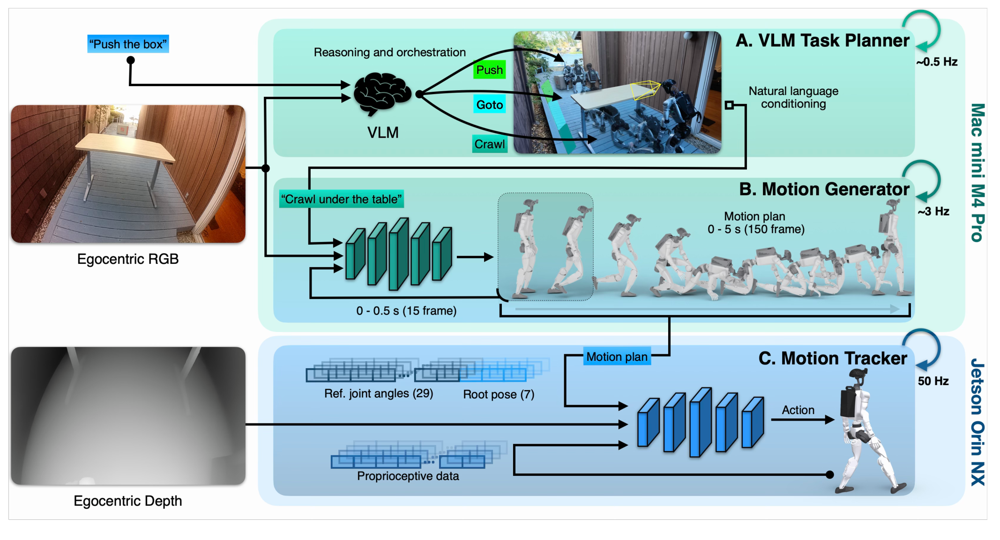

# Perceptive Humanoid Motion from Simulation

人形机器人会跟踪一段漂亮动作，并不等于能在陌生房间里找到椅子再坐下。HALO 把这两个问题接起来：先在程序生成的室内场景中合成视觉、语言和全身轨迹，再让语义规划、动作生成和深度反馈控制以不同频率协作。最值得复用的是数据与控制接口的设计；最容易误读的是“无需遥操作”被扩大成“无需人工技能设计”。

Siyuan Hu 等，Apple；[arXiv:2611.06908v1](https://arxiv.org/abs/2611.06908)，首次提交北京时间 2026-11-05。[项目页](https://apple-aiml-research.github.io/ml-halo/)。以下页码对应 20 页论文 PDF。

## 仿真如何提供能训练动作生成器的数据

作者并非从随机房间直接搜索出所有技能。每种任务先由人定义文本提示、路径约束与末端关键帧，再用 KIMODO 运动扩散模型生成运动段。坐下任务由走近、转身、坐下组成；前段末帧成为后段起点，连接处用短交叉淡化平滑。前向运动学检查足底滑动、穿地、关节限制等，随后把轨迹和目标家具共同放入 INFINIGEN 房间，检查与环境的碰撞，再回放并渲染第一视角图像（第 4、10–11 页）。

这条链把运动采样与场景渲染解耦：随机种子和放置记录足以重新渲染不同相机与外观，不必重新合成动作。附录给出的语料为 162,698 个片段、296.3 小时，正文约称 300 小时，训练场景为 1,000 个房间。这里的多样性主要来自环境和轨迹实例；底层语料实际上只有十种固定指令，运行时再由编排器将自由语言映射到技能。因此不能把它理解成开放词汇动作全集。

规模化的另一关键是预烘焙光照：Cycles 每帧路径追踪成本太高，作者将直接与间接照明烘入纹理并替换为自发光材质，让快速渲染器重用。视角相关反射不能被这种表示完整保留，木材还被处理成哑光。我的分析是，这是一种有意识的训练吞吐与光学精度折中，并非以完全物理正确的图像消除了域差距。

“筛选”也不是所有坏轨迹都被排除。坐下的候选在有限重试后会保留最优链，即使仍未通过检查；50,000 条生成坐下片段中 77% 通过全部硬检查，最终语料按序均匀取样。推箱还使用录制的人类动作，部分关键帧来自手机视频或真实 G1 关节记录。准确的表述应是避免逐次为部署场景采集遥操作数据，仍依赖先验运动模型、录制动作和人工任务结构。

## 三个频率如何连续驱动同一个身体

*原图 Fig. 2：RGB 与语言驱动慢语义和中速运动计划，深度与本体反馈驱动快速跟踪；图中箭头同时说明两个机载计算平台的职责。*

考虑“穿过桌下再去推箱子”的请求。约 0.5 Hz 的 VLM 编排器先选择当前子任务；约 3 Hz 的动作生成器读取当前 RGB 与指令，输出未来五秒轨迹；50 Hz 跟踪器读取参考轨迹、深度和本体状态，产生 29 个关节位置目标，再交给低层 PD 驱动。轨迹每帧为 29 个关节角、3 维骨盆平移和 4 维四元数，共 36 维，以当前骨盆为参考坐标；150 帧对应 30 Hz 的五秒计划（第 2、5–6 页）。

生成器使用冻结的 Qwen3.5-2B 编码图像和语言，投影后交给八层、宽 512 的 DiT，训练参数约 49.3M。它学习的是流匹配速度场，不是直接回归平均轨迹。附录 B 的核心构造是：

$$x_s=sx_1+(1-s)x_0$$

其中 $x_1$ 是归一化的真实计划，$x_0$ 是高斯噪声，$s$ 是从噪声走向数据的流时间，训练采样服从 Beta(1.5,1)。速度网络预测 $x_1-x_0$，推理用十五步 Euler 积分恢复计划。为了让新旧计划接上，前 $P=15$ 帧保持干净，只有后面的帧参与去噪损失：

$$\mathcal L=\mathbb E\left[\frac{1}{D(H-P)}\sum_{\tau=P+1}^{H}\|v_\phi(\widetilde x_s,\widetilde s,c)_\tau-(x_1-x_0)_\tau\|^2\right]$$

这里 $H=150$、$D=36$，$c$ 为图文条件，$\widetilde x_s$ 的前十五帧来自已承诺执行的旧计划，$\widetilde s$ 在这些帧为一。实现时每次 Euler 更新后也覆盖回这一前缀，只重新生成剩余 135 帧。这在轨迹接口上固定衔接部分，避免慢推理期间停住机器人；它并不是对实际接触运动无误差的数学保证。

跟踪器则分三阶段训练：有特权几何的专家先学技能；学生用 20% 教师驱动与 80% 学生驱动的 DAgger 混合轨迹蒸馏，只保留机载深度和本体输入；最后共享 actor、分技能 critic 的 PPO 继续训练并分别归一化优势，防止不同技能的奖励尺度相互压制。推箱的对象位移奖励很重要，因为单纯姿态跟踪可能让机器人动作正确、箱子却完全没动。

机载实现也属于方法有效性的条件。Mac mini M4 Pro 负责语义与生成，Orin NX 上的实时 C++ 跟踪进程通过无锁三缓冲与电机通信。深度来自原始双目 IR 经 LiteAnyStereo 推理，生成器单独运行约 152 ms，与编排器共享时约 155 ms；编排决策则从约 0.72 秒升到 1.46 秒（第 16 页）。因此“全机载”不意味着只有 G1 原装计算配置。

## 哪些实验真正支持这条设计

单任务评估涵盖六种技能、100 个未见仿真环境和六个未见真实环境，每任务每环境十次，共 6,000 次仿真与 360 次真机试验。表 II 报告平均成功率均为 91%；真机坐下为 85%，蹲行穿过桌下为 100%，推箱为 88%。成功是任务相关的，例如推箱至少移动 0.3 米、走向目标停在一米内，不能自动等同高精度操作。

表 III 在坐下任务上进行阶段消融，仍是仿真结果：

| 改变的设置 | 坐下成功率 |
|---|---:|
| 完整模型，1,000 场景 | 84% |
| 100 / 10 / 1 场景 | 81% / 64% / 43% |
| 推理时分块衔接 | 66% |
| 不做分块衔接 | 24% |
| 回归解码器 | 19% |
| 不提供深度 | 74% |

环境规模实验保持其他环节不变，支持场景多样性有用，但从一百增到一千仅增加三个百分点。训练时前缀条件明显优于推理期修补；去深度下降十个百分点，支持控制层直接感知几何的价值。回归解码器的巨大下降同时伴随不兼容原有扩散分块机制，不能将全部差距归因于多模态概率表示。

长链任务提供更强的反证。三个链在一处真实环境中各测试十次，平均成功率 70%，其中蹲行、走近、推箱的三阶段链只有 50%。论文分析失败常由上一动作结束朝向让下一目标离开视野，而不是单个技能完全不会做。六环境 360 次的 91% 不能挪给这项长链测试。

## 复现首先要补齐什么

生成语料正文报告需 250 张 H100 运行 48 小时，生成器训练用 64 张 B200，跟踪器训练用四张 H100；“算力扩展”仍有相当高的成本。复现也不能只拷贝随机化范围：附录报告实测驱动延迟约 25–30 ms、命令刚度实现比例 78–90%，系统辨识后关节跟踪误差从 26.9% 降至 10.1%。延迟、柔软地毯接触和动作平滑惩罚直接影响真实稳定性。

作者承认新增技能仍需人编写提示和关键帧，纯视觉对遮挡接触缺乏反馈，跟踪器只知道要跟什么轨迹、不知道任务意图。附录还指出微调视觉编码器虽改善响应，却可能只认训练里的人形外观，或忽略语言依赖视觉捷径，这部分是部署观察而非完整受控统计。下一步最值得验证的是加入主动搜索后的长链恢复，以及以相同数据和衔接方式隔离回归与流匹配的差异；当前证据尚不能证明任意室内技能或长期安全自主运行。
