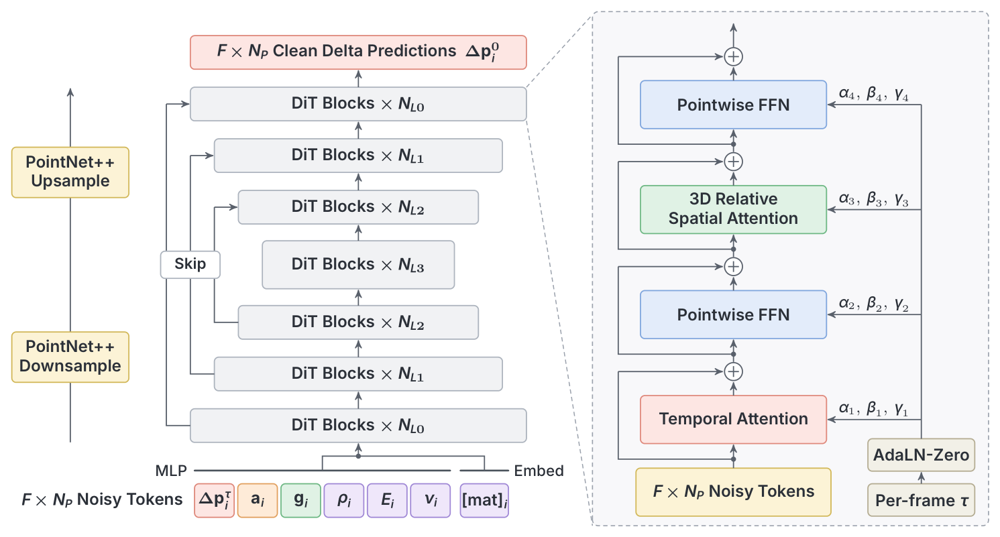

# GPWM: Modeling the World as 3D Particle Motion

世界模型如果只生成看起来合理的视频，规划器仍难直接读取对象的三维状态。GPWM 直接生成粒子和刚体的运动，并把执行器与对象的联合轨迹学成先验。它真正改变的是规划搜索的空间：从任意动作序列，转向模型认为可能发生的接触过程。

Robert Ren、Matthew Bronars 等，CMU 与 Toyota Research Institute；[arXiv:2611.08338v1](https://arxiv.org/abs/2611.08338)，首次提交北京时间 2026-11-06。[项目页](https://robertren1122.github.io/gpwm/)。页码对应 39 页 PDF。

## 统一的不是材质方程，而是运动接口

输入包含四帧历史三维状态、粒子对应关系和对象身份，以及可用的材质参数或未来执行器轨迹。软体以逐帧粒子位移表示；刚体单独预测三维平移和六维旋转增量，将变换应用到固定的体坐标粒子，避免独立粒子噪声破坏刚性。未来位置由最后观测状态累积位移恢复，物体的 Young 模量、泊松比、密度作为条件，不是网络自动从视频可靠识别的隐藏物理属性。

*原图 Figure 2：对象内降采样将大量粒子压缩成锚点，粗层进行全场景交互，再经上采样和跳连恢复细节；右侧显示逐帧噪声调制的时空注意力。*

直接对上万个粒子跨时间做全连接注意力代价过高。模型在对象内用最远点采样固定锚点身份，通过 PointNet++ 邻域聚合下采样，粗层才跨对象交换信息；返回细层时逆距离插值并与编码器特征融合。邻域随当前噪声轨迹对应的位置更新，锚点身份在时间窗内不变。刚体姿态词元不被池化。这些设计让稠密形状细节与全场景接触建模各自在合适分辨率发生（第 4–5 页）。

## 为什么每个未来帧要有自己的噪声

训练把干净粒子位移 $x_0$ 与高斯噪声 $\epsilon$ 混合：

$$x_\tau^t=(1-\tau_t)x_0^t+\tau_t\epsilon^t$$

$t$ 是未来帧，$\tau_t$ 是该帧独立采样的噪声比例。网络预测干净终点，而不是直接输出速度，刚体增量 $y_0$ 同样处理。损失为：

$$\mathcal L=\mathbb E[\|\widehat x_0-x_0\|_2^2+\gamma\|\widehat y_0-y_0\|_2^2]$$

$\gamma$ 平衡粒子与刚体误差，两项在归一化空间计算；论文未加入额外物理守恒损失。推理中近未来先去噪并提交，远未来保持更大不确定性，窗口前移再补入噪声。它允许固定十六帧预测窗口反复滚动到更长时域，但不能保证累积误差消失。衣物测试最长 898 帧，约为窗口的 55 倍；这与只生成一次十六帧预测不同。

规划时使用任务专用模型联合生成对象和执行器运动。终点奖励只看被动物体，冻结模型后对初始噪声 $z$ 做：

$$z\leftarrow z+\eta\nabla_z r(\Pi_{pass}(\widehat s_H(z)))$$

$\widehat s_H$ 是反归一化、积分后得到的终点状态，$\Pi_{pass}$ 选择被动物体，$r$ 为目标奖励，$\eta$ 为步长。梯度穿过整个生成过程，多窗口规划还要跨窗口反传。也可在相同噪声空间做 CEM 采样筛选。最终取生成轨迹中的执行器部分，用跟踪控制器在仿真开环执行，而非每步重新感知闭环纠错。

## 预测更准与规划有效是两项检验

ParticleWorlds 包含 2550 万模拟帧、六个物理领域，覆盖刚体、弹性、塑性、颗粒和布料。预测评测使用同样测试轨迹和可用执行器条件，单次采样；一般指标为被动粒子的平均欧氏位置误差，衣物则用对称 Chamfer。不能把不同指标简单看成完全相同的物理误差。

| 设置 | 最强适用旧基线 | 专家 GPWM | 统一 GPWM |
|---|---:|---:|---:|
| Free Fall | 53.0 | 40.0 | 41.5 |
| Dragging | 7.8 | 6.5 | 6.1 |
| Pushing | 23.9 | 13.3 | 18.0 |
| Pick and Place | 34.1 | 12.6 | 11.1 |

表中数字来自表 1，单位毫米。平均降低 31% 取的是每领域专家和统一模型中更好的一个，不是单一统一模型的平均收益。统一模型在五个领域优于旧方法，但衣物为 10.8，略差于 PointWorld 的 10.6，专家模型为 10.0；这明确显示异质联合训练的干扰。

规划对照用相同 GPWM 检查点，仅改变动作空间与噪声空间搜索，有助隔离交互先验的贡献。推物与抓取的噪声规划进度分别为 0.48–0.57、0.40–0.56，动作空间至多约 0.01；颗粒堆优势却较小，噪声空间 0.21–0.23 对最佳动作搜索 0.19，因为随机接触也容易推动颗粒。进度是初始目标距离缩短的比例，并非完成任务的成功率。推物、颗粒各五十个场景，抓取二十五个问题；单 L40S 规划预算分别可到一百或二百秒（第 9–10 页）。

## 哪些结论仍不能外推

未见刚度实验是在训练范围内取 30、300 kPa，对照已见 10、100、1000 kPa，支持插值而不是任意材料外推。单张照片的示例还需分割、三维重建、场景定位与人工赋予物理参数，不是端到端从像素恢复可靠物理系统。

作者明确要求完整、持续跟踪的三维场景状态；真实遮挡下的粒子跟踪并未解决。所有规划证据是仿真开环，长时域反传成本限制在线控制。我的分析是，最值得复用的部分是“在学得的接触分布里搜索”，下一步应在相同墙钟与相同初始状态估计误差下检验闭环规划；当前结果不提供碰撞安全或动力学守恒保证。
