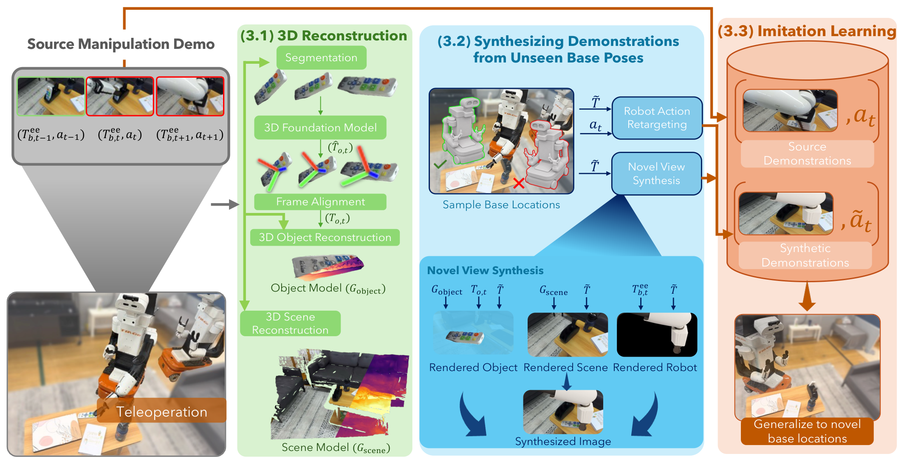

# MOMASPLAT: Dynamic Novel-View Demonstration Augmentation for Mobile Manipulation

移动底座停偏几厘米，既改变相机视角，也改变动作表达的坐标系。只增强图像或只给动作加噪声都没有同时解决这两件事。MOMASPLAT 利用导航途中已经拍到的多视图，分别重建静态场景与运动对象，再生成视角、机器人姿态和动作标签相互匹配的新示范。

Sateesh Kumar、Arnav Balaji 等，UT Austin；[arXiv:2611.08372v1](https://arxiv.org/abs/2611.08372)，首次提交北京时间 2026-11-06。[项目页](https://robin-lab.cs.utexas.edu/momasplat/)。以下页码对应 12 页 PDF。

## 静态重建为什么会在接触后失效

把整个场景拟合成单个 Gaussian Splat，瓶子就会固定在初始位置。机器人抓起瓶子后，重渲染仍留下静态瓶子，训练样本最重要的接触阶段反而错误。作者将场景、操作对象和机器人拆成三个独立渲染层：导航数据用于静态背景，操作片段用于对象轨迹，已知机器人模型用于新关节配置的渲染（第 2–4 页）。

*原图 Fig. 2：绿色部分对齐对象与场景，蓝色部分同步重渲染和重定向动作，橙色部分联合训练真实与合成示范。*

场景先用 COLMAP 恢复相机并初始化 WildGaussians，遮掉机器人与操作对象以免烘出重影。SfM 的尺度不确定，必须用实测 RGB-D 深度与渲染深度的稳健比例恢复米制尺度，否则后面的厘米动作没有一致含义。对象通过 GroundingDINO/SAM2 分割，FastVGGT 估计对象相对相机轨迹，并做 bundle adjustment。

对象坐标系和场景坐标系仍不同。导航期间对象不动，因此同一相机运动能被两套重建同时观测，作者用这些帧的相机中心通过 Umeyama 和 RANSAC 求 Sim(3) 对齐。随后联合优化对象高斯与每帧姿态，缺失时刻用旋转 SLERP 与平移插值补齐。铰接对象只把运动刚性部件独立建模，例如笔记本盖子；它没有学习完整关节物理，也不外推示范以外的运动。

## 新视角必须和新动作坐标系一起生成

设原底座在世界中的位姿为 $T$，新底座为 $\widetilde T$，则从旧底座坐标到新底座坐标的变换为：

$$\Delta T=\widetilde T^{-1}T$$

保持末端在世界中的位置不变，将旧末端位姿左乘 $\Delta T$，再求新底座下的逆运动学；若多个探测时刻不可达，则拒绝该采样。底座默认在 1.2 米见方区域内采样，朝向对象并扰动约正负二十度。这样的筛选只证明所检查姿态可达，不是全轨迹碰撞或接触可行证书。

动作是底座坐标中的平移增量、旋转增量与夹爪指令。令 $R_\Delta$ 是上述变换的旋转部分，则：

$$\widetilde p=R_\Delta p,\qquad \widetilde R=R_\Delta R R_\Delta^{-1}$$

$p$ 为原平移增量，$R$ 为原旋转增量。平移增量只旋转而不加坐标系平移，旋转增量用共轭变换保持同一世界旋转轴，夹爪指令保持不变。本体感知中的绝对末端位姿也要同步变换。否则图像看似一致，监督标签仍会教错方向（第 5 页）。

新相机分别渲染静态高斯、按源轨迹移动的对象高斯、IK 配置下的机器人，再按每像素深度排序，前向 alpha 合成遮挡。最终得到图像与动作成对数据。Diffusion Policy 在真实与生成序列中按 0.25/0.75 概率采样，用标准噪声预测损失训练；每条真实示范生成十条合成示范。附录配置为两步观测、八步动作块，ResNet-18 加条件一维 U-Net，训练十万步，batch 32，AdamW 学习率 0.0003。

## 真机改善有多大，又有多难

实验使用 TIAGo，在三个场景的五个任务上评测刚性抓放与单自由度铰接操作。每任务三个源底座位置，关笔记本收集 75 条示范，其他任务各 90 条，另有九条导航轨迹。测试每任务十二个未见底座位置、每位置三次 rollout，不能把三次试验当成高置信度长期可靠性统计。

| 方法 | 五任务未见位姿平均成功率 |
|---|---:|
| 仅原始数据 | 6% |
| 动作增强 | 6% |
| VISTA | 8% |
| One-Thousand Trajectories | 17% |
| MOMASPLAT | 37% |

两倍以上提升的绝对水平仍为 37%，这意味着许多未见位姿仍会失败。放瓶在距源位姿三十厘米处达到 33%，关笔记本四十厘米处为 50%，对应基线已为零。这支持动态重建与坐标一致监督能扩展局部视角范围，不证明跨新房间、新物体的通用泛化。

减少真实示范的瓶子实验在同样四个测试位置比较：10、50、90 条源示范增强后为 33%、42%、50%，原始 90 条不增强只有 8%。但基线比较也有协议差异：VISTA 保留旧动作，不支持这里的底座动作重定向；静态重建基线的瓶子合成数据仅 400 条，而本方法可生成 900 条，因此不能把全部差距单独归因于某一个重建模块。

生成质量在仿真单瓶任务中用 75 条示范、2486 帧对照真值，场景 PSNR 为 26.40 dB，对象 18.18 dB，机器人 17.43 dB；对象轨迹平均平移误差 1.46 厘米、旋转误差 4.01 度。真实完整图像没有报告同类真值指标，因为机器人外观和合成光照差异主导误差。这不是省略后的完美重建证据。

## 复现首先要守住几何与物理的边界

场景高斯训练三万步、对象高斯六万步，还需分割、BA、尺度恢复和对象轨迹插值。小物体、弱纹理、遮挡会影响位姿；被初始物体挡住的桌面或抽屉内部从未被观察，新视角露出后仍缺模型。提高渲染质量不能从根本上补齐这种不可见信息。

作者明确指出合成示范按原对象轨迹重放，不计算接触力和动力学，因此可能产生非物理交互。我的分析是，最可迁移的贡献是让视图、动作与本体输入严格使用同一底座变换。下一步应在固定合成数据量和相同动作重定向下隔离动态对象建模的贡献，再研究完整碰撞与接触验证；目前的结果支持有限场景中的数据增强，而非可替代物理仿真的通用数据引擎。
