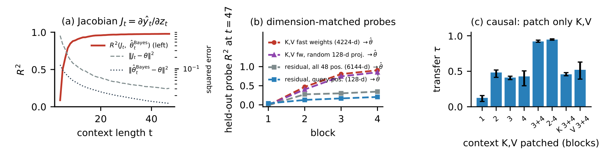

# What a Transformer Learns When It Adapts to Unknown Physics In-Context: Probing, Patching and Controlling

机器人在几步交互中适应未知质量或摩擦时，历史信息必须影响接下来的预测和动作。Anuar Zhambakin 用小型 Transformer 将这个问题拆成三个可单独测量的部分：预测离贝叶斯参考有多远，哪些内部张量真正改变预测，以及适应能力能否稳定地用于闭环控制。以下以北京时间 11 月 7 日 17:47:42 的 18 页版本为准。[固定版本 PDF](https://raw.githubusercontent.com/nonberw/suss/61b2aac11534c1bf14da4344f1227d6589ceb88b/paper/main.pdf) · [代码与实验记录](https://github.com/nonberw/suss/tree/61b2aac11534c1bf14da4344f1227d6589ceb88b)。

## 把适应写成可以精确比较的预测问题

实验 A 先把世界缩小成两维状态、一维控制输入的线性系统。每条轨迹采一个未知动力学，训练因果模型读当前与历史的状态、动作，预测下一状态，部署时权重固定。令 $z_s=(x_s,u_s)$，其中 $x_s$ 是状态、$u_s$ 是控制。动力学矩阵 $\theta=[A\ B]$ 将 $z_s$ 映射成下一状态的条件均值，转移还有独立的高斯噪声，方差为 $\sigma^2$。用高斯先验的精度矩阵 $\Lambda_0$，后验均值给出预测基准。

$$S_t=\sum_{s<t} z_s z_s^\top,\qquad C_t=\sum_{s<t} z_s x_{s+1}^\top,\qquad \widehat y_t=C_t^\top(\sigma^2\Lambda_0+S_t)^{-1}z_t$$

$S_t$ 累积哪些方向被数据激发，$C_t$ 累积输入与结果的关联。实现上，保存这两块矩阵就足以在收到新查询 $z_t$ 时求出带先验正则的预测。定理使用未截断高斯先验，实验仅采稳定的 $A$，因此作者以截断后验蒙特卡洛均值作主要对照。每条序列长 48 步，训练模型约 80 万参数、4 层 4 头，用 20,000 个新批次更新步。和最小二乘、单步梯度及贝叶斯基准的距离比较，都在这组受控输入下解释（第 3–6 页）。

数据少时模型在贝叶斯超额风险的 1.23 倍内。平均风险比为 1.59，区间为 [1.56, 1.62]，超过预注册容忍阈值 1.25。放大模型或延长训练在探索性单种子结果中缩小差距，但更大的四维系统仍有约 4.4–4.9 倍风险。相似的函数形状可以与显著的绝对误差并存。

## 从读出参数到置换注意力记忆

预注册假设认为网络先把估计出的动力学参数写进残差流，再使用这个向量预测。作者先训练线性读出，再沿读出方向干预，最后在两个轨迹之间交换读出子空间。最佳残差探针的 $R^2$ 为 0.19，交换六维子空间只转移约 0.0001 的预测行为，低于随机同维子空间。这个实验否定了被测的线性因果路径。MLP 探针能恢复部分参数信息，说明残差仍可携带非线性表示（第 6–7 页）。

论文随后转向注意力。在分数足够小的近均匀注意力头中，对 softmax 作一阶近似，可把输出写成查询的仿射函数：

$$o(q)\approx \overline v+\frac{1}{\sqrt{d_h}}\widehat{\operatorname{Cov}}(v,k)\,q$$

$q$ 为当前查询，$k$、$v$ 为历史各位置的键和值，$\overline v$ 是值的均值，$d_h$ 是单头维度，协方差在历史位置上估计。线性部分取决于整段历史，因而可以改变同一个查询的映射，即使没有一个显式参数向量供线性探针读出。这是局部近似，尖锐注意力头的结果给出了适用边界。

*Figure 2 左侧比较查询雅可比与贝叶斯估计，中间比较不同特征和维度的探针，右侧通过替换历史键值检验预测如何变化。*

保留历史、改变查询可测量功能雅可比 $J_t=\partial\widehat y_t/\partial z_t$，与贝叶斯参数估计的拟合 $R^2$ 为 0.92。同样压到 128 维时，末层键值特征读出参数的 $R^2$ 约 0.84–0.86。更直接的证据是固定查询及其残差，替换另一段历史的第 3、4 层上下文键和值，转移 0.91–0.94 的行为。只换首层转移 0.07–0.16，只换键或只换值也明显较弱。这里的转移系数衡量替换后预测在参照预测差方向上的位移，不能当成分类准确率。七个补充训练种子复现了主要结果，但这个键值机制最初来自预注册假设失败后的探索。

## 接触预测与闭环控制的不同证据

MuJoCo 实验使用一自由度摆、受摩擦的推块与探索性弹跳球。推块归一化单步误差为 0.0058，物理特征 RLS 为 0.019。用同一观测状态重启仿真、网格搜索质量与摩擦的结构化辨识器为 0.011。即使给重启仿真器真实参数，隐含接触状态仍缺失。完整仿真状态的真实参数参考误差更低，为 0.00026。这个协议支持历史补足接触信息的解释。摆上匹配模型类的 RLS 接近 Transformer，弹跳球只有部分物理参数复现键值读出的优势（第 7–8 页）。

闭环实验 C 中，策略读历史和当前状态并输出受限动作。因为输入方向未知，零输入的确定性等价控制无法识别输入矩阵。策略先用 DAgger 模仿有限时域 LQR，再以截断反传优化对数归一化代价。微调后前八步信息量由 12.0 增至 14.2 nats，相对不加激励的确定性等价多 4.2，仍低于加入衰减激励的 15.6。代价以已知参数的 LQR 参考归一化，失败阈值为代价比超过 10。

| 4,096 个配对仿真对象 | 中位代价比 | 失败率 |
|---|---:|---:|
| 确定性等价，带衰减激励 | 1.57 | 1.4% |
| Thompson sampling | 1.78 | 1.4% |
| Transformer，预热后按对数代价微调 | 1.69 | 10.0% |

失败集中在开环不稳定对象，Transformer 在该组的失败率为 27%。微调降低中位代价，却将平均代价从 22.69 拉到 382.19。直接优化原始代价和最坏十分位的 CVaR 都发散，验证选择退回预热权重。部署评估若只看典型轨迹，会漏掉这组最重要的控制限制（第 8–9 页及附录表 1）。

## 实验边界与复现

复现预测机制时，应分别记录同维度探针、当前查询雅可比与跨轨迹键值置换。三者分别回答能否读出、预测怎样随输入变化和干预是否改变输出。代码公开了试验偏离记录和结果生成脚本，附录报告约 15 个 RTX 3050 Ti GPU 小时。主比较用三个训练种子，分层 bootstrap 和 Holm 校正所得推断以这些种子为条件，跨种子方差仍难精确估计。线性系统规模有限，接触实验只有一自由度，闭环控制也仅在仿真。大型策略能否复现相同机制，以及能否在显式安全约束下探索，仍需新的实验。

## 参考资料

- Anuar Zhambakin，SUSS 研究归档，2026 年 11 月 7 日。[DOI 10.5281/zenodo.24031898](https://doi.org/10.5281/zenodo.24031898)。
