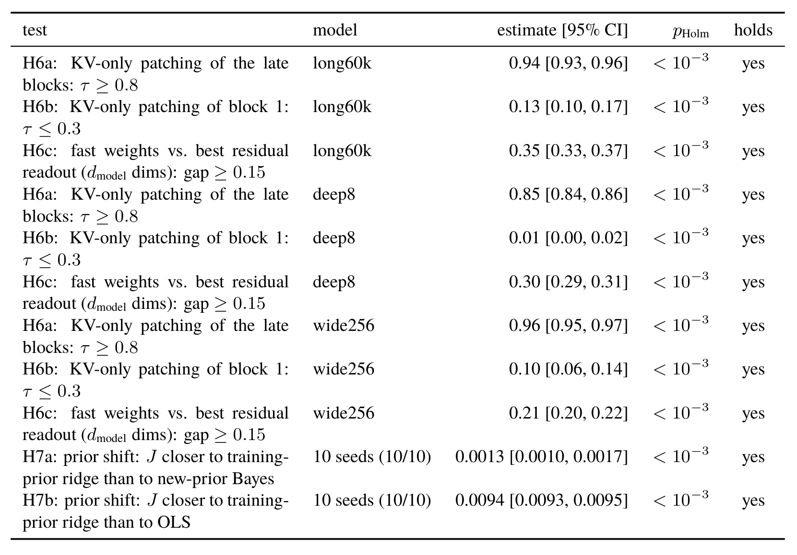

# What a Transformer Learns When It Adapts to Unknown Physics In-Context: Probing, Patching and Controlling

Anuar Zhambakin 在 SUSS v0.2.0 中检验两个问题。原模型在未知动力学下对历史键值的依赖，能否在更深、更宽或训练更久的模型中复现？测试对象的动力学分布改变时，模型的预测函数更像哪一种辨识器？这篇精读以 2026 年 11 月 8 日 02:44 北京时间发布的 19 页版本为准。[版本发布](https://github.com/nonberw/suss/releases/tag/v0.2.0) · [固定版本 PDF](https://raw.githubusercontent.com/nonberw/suss/v0.2.0/paper/main.pdf)。

## 用同一个查询区分读出与因果作用

实验 A 从二维状态、一维动作的线性动力学出发。每个回合抽取不同的状态转移矩阵 $A$ 和输入矩阵 $B$。预测器读历史转移以及当前状态和动作 $z_t$，输出下一状态预测 $widehat y_t$。测试时网络权重冻结。状态、动作的历史二阶矩和它们与下一状态的交叉矩，决定高斯先验下的岭回归后验均值。主实验用稳定性截断后的蒙特卡洛贝叶斯参考，公式中的未截断高斯对照则可直接用岭回归计算（第 3–5、15 页）。

研究者可以在三处找动力学信息。第一处是残差流，用留出回合检验读出器能否恢复估计参数。第二处是预测函数，固定历史、改变当前查询，计算局部雅可比 $J_t=partialwidehat y_t/partial z_t$。第三处是上下文注意力缓存，固定查询，交换不同历史的键和值，看输出是否沿供体预测的方向移动。在线性化的近均匀注意力头中，键和值在历史位置上的协方差构成依赖历史的局部线性映射。作者把这类特征称作快权重。读出优势和缓存置换分别测量可恢复信息和干预效应（第 6–7 页）。

设 $widehat y_B$ 是原历史配同一查询的预测，$widehat y_{A'}$ 是供体历史配同一查询的预测。将干预造成的位移投影到 $widehat y_{A'}-widehat y_B$ 上，取有符号投影长度，再除以供体位移的长度。所得转移系数 $	au$ 为 1 时，投影达到了供体参照的位移。它可以在归一化方向上越过 1，也不衡量垂直方向上的误差。

## 第二轮预注册检验覆盖了哪些配置

早期实验中的残差线性读出和对应的干预未支持原先假设，晚层缓存解释由随后探索产生。第二轮预注册在分析三个扩展配置的内部状态前登记阈值。用同一配置的 4,096 条参考回合，2,048 条训练探针、2,048 条评估。读出比较统一到模型宽度，缓存干预分别替换网络后半部分或第一块的上下文 K/V（第 10、15、17–18 页）。

*表 4 保留 11 个检验的阈值、模型、估计和区间。前三种模型每种做三项检验，最后两行比较先验变化下的预测函数。*

| 模型 | 后半层转移系数 | 首层转移系数 | 同维度读出 $R^2$ 差 |
| --- | ---: | ---: | ---: |
| long60k，原宽度训练 60,000 步 | 0.94 | 0.13 | +0.35 |
| deep8，8 块 | 0.85 | 0.01 | +0.30 |
| wide256，宽度 256 | 0.96 | 0.10 | +0.21 |

三个配置都越过预设阈值，晚层至少 0.8、首层至多 0.3、同维度读出差至少 0.15。按回合自举的置信区间也处在阈值支持侧。对应快权重读出 $R^2$ 为 0.85–0.92，最佳残差读出为 0.52–0.71。容量更小的 0.1M 参数模型给出约 −0.07 的读出差，属于探索性边界。这个反例使结论限定在受测的三种确认配置。残差也可以通过非线性方式携带参数信息。

## 先验改变后模型追随谁

研究者把测试回合中 $A$ 的元素标准差从 0.4 降到 0.1，生成 1,024 条新回合，并保留 10 个原模型训练种子。比较的是查询雅可比中对应 $A$ 的块与三种参考之间的均方距离，对上下文长度 8 至 47 取平均。最短的上下文排除在这轮检验之外，因为同分布时模型在那里也会偏离贝叶斯参考（第 10、15、17 页）。

| 对照 | 均方距离，约值 |
| --- | ---: |
| 使用训练先验的岭回归 | 0.026 |
| 使用新先验的贝叶斯参考 | 0.028 |
| 普通最小二乘 | 0.036 |

十个种子都更接近训练先验的岭回归。新先验和训练先验两者的配对平均距离差为 0.0013，区间为 [0.0010, 0.0017]。普通最小二乘相对训练先验的差为 0.0094，区间为 [0.0093, 0.0095]。两个先验对照在较长历史上本来就接近，因此效应量应与方向同时阅读。作者使用单侧配对检验汇总种子，并对全部 11 项作 Holm 校正，表中校正后均小于 0.001。这组结果支持冻结模型沿用训练分布的收缩偏好，尚不足以确认模型内部逐项执行了岭回归算法。

## 复现边界与控制证据

用相同查询、同维度读出和明确的供体参照，可以把这套验证迁移到其他历史条件模型。若要验证它在更大系统中的适用范围，可以分别改变层数、训练时长和动力学偏移类型，并把短历史条件单独报告。原作者披露首次 GPU 运行遇到显存不足，表中数字来自相同分析的 CPU 重跑。该登记是公开 Git 标签，复现可先核对标签和结果表，再运行确认脚本。九项架构检验的区间基于回合抽样，跨训练随机性的直接检验集中在另两项先验试验。两种统计单位应分开解释。[第二轮预注册](https://github.com/nonberw/suss/blob/prereg2-94b6cf8/PREREGISTRATION_2.md) · [确认结果与复现入口](https://github.com/nonberw/suss/blob/v0.2.0/results/confirm/SUMMARY.md)。

新增检验针对线性系统的预测机制。此前的一自由度 MuJoCo 接触预测和线性闭环控制证据仍各自成立于原设置。闭环中位归一化代价为 1.69，带衰减激励的确定性等价对照为 1.57。超过 10 倍参考代价的失败率分别为 10.0% 和 1.4%。后续问题是晚层历史依赖能否在未建模接触和不稳定对象上同时改善辨识与失败尾部。本次版本没有新增实机或闭环试验。

## 参考资料

- [v0.2.0 论文 PDF](https://raw.githubusercontent.com/nonberw/suss/v0.2.0/paper/main.pdf)
- [v0.2.0 源码与发布记录](https://github.com/nonberw/suss/releases/tag/v0.2.0)
- [Zenodo DOI 10.5281/zenodo.24031898，早期版本存档](https://doi.org/10.5281/zenodo.24031898)
