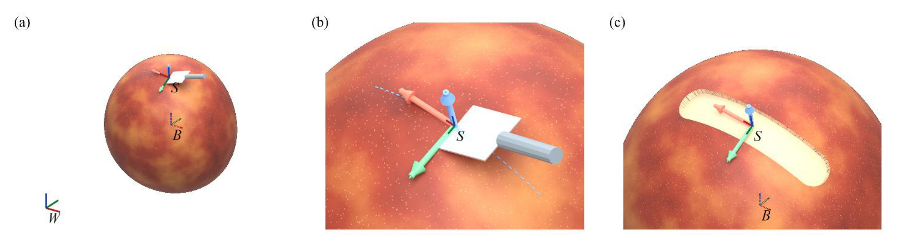

# Action Representation for Spatial Generalization in Robot World Models

在削皮任务中，物体换了摆放方向，刀刃与果皮的局部相互作用可以保持不变。换一个下刀深度则会改变结果。论文用受控几何仿真区分这两类变化，检验世界、物体和接触表面坐标分别保留了哪些信息，以及这些差异怎样传导到反事实动作选择。[arXiv:2611.11869](https://arxiv.org/abs/2611.11869)。

## 用同一物理交互控制坐标变量

生成器构造不规则果实的几何形状与厚度场，模拟刀具按给定宽度、角度、深度和行程划过表面。几何参考先计算同一次交互的移除区域及残皮、果肉损失等结果。随后将刀具轨迹和物体信息重写到三种坐标中，再训练结构相近的预测器。世界坐标保留绝对位置和姿态，物体坐标消除整体刚体位姿，表面坐标再以接触点和局部方向表达动作。这使标签只由物理交互决定，比较时改变的是模型看到的输入形式（第 6–8 页）。

*三个面板给出全局与物体坐标、局部刀具轨迹和材料移除。预测比较使用同一个几何参考生成标签。*

为什么表面坐标可能有效，可以从同一动作在空间中的等价性理解。如果刀具和果实整体作相同刚体变换，物理相对关系保持不变。让模型自行学会这种不变性会消耗样本。若接触位置变化仍保留相同局部形状和轨迹，表面坐标又可以消除一层无关变化。真实接触里局部曲率、厚度和法向会改变结果，这些状态应与相对动作一起保留。

## 表面坐标的收益需要哪些前提

隐藏厚度的对照构造了输入张量完全相同而几何结果不同的配对。五个种子的 NRMSE 从完整输入的 0.3888 上升到 0.8596。对具有同一输入的两个等权结果，确定性模型的最小平均平方误差至少是两结果平方距离的四分之一。这是构造配对上的下界。更多网络容量无法用相同输入恢复被删除的物理变量（第 11–13 页）。

另一组对照只扰动表面坐标原点，保持真实轨迹与结果。干净条件下表面 NRMSE 为 0.5678，物体参考为 0.8951。在三个轴各加标准差 1 毫米的高斯扰动后，表面模型误差升至 1.0324。此处毫米数是定义好的估计噪声，不是刀具的机械公差。把表面点和轨迹点共同平移不改变两者的差，普通网络仍可能对此敏感。可用共同平移不变的相对特征处理这类偏差，但接触位置或法向真的估错时还需额外的稳健性检验（第 12–14 页）。

## 把预测误差换成动作选择后再评价

在 72 个初始场景中，每个场景对同一接触设置比较 18 个候选刀具划痕，由六种深度和三种倾角组合而成。成本同时考虑残皮、果肉损失和深度均匀性。五种子平均两两排序准确率，世界、物体与表面坐标分别为 0.484、0.681 和 0.729。最优动作落入预测前三名的比例为 0.158、0.503 和 0.772。归一化遗憾分别为 0.653、0.681 和 0.226。物体坐标改善两两排序却没有降低最终遗憾，说明用哪一个决策指标会改变解释（第 14–16 页）。

这些数据来自固定动作集和几何材料移除模型，未覆盖真实刀具柔顺性、随机接触或长时反馈。复用这套评估时，可以保留准确、带定位误差和未见局部几何三组切分，并在相同候选预算下同时看预测误差、排序和执行遗憾。这样能判断表面坐标的收益是否在控制端仍然存在。

## 参考资料

- [arXiv:2611.11869](https://arxiv.org/abs/2611.11869)
