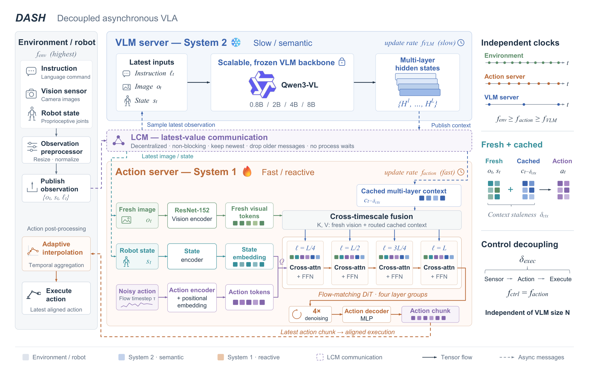

# Decoupled Asynchronous System for Humanoids (DASH): Latency-Agnostic Scaling of Vision-Language-Action Models for Humanoid Manipulation

DASH 关注一个容易被离线损失掩盖的问题。控制器消耗的计算时间会让物理场景继续变化，较大的视觉语言骨干即使理解更好，也可能让动作基于过时的画面。论文将动作通路从骨干等待中拆开，并用训练和执行机制处理两个时钟的错位。[arXiv:2611.11854](https://arxiv.org/abs/2611.11854)。

## 把语义与反应放到不同的时钟

环境进程持续发布图像与机器人状态，低频 VLM 进程读取最新观测并缓存多层隐状态，高频动作进程读取最新图像、机器人状态与最近一次语义缓存。通信采用保留最新值的机制，消费者不等待另一侧生成新消息。语义过时量和动作执行等待因而可分别观察。若 VLM 较慢，动作头仍可用新视觉修正位置，但所依赖的高层语义会随缓存年龄增长（第 3–4 页）。

*图中实线是张量传递，虚线是异步通信。动作头的四组块分别融合对应深度的缓存表示和当前图像。*

动作头用独立 ResNet-152 编码新图像，和旧的视觉语言上下文一起作为跨注意力的键和值。机器人状态和带噪动作提供查询侧信息。四组流匹配块分别接收骨干不同深度的语义缓存。骨干冻结，训练动作头和新视觉分支，增大语义骨干时动作路径计算不必同步增加。图中的通用骨干标注和实验硬件、模型规格应分别从架构图与结果表读取。

## 错位训练和插值各自解决什么

若训练用的是完全对齐的两路观测，部署中的旧语义和新视觉并不来自训练分布。论文按实测部署时间差在示范中抽取随机的观测时间偏移，使动作头在训练中学习利用旧的任务上下文和新的局部信息。偏移上界由实际延迟与数据采样周期确定。消融中的对齐训练异步版保持同样的快路径，却未稳定得到完整系统的成功率收益（第 4–6 页）。

另一个问题发生在动作块切换时。推理间隔改变会让同一实际时刻落在动作块内部的不同位置。聚合器根据两块的实测生成间隔算分数偏移，再做插值对齐并聚合，而固定整数偏移容易令轨迹重复、跳步或在交界处振荡。这是调度和动作时间戳问题。把平均推理频率拉高并不能自动消除相位错位。

## 控制频率稳定不等于任务性能单调上升

| 骨干 | 同步延迟 | DASH 动作延迟 | 同步成功率 | DASH 成功率 |
| --- | ---: | ---: | ---: | ---: |
| 0.8B | 103 ms | 50 ms | 64.5% | 65.5% |
| 4B | 183 ms | 50 ms | 63.6% | 69.5% |
| 8B | 243 ms | 50 ms | 62.7% | 65.9% |

50 项 RoboTwin 任务共 250 个评估回合每配置，仿真时间推进计入实测推理延迟。四档模型的快路径均为 20 Hz，同步路径随规模降低到 4.1 Hz。4B 在该套件的成功率最高。实验说明骨干规模和动作频率可以解耦，任务成功率仍受训练、视觉和指令理解影响。4B 对齐训练异步版只有 62.3%，也说明异步运行时和错位训练应分别验收（第 6–8 页）。

真机在准静态抓放中完成 23/24 次，对照为 16/24 次。该对照同时改变同步方式与时间聚合器，因此不能单独归因于插值。开发复现时可记录语义缓存年龄的分布、动作快路径抖动、块切换误差与最终任务结果。动态交互、长时任务和更广硬件上的收益仍需额外实验。

## 参考资料

- [arXiv:2611.11854](https://arxiv.org/abs/2611.11854)
