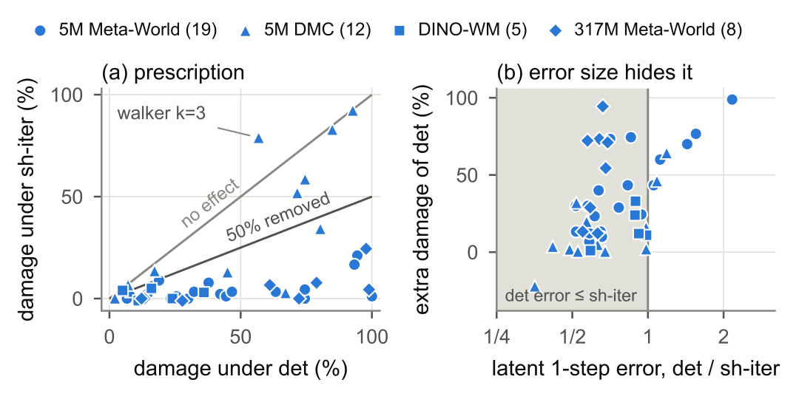

# Planners Exploit Deterministic Error: Dithered Low-Bit World Models

模型预测控制每一步都要比较大量动作序列。把世界模型量化后，单步潜状态误差可以仍然很小，规划性能却大幅下降。Yong Hwi Song 与 Keon Myung Lee 的实验将问题定位到误差的持续性以及它在候选之间的共享方式，并用不重新训练的改动进行干预。[arXiv:2611.11780](https://arxiv.org/abs/2611.11780)。

## 为什么低预测误差仍会导致规划失败

MPPI 或 CEM 先从候选分布抽动作序列，用世界模型预测回报，再依据较好的候选更新下一轮分布。确定性就近舍入使相近候选在同样激活位置反复得到相似偏差。即使这些偏差在一批任意候选上没有显著增加潜状态误差，迭代选择也会逐步偏向高估回报的一侧。作者区分最后一轮从候选群中挑最好者的选择效应，与整个候选群从第一轮到最后一轮移动的漂移效应（第 1–3 页）。

*左图比较确定性舍入与逐轮共享抖动的性能损失。右图显示，即使确定性舍入的单步误差较小，闭环损害也可能更大。*

同位宽比较特别重要。Meta-World 的三比特抓放对照中，确定性舍入的潜状态一步误差为 0.22，逐轮共享抖动为 0.39，但成功率损失分别为 37.8 和 7.8 个百分点。跨位宽时两者仍可能相关。因此论文揭示的是一步误差在相同位宽的排序能力有限，不能据此认为任何一步预测指标都无用。多步误差和预测奖励误差更贴近规划需求。

## 只改变抖动的共享方式和寿命

设 $\Delta$ 为均匀量化步长，$x$ 为待量化激活，$u$ 为单位区间内均匀抽样的偏移。论文讨论的随机舍入形式为

$$q(x)=\Delta\lfloor x/\Delta+u\rfloor$$

同一轮各候选对相应条目共享抖动，减少候选比较受独立噪声支配的机会。到下一轮重新抽样，使前一轮有利误差难以持续。对照保持随机误差的分布，分别让候选独立抽样，或让共享抖动在控制步、回合内固定。固定抖动在三个 TD-MPC2 机制任务中恢复约 70% 至 130% 的确定性漂移。PushT 的完整固定抖动表没有产生同等漂移，缩减偏移表时才观察到利用现象。机制边界与候选接触到的有效误差结构有关（第 2–4 页）。

这项改动主要抑制候选群随规划轮次追逐固定误差的效应，末轮从多个有噪候选中挑最好者仍然可能偏乐观。增加候选数量或规划轮次时，应用侧应分别看群体漂移和末轮选择误差。作者的单轮 MPPI 试验没有得到类似收益，符合改动针对迭代累积这一解释。

## 恢复成功率与节省时间的边界

5M TD-MPC2 在 Meta-World 的 19 个受影响任务与位宽组合均挽回至少一半损失，中位挽回 95%。DINO-WM 五项中四项达到此标准，317M TD-MPC2 的八项也有改善。DMC 十二项中只有五项恢复过半，Walker 三比特的损害还增大。这里的样本是按确定性量化已造成损害筛出的对照，不能当作任意任务都获益的比例。没有加入外部实机验证。

论文在 A40 上把 W8A4 TD-MPC2 捕获为 CUDA 图，完整规划步较 FP32 快 1.3 至 1.5 倍，未超过使用预转换权重的 BF16。抖动的额外延迟最多 2.3%。工程验收应同时报告比特数、实际计算精度、后端与闭环指标，量化带来的收益会随参考内核变化。部分块缩放格式的结果也说明，粗共享量化网格是测试条件之一。优先验证受测平台上的规划预算，再决定是否值得采用这一扰动方式（第 4–5 页）。

## 参考资料

- [arXiv:2611.11780](https://arxiv.org/abs/2611.11780)
