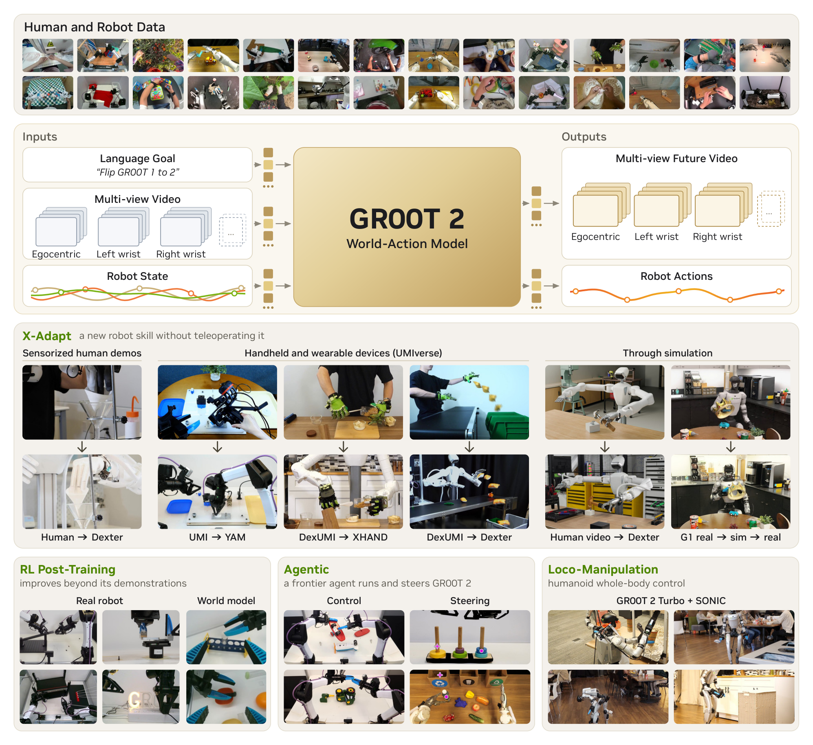

# GR00T 2: Scaling Robot Foundation Models for Generalization, Dexterity, and Adaptation

NVIDIA 的技术报告把机器人策略建成世界动作模型。最有辨识力的实验证据来自 Dexter-50，这些任务没有出现在目标机器人 Dexter 的预训练轨迹里，却在其他机器人数据、人类视频或两者中出现。报告也分别给出真机后训练和端侧运行结果，三类数据应按不同协议阅读。[项目和技术报告](https://research.nvidia.com/labs/gear/gr00t-2/)。

## 联合预测怎样把人类视频接到动作上

模型以 Cosmos-Predict2.5-2B 的视频扩散 Transformer 为基础。冻结的视频 VAE 对各视角进行时间和空间压缩，并用视角嵌入区分头部与腕部画面。冻结的语言编码器提供指令条件。本体专用的小网络把机器人状态与带噪动作块映射到共享宽度，再将输出映射回该本体动作。共享模型同时处理视频、状态和动作的序列表示，因此人类视频可以用于学习视觉变化，而有控制标签的数据把视觉变化连到机器人可执行的动作（第 4–5、15–16 页）。

*上半部给出人和机器人数据，以及语言、视频、状态到联合预测的映射。下半部展示跨本体适配、后训练、代理运行和移动操作的不同用法。*

视频序列跨时间和视角交互，动作表示可以关注同时生成的未来视频。训练分别计算未来视频和动作的流匹配目标。报告的部署设置通常采用一至两步视频去噪、两至四步动作去噪。这里的未来图像是模型内部生成的条件，实际世界是否按该图像演进仍需靠下一次真实观测确认。该机制值得和纯动作模型在相同视频数据及训练预算下比较，才能判断收益中有多少来自联合预测。

## Dexter 的少样本实验测量了什么

目标平台是具有两条 7 自由度机械臂和两只 22 自由度手的 Dexter。在零样本设置只输入任务指令。单条或五条样本设置对同一预训练检查点做逐任务适配，LoRA 的秩为 32，施加于 Transformer 的线性层，基础权重及文本、视频和本体接口保持冻结。每条轨迹切成 100 个均匀间隔的窗口，再按冻结模型的损失选择窗口，使训练更关注抓取、插入等难段。作者报告单个适配可在一张 RTX 5090 上约 30 分钟完成（第 6 页、附录 A.3）。

| 每任务 Dexter 示范 | 平均成功率 |
| --- | ---: |
| 0 条 | 40% |
| 1 条 | 71% |
| 5 条 | 95% |

零样本有 40 项至少成功一次，只有四项每次都成功。五条示范后有 37 项每次都成功。作者列举的零样本失败中，部分策略可以启动正确的步骤，却在拉袋口、提壶盖等接触操作上失败。少量本体数据在这种设置中能校正动作细节。测试任务已存在于其他本体或人类数据，数字反映的是技能跨本体迁移和逐任务适配，无法直接外推到所有训练数据都未见过的技能。

## 预训练、后训练和部署是三组证据

报告另展示用带传感器的人类演示、手持采集器或仿真迁移获取目标技能，以及在真机和世界模型中做强化后训练。需要核对每个试验是否包含目标任务数据、是否逐任务适配、在线反馈来自真机还是预测器。尤其不能将后训练提升与 Dexter-50 的零样本成绩混算。若世界模型内生成结果供奖励判断，真机对照仍是检验模型误差是否被策略利用的关键。

标准模型在 RTX 5090、三视角 Dexter 输入下，报告预测一个动作块的中位延迟为 153 毫秒。Turbo 缩减视频序列的计算成本并保留联合建模，用于更紧预算的整身移动操作。这个指标反映特定设备上的动作块预测，不包含所有闭环调度、传感器和执行延迟。实际复现宜同时记录端到端时延、动作块更新间隔和按任务分布的成功率。本次以公开技术报告和项目材料核验，项目页标注代码计划 12 月开放，公开权重和第三方复现尚未核实。

## 参考资料

- [1] NVIDIA，2026，GR00T 2。[正式技术报告 PDF](https://research.nvidia.com/labs/gear/gr00t-2/assets/gr00t2_whitepaper.pdf)
- [研究项目页](https://research.nvidia.com/labs/gear/gr00t-2/)
