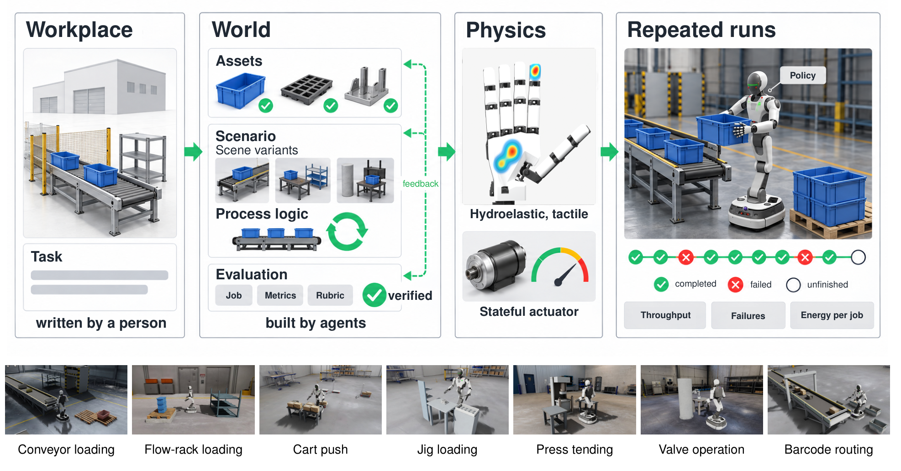

# HolidayFactory 1.0: Simulating, Generating, and Evaluating Industrial Robot Tasks

一次抓取回合成功后重置场景，会清除零件堆积、设备过热与上一次错误留下的状态。HolidayFactory 把这些状态保留下来，试图用仿真衡量长时段工业作业。它把工位描述、物理场景和评测规则分别表示，使生成器和验证器都能检查作业在什么条件下开始、结束和判错。[arXiv:2611.11789](https://arxiv.org/abs/2611.11789)。

## 把工位、场景和作业评分连起来

作者从人写的工位与任务开始。场景由资产、初始状态变体以及作业流程组成，评测描述则给出作业、计量和判定规则。上料例中，不只要实例化输送带、料箱和支撑件，还要明确零件何时出现、怎样进入下一步、异常事件怎样保留。生成代理构建资产和变体，几何与交互检查确认可放置和可执行。评分规范经过人确认再编译，并对候选运行轨迹做可执行检查。可读取的模拟器特权状态用于评价，政策输入与评价信号可以分开（第 4–7 页）。

*上方展示工位、世界、物理和反复运行的关系，下方是七类工位。示意图中的流线不能视作完成任务的实测证据。*

这一拆分使验证可以针对不同失败。几何约束可以排除相交或缺件，流程检查可以发现事件不再可达，轨迹测试可以发现规则没有在预期时间触发。通过这些检查也未必覆盖全部任务语义。例如，判据可以在测试轨迹上工作，却无法识别一个不在样例集中的违规替代动作。论文报告不同模型评审对替代资产是否可接受会有分歧，因此评审器评分和人确认都有独立作用。

## 接触和驱动器为什么要进入仿真

HOLIDAY-SIM 扩展 Newton 的稀疏符号距离场水弹性接触。有限接触斑上计算压力、阻尼和摩擦，用半隐式原始对偶求解将它们与关节运动耦合。和少量点接触相比，分布式接触能够表达接触区域及其随法向载荷的变化。论文用指尖滚动、轮地接触等探针隔离不同机制，也展示了相同净力可对应不同的触觉分布（第 7–15 页）。

驱动器包含电流和电压限制、温度、传动和内部摩擦等状态。状态随作业延续，影响可用关节作用力和阻抗。即便两个控制器完成同一个动作，耗能和热积累仍可能不同。这样的细节可用来构造试验，但模拟器的探针验证仅说明若干机制在选定配置下可比较，接触参数、校准和真实工位的长时稳定性仍需单独验证。

## 持续评测如何暴露误差累积

24/7-BENCH 提出七类工业作业。连续运行中，后续作业接着同一个现场，有的经事件、输送带或队列到达，有的消费固定初始库存。记录区分完成、失败、超时和未完工，并给出吞吐量、作业时延、违规和电机能耗。举例说，假设 20 次作业相互独立且单次成功概率为 0.95，连续全成的概率约为 36%。这只是算例，真实作业错误可以相关，前一次失败也可能改变下一次的难度。

报告用脚本轨迹检查作业评分，并分析生成评分和场景的可靠性。作者尚未完成多策略在持续运行中的对照。复用该设计时，可同时公开重置和连续两种评估、状态初始化规则、失败恢复时间与未完成作业的处理口径。只有在等作业到达率和等运行预算下，吞吐量才便于比较。把判据的误报、漏报与策略失败分开记录，可定位问题来自仿真、规则还是控制器。

## 参考资料

- [arXiv:2611.11789](https://arxiv.org/abs/2611.11789)
