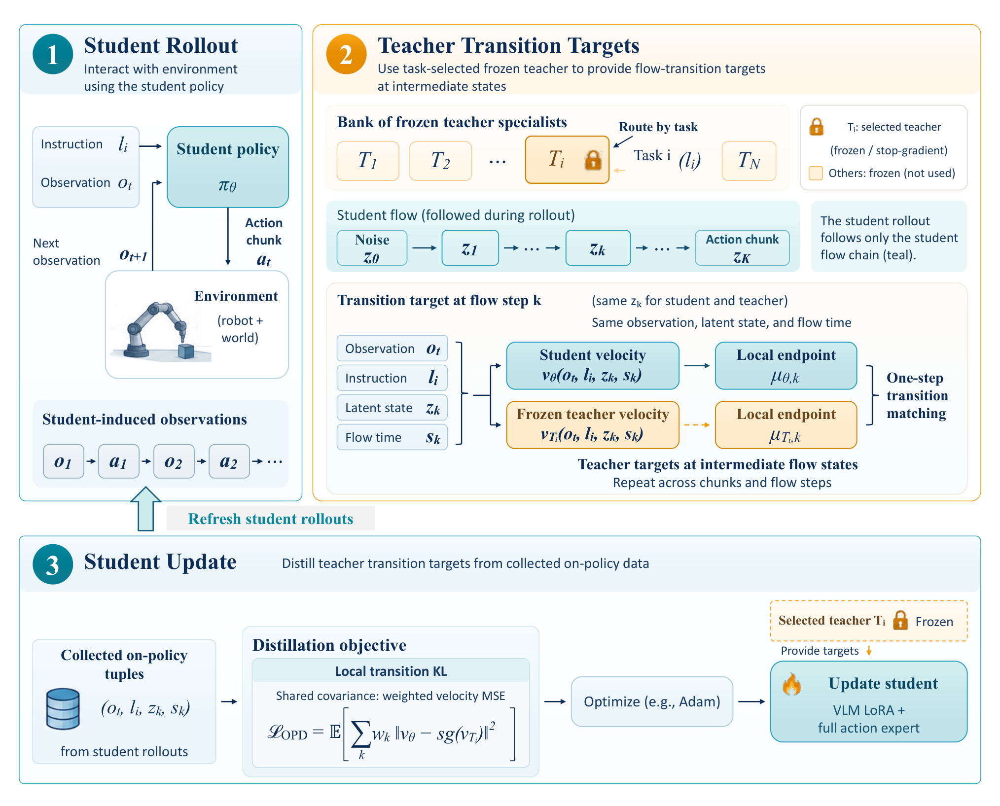

# VLA-MOPD: On-Policy Distillation for Multi-Task VLA Policy Consolidation

任务专家可以通过单任务强化学习或示范微调做得很好，部署多个专家却需要维护模型组与路由器。VLA-MOPD 把教师的能力并入一套流匹配策略。它通过学生自己的闭环观测采样，也在学生动作生成过程中间位置查询教师，因此分别对齐环境状态分布和生成器状态分布。[arXiv:2611.12286](https://arxiv.org/abs/2611.12286)。

## 为什么学生要自己走出训练轨迹

训练先用多任务示范初始化统一学生，然后为任务或任务簇准备冻结教师。每轮固定当前学生快照，让它根据任务采样计划执行动作。记录的不只是观测与最终动作块，还包含每一步确定性 ODE 生成的中间状态和流时间。任务标识决定去问哪位教师。部署时只有学生生成动作，教师仅在训练时提供目标（第 5–7 页）。

*左侧是学生采样，右上是冻结教师路由以及共享中间点的转移对照，下方回到学生更新。*

这和直接合并教师演示有两处差异。离线动作示范来自教师访问过的环境状态，学生走偏后可能进入训练数据缺少的观察。即便用相同的学生观测查询教师，只监督最终动作也未直接约束学生生成动作时实际经过的中间点。让学生执行并刷新采样可覆盖第一类失配，沿生成链的局部监督针对第二类失配。

## 教师监督的是局部速度场

在固定观察和指令条件下，设 $x_k$ 为学生在第 $k$ 个流时间步的状态，步长为 $\delta_k$，教师速度为 $v_T$。教师转移目标由该点和对应速度求得。

$$\mu_{T,k}=x_k-\delta_k v_T(x_k,s_k,c)$$

教师用自己的视觉语言前缀编码，目标停止梯度。学生也在同一个中间点计算下一步，用有效动作块掩码排除终止与填充项，再更新视觉语言侧 LoRA 与动作专家。共享协方差的高斯转移假设使局部 KL 约化为加权平方误差。实际采用确定性 Euler 更新时，比较局部转移均值和匹配速度等价到步长缩放。教师无需替换学生采样链，旧的样本状态仍按轮次来自学生快照（第 6–8 页）。

## 仿真与实机结果要分开读

| 设置 | 学生初始化 | 蒸馏后 | 可比较参考 |
| --- | ---: | ---: | --- |
| LIBERO 四套任务 | 75.4% | 98.9% | 终点动作蒸馏 98.15% |
| RoboTwin 2.0 三项双臂任务 | 73.0% | 89.3% | 路由 PPO 教师 94.0% |
| Piper 三项实机任务 | 70.0% | 90.0% | 路由教师 93.3% |

LIBERO 的一条示范指学生初始化用量。教师获得与在线环境采样仍有成本。相同初始化下，局部监督对终点对照约多 0.75 个百分点，主要收益在 Goal 和 LIBERO-10，单个套件并未一致提升。训练早期在匹配采样规模下比 MixRL 收敛更快，减少并行环境会延迟收敛，也会在固定步数造成差距。训练步数、环境交互量和教师推理量应分别记账（第 9–12 页）。

Piper 测试包含抓香蕉、叠杯和数字分拣。每轮每项任务收集 50 条学生轨迹，两轮后每项做 30 次评估。数字分拣仍有差距，学生为 76.7%，教师为 83.3%。结果表明可减少部署时的教师维护，但对任务新增频繁、教师能力有限的场景，值得保留教师获取成本、回放量和各任务退化指标，避免平均分掩盖小任务的损失（第 12–13 页）。

## 参考资料

- [arXiv:2611.12286](https://arxiv.org/abs/2611.12286)
