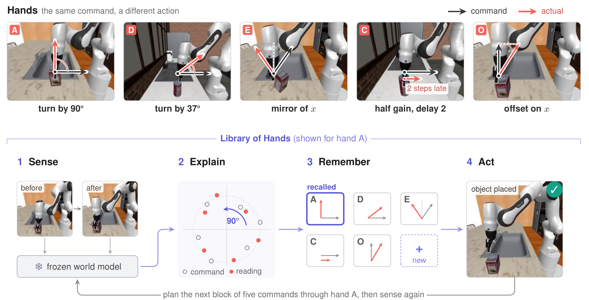

# Library of Hands: Fix the Hands, Not the World Model

部署时改变末端坐标轴、控制增益或延迟，会让世界模型接到含义不同的指令。若模型对给定实际动作的预测仍然有效，可以从观察反演执行过的动作，再拟合指令到实际动作的映射。Library of Hands 将已辨识的映射存起来，在同一接口再次出现时用少量证据召回。[arXiv:2611.12678](https://arxiv.org/abs/2611.12678)。

## 把动作接口变化写成辨识问题

设 $z_t$ 和 $z_{t+1}$ 为一段执行前后图像对应的潜状态，$f$ 为冻结世界模型。每执行五步，搜索最能解释后状态的动作块。作者从九个起点做梯度下降，取残差最小的结果。若残差超过未改变接口数据上估计的第 95 百分位阈值，丢弃本块的读数。前后两帧主要提供整个动作块的净变化，作者把反演得到的动作压成逐轴的五步和。该观测不要求读取真实控制状态，但需要模型能预测动作对当前观察的影响（第 2–4 页）。

*上方示意旋转、镜像、增益、延迟和偏置。下方展示五步反馈回路。*

动作影响很小时，多个动作都可能解释同一对观测。作者根据预测器关于动作的雅可比，在反演点近似读数的协方差，再投影到动作块总和。夹具受阻或动作已饱和时，视觉中的运动证据会减弱。相应方向的读数不确定性增大，映射拟合降低其权重。这一步解释了为什么获取更多图像未必就能快速校准，关键是动作在图像里留下的可区分影响。

## 何时重用旧的动作映射

对候选延迟 $d$，将该延迟对应的五条命令求和为 $\bar c_t^{(d)}$。设 $M$ 为变换矩阵、$b$ 为每步偏置，模型对五步净作用的预测是 $M\bar c_t^{(d)}+5b$。算法用带不确定性的读数比较多个矩阵模型及延迟。已见过的接口用历史后验作为先验，新接口候选只依赖当前片段。先验偏向延续前一接口，同时允许在证据充足时创建记录或识别回合中途的切换（第 4–5、14 页）。

选定接口后，规划器按该映射计算候选指令真正会执行的动作，将它交给原预测器评分，执行下一块后再读一次。迁移所需的新参数集中于动作映射，世界模型不更新。若一次可靠读数已经足以拟合接口，保存历史的额外收益可能很小。若感知质量低到无法区分接口，历史匹配同样会受限。

## 仿真收益取决于动作是否可辨识

在使用真机数据预训练的模型上，作者仍用 RoboCasa 仿真评估 place 任务。DINO-WM 在已知接口返回后的成功率从冻结规划器的 7.8% 到 26.6%，告知真实映射的参考为 35.9%。V-JEPA 2-AC 从 21.9% 到 35.9%，区间较宽。DINO-WM 在同设置下的单记忆对照为 29.7%，因此不能把相对冻结规划器的提升全部归到映射库。其他合成任务中，反演较不准确时，历史映射相对单记忆更有优势（第 7–9 页）。

每回合首块仍使用上一映射，切换后的第一次动作可能已经造成损失。作者在 PushT 修改摩擦或重心而保持接口时，报告 LoH 下降 5.0 个百分点。模型偏差会被误解释为动作变化。部署前值得用不同扰动分别测试指令坐标、接触动力学和视觉位姿，以确认误差属于可辨识的接口变化。本文没有提供实体机器人上的同类切换验证（第 10 页）。

## 参考资料

- [arXiv:2611.12678](https://arxiv.org/abs/2611.12678)
