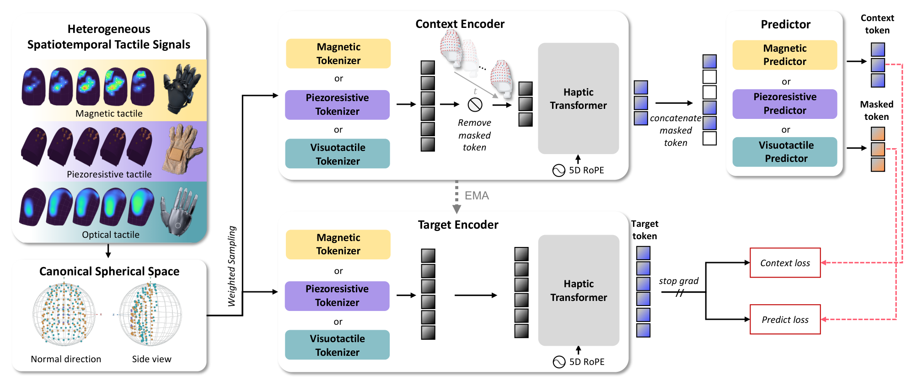

# Learning Heterogeneous Tactile Representation for General Dexterous Manipulation

LingBot-Touch 将不同硬件采到的触觉信号映射为可供机器人策略使用的特征。作者首先回答跨硬件的测量如何对齐，然后验证共享特征能否保留接触强度、空间位置和短时动态，最后将冻结编码器接入四种操作策略。[arXiv:2611.12806](https://arxiv.org/abs/2611.12806)。

## 给不同触觉硬件定义共同坐标

触点索引只描述某块传感器内部的编号。同一个编号换到另一款指尖，可能落在不同的物理位置。作者离线根据几何资产对齐指尖方向，再用比例和平移把触点映射到规范局部坐标。传感器量程用于幅值归一化，法向量值映射至零到一，带符号的切向响应映射至负一到一。每个触点的时空地址包含时间窗、手指编号和三维位置。五轴 RoPE 分别将这五个分量施加到注意力的查询和键。地址使用连续坐标，骨干可以读不同数量的触点（第 5–6 页）。

*左侧是三种触觉及几何对齐。中间是上下文和目标分支，右侧比较遮挡与可见位置的预测。*

预训练数据为 4,983 小时、464,431 个交互回合，约三分之二来自人戴触觉手套，其余来自遥操作。三种传感器在训练采样中等概率出现。每种感知原理保留单独的浅层输入投影，每个投影将一个触点的两帧测量映射为一个特征。输入边界分开处理不同响应，深层 Haptic Transformer 则共享参数。因而适配新的布局仍要提供触点几何、感知类型和响应范围（第 4–6 页）。

## 用遮挡预测学习接触结构

上下文分支只看到未遮挡的触点。同一个触点在整个片段中使用相同掩码，模型无法仅靠相邻帧抄回该点的响应。预测器在原位置放入学习得到的遮挡特征，并联合处理可见上下文。完整片段输入目标编码器，取四个深度的归一化特征作为目标。若 $M$ 是遮挡位置集合、$C$ 是可见位置集合，作者分别对两组的平均绝对特征差赋权，遮挡权重为 1，可见权重为 0.5。目标分支停止梯度，其参数通过在线分支的指数滑动平均更新（第 6–7 页）。

选择潜空间目标的动机是大部分触觉位置没有发生接触，原始信号中的近零背景会左右重建损失。训练将遮挡率从 40% 提升到 80%，降低训练早期把有效接触全部遮住的概率。消融表明传感器分组接口比全共享边界更能保留位置，较快的目标滑动更新在受测配置中还出现表征坍缩。这些对照说明，共享骨干仍依赖针对测量形式的输入边界与稳定的目标更新（第 7、13–14 页）。

## 从接触探针到机器人策略

在预训练见过其传感器的 Sharpa Wave 上，冻结特征加读出头把力误差从 FTP-1 的 2.31 N 降至 0.81 N，接触中心误差从 2.19 mm 降至 0.12 mm。未见磁传感器的 XHand1 另做了探针，实验仍训练对应下游头。这个设置检验编码器迁移，无法把读出头训练的贡献视作零样本能力（第 9–11 页）。

实机阶段冻结 Tiny 编码器。每只手输入 30 Hz 的 16 帧窗口，训练交叉注意力读出为 40 个条件向量。每个策略比较无触觉、原始信号与学习表征三种输入，各设置使用同一示范集，按任务进行 20 次评估。26 个任务上，Diffusion Policy 从 21.6% 到 35.6%，π0.5 从 48.1% 到 69.9%，LingBot-VLA 从 48.3% 到 73.1%，T-Rex 从 45.4% 到 68.6%。实机主表使用 4,000 小时版本的 Tiny，和 4,983 小时的完整预训练语料规模要分别读。实验覆盖两种手，电容式触觉、掌部和指身接触覆盖仍有限（第 15–19 页）。

## 参考资料

- [arXiv:2611.12806](https://arxiv.org/abs/2611.12806)
- [代码与检查点入口](https://github.com/Robbyant/lingbot-touch)
