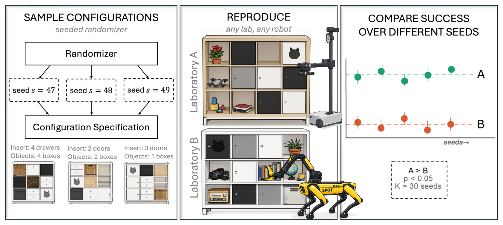

# Benchmarking Real-World Robotic Manipulation through Stochastic Challenges

不同实验室可以重建同一类操作任务，但各自挑选的几个场景难度可能相差很大。这项工作把比较对象定义为可复现的随机场景分布。评估既要估计机器人执行的随机性，也要估计场景难度带来的波动，并用两地实机试验说明固定少量场景会如何影响结论。[arXiv:2611.12804](https://arxiv.org/abs/2611.12804)。

## 让复现的对象变成场景分布

KALLAX 试验以同类格柜和插入件为基础。种子决定柜内的门、抽屉和物品配置及其关联任务。不同实验室可以按照规格重建指定种子的配置，也可以从同一生成规则独立抽取场景。这样可在异构机器人之间比较同一种操作目标，同时允许对未共享的配置进行泛化测试（第 3–7 页）。

*左侧是种子与配置，中央是可重建的工位，右侧是跨种子聚合示意。图中显著性数值为示意。*

每次执行记为二值成功。先在同一任务的重复中求均值，再在同一场景的任务之间求均值，最后对场景均值做等权聚合。若直接把全部试验混在一起，任务数量多的场景会增加权重。论文的目标则是生成规则下一个随机场景的期望成功率。复现实验还需要固定开始条件、软件重置方法和成功判定，避免把人为摆放差异当成系统能力。

## 如何用配对降低比较方差

设 $J$ 为单任务重复数，$K$ 为场景种子数。论文把单个系统的场景均值波动写成两部分。$\sigma_{\mathrm{seed}}^2$ 描述种子间难度差异，$B/J$ 描述同一任务重复执行的估计噪声，其中 $B$ 由场景内的二值试验方差汇总得到。对 $K$ 个独立种子取均值时，方差为

$$\operatorname{Var}(\widehat\mu)=(\sigma_{\mathrm{seed}}^2+B/J)/K.$$

增加 $J$ 只减少重复执行项。增大 $K$ 才同时压低种子和执行两项。如果两个系统在同一场景上受同一个加性难度效应影响，按场景做差会消掉这项共同波动。共享比例介于零和一时，可用混合方案对比独立与配对条件。这个简化依赖种子效应足够相似。若某类场景专门卡住一种夹具，配对的精度收益应从实测差分方差估计（第 4–6、13–14 页）。

## 两地实机比较验证了哪一步

| 任务 | 独立配置的实测差 | 独立设计可检测差 | 50% 共享设计可检测差 |
| --- | ---: | ---: | ---: |
| 开门 | 53.1 个百分点 | 33.3 个百分点 | 25.6 个百分点 |
| 开抽屉 | 24.4 个百分点 | 23.2 个百分点 | 18.3 个百分点 |

两地使用 Spot 与 Stretch 3。表中可检测差按双侧显著性水平 0.10、功效 80% 估算。开抽屉的实测差接近独立设计的检测边界，固定少量配置时成功率也有较大波动。共享部分种子可以让所需的差距变小，同时保留独立配置来观察泛化。这个结果针对该格柜和两套机器人，不能据此给异构平台作普遍排序（第 8–9 页）。

同一研究者在两地重建共享场景，论文未量化独立团队对同一种子进行复现的摆放差异。若将协议用作公开排行榜，可公布生成器与抽样规则，保留种子级结果及失败记录，并用小规模先导试验估计 $B$ 和种子间方差。它们决定追加资源该用于更多配置还是更多重复。作者将诚实、校准良好的成功判定列为限制，跨实验室自动判分还有待单独验证。

## 参考资料

- [arXiv:2611.12804](https://arxiv.org/abs/2611.12804)
