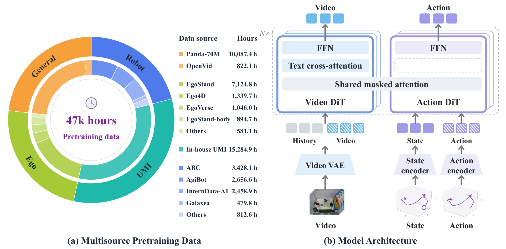

# SWAM: Scaling World Action Models with Cross-Modal Alignment

在视频生成骨干上加入动作预测，可能改变预训练得到的语言与视觉对应关系。SWAM 用通用视频、第一视角视频、手持夹具示范和机器人轨迹逐项比较监督来源，追踪这些变化最后是否体现在随机场景里的操作成功率上。[arXiv:2611.12870](https://arxiv.org/abs/2611.12870)。

## 为不同数据源分配监督任务

约 47,000 小时的数据池由约 11,000 小时通用视频、11,000 小时第一视角视频、15,000 小时手持 UMI 示范和 10,000 小时机器人示范组成。通用与第一视角数据主要提供描述和视觉变化的对应关系。UMI 补充可跟踪的夹具运动，机器人数据给出部署本体的观察、状态和动作。各组实验按设定取样，数据池规模与每个训练运行实际处理的数据量有所区别（第 3–5 页）。

*左图给出各类数据时长，右图给出视频与动作分支如何经掩码注意力交互。*

作者对机器人示范的语言标注做了单独比较。原任务指令下 Hard 成功率为 50.80%，同义改写提高到 54.76%，轨迹细节和环境描述同时加入时为 56.16%。UMI 的动作标签覆盖实验保持全部视频参与，只改动提供动作监督的比例，Hard 从 0% 覆盖时的 46.72% 升至 100% 时的 51.28%。Easy 结果并不随覆盖单调上升。两组对照说明标注本身也会改变收益，不能只用小时数解释（第 12–13 页）。

## 让动作读取视频表征

视频分支初始化自 Wan，动作分支随机初始化。视频 VAE 把帧序列压到潜空间，语言通过交叉注意力进入视频支路。独立编码器处理状态与动作。两支各有残差流，注意力掩码使动作支路能够读到当前与历史视频块，并在当前块内读取状态与动作。视频支路不反向读取动作，因此仅有视频监督的样本仍可继续训练视频分支。动作端没有直接文本交叉注意力，语言信息经由视频表征间接传递（第 6–7 页）。

两支分别预测视频潜变量和动作上的流速度。训练样本若只有视频，可只提供视频目标。有同步动作的 UMI 或机器人轨迹才能计算动作监督。这样可以维持现有图文对齐，同时用动作数据训练从可预测的视觉交互到可执行动作的映射。这个设计仍可能受视频侧语义和几何误差限制，尤其在图像里无法分辨细小接触状态的任务上。

## 在随机场景中衡量迁移

RoboTwin 的后训练只使用 Clean 示范。SWAM 的 Easy 为 88.10%，OpenWAM 为 89.30%。切换到 Clean 训练、Random 测试的 Hard 设置时，SWAM 为 61.56%，OpenWAM 为 48.70%。真机的三个双臂任务为叠杯、折毛巾和礼品入盒，困难条件下的平均完整成功率为 40.00%，OpenWAM 为 23.33%。部分成功指标另计，不能和完整成功混用（第 15–17 页）。

随机场景收益支持在指定模型与训练条件下继续研究第一视角和 UMI 的组合。最终模型还改变了数据规模与配方，跨论文结果不足以单独归因于一种数据或一种掩码。复现时可先固定预算与机器人示范量，比较语言标注、动作标注覆盖和随机化类型，再报告按任务分解的成功率。三项实机测试对开放任务和多本体迁移仍只能提供有限证据。

## 参考资料

- [arXiv:2611.12870](https://arxiv.org/abs/2611.12870)
