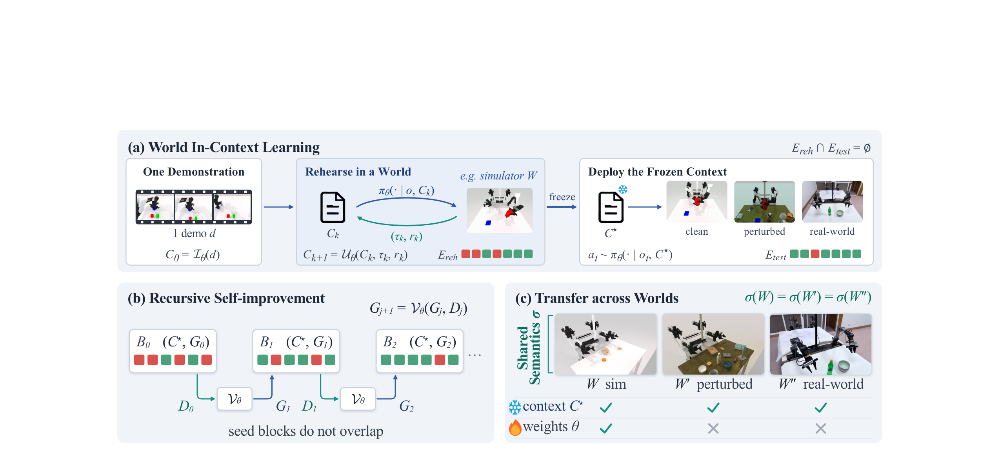

# World In-Context Learning for Agentic Robot Manipulation

RoboScript 将示范和仿真排练中得到的操作知识写入任务记忆。基础模型冻结，通过观察理解当前实例，再调用低层动作技能。论文重点检验这种文本记忆能否在未见场景使用，以及从仿真平台迁移到另一种双臂硬件需要做哪些调整。[arXiv:2611.12885](https://arxiv.org/abs/2611.12885)。

## 把一条示范变成可执行的任务记忆

阅读角色从一条示范建立 Markdown 任务记忆，记录物体角色、阶段、相对抓放规格、可用参数和教训。例如抓取点可表达为从某部件左侧接近、抓住其中心，在运行时再用感知确定位置。执行角色先练习示范实例，评审角色根据尝试结果修订记忆。随后转到不同排练实例，比较第一尝试的成功率，失败后只合并能通过该实例的修订。达到退出条件后冻结记忆（第 4–7 页）。

*上方是冻结任务记忆的过程，下方区分跨实例的反思与跨环境转移。*

设 $C_k$ 为第 $k$ 次排练前的记忆，$\tau_k$ 为轨迹，$r_k$ 为反馈。模型根据这三项产生 $C_{k+1}$，并将新知识保存到上下文。低层执行依赖预先提供的可重用技能。因此一条示范是任务初始化的数据量，还需要在仿真中反复执行和评价，动作能力也由技能接口和感知模块共同决定。

## 用数据隔离检验部署条件

模仿阶段的阅读角色能使用指定的模拟器信息来理解示范，排练阶段的评审能用特权失败诊断。执行角色只读可部署的相机、深度和本体状态。任务记忆经过检查，排除固定场景坐标、真实状态字段和实例标识。部署用冻结记忆在独立实例上运行。论文另有跨批次反思试验，只允许上一批已经完成的记录影响下一批未见实例。读取诊断的角色、时间和数据隔离是复现该评估的关键（第 5–8、11–12 页）。

这项分离能检查部署时没有直接读取仿真器的真实状态。仍需验证相对抓放规格能否借助实际感知稳定定位，以及低层动作接口是否表达了相同任务语义。若摩擦、柔顺性或可达空间改变到破坏原技能，文字说明可以保留工作流，执行则需要进一步适配。

## 成功率、推理成本与真机适配

在 RoboTwin 2.0 的 50 个任务上，作者报告使用 GPT-6.1-Sol 的方案为 83.6% Clean、83.2% Random，平均 83.4%。这是给定低层技能、模型、仿真排练和测试分布的结果。每个测试回合平均调用模型 54.7 次，使用约 233 万个模型词元。任务记忆可跨回合复用，但多次推理仍是部署成本的一部分（第 8–9、13 页）。

作者将仿真 ALOHA 的任务记忆迁移到双臂 PiPER，调整坐标、运动学和夹具参数，保留任务流程。四项任务各 10 次，结果依次为 10/10、7/10、7/10、6/10。真机先离线规划整条动作序列，执行中没有在线重规划。失败主要涉及夹具对齐与深度估计。这一结果支持部分语义知识跨本体复用，尚未覆盖真实环境的在线恢复、长时连续运行或广泛任务迁移（第 13–14 页）。

## 参考资料

- [arXiv:2611.12885](https://arxiv.org/abs/2611.12885)
- [RoboScript 官方代码](https://github.com/ArcheOne-AI/RoboScript)
