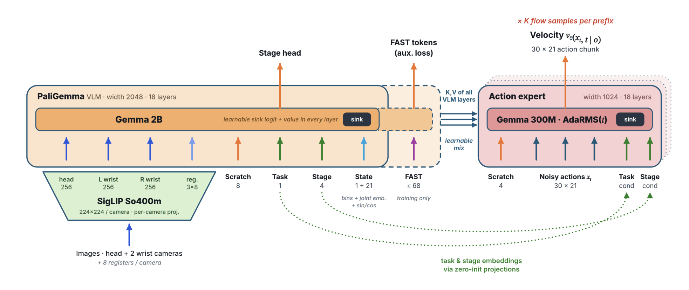

# One Policy for 100 Household Tasks: Our Solution for the 2026 BEHAVIOR Challenge

这篇报告复盘一支独立队伍如何把基于 π0.5 的策略扩展到一百项长时家庭任务。它给出了训练、评测以及代码代理的工程细节，也说明最终公开提交和论文内部实验采用了哪些组合。[arXiv:2611.14432](https://arxiv.org/abs/2611.14432)。

## 一个检查点怎样覆盖100项任务

策略读取头部与双腕相机、本体状态、任务嵌入和阶段嵌入，输出 21 维的遥操作控制动作块。视觉语言骨干把每层键值提供给动作专家。新任务的任务及阶段嵌入由相似旧任务热启动，阶段由示范技能标签归纳。相较先前按时间均匀分段，语义阶段可以对应不同耗时的真实子过程（第 2–5 页）。

*左侧编码三视角、任务与阶段，右侧在相同前缀上训练多组流样本。*

阶段仍然要由策略估计，演示标签和运行时误判会影响后续动作。作者将多个任务放在同一训练中，减少部署检查点数量，但部分任务可以因动作顺序或场景位置分布变化而明显退化。因此扩展任务数既是容量问题，也是数据和运行条件问题。

## 怎样把更多计算用于有效训练

每个观察前缀可匹配多组流匹配噪声和时间样本。重复动作专家计算时复用视觉语言前缀，以降低目标采样的方差。作者用噪声和计算预算模型选择每观察的动作专家样本数，未为这一选择提供独立的穷举消融。还通过限制辅助 FAST 目标长度、对齐注意力尺寸等优化减少训练时间（第 6–7 页）。

提交检查点经历 200,000 步，约一次遍历 2.11 亿示范帧。前 130,000 步在单 B300 上，后 70,000 步用八张 H200 继续训练。完整流程同时改动数据量、嵌入、优化与模型组件，所以共同提升不能由单个变化独占解释。复现时可先固定旧任务子集和训练预算，逐项核对每步样本、前缀重用及损失归一化。

评测基础设施为每次运行记录代码版本、参数、模拟器和检查点校验值。场景周期性保存，可从记录状态开始恢复试验。共享任务队列调度不同云平台，作者报告单 GPU 上并行六个模拟器可超过实时。这样的记录让同一失败能被定位到特定状态，方便分析长时任务里的动作顺序和恢复问题（第 7–8 页）。

## 学得的策略与代码代理分别得到什么

学习策略在一百任务上的 Q 为 0.392。Q 表示目标完成程度，完整成功率另算。五十项旧任务的 Q 从上一年 0.260 升到 0.371。两年使用不同模拟器版本和时限，论文将数据与训练变化等因素一并讨论（第 9–12 页）。

在十四项任务上，Astra 代码代理从冻结的练习会话开始，读取 RGB-D 和机器人状态并使用动作工具。练习期有重置和目标谓词反馈，评估期撤去这些训练工具，每回合从相同冻结副本开始。十四任务的平均 Q 为 0.639，学习策略在同一子集为 0.108。正式公开提交只纳入部分代理结果，最终为 0.446 Q、27.3% 全任务成功。这个数值与一百任务纯学习策略、十四任务代理子集对应不同方案。

全部试验来自 OmniGibson。部分模型改动缺少独立消融，代理子集也经过练习和路由。报告最适合用于复核训练与评估流程，实体机器人上的部署成本和工具可靠性仍需另外测试。

## 参考资料

- [arXiv:2611.14432](https://arxiv.org/abs/2611.14432)
