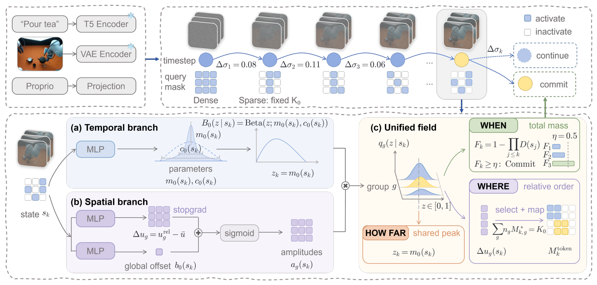

# Elastic-WAM: Adaptive Spatiotemporal Imagination for Efficient Robot Control

世界动作模型通常联合预测未来视频和动作。视频去噪消耗的计算很多，但不同任务、同一任务的不同阶段，需要细化的未来区域和程度可以不同。Elastic-WAM 训练一个控制器，在每次动作推理中决定未来表示需要更新多少，再保留当前表示完成动作生成。[arXiv:2611.14257](https://arxiv.org/abs/2611.14257)。

## 先确定哪些未来还值得细化

输入包含当前图像、语言和本体状态。模型先对所有未来视频位置进行一次密集联合去噪，建立递归状态和各层键值缓存。控制器读这个状态，输出时间分布参数和分组的空间幅度。论文用共享 Beta 分布描述后续去噪进度，把各组幅度加权得到总需求，同时将组间分数中心化以表达相对优先级（第 3–4 页）。

*上方是密集起步与稀疏递归更新，下方展示时间分布、空间幅度和提交动作的条件。*

这种参数化把三种决策联系起来。总量决定继续视频更新的必要性，时间分布的峰值指导下一次去噪推进距离，组间顺序指导哪些查询需要重算。固定更新预算仍由外部配置，默认每个稀疏步骤刷新 96 个未来特征。学习得到的是预算下的分配和停止行为。

控制器通过三阶段监督学习。第一阶段在同一中间状态比较立即停止与不同推进距离后的动作误差。误差同时考虑整个动作序列和相邻动作差分。第二阶段保持时间策略，比较密集教师与稀疏学生，并用直通近似优化离散掩码。第三阶段训练总体幅度偏移，让累计停止行为跟随教师的继续需求。预训练世界动作模型在这些阶段保持冻结（第 5 页）。

## 把需求场变成稀疏推理

在每轮稀疏更新中，观察和动作查询仍能读取完整的逻辑键值上下文。只有被选中的未来视频查询重算，未选中位置重用隐藏状态、键值和上次刷新的速度。所有视频与动作潜变量仍推进到下一噪声水平。控制器每轮重新评估需求，累计提交量达到阈值或触发给定的停止条件后，视频侧固定，继续完成动作去噪。这个设计保留了跨位置上下文，同时压缩需要刷新的查询集合（第 5–6 页）。

因此节省并非只取决于保留多少未来位置，还取决于稀疏算子的实现、缓存访问以及最后还需多少动作去噪。若把整段模型重新运行而只遮住结果，就无法得到同样的计算收益。复现应核对缓存语义和实际内核耗时，并与同一硬件、相同输入设置下的密集模型比较。

## 哪些收益由对照支持

在 H800 的 RoboCasa-GR1 评估中，作者报告相对 Joint-WAM 推理延迟降低 32.2%。同预算空间消融里，学习选择优于随机选择，也优于只保留初始缓存。LIBERO-Plus 上，只有空间选择为 71.71%，再用自适应提交和推进距离为 73.71%。预算从 96 增到 196 时为 70.92%，更广泛刷新并未在这一配置下提高成功率（第 6–8 页）。

双臂 xArm 7 的实机任务有四阶段泡茶，名义和照明变化下 Elastic-WAM 完整成功率均为 50%，Joint-WAM 均为 30%。物体替换条件两者都是 30%，任务平均进展分别为 47.5% 和 35%。数据说明必须同时检查完整成功和部分阶段进展。真机只覆盖这一长时任务，控制器训练成本和端侧设备上的稀疏效率仍需额外评估。

## 参考资料

- [arXiv:2611.14257](https://arxiv.org/abs/2611.14257)
