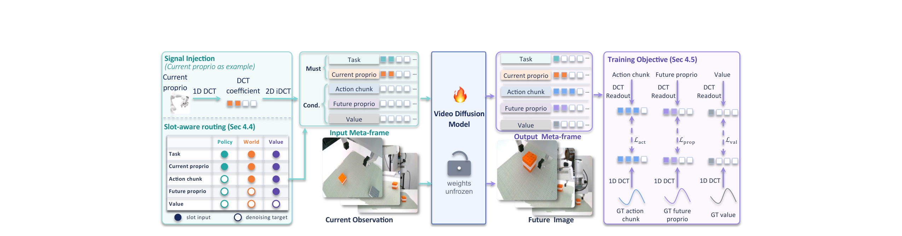

# From Video Frames to Robot Meta-Frames: A Unified Latent Interface for World Action Models

视频扩散模型的潜空间适应了图像，而动作和本体状态是低维数值信号。MetaWAM 先用冻结去噪器测量不同注入格式与原先验的兼容性，再用固定频域槽位承载多个机器人信号，缩短联合预测需要的潜序列。[arXiv:2611.14365](https://arxiv.org/abs/2611.14365)。

## 先测机器人信号与视频先验的距离

把一个数值复制成整帧，或把不同信号写入空间方块，会产生常量区或突变边缘。作者将这些潜变量加噪，交给冻结的 Cosmos-Predict2 去噪器，再比较相对重建误差。频域编码在测试的噪声范围里通常更易恢复。这个探针说明格式会影响预训练模型的响应，任务效果还需在微调后的控制模型中验证（第 3–4 页）。

*左侧给出频域注入和三类任务的槽位掩码，中间是输入输出元帧，右侧按固定槽读回动作、未来本体状态和值。*

这里的可解码性需要固定信号归一化与槽表。相同维数的信号可以被写入不同潜变量布局，布局本身会改变去噪器如何处理它。较小的潜空间修正并不自动等于准确动作，因此论文还测了输出信号的读回误差与下游成功率。

## 把多个信号写进一个元帧

每类信号使用互不重叠的潜通道频带。归一化数值直接放进固定的频率系数槽，未使用位置为零，再对每个通道做正交二维逆 DCT，得到空间潜帧。输出经过二维 DCT 后，按原槽表读取动作、未来本体状态和值，恢复各自形状。编码布局不引入学习参数，视频模型仍要训练（第 5–7 页）。

输入元帧包含任务指示和当前本体状态，输出元帧包含动作块、未来状态和值。配合当前和未来三个视角的六帧，形成八帧潜序列。独立信号帧基准需要十一帧。策略、世界预测和值预测共享这套槽表，掩码指定哪些槽是干净条件、哪些是待预测目标。这样每种训练任务都能使用有对应标签的信号组合。

实现时需要注意，槽内直接保存的是归一化系数。对去噪后的空间元帧做二维 DCT 并取出这些槽即可。误把取出的信号再当频谱做额外逆变换，会改变其含义。输入与输出掩码也必须与任务语义一致，才能复现论文的条件化过程。

## 压缩帧数与改变编码的收益

RoboCasa 的信号编码消融中，十一帧空间复制基准成功率为 67.1%，延迟 0.479 秒。八帧元帧方法为 68.9%、0.291 秒，约减少 39% 延迟。同为八帧的空间四分区和紧凑块布局也都是 0.291 秒，成功率为 65.9% 和 68.1%。因此帧数下降解释主要时间差，频域布局的收益要与同帧数对照比较（第 8–9 页）。

Franka 的三项真实任务各评估 20 次，域内平均成功率为 85.0%，域外为 68.3%。域外加入干扰物、位置与背景变化。论文还报告未来本体状态误差、价值误差和视频质量。复现可先验证编解码往返，再用冻结去噪器探针筛选布局，最后在同数据和同任务预算下测完整闭环结果。三项实机结果仍不足以覆盖跨本体控制和长期接触变化。

## 参考资料

- [arXiv:2611.14365](https://arxiv.org/abs/2611.14365)
