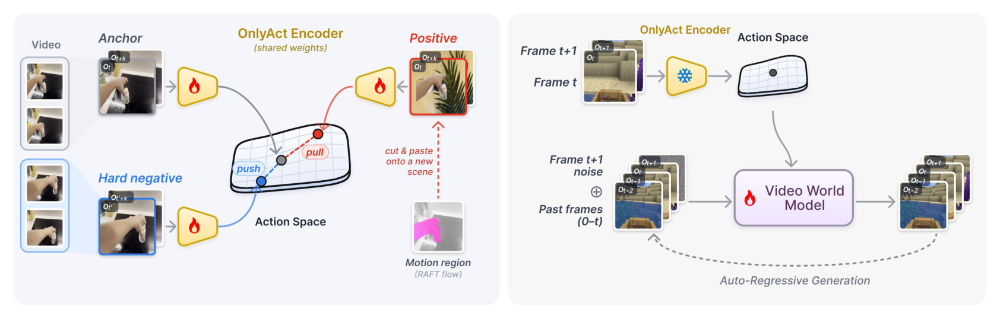

# OnlyAct: Extracting Action Representations from Foundation Models for World Models

视频中有大量没有控制标签的交互。OnlyAct 从已有视频模型的帧对表征开始，用对比适配减少场景线索，使表征能作为未来视频生成的动作条件。论文分别检验动作可读出性、场景泄漏和生成质量，避免只靠一种指标判断接口是否有效。[arXiv:2611.14420](https://arxiv.org/abs/2611.14420)。

## 用正负样本压低场景线索

编码器以 V-JEPA 2 的 ViT-L 为基础，把两帧作为短视频输入，用 LoRA 适配。正样本保留运动而替换背景，具体用光流估计移动区域，将其剪出并移位粘贴到其他场景。移动相机的条件改用光度增强，减少错误背景替换。困难负样本来自同一视频的不重叠时间窗，因而外观相近却更可能包含不同动作（第 4–5 页）。

*左侧通过同运动异背景与同场景异时刻构造对照，右侧冻结动作编码器并训练生成模型。*

对称 InfoNCE 把锚帧对拉向正例，同时推离负例和批内其他表征。如果负例全来自不同场景，模型可以只看背景满足目标。加入同视频负例提高了利用运动的必要性。正例构造仍是近似，剪贴可能改变遮挡或接触关系，相隔窗口也可能重复动作。它提供的是无标签训练信号，不能保证每个三元组都有精确物理对应。

## 把动作流接入视频世界模型

适配完成后冻结编码器，将连续帧对映射为动作流。作者采用 AdaWorld 自回归视频骨干，每步读过去一至六帧和一个动作向量，预测下一帧。动作经过训练集上的固定协方差白化，然后分别进入跨注意力上下文和向量条件。基线默认使用自己的动作表示，附录另做了对白化基线的控制（第 6 页）。

这套接口支持两种用途。第一种从演示视频提取动作流，给另一个初始场景生成相同动作的后果。第二种在小规模带真实动作标签的数据上学习从控制量到潜动作的接口，之后用真实动作控制生成。第一种仍使用含未来帧的演示对来确定动作，部署为交互系统时必须提供动作来源。第二种则需要额外动作标签和适配。

## 动作信息和场景泄漏要一起测

作者在十三个动作探针基准中有十一个改善。平均线性动作预测 $R^2$ 从最强潜动作基线的 0.211 到 0.490，冻结 V-JEPA 2 为 0.347。预训练表征本身已经有动作信息，但在部分机器人数据中不稳定。对比适配改善跨数据集可读出性，有些基准未在适配时使用（第 7 页）。

场景泄漏实验只给解码器动作表征，要求它恢复未来帧。若可轻易重建细节，表征可能携带物体身份和场景布局。冻结 V-JEPA 2 的平均 LPIPS 为 0.275，OnlyAct 为 0.304。这个试验里更高距离表示更难从动作编码重建场景，具体含义取决于解码器能力和数据划分，不能把 LPIPS 本身当作普遍的去场景指标。随后同世界模型架构和数据的对照，进一步考察动作转移与真实动作条件的视频质量（第 8–10 页）。

复现时应保留三类指标和未见域测试，单独检查白化、编码器适配和正例合成各自的影响。机器人操纵、导航、游戏与驾驶中的生成证据表明接口可以迁移部分运动信息，尚不能由视频效果推断实机闭环控制成功率。论文将代码与模型列为计划公开资源，当前可下载版本需从项目入口继续核对。

## 参考资料

- [arXiv:2611.14420](https://arxiv.org/abs/2611.14420)
- [作者项目页](https://runjiali-rl.github.io/onlyact/)
