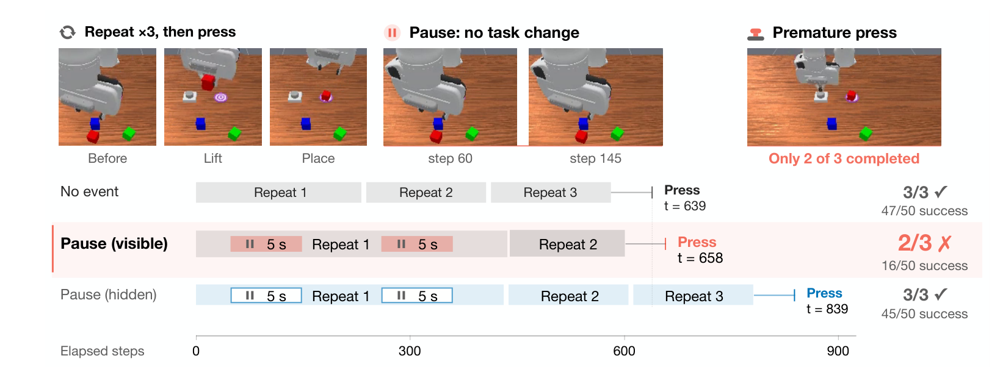

# Is Your Robot's Memory Just a Clock? Temporal Shortcuts in Memory-Augmented VLA Policies

计数操作要求机器人根据完成的事件判断何时结束。如果示范始终按稳定速度进行，经过的时间也可能预测进度。论文在模拟操作中插入暂停或手腕晃动，用相同物理过程、不同记忆可见性的对照，检验记忆增强策略究竟如何使用历史。[arXiv:2611.14488](https://arxiv.org/abs/2611.14488)。

## 用没有任务进展的间隔做干预

RoboMME 的 PickXtimes 要将方块拿起放下指定次数后按按钮，SwingXtimes 也要求完成规定次数。策略访问固定数量的历史槽。研究者在重复之间加入暂停或回到原状态的动作，确保该间隔没有增加已完成次数。随后对比策略可以读到间隔的记忆版本，以及实际等待相同、却不将这些帧放入记忆的版本（第 3–4 页）。

*实例要求三次重复。可见暂停时，策略在完成两次后按下按钮。隐藏暂停帧后，第三次重复被正确执行。*

图中 PickXtimes 的成功从 47/50 降到 16/50，隐藏暂停帧时恢复到 45/50。这个控制使暂停的物理时间存在于两种条件，差别集中到记忆输入。论文还逐项检查晃动是否确实没有影响任务状态。一次空抓若重新抓住已放下的方块，就破坏了空事件假设，作者在相应分析中排除这种条件。定义空事件需要任务级验证。

## 时间戳和记忆槽如何传递误差

不改画面，只将历史时间戳乘以 1.5，策略在 PickXtimes 的成功降到 18/50，失败均为提前按下。减慢时间戳则出现额外重复。方向与时钟变化一致，支持策略读取显式时间的解释。较长暂停还会造成不同于单次重复误判的行为，说明模型响应间隔长度（第 5–6 页）。

删除时间编码后从头训练的 NOCLOCK 对时间缩放不再敏感，但仍会把暂停算作进度。按时间均匀采样的 32 个槽仍会被没有进展的画面占用，改变历史事件的相对布局。仅根据画面变化挑帧，可以较好过滤静止暂停，却容易保留手腕晃动。子目标索引的记忆对某些暂停更稳健，但无干扰时计数能力也有代价。多种索引的结果需要结合基本任务水平阅读，低基线成功率会压缩可观察损害（第 6–7 页）。

## 按事件重排记忆能恢复多少

作者尝试在训练中加入暂停，未消除主要失败，还损伤计数能力。运行时的事件索引则折叠回到先前任务状态的区间，用保留的事件重新组织历史，在测试条件中挽回至少一半损失而无需重新训练。其核心检验是排除没有任务变化却改变记忆位置的区间，不等同于任意图像压缩（第 7–8 页）。

工程上可把相同事件序列的不同速度和暂停长度作为配对测试，再单独修改时间戳与历史内容。需要先确认任务里等待是否真的无关，例如真实接触松弛、加热或动态目标跟踪可能随时间变化。本文主要证据来自模拟计数任务，尚不能据此推断所有记忆策略在所有长时任务中的行为。它提供了一组可复现的干预，让进度判断的时间依赖可被直接测量。

## 参考资料

- [arXiv:2611.14488](https://arxiv.org/abs/2611.14488)
