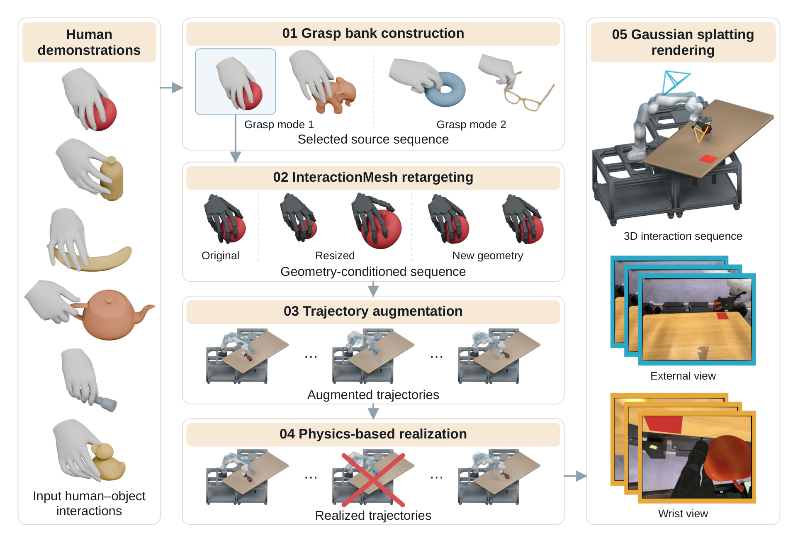

# DexSeed: Expanding Human Hand-Object Interactions into Robot Demonstrations for Dexterous Policy Learning

人手数据能提供抓法，但机器人策略还需要可执行的手臂与手指动作，以及部署相机看到的画面。DexSeed 将人手交互当作种子，依次扩展几何和轨迹、经过物理实现与渲染，生成灵巧 VLA 的训练示范。[arXiv:2611.14092v1](https://arxiv.org/abs/2611.14092)。北京时间 11 月 10 日提交，本期补记。

## 先保留抓法再扩展动作

作者从 GRAB 提取抓取建立附近的姿态，以 170 维描述符表示手指弯曲、手物距离、方向和接触几何。阈值分组后人工选择八类代表抓法及十九段种子，给同一类配共享语言描述。自动扩增的起点仍有人工筛选，覆盖范围由这些种子限定（第 2–3 页）。

*中间依次完成抓法分组、交互重定向、手臂轨迹扩增和物理实现；右侧从成功轨迹渲染头部、腕部画面，形成训练数据。*

InteractionMesh 将手的关键点与物体表面锚点组成固定邻接图，在物体局部坐标中保存每个点相对邻域的位置：
$$
\delta_{t,i}=v_{t,i}-\frac{1}{|N(i)|}\sum_{j\in N(i)}v_{t,j}.
$$
$v_{t,i}$ 为时刻 $t$ 的第 $i$ 个手部或物体顶点，$N(i)$ 是固定邻居。优化机器人腕部和手指，使目标与源的这些坐标接近，可以约束手与物体的局部关系；仅匹配手部关节位置则较容易丢失这种关系。

换物体时用 Diff3F 表面特征建立对应，并估计旋转、平移与尺度，将源锚点映射到兼容目标。目标锚点固定，机器人手优化局部关系，同时加入接触、穿透、形态与时间平滑约束。随后保持抓起阶段的手物相对运动，采样起始腕位、物体位置和放置目标，连接接近、搬运、放置和撤离轨迹。逆运动学无可行解的版本被丢弃（第 4 页）。

## 让手指适应手臂跟踪误差

运动学参考不保证物理成功。每段源序列训练一个手指残差策略，机械臂用 PD 跟踪预先计算的关节参考，策略只控制 Wuji 手的二十个关节。观察包含实际与参考手指状态、腕部相对物体位姿、几何编码、接触力、未来参考及腕部跟踪误差，共 542 维。手指必须在手臂误差真实存在时维持接触，不能只在理想浮动手上训练（第 4–5 页）。

奖励同时考虑物体跟踪、接触、指尖位置和关节跟踪，并惩罚突变及碰撞。物体跟踪容差随腕部误差调整，避免手指承担无法通过自身动作纠正的全部手臂误差。成功物理轨迹才进入数据集。

同一参考的 FR3 跟踪评测中，DexSeed 物理实现成功率为 95.50%，ManipTrans 为 34.25%，Dexplore 为 24.81%。不考虑手臂的变体在浮动手上为 98.04%，接上 FR3 后仅 28.02%。这个对照直接支持在手臂动态背景下训练手指的重要性；这些数字不是后续 VLA 真机成功率（第 6 页）。

渲染阶段先重建真实工作区的三维高斯场景，重放成功轨迹，输出头部与腕部视角，并扰动光照、纹理、阴影和相机参数。十九段种子最终产生 25,270 条示范。动作标签来自物理执行，不能用未经验证的运动学参考替代。

## 从仿真数据到实机抓放

LingBot-VLA 读取两路图像、状态与抓法指令，联合预测七维手臂和二十维手指动作。作者在八张 H20 上微调 55,000 步，推理约 5Hz，预测五十步动作并用 RTC 执行其中三十步。无需采集部署时的真实机器人动作示范，但仍使用预训练 VLA、三维场景采集和物体资产（第 5 页）。

| 仿真数据设置 | 已见条件 | 新布局、几何和外观 |
| --- | ---: | ---: |
| 直接渲染运动学参考 | 7.50% | 5.00% |
| 完整 DexSeed | 97.50% | 91.25% |
| 不做渲染增强 | 91.25% | 76.25% |
| 不提供抓法描述 | 80.00% | 70.00% |

每个条件八类抓法各十次。移除几何扩增主要损害新几何，渲染增强主要影响外观变化。同一苹果在两种指令下的关节姿态更接近各自参考，支持语言可以选择抓法，但这个控制只比较了两类（第 6–7 页）。

Franka 加 Wuji 手的真机评测每模式一个物体、十次试验；八模式成功率依次为 60%、40%、70%、70%、20%、50%、50%、80%，算术平均 55%。最低的是穿把手抓法，精细对齐仍困难。论文主要测单臂抓起并放置，没有验证手内重抓或双臂协调。复用时应先检查种子与目标形状的兼容性，保留物理筛选和真实相机约束，再评估数据扩增对新抓法的覆盖。

## 参考资料

- [论文](https://arxiv.org/abs/2611.14092)
- [作者项目页](https://robbyant-research.github.io/DexSeed/)
